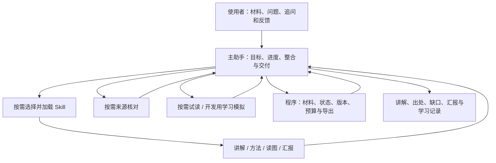

# 科研学习助手整体落地方案

后续更新（2026-10-06）：[科研能力培养与三类 Agent 协作整体落地方案](科研能力培养与三类Agent协作_整体落地方案.md)承接本方案及既有实现，统一最新产品目标、三类角色、教学／PPT 双闭环、前后端对应与模型迁移；有调整的后续规格以新方案为准。本文保留历史设计与核查基线，当前能力以代码和[整体实施验收](整体方案实施验收.md)等验收记录为准。新方案成稿不代表新增流程已经实现。

版本：v1.0 · 日期：2026-10-05 · 核查基线：`66c5486` · 状态：方案成稿，新增能力待实施

**本轮只写方案，不修改产品代码、不安装框架、不启用新流程、不发起模型回放。** 本文统一此前的产品讨论、skill 组织方案与 GitHub 源码核查；后续按本文实施。源码依据留在[核查记录](Skill模块化与新手模拟_源码核查.md)，既有运行结果留在[原验收记录](基础资料迁移与四场景验证_验收.md)，两者不作为额外实施方案。

## 1. 用通俗的话说明最终要做什么

做一个能接着聊的科研学习助手。你给论文、图或问题，它帮助你理解概念、方法和推理；哪里不懂就局部补讲；需要汇报时把已经确认的内容整理出来，随后可以改单页、查出处、接着上次继续。

模型本身的知识与能力是起点。准备工作的重点是把工作说明、输入和协作方式磨合好，让模型发挥合适的作用。论文材料用于核对这篇论文的具体事实；资料库用于保存和复用已经取得的材料、解释与核验记录。

整体采用五个决定：

1. **一个主助手承接目标。** 用户只需和它交流，它负责调用适合的 skill、整合结果、保存进度和完成交付。
2. **Skill 按任务组织。** 讲解、读图、汇报、核对有各自的工作方法，按需加载；不把所有规则放进每次调用。
3. **角色按需要协作。** 普通解释可以直接回答；事实需要核对、讲解需要试读时，再启用对应角色。
4. **新手模拟有明确状态和实际行为。** 用它检查教学，不把一句“我懂了”当成学习成功。
5. **先用完整小样例验证，再扩展体验。** 保留已有可用代码，每一步交付可看的结果，不靠扩大角色数量证明进展。

默认目标使用者暂沿用讨论中的设定：有医学基础，科研方法刚入门，希望读懂论文图和实验推理，并能向别人解释、整理汇报。这是产品与测试的工作假设，可以调整，不是对使用者个人知识的诊断。

## 2. 已经有什么，还缺什么

| 项目 | 当前实际情况 | 本方案的处理 |
| --- | --- | --- |
| 模型接入与调用控制 | 已有接入、预算、停止和失败记录 | 复用，不先换模型或训练 |
| 论文、图件与来源 | 已有 PDF 阅读、图件登记、来源快照和定位 | 复用，完善事实对应出处和缺口呈现 |
| 会话与产物 | 已有连续会话后端、保存、缓存与 PPTX 导出 | 接到统一对话，并补局部修改与版本恢复 |
| 提示词模块 | 已按功能读取指引与外部 manifest，记录版本 | 迁移到标准 skill 入口，并实现按需加载 |
| 多角色 | 已有讲解、试读、来源核对及一次修订 | 明确主助手职责，按任务使用角色 |
| “新手” | 当前主要输出试读意见；已有输入隔离和软性知识约束 | 保留为试读；另实现知识状态、实际作答和更新的学习模拟 |
| 使用效果 | 有工程检查与开发场景记录，未验证真实学习效果 | 区分工程、模拟行为和真实使用反馈 |

历史构建及 50 项工程测试有通过记录；连续追问、换论文和独立 qPCR 场景有通过记录。三页汇报内容验收仍失败：Figure 1m 的计数分母缺明确依据，且有一处论文事实缺对应论文引用。正文及已读补充材料尚未解决分母问题。本轮没有重跑这些检查，不能据此宣称当前新方案已经有效。

## 3. 总体结构和各部分职责



| 部分 | 负责什么 | 不应混淆的边界 |
| --- | --- | --- |
| 模型 | 理解任务、解释、推理、组织内容与发现问题 | 模型记忆不能保证论文原句、数值或题录准确 |
| Skill | 告诉模型何时使用、怎样工作、需要什么输入、交付什么 | 文件格式与指令本身不会自动提供搜索、存储或导出能力 |
| 主助手 | 持续持有目标，选择工作方式，协调角色，整合与交付 | 当前主助手主要输出计划；直接回答和整合需要实际改造 |
| 模拟环境 | 保存模拟学生状态，控制各角色所见，推进交互，记录行为与更新 | 可以是轻量文本环境；“多个角色在说话”不自动证明模拟真实 |
| 程序和页面 | 读取材料、执行工具、保存与恢复、定位出处、显示状态、导出 | 可靠状态传递与输入隔离需要程序落实 |

同一个强模型可以承担不同角色。角色接着已经取得的材料和结果工作，不从零重建知识。当前独立临时调用不会自动保留历史，主助手与环境必须实际传递相关上下文。

## 4. Skill 怎样模块化

采用标准目录入口：`SKILL.md` 含名称、触发说明和工作指引；需要时才增加参考资料、脚本或模板。运行时先提供名称和描述，选中后加载正文，专门资料再按需读取。已有工具能够完成的操作不重复造脚本。[OpenAI 官方说明](https://developers.openai.com/plugins/build/skills)、[Agent Skills 规范](https://agentskills.io/specification)

| Skill／指引 | 复用位置或拟新增位置 | 关键改变 |
| --- | --- | --- |
| 主助手 | `medical-research-assistant` | 承接目标、选择工作流、整合反馈；普通追问可直接回答 |
| 论文带读 | `medical-paper-guide` | 沿研究问题、方法、观察、结论组织解释 |
| 方法讲解 | `medical-method-tutor` | 说明测什么、为何能测、对照作用与推理范围 |
| 读图 | `medical-figure-tutor` | 从图、图注和方法解释观察如何支持结论 |
| 汇报 | `medical-journal-club-ppt` | 组织要点和讲稿，支持指定页修改 |
| 来源核对 | `medical-grounding-check` | 核对具体事实、引用与推理，返回可定位的问题 |
| 试读 | 现有 `medical-novice-simulator` | 明确展示为“模拟试读”，检查表达和衔接 |
| 学习模拟 | 拟新增 `medical-learner-simulation` | 接收明确知识状态，产生复述、应用回答或疑问 |
| 术语、证据链及公共规则 | 现有对应目录与 `shared` | 按相关性复用，减少重复和角色之间的规则冲突 |

“带读、方法、读图、汇报”是主助手可以使用的工作方法，不要求各自常驻一个 agent。先保留旧目录和 ID 兼容现有入口，移植时再验证包内引用能独立解析。

下面是拟使用的入口形式，仅为方案示例，尚未写入实际 skill：

```yaml
---
name: medical-learner-simulation
description: 在指定知识背景和可见教学内容下模拟学生复述、应用与提问，用于检查教学及学习状态承接。
---
```

正文写清目标、输入、关键做法、输出和停止条件。比如学习模拟的核心指引应是：

> 使用指定背景与实际见过的教学内容完成当前任务。可以答对、答错、提出具体疑问或说明不知道；不为了扮演新手而固定出错，也不把未指定掌握的专业知识当作学生基础。通过简短复述和应用回答表现当前理解。知识状态由环境依据实际作答更新，自述“懂了”只算反馈。

标准包装和加载分两件事实现：先补元数据并校验引用，再让程序按职责提供指引。当前 provider 关闭文件、搜索和动态工具，因此第一阶段由后台读取选中的文件；文件符合标准不代表已经启用原生自主发现或联网。

## 5. 多角色如何协作

| 情况 | 建议工作流 | 要交付的结果 |
| --- | --- | --- |
| “这句话换个通俗说法” | 主助手使用相应讲解指引 | 针对该句的解释，不重复整篇 |
| 独立概念或方法 | 主助手讲解；必要专业细节查证 | 原理、适用范围与可选深入问题 |
| 读论文或图 | 讲解后核对具体事实；必要时试读和局部修订 | 解释、对应出处及未解决问题 |
| 做汇报 | 组织要点与讲稿，核对事实和图件；按需试读 | 可修改的汇报草稿与导出 |
| 教学开发测试 | 导师与指定画像的新手在模拟环境中交互 | 输入、回答、状态变化和验证记录 |
| 修改某一页 | 使用该页与相关材料，变化涉及事实时核对 | 新版本，其余页面保持有效内容 |

角色只取得其职责需要的上下文：讲解取得目标、来源和已确认解释；核对取得候选内容与原始材料；模拟学生取得实际展示给学生的内容、相关历史与自己的状态。评分答案和完整核对报告不传给模拟学生。

主助手根据具体反馈修订，再整合结果。相同模型的不同角色可能共享错误，互相赞同不能当成独立事实证明。工程负责隔离与记录，原文支持论文事实，行为测试检验模拟是否可靠。

## 6. 新手模拟环境如何做

先实现一个导师和一个固定画像的新手。不同画像可用于开发对照，不默认把用户映射成某个模拟学生，也不要求实际使用者每轮参加测验。

| 保存的信息 | 通俗含义 | 更新依据 |
| --- | --- | --- |
| 画像及版本 | 模拟谁，有哪些背景和任务相关基础 | 固定测试设定或明确提供的信息 |
| 概念状态 | 哪些已知、未知，有无明确误解 | 初始设定及实际作答；不自行编造误解 |
| 可见内容与历史 | 真正看到过哪些讲解、图件和问答 | 环境实际交付记录 |
| 观察到的表现 | 能否复述或应用、仍有什么疑问 | 回答、判分与对应任务记录 |
| 待解决问题 | 下一轮需要继续处理什么 | 具体反馈，不自动设为已解决 |

一次完整样例依次经过：初始状态 → 讲解前作答 → 导师讲解 → 新手对新例子作答或提问 → 验证并保存状态 → 下一轮继续。

“讲过”“学生说懂了”“本次表现为能应用”分别记录。出现术语或自述理解不自动升级概念状态；一次答对也不等于永久掌握。错误回答保留，不能只保存成功样例。

知识限制只用于模拟角色。主助手和导师继续正常发挥模型已有知识。提示词和输入隔离不能删除模型预训练知识，需观察它是否使用了未指定或未教的专业内容；效果不好就改指引、状态或测试设计，不能假装模拟已经可靠。

## 7. GitHub 项目借鉴与技术选择

| 来源 | 已核查的具体做法 | 本项目采用方向 |
| --- | --- | --- |
| [TinyTroupe](https://github.com/microsoft/TinyTroupe/tree/a6244b358a1fe1c71bf751f7ba0f8dfa368ec5a4) | 角色状态、记忆、可见刺激、环境步进及经验数据验证 | 借鉴状态与信息边界，作为模拟环境候选参照 |
| [CAMEL](https://github.com/camel-ai/camel/blob/0106b76830c707effe48cd3da384dda38cbed92e/camel/societies/role_playing.py) | 角色间逐轮消息传递、记忆承接与结束条件 | 借鉴角色输入合同、历史承接和停止处理 |
| [Generative Agents](https://github.com/joonspk-research/generative_agents/blob/fe05a71d3e4ed7d10bf68aa4eda6dd995ec070f4/reverie/backend_server/persona/persona.py) | 持续观察、记忆、计划和行动 | 借鉴观察驱动的持续状态，不引入当前任务用不到的空间模拟 |
| Agent Skills 规范 | 标准入口与按需加载的资源组织 | 作为 skill 包装和迁移依据 |

这些是源码机制核查，没有安装运行或效果排名。**当前工程选择是先沿用已有模型接入、TypeScript 后端与存储，实现一个轻量环境。** 若原型暴露出现有环境难以支持的需求，再用相同任务比较 TinyTroupe 适配路线，决定是否接入。采用框架的成本、兼容性和模拟效果由开发方研究，不交给使用者判断。

没有接入框架时如实写“借鉴机制”，不能写成“已使用该项目”。后续取得新的项目知识，也要落实到指引、状态传递或验证的具体改变，而不是不断扩大框架清单。

## 8. 模型知识、资料和上下文如何复用

基础概念、类比和讲解组织正常使用模型已有知识。当前论文的数值、分组、操作、图件与结论回到原文核对；用户要求正式出处或专业细节需确认时，取得实际来源，不能凭记忆编造引用。

当前输出合同对基础段落有引用要求。允许正常模型背景解释时，需要同步调整对应 schema、校验和核对指引，明确哪些内容经过来源核验；不能只改提示词，迫使模型编造引用才能通过。混合段落中的论文事实仍要有对应论文出处。

已有 17 条基础资料是可复用材料，不是模型知识范围。论文、已核验来源和有效解释按版本保存；主助手传递与当前问题相关的内容，避免每个角色重复分析所有材料。

换论文重新绑定论文事实；明确适用的通用解释与用户偏好可继续使用。模拟学生状态按学生身份保存，不能混入另一个画像或真实使用者的记录。

缺材料时说明“缺什么、影响什么、目前能交付什么”。例如计数分母不明，就不把它写成已确认的特定群体阳性率；其他有依据的解释可以继续提供。改进部分交付体验不等于原失败场景通过。

## 9. 使用者最终看到的功能

| 功能 | 具体体验 | 实施优先级 |
| --- | --- | --- |
| 统一对话 | 读图、补基础、整理汇报在同一会话承接 | 完整样例之后优先接入 |
| 局部追问与深浅调整 | 选一句话说没懂，针对该句补讲；深度可调整 | 第一批体验 |
| 点击出处 | 打开实际原页和相关内容，区分论文事实与背景解释 | 第一批体验 |
| 真实进度与停止 | 看见实际阶段，能停止并查看已保存部分 | 第一批体验 |
| 缺口与部分交付 | 看见已有结果、待核实问题及其影响 | 第一批体验 |
| 逐页修改和版本恢复 | 修改第二页，其他有效内容保留，能回到旧版 | 下一批体验 |
| 个人学习记录 | 收藏解释、保存明确反馈，回来继续 | 核心流程稳定后 |

个人学习记录以用户主动反馈为依据，可编辑、撤销和删除。“读过”“没懂”“主动确认理解”与模拟学生表现分开保存。模拟环境主要用于开发和改进教学；对用户展示适当的讲解与建议，不暴露一堆角色编号和技术账本。

## 10. 实施顺序、位置和每步交付

| 阶段 | 做什么 | 主要位置 | 可检查的交付 |
| --- | --- | --- | --- |
| A：验证最小完整样例 | 标准 skill 入口、加载、固定画像、实际作答、更新与跨轮承接 | `skills/`、`server/skills.ts`、模拟环境模块、类型／存储与验证脚本 | 学习前后回答、所见材料、状态变化与下一轮记录；失败也展示 |
| B：接入主助手协作 | 普通追问直接解释，按需核对／试读，修订具体问题 | `server/assistant.ts`、`server/orchestrator.ts`、schema 与指引 | 同一目标连续处理，角色取得正确输入，回答与核对可追溯 |
| C：连通核心体验 | 统一对话、局部追问、出处、阶段状态、停止和缺口提示 | 现有会话接口与 `app/` | 读图→一句话追问→看原文→继续任务的完整使用过程 |
| D：完善汇报 | 指定页修改、父版本、必要复核、恢复与导出 | 会话／产物类型、存储、导出与页面 | 修改一页保留其余内容与图件，能比较、恢复和导出 |
| E：整理学习记录 | 保存用户收藏、主动反馈及待解决问题 | 现有会话记录与前端 | 可编辑记录，接着上次继续，不自动诊断掌握 |

A 阶段先选现有材料中容易核对的小任务，使用新例子检查应用；必要时加一份明确标注为测试用的自定义规则材料，观察模拟学生有没有使用未见信息。这个测试不冒充真实论文，也不能代替真实使用反馈。

每阶段独立验收和提交，交付后用通俗话说明“现在能做什么、实际看到了什么、还缺什么”。不预先承诺耗时或学习效果。材料缺口单独记录，不围绕同一缺口无休止增加角色。

## 11. 如何验证与磨合

| 验证层次 | 看什么 | 不能替代什么 |
| --- | --- | --- |
| Skill 格式与加载 | 元数据、引用、版本、只加载相关指引 | 模型是否真的按指引做好任务 |
| 工程 | 信息隔离、身份与状态保存、版本、取消、预算、导出 | 教学是否容易理解 |
| 模拟行为 | 未教信息越界、已知题是否装傻、缺前提与完整讲解的差异、跨轮承接 | 真实学生的学习效果 |
| 内容 | 事实和引用、必要概念、观察到结论的衔接、诚实表达未知 | 交互体验 |
| 使用者反馈 | 回答和疑问是否自然、操作是否顺畅、能否继续任务 | 对所有学生的普遍有效性 |

比较基线和候选时保持相同模型、材料、任务和评价条件，保存 skill 版本、完整输入输出、调用数、耗时及可取得用量。测试答案只给验证端。模型自评辅助定位问题，原文核验与固定答案检查用于适用任务，少量使用者反馈逐步校准模拟。

沿用连续追问、换论文、独立方法和三页汇报四个开发场景，补局部解释、单页修改及学习状态承接。修复具体问题后只补验受影响场景，不因一个材料缺口反复跑完整批次。

固定保留这些检查：未教前不能无依据表现出指定未知的专业知识；材料充分且基础已知时允许答对；自称懂了不能升级状态；实际作答可追溯；恢复后承接同一学生；换学生不串状态；修改产物不会覆盖其他页。

发现问题先定位是指引、材料、状态、输出合同还是执行失败，再改对应部分。用具体失败磨合提示词，不机械地反复“再检查一遍”。候选未通过就记录原因；不删失败记录、不改留出标准制造通过。

第一阶段沿用现有每轮最多 6 次、含独立规划最多 7 次、480 秒产品截止和一次修订上限。模拟开发评价单列预算，开始前写明场景及调用上限，失败不自动重发；所有评价和失败尝试统计总量。简化任务希望减少调用，但次数与速度必须实测，不能预先当成已达成指标。

## 12. 使用者与开发方各自负责什么

使用者只需表达目标、给当前材料或明确问题，试用时指出“这里像我会问的”“这里我已经会了”“这里仍然没懂”。现有讨论足够开始，技术设计、框架选择和完整提示词由开发方负责。

开发方负责从 GitHub 和官方资料吸收有用做法，形成 skill 与流程，落实上下文和模拟环境，跑合适的验证，保存实际结果，再把复杂实现翻译成能看懂的进展说明。需要使用者判断时，提供具体回答或产物供判断。

本轮交付的是这份整体方案。后续第一项执行任务是 A 阶段的可运行样例；该样例和其他新增功能目前尚未实施。历史失败与验收限制继续保留。
