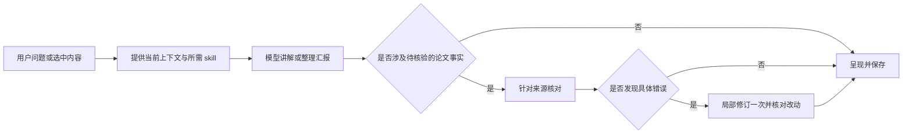

# Skill 与工作流驱动的科研学习助手：落地方案

版本：v0.1 · 日期：2026-10-05 · 代码基线：`314b447` · 状态：待实施

本文件落实本次讨论的产品方向，只是方案。本文提出的简化调用、统一对话和局部修改尚未实现；当前结果以[上一轮实施与验收](基础资料迁移与四场景验证_验收.md)为准。

## 1. 先用通俗的话说明要做什么

把现有强模型用好：模型本身已有广泛的通用知识、语言理解与推理能力，准备工作重点是不断完善提示词和 skill，让它们适合本项目的科研学习任务。提供当前论文材料，是为了准确讨论这篇论文的具体事实；不是要求模型从零学习每个基础概念。

skill 相当于一份可复用的工作说明，工作流决定什么时候使用这份说明、怎样承接上下文、结果怎么保存和呈现。多角色可以用于检查和磨合：同一模型在不同职责下工作，主智能体保持目标和上下文，各角色接着已有材料与结果完成自己的部分。

用户可以直接说“帮我读懂这张图，再做三页汇报”，也可以选中一句话说“这里没懂”。助手承接目标，按需补解释，引用能够点开核对，汇报能够逐页修改。

优先做好四件事：

1. 调用顺畅：同一个模型按需加载不同 skill；主智能体统筹，普通追问可以直接回答，需要检查时组织角色协作。
2. 解释有效：把测量对象、原理和推理讲清，允许用户调整深浅。
3. 来源清楚：具体论文事实能回到原文，未知内容说明影响范围。
4. 修改方便：改一句解释或一页汇报，保留其余有效内容和上一版。

多角色的价值来自合适的职责、提示词、输入和协作方式。可以保留讲解、模拟试读、科研核对并持续磨合；不要求每个角色重新分析整件事或重建一份知识库。普通追问由主助手直接处理，完整读图或汇报按需要使用角色闭环。

## 2. 三层分工

| 层次          | 负责什么                                                       | 本项目做法                                           |
| ------------- | -------------------------------------------------------------- | ---------------------------------------------------- |
| 模型          | 理解自然语言、解释概念、推理、组织讲稿、识别疑点               | 沿用现有已接通模型与 provider，暂不更换模型或训练    |
| Skill／工作流 | 给出任务目标、讲解方法、取材要求、交付标准和停止条件           | 改进现有 skill，按任务加载，不把所有规则塞进每轮输入 |
| 程序和页面    | 读取 PDF、提供材料、保存版本、定位出处、控制实际调用、导出文件 | 复用已有接口与存储，补少量交互所需字段               |

OpenAI 官方文档将 skill 定义为可复用的指令和资源，也区分了工作指引与实际工具能力。本项目据此分工：读原文、保存和导出需要实际工具；讲解与组织内容由模型完成。[Skills 官方说明](https://developers.openai.com/plugins/concepts/skills)

同一模型配不同 skill 可以承担不同工作。本方案先明确主助手职责，再让讲解、试读和核对承担各自任务；这符合官方文档关于先明确单个智能体职责、再根据需要组织协作的建议。角色数量及调用次数通过实际效果判断，不预先承诺越多或越少越好。[Agent definitions 官方说明](https://developers.openai.com/api/docs/guides/agents/define-agents)

### 模型已有知识与资料库各自做什么

| 内容                                   | 默认怎样处理                                                                               |
| -------------------------------------- | ------------------------------------------------------------------------------------------ |
| 通用概念、基础原理、类比和讲解组织     | 正常发挥模型已有知识，直接解释；不会因为目录没有条目就判定无法讲解                         |
| 用户要求正式出处，或需要确认的专业细节 | 查实际可用来源；明确引用位置，不能凭记忆编造文献或原句                                     |
| 当前论文的数值、分组、具体操作与结论   | 对照该论文原文、图件及方法；已有通用知识帮助理解，不能替代具体证据                         |
| 项目资料库                             | 保存已取得论文、已查来源、可复用解释和核验记录，方便定位与重复使用；不是模型全部知识的目录 |
| 上一轮讲解、审阅意见和用户反馈         | 主助手保存并按职责传给角色，下一轮集中处理变化和仍未解决的问题                             |

不把模型已有知识等同于可以精确检索的个人文献数据库，也不把每句日常基础解释都变成重新找论文的任务。需要正式查证的内容与正常教学背景分开呈现；没有出处时不伪装成已核验资料。

**当前的实际限制：** 项目 `skills/` 是由 `server/skills.ts` 读取并送入模型的指令文件。现有 provider 的教学调用关闭联网、文件访问和动态工具，材料由后台提供。因此，仅修改 SKILL.md 不能让现有调用自动联网或导出文件。第一阶段仍沿用后台取材，不新建插件或切换 SDK；以后确需自主查资料时，再明确接入搜索／读取工具。

### 对需求的批判性取舍

以“把强模型用好、让科研学习更顺畅”为目标，具体判断如下：

| 需求或想法                       | 本方案的判断与做法                                                                                                                             |
| -------------------------------- | ---------------------------------------------------------------------------------------------------------------------------------------------- |
| 模型已有知识，不必从零准备       | 采纳。基础解释正常运用已有知识；项目目录不设为知识上限。但模型记忆不能保证原文、题录、数值和专业细节准确，需要时仍查证。                       |
| 准备工作主要是完善提示词和 skill | 采纳为第一优先级。但页面操作、上下文传递、出处定位、版本保存及导出确需程序支持；输入缺失、输出合同冲突或调用中断也不是单改提示词就能解决。     |
| 多角色检查和磨合                 | 保留并按实际作用使用。试读查表达，核对查来源，主助手整合结果；同一模型的多个角色可能共享错误，不能把互相赞同当成事实正确。                     |
| 已有材料和结果反复使用           | 采纳。传递与当前目标相关的有效上下文。论文、材料或用户目标改变时检查适用性；不把过期结果直接复用，也不把独立调用未收到的内容当作它仍记得。     |
| 流程应简单                       | 采纳。先改指引和协作方式，必要工程逐步补。但不能为了减少步骤，把需要核验的论文事实当成普通改写跳过检查。                                       |
| 需要不断磨合                     | 采用有具体问题的迭代。每轮说明哪里不好、改了哪条指引、结果怎样；固定小范围验收。不围绕缺失原文重复生成，也不以泛泛的“再检查一遍”无限增加角色。 |

工作原则：模型知识帮助理解，原文支持具体事实，skill 组织工作，程序提供实际能力。问题发生时先判断是讲法、来源、上下文、合同还是执行失败，再改相应部分。强模型能力是起点，具体质量仍需用结果判断。

## 3. 在现有基础上改，不重新搭一套系统

已经有：四功能入口、PDF 和图件、连续会话后台、17 条基础资料、来源快照、一次修订、取消与保存、PPTX 导出。

已有验证：构建及 50 项工程测试通过；连续追问、换论文、独立 qPCR 有通过记录。三页汇报内容验收仍失败，原因是 Figure 1m 的计数分母缺依据，以及一处论文事实没有对应论文引用。正文与已授权检查的补充材料尚未解决分母问题。

本轮计划先改进提示词、角色职责、上下文承接、引用表达与缺口呈现，再视需要调整调用方式。原有三角色流程保留作基线，优化后的指引与协作作为候选；旧失败、原评价和未解决问题保留。

## 4. Skill 怎么组织

复用现有目录，只在确有不同任务方法时分开说明；不为按钮、每个概念或每种说法新建智能体。

| 指引             | 对应现有文件                                                          | 要改成什么                                                                                             |
| ---------------- | --------------------------------------------------------------------- | ------------------------------------------------------------------------------------------------------ |
| 主助手           | `skills/medical-research-assistant/SKILL.md`                          | 理解并持续持有目标，决定需要的讲法、材料和角色；整合已有结果，直接回答追问或交付任务，不固定只返回计划 |
| 带读／方法／读图 | `medical-paper-guide`、`medical-method-tutor`、`medical-figure-tutor` | 给出教学方法和必要材料；支持从选中句子追问、调整深度，复用已经确认的解释                               |
| 术语与证据链     | `medical-term-explainer`、`medical-evidence-chain`                    | 作为按需参考，避免与主 skill 重复；解释如何从观察走到结论                                              |
| 汇报             | `skills/medical-journal-club-ppt/SKILL.md`                            | 同次组织要点与讲稿；支持指定页局部修改，保留原图和出处                                                 |
| 来源核对         | `skills/medical-grounding-check/SKILL.md`                             | 核对具体论文事实、关键推理和引用；指出具体位置，不自动扩大到完整实验复现                               |
| 试读             | `skills/medical-novice-simulator/SKILL.md`                            | 完整带读／汇报需要试读、用户请求或开发评价时使用；承接已有试读断点，反馈不代表真实用户掌握程度         |
| 公共规则         | `skills/shared/rules.md`                                              | 保留来源、资料边界、可见输出与格式规则；教学细节回到对应 skill                                         |

每份主 skill 只需写清：何时使用、需要哪些输入、怎样完成任务、交付什么、遇到缺口怎么办。长示例和专门资料放在参考文件，按需加载。

第一阶段不删除现有目录、不改变引用 ID、不大改存储格式。主助手输出合同随候选流程做兼容扩展；旧页面继续可用。

### 多角色怎样承接，而不是每次重做

主助手持有用户目标、当前材料、已确认解释、未解决问题和产物版本。讲解角色接收这些相关上下文，利用模型已有知识组织教学；核对角色接收候选回答与实际来源，集中检查事实、引用和推理；试读角色接收用户可见内容、画像及先前断点，检查表达衔接。

现有角色调用使用独立临时会话，承接由主助手实际传入上下文实现；不假设下一次独立调用自动记得上一轮。这只要求传好材料和已有结果，不需要重新训练模型。

修订时传递具体问题和待改内容，保留已经确认的部分。涉及全局结论才整体检查，其余尽量核对变化处。换论文重新绑定论文事实，仍可承接用户明确的偏好和已确认的通用学习记录。

试读的输入隔离用于避免它偷看原文后自称讲解清楚，并不意味着把模型基础能力清零。各角色都是强模型在不同职责下的调用；多角色结果也不是多名独立真人专家的共识。

### 可以直接用于改写 skill 的核心说明

以下是拟写入项目指引的工作规则，不是已经启用的 skill：

```text
理解用户当前要学什么或交付什么，利用已有上下文直接完成。
明确问题不另起一次规划；指代确实不清且影响答案时，问一个具体问题。

按需要选用带读、方法、读图或汇报指引。用模型能力完成语义理解、
概念解释、比较和内容组织，不要求程序列举所有问题的关键词。

先讲当前目标需要的最少基础，再连接到测量、观察和推理。
用户选中一句话追问时，集中解释该句，并承接上下文。
只有用户确认理解后才记录“已理解”；讲过一次不等于已经学会。

直接利用模型已有的通用知识解释基础概念，已有适用资料可帮助保持一致和提供出处。
目录匹配不到不等于不会讲，不要求为每句基础解释重新建立条目。
用户要求正式出处或专业细节需要核实时，通过实际可用方式查证。
具体论文事实依据当前论文材料；不得用通用知识填入论文未给的参数或数值。
没有实际查证的背景说明，不包装成已核验来源，不编造文献或原句。

一段话包含通用概念和论文例子时，分别附对应出处，或拆成两句说明。
缺材料时交付有依据的部分，说明缺什么、影响哪项判断、怎样补充。
不要为填满答案猜测，也不要把无关复现细节变成本次讲解的门槛。

根据用户目标直接给讲解、大纲或局部修订。
独立核对只针对需要核实的事实和引用；试读按需要使用。
主助手传递目标、有效上下文和既有结果；各角色承接工作，不重新展开无关内容。
内部问题编号留在工作记录，讲解用具体概念名称。
```

## 5. 最小工作流与调用原则

### 5.1 一条主线



需要材料时在相关步骤请求或读取材料，不另外制造一个完整的规划回合。用户指定的功能、选中句子、页码和修改范围直接传入。

模型的正常自查包含在生成中，不把自查当成独立来源核验。独立查证调用取得实际资料；模拟试读只取得用户可见内容。

### 5.2 建议调用路径

下面是候选路径，不是当前程序已经具备的调用次数，也不承诺实际耗时。

| 用户请求                             | 常规路径                               | 何时增加步骤                                     |
| ------------------------------------ | -------------------------------------- | ------------------------------------------------ |
| “这句话换个通俗说法”                 | 一次局部讲解                           | 引入新的论文事实时核对；纯显示、查看记录为零调用 |
| 独立概念或方法问题                   | 一次讲解，利用模型知识及适用的已有资料 | 专业细节需核实或用户请求正式出处时查资料并核对   |
| 读论文、解释图                       | 一次讲解＋一次来源核对                 | 有具体错误才局部修订，并核对改动                 |
| 同一图讲解＋三页汇报                 | 一次联合生成＋一次整体来源核对         | 需要检查表达衔接时加试读；有具体问题才修订       |
| 简化某页措辞                         | 一次局部修改                           | 数字、分组、结论、图件或引用变化时核对该页       |
| 打开出处、恢复旧版本、导出已检查大纲 | 程序操作，零生成                       | 来源已变或结果未核对时先提示并重新检查           |

上述次数是可用的轻量路径。完整讲解＋试读＋核对可以继续用现有三次调用；是否采用完整闭环由任务和效果决定，不以减少角色作为本轮首要指标。额外试读、确有必要的规划和所有失败尝试都计入真实预算；不能把这些隐藏在“一次调用”里。

第一阶段沿用现有每轮 6 次／含规划 7 次、480 秒产品截止，以及一次修订上限。次数减少是待验证目标，达到上限或超时后保存已确认部分和具体问题，不自动反复重试。独立开发评价沿用独立账本，评价调用也统计总量。

流程选择由明确用户操作和模型语义判断共同完成；不新建大量关键词分支。直接解释路径只适用于不引入待核验论文事实的任务，不能用简化路径绕过必要来源检查。

## 6. 使用者看到的功能

### 6.1 一个主对话

主区域为对话，论文和图件在侧边。四个原入口保留为快捷开始方式，进入同一个会话。

例子：“读懂 Figure 1 的 d–f，再做三页汇报。”助手用当前资料解释，并把确认内容整理为三页。用户接着说“第二页太复杂”，继续修改第二页，不要求重新选入口或重复上传。

已有会话接口负责创建、恢复、提交和取消；前端接入它们即可。用户不需要看到技能编号、角色数量和调用账本。

### 6.2 针对一句话追问，调整讲解深浅

选中一句话后提供“解释这句话”“补基础”“举个例子”“展开方法”四个操作，也允许直接输入要求。

提交选中原句、所在单元／页面及当前问题，模型按语义处理；不把点击机械地映射成固定话术。默认答到足够理解为止，深入解释按需展开，不为每个术语自动写一大段。

“我懂了”由用户主动确认，可撤销；“讲过”与“已理解”分别记录。临时调整讲解深度只改变本次回答，用户主动要求后才保存为偏好。

### 6.3 点开出处

事实句或解释段旁显示可点击来源，点击后打开原页与对应原文。先用已保存的页码、段落范围和来源 ID，不依赖整篇重新生成定位。

显示三种自然语言标签：“这篇论文报告”“基础原理”“根据这些证据的解释”。解释项仍给支撑来源，不把标签当成正确性的证明。

同一段混合两类内容时附两类出处或拆句。不能把“某段含一个基础引用”当成其中所有论文事实都有依据；这是上一轮汇报引用问题的直接修复点。

### 6.4 缺口和部分结果

缺口显示三个信息：缺什么、影响哪一项判断、怎么补。以实际证据为准，不能仅根据资料条目匹配就标已解决。

例子：

> 这张图标的是符合 TAF 阳性和 LUC 阴性条件的细胞百分比，但现有材料不能确定分母是哪一组细胞。因此暂不把它解释成“受体细胞中的阳性率”。前面的分组、方法原理和功能比较仍可继续讲解。

必要缺口阻止相应结论成为“已确认”，不阻止其他有依据内容呈现。页面分别显示“已确认部分”和“待核实部分”。正式汇报可以保存带限制的草稿；有影响关键结论的缺口时不能显示“全部核对通过”。

材料充分性、内容正确性、用户是否理解分别记录。当前 S4 仍按原条件记失败；改进部分交付体验不等于补齐分母，不修改历史条件来制造通过。

### 6.5 等候、停止和恢复

显示实际状态，例如“正在准备图和方法”“正在生成讲解”“正在核对来源”“正在导出”。只展示程序已知阶段，不虚构百分比或预计完成时间。

保留停止操作和中断记录。停止后可以查看已保存结果，重新请求只执行尚需完成的步骤；不自动重发状态不明的调用，不把未检查草稿冒充已确认内容。首次不必实现逐字流式显示，可先交付可靠的阶段状态。

### 6.6 逐页修改汇报

用户指定页或选中内容，提出“简化”“扩展讲稿”“改成五分钟汇报”等要求。单页修改优先使用该页材料；全局要求确实影响多页时先确定作用范围。

程序保存父版本、改动页面及来源快照，未涉及页面保持不变。事实、引用或图件改变时核对改动页；确认后的文字缩短仍须保持原义。导出使用最新已检查版本，旧文件不覆盖，可恢复上一版。

## 7. 工程改动落在什么地方

这些是后续实现位置，本次不修改代码。

| 位置                                   | 最小改动                                                                                                | 复用的能力                                    |
| -------------------------------------- | ------------------------------------------------------------------------------------------------------- | --------------------------------------------- |
| `skills/`、`server/skills.ts`          | 明确角色职责与承接方式，精简重复规则；按目标加载指引，避免无关角色规则干扰普通追问                      | 现有文件、版本哈希和模块加载                  |
| `server/assistant.ts`                  | 接收局部追问及页面修改目标，承接对话；常规任务避免重复规划                                              | 现有会话、目标、上下文及来源选择              |
| `server/orchestrator.ts`               | 增加可选择的生成／核对／试读路径，保留一次修订和实际预算                                                | 现有角色合同、审计、取消、来源校验            |
| `shared/types.ts`、`server/schemas.ts` | 兼容增加选中文本、目标页、父版本和部分结果信息；区分正常模型背景说明与有来源的核验内容，不能伪造来源 ID | `LearningUnit`、`DeckOutline`、来源与会话类型 |
| `server/index.ts`、存储与导出          | 对局部改动保存新版本，导出检查版本和来源                                                                | 会话接口、来源定位、原子保存、PPTX 导出       |
| `app/main.tsx`、`app/style.css`        | 主对话、句子操作、出处面板、阶段状态、缺口提示、版本选择                                                | 原四入口、PDF 阅读器、现有任务状态            |
| `checks/`、`evals/`                    | 针对真实改动验证，不为每个文案写测试                                                                    | 现有工程回归与固定内容评价                    |

只增加实现交互所需的少量字段。先复用现有来源快照和任务记录作为版本依据，不新建知识图谱、长期自动画像或复杂工具编排框架。

## 8. 实施顺序和每一步的交付

### A. 先把 skill 与回答流程用顺

先改写主助手及角色指引，明确通用知识的正常使用与已有结果的承接；修混合段落引用，完善缺口及影响范围表达；用现有角色流程磨合，再为普通追问增加直接回答路径。当前来源合同要求基础段落引用，允许正常模型背景说明需要同步调整合同，不能仅改提示词后让模型编造引用。

交付：实际 skill 文件、角色输入与输出示例、可运行候选流程、与旧流程的比较记录。用户应能感觉到模型回答更直接、角色协作有用、追问更集中，并能分清已确认和未知内容。没有解决的 Figure 1m 原文缺口继续保留。

### B. 再接最重要的使用体验

接入主对话、选中一句话追问、点开出处、真实阶段状态和停止。这是后续前端实施阶段，本次只是记录顺序；不在文档任务中顺带开发页面。

交付：一段完整体验——读图、局部追问、查看原文、继续任务，使用同一会话。原四入口继续可用。

### C. 汇报局部修改和版本恢复

实现指定页修改、必要核对、保存新版本、恢复上一版与导出。

交付：改变一页时其他页面内容及原图保留，用户能比较并恢复。关键事实缺依据时保留草稿和具体提示。

### D. 最后再做个人学习笔记

整理用户主动收藏的解释、确认理解的概念与待解决问题；支持“接着上次继续”。先以用户确认和已有会话记录为依据，不自动判断掌握程度。

交付：可编辑、可删除的个人笔记。是否扩大为跨论文知识整理，等前三阶段使用后决定。

每阶段单独提交、写简短结果记录。发现必要原文无法取得时，把该问题留在材料清单，不为同一缺口反复添加角色或批量重跑其他场景。

## 9. 怎样判断改造值得保留

### 用户操作验收

| 场景               | 应观察到的结果                                     |
| ------------------ | -------------------------------------------------- |
| 读图后要求汇报     | 同一对话完成衔接，不重复上传，不重复解释一整遍     |
| 选中一句说没懂     | 解释集中在该句，有必要基础；其余内容保持           |
| 点击出处           | 打开实际来源及位置，能够辨认论文事实和基础解释     |
| 关键资料缺失       | 看得到已确认内容、缺口及影响，不显示全部通过       |
| 修改第二页         | 其他页内容与图件保留，能回到上一版                 |
| 停止并回来         | 任务状态及已保存内容正确，继续操作不自动重复原调用 |
| 确认理解后再次追问 | 能修改或撤销理解记录，不强迫测验                   |

### 内容与效率验收

复用现有四个开发场景作为主要基线，新增“局部解释”和“单页修改”两个短场景。比较采用相同模型、材料、问题和评价条件，记录 skill 版本、实际调用、耗时及可取得的用量；试读、修订、失败和独立评价全部计入。

先用工程检查确认来源、保存、取消和局部修改，再对确实改变回答路径的少量场景做内容评价。留出条件不改写，不为减少调用而放宽内容标准，也不以模型自称“已懂／通过”代替验收。

保留候选需要同时满足：事实与引用正确、必要解释完整、未解决问题诚实呈现、交互符合用户目标。次数或耗时降低只能作为实测结果报告，不能预先宣称性能提升。未通过的场景写明原因，停止本批；修复具体问题后只补验受影响场景。

## 10. 本次交付范围

本次交付这份落地文档，包含 skill 写法、最小工作流、使用体验、实现位置、分阶段顺序和验收办法。没有改产品代码、安装 skill、启用工具或执行模型回放。

后续首先实施 A：重点磨合提示词、skill、主助手职责和角色承接，让模型已有能力充分用于教学，并把引用与部分结果表达做好。前端及新功能按 B、C、D 顺序展开。此前方案保留作历史记录；本文件提出新的候选方向，尚未作为当前运行行为。
