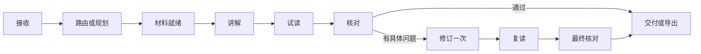

# 主助手与多智能体：效率、成本和效果落地方案

> 历史设计／阶段记录：正文的版本、状态、调用次数及“待实施”只对应当时范围。当前有效要求、交付状态和下一步以 [当前落地方案](科研能力培养与三类Agent协作_整体落地方案.md) 与 [当前整体复查](科研能力培养与三类Agent协作_整体复查与优化记录.md) 为准；本文不作为整个项目已完成的证明。

版本：v0.1 · 日期：2026-10-04 · 基线代码：`277aef8` · 状态：后端改造规格

实施进展见 [主助手后端优化验收](主助手后端优化验收.md)。本文保留基线描述与分阶段规格；当前运行行为、已验证范围及 P2 待办以验收记录为准。

## 1. 本轮决策

主智能体定位为科研学习助手，统一理解目标、组织四项功能、保存上下文并交付结果。导师、模拟新手和科研核对承担专业任务。执行层继续采用现有 TypeScript 状态机与 Codex provider。

默认采用“规则路由＋必要时一次模型规划＋三角色教学闭环”。一次普通教学需要 3 次生成，修订后最多 6 次；需要规划时分别为 4 次和 7 次。最终结果由程序组合为助手回复，减少重复转述。

效率优化先处理重复材料、重复生成和回放基线，再测试连接复用与检查并行。效果以原文依据、解释完整性、追问衔接和汇报可用性评价。前端保持现状，改造通过后再接入新的会话界面。

## 2. GitHub 复查与选型

| 资料 | 读到的机制 | 本项目采用的做法 |
| --- | --- | --- |
| [OpenAI Agents JS：agents-as-tools](https://github.com/openai/openai-agents-js/blob/96aa754b69282fef3bf8be2f15897985400ee0a6/examples/agent-patterns/agents-as-tools.ts) | 主角色调用专业角色，结果返回主角色 | 主助手持有会话；专业角色返回结构化讲解和检查结果 |
| [OpenAI Agents Python：multi_agent](https://github.com/openai/openai-agents-python/blob/81f0ccf20c6e24063b9da36fa37f2bdb6a43d8d3/docs/multi_agent.md) | 模型调度与代码调度；固定流程可交给程序；评估指导迭代 | 明确操作由代码路由，复合或含糊需求使用一次规划 |
| [LangGraph：Workflows and agents](https://github.com/langchain-ai/docs/blob/14cfa205d93c6bd73a2ad5e0fb31ea94610183c6/src/oss/langgraph/workflows-agents.mdx) | 路由、状态、并行、协调者与工作者、评价后修订 | 采用显式状态与有界修订；检查并行作为单独实验 |
| [promptfoo：Assertions and metrics](https://github.com/promptfoo/promptfoo/blob/5fde786d0c296339be3fd189d1542157e1d4217a/site/docs/configuration/expected-outputs/index.md) | 结构、程序、模型评价，以及延迟和成本断言 | 为现有回放加入可执行断言、成本账本和固定基线 |

上述四项为本次读取的上游文件，链接固定到复查时的仓库提交。当前采用独立实现的轻量状态机，保留 provider 接口与现有依赖；以后按实际维护需要评估框架迁移。

[OpenAI Docs 延迟优化](https://developers.openai.com/api/docs/guides/latency-optimization)提出减少请求、控制输入输出、并行独立步骤和采用传统程序优化；本方案将这些原则落实到路由、资料包和缓存。[成本优化](https://developers.openai.com/api/docs/guides/cost-optimization)强调请求、token 和模型选型的配合。本轮沿用已接通的 GPT-6.1 Sol，先测同一模型下的流程变化。

## 3. 现有实现与改造点

| 当前代码 | 已有能力 | 本轮改造 |
| --- | --- | --- |
| `server/orchestrator.ts` | 三角色、一次修订、六次上限、独立会话、取消、持久化 | 在外层加入主助手；共享请求预算；按功能组装输入 |
| `server/skills.ts` | 四功能按需加载 8 个 skill | 支持任务所需的模块组合；加入主助手规则 |
| `shared/types.ts`、`server/schemas.ts` | 当前问题、资料 ID、上一段讲解、已教概念字段 | 增加会话、规划、任务组、回复和用量数据结构 |
| `app/main.tsx` 的任务请求 | 传入上一段讲解；`taughtConcepts` 固定为空数组 | 后端从会话记录组装有效上下文，供现有入口调用 |
| `visibleInput()` | 隔离新手输入；提供讲解与独立图注 | PPT 试读同时接收页面要点和讲稿 |
| `server/replay.ts`、`evals/cases.ts` | 固定版本、8 案例、基线与候选、保留或撤回 | 执行内容验收条件；基线复用；按批限制调用 |
| `cacheKey()` | 有版本化键函数 | 增加完成结果缓存与精确失效规则 |
| `server/provider.ts` | 每角色启动 app-server；记录耗时和原始 usage | 统一用量口径；连接复用单独试验 |

当前回放的通过判断来自运行状态与角色反馈，`required`、`condition` 尚未转成内容断言。现有 8 案例还使用静态摘要包；真实 PDF 图件需要作为新的固定资料快照接入。

## 4. 主助手如何工作

### 4.1 路由顺序

1. 读取用户目标、当前论文、选中内容、最近任务和未解决问题。
2. 对明确入口和操作建立程序计划，例如导出已有大纲、继续当前单元、指定方法讲解。
3. 对复合或含糊需求调用一次主助手，输出 `AssistantPlan`。
4. 校验资料、任务类型、步骤依赖和预算，建立任务记录。
5. 调用专业角色，保存检查与修订结果。
6. 组合 `AssistantReply`，更新会话，返回答案和产物。

语义路由依次使用明确操作、当前问题与上下文；关键词仅作为线索。例如“把 PCR 的介绍放进 PPT”应按汇报目标组织任务。存在多个合理解释时，主助手提出一个具体澄清问题，回答后继续当前计划。

主助手可安排的动作：`paper.read`、`method.explain`、`figure.explain`、`ppt.compose`、`ppt.export`、`material.request`。模型返回动作名称、参数和依赖，程序执行白名单内的本地服务。现有模型环境隔离继续保留。

### 4.2 四项功能的角色合同

| 功能 | 导师输入与输出 | 新手试读重点 | 科研核对重点 |
| --- | --- | --- | --- |
| 论文带读 | 原文、当前目标、相关基础 → 研究问题与实验推理 | 术语、对照、观察到结论之间的断点 | 分组、方法、结果、证据层级与引用 |
| 方法讲解 | 基础资料、当前问题；关联论文时加入其方法 → 原理与读数含义 | 能否解释“测了什么、为什么这样测” | 原理、信号含义、对照及论文条件 |
| 图表解读 | 原图、完整图注、对应结果 → 读图步骤与解释 | 面板、坐标、分组、统计和比较 | 图注对应、单位、统计定义、数值与推理 |
| 汇报 PPT | 目标、材料、有效学习单元 → 大纲、页面、讲稿、来源 | 作为听众复述各页，检查概念衔接 | 逐页事实、图件、来源及结论 |

方法模块支持独立使用；PPT 支持直接制作。模拟新手每次采用一个固定画像，修订后沿用同一画像。它取得学习者可见讲解、图注、页面与讲稿；科研核对取得对应原文及原图。

### 4.3 复合任务的合并

首个场景：“帮我读懂 Figure 1，解释相关方法，再整理成三页汇报。”

主助手选择一个共同资料包，将读图、必要方法解释与三页讲稿组织为一个教学任务。导师同次返回 `LearningUnit` 和 `DeckOutline`；新手整体试读；核对整体检查；程序导出 PPT。相关 skill 在该次调用中组合加载。

当资料或问题适合分段推进时，计划记录后续任务和依赖。默认一轮执行一个教学任务组。P2 扩展长任务执行，最多两个任务组，共享一次规划和总预算。

### 4.4 状态与交付



每个任务组最多一次修订。事实与推理问题对应原文修正；教学断点对应补解释；材料缺口对应补材料。已解决项保留原问题 ID 和修订位置，避免重复提出同一问题。

最终回复采用已检查的内容字段、产物链接和下一步。事实争议映射到具体段落或页面：交付已确认部分，争议部分进入待处理记录。引用、结构和文件验证由程序完成。

## 5. 调用预算与成本账本

以下为 v0.4 目标预算；当前运行时仍执行每任务六次上限。

| 请求类型 | 规划 | 首轮专业生成 | 修订与复查 | 上限 |
| --- | ---: | ---: | ---: | ---: |
| 查看 PDF、保存记录、导出已有大纲、恢复已完成结果 | 0 | 0 | 0 | 0 |
| 明确的普通教学任务 | 0 | 3 | 3 | 6 |
| 需要主助手规划的教学任务 | 1 | 3 | 3 | 7 |
| 同资料的读图＋方法＋PPT 组合 | 0 或 1 | 3 | 3 | 6 或 7 |
| 已检查结果的精确缓存命中 | 0 | 0 | 0 | 0 |
| P2 长任务：两个教学任务组 | 最多 1 | 最多 6 | 最多 6 | 13 |

澄清或材料请求结束在规划阶段，本轮使用 0 或 1 次。基础模式默认采用第一轮三次检查，按问题触发后续三次。PPT 的整体试读与核对各一次。

`BudgetLedger` 同时维护请求总额、任务组额度、规划额度、修订次数和开发批次额度。调用前原子预留一次 attempt，记录唯一 ID；成功、失败、超时和取消均保留记录。保存失败时先终止后续调度，恢复时依据已预留的 attempt 对账。

预算规则：主助手规划最多一次；单任务组最多六次；默认请求最多七次；格式失败保留原输出并结束该次执行；网络状态不明确时记录 `unknown`。后续主动重试创建新 attempt，已有成功结果继续复用。

建议初值：规划阶段 60 秒、单角色 180 秒、普通请求总截止时间 480 秒。P2 两任务组总截止时间 900 秒。每次请求的实际超时取阶段额度与剩余总时长的较小值，截止时间覆盖连接初始化和角色执行。

日志字段：`attemptId`、`turnId`、`groupId`、`role`、`model`、`sourceHash`、`skillHash`、`startedAt`、`durationMs`、`status`、输入输出字符数、原始 usage、归一化 token 用量、缓存命中和重试关系。失败阶段也记录耗时。

保留 `billingMode: chatgpt`。本轮以生成次数、可取得的 token 用量和耗时度量成本；金额字段为 `null`。usage 按每次 turn 的增量归一化，保留未知字段原值；累计计数只计一次。模型、接入方式、推理设置与图片数量一并进入比较记录。

## 6. 上下文、材料与缓存

### 6.1 会话状态

```typescript
interface ConversationState {
  id: string;
  version: number;
  paperId: string | null;
  sourceVersion: string | null;
  goal: string;
  profileId: string;
  taughtConcepts: { name: string; unitId: string }[];
  userProgress: { unitId: string; state: string }[];
  openQuestions: { id: string; question: string; sourceIds: string[] }[];
  taskGroups: { id: string; status: string; dependsOn: string[] }[];
  artifacts: { id: string; kind: string; sourceHash: string }[];
  recentTurnIds: string[];
}
```

完整轮次和产物按 ID 保存。向角色发送当前任务所需的摘要与资料。已教概念来自已交付学习单元，用户理解状态来自用户反馈，两个字段分别维护。切换论文后重建当前来源绑定；跨论文比较采用明确的多个资料包。

初始上下文上限：最近两轮摘要合计 1,200 个字符、20 个已教概念、5 个当前未解决问题；原文与基础资料合计 20,000 个字符；图表任务一张图及其完整图注。字符长度作为程序额度，token 用量作为服务返回指标。

优先提取目标面板、图注、对应结果和方法段。超过材料额度时重选相关段落或拆分任务，保留原文位置和完整文件。历史摘要从结构化结果提取，完整原记录可按 ID 读取。

### 6.2 材料去重与角色隔离

Xu 正文中同一页可能同时对应设计、图注和整页文本。按内容哈希保存一份正文，来源 ID 通过别名映射到正文块。模型引用沿用可定位 ID，原页与来源版本保持可追溯。

主助手取得题录、资料目录、用户目标和会话摘要；导师取得相关证据与基础；新手取得可见内容；核对取得原文、图像与检查对象。教学规则前缀保持稳定，任务资料放在后部。

### 6.3 两级缓存

| 缓存 | 键 | 使用规则 |
| --- | --- | --- |
| 资料预处理 | 文件 SHA-256＋解析器版本＋页码／区域 | 复用文字、定位和图件；内容变更后重建 |
| 已检查任务结果 | 规范化问题＋证据块哈希＋图片哈希＋全部相关 skill 与 schema 版本＋画像版本与内容＋模型设置＋有效会话上下文＋产物要求 | 复用完成且适合当前交付的结果；保留原检查记录和来源 |

预算不足、中断、争议内容与部分结果保存为任务记录。缓存候选必须经过完成状态、来源一致性与交付规则检查。复用结果后按当前会话更新概念、未解决项和产物绑定。

开发回放使用独立缓存命名空间。基线按案例、材料、版本与模型配置精确复用；候选实跑默认跳过答案缓存。每项比较记录新生成或复用状态。性能比较采用基线原始生成耗时，缓存读取耗时另列。

## 7. 效率优化的启用顺序

| 优化 | 作用机制 | 进入默认流程的条件 |
| --- | --- | --- |
| 明确任务程序路由 | 减少一次规划请求 | 路由案例通过，含糊问题进入澄清或规划 |
| 同资料组合生成 | 复用证据和讲解，一次生成学习单元与 PPT | 学习单元、页面和讲稿均通过相应检查 |
| 材料去重、按需加载 skill | 减少输入与重复处理 | 图注、方法和关键证据完整，引用定位保持正确 |
| 精确结果与基线缓存 | 减少重复生成 | 版本与上下文键通过失效、隔离和取消案例 |
| app-server 连接复用 | 减少进程和初始化开销 | 各角色仍创建独立 thread；断线、中断和用量测试通过 |
| 新手与事实核对并行 | 缩短独立检查阶段的等待 | 先拆出独立事实检查合同，再完成同案例质量与延迟比较 |

默认检查保持串行：现有核对输入含新手反馈。并行候选将原文事实检查与新手试读分开，程序合并问题后交给导师；后续复查遵循同一合同。最大生成并发为 2，并原子预留两次调用额度，取消时覆盖两个执行分支。

并行优化以调用数、内容条件、排队与耗时共同决定。首轮比较报告中位耗时和各阶段耗时；同一场景累计记录达到 20 条后再展示其 p95。较高推理强度或替换模型作为独立候选，和固定模型基线比较。

## 8. 评价、案例与开发预算

[OpenAI Docs 评价指南](https://developers.openai.com/api/docs/guides/evaluation-best-practices)建议按任务建立评价并持续扩充案例。本项目采用三层结果：程序断言、证据审阅、教学断点与修订审阅。

| 层级 | 检查项 | 记录 |
| --- | --- | --- |
| 程序断言 | 路由、引用 ID、预算、依赖、取消、schema、缓存失效、PPTX 结构 | 通过／失败、具体字段和事件 |
| 证据审阅 | 关键事实、分组、图注、统计、原文支持程度 | 句子／页号、source ID、判断与依据 |
| 教学审阅 | 必要概念、测量原理、推理衔接、追问是否改变解释 | 具体断点、修订位置、已解决／待处理 |

将原 `required`、`condition` 拆成结构断言与内容 rubric。词语出现用于筛选，语义通过条件由具体讲解及证据判定。模型审阅采用明确 rubrics，保留可核查说明；额外评价请求计入开发预算。

### 8.1 案例集

保留 8 个原案例：开发集 `term`、`pcr`、`flow`、`figure`、`chain`、`rewrite`；留出集 `lifespan`、`ct-context`。冻结各自资料版本。`figure` 继续作为只有图注的材料缺口案例，真实原图另建快照；PCR 材料完善使用新版本案例并单独建立基线。

新增 6 个主助手案例，形成 10 开发＋4 留出，共 14 个案例：

| ID | 划分 | 场景 | 核心通过条件 |
| --- | --- | --- | --- |
| `assistant-method` | 开发 | 直接问 PCR 原理 | 选方法功能，取得基础资料，规划调用为 0 |
| `assistant-followup` | 开发 | 同一会话继续问“为什么设置这个对照” | 正确绑定上一单元，改变解释，已教概念可用 |
| `assistant-report` | 开发 | Figure 1＋相关方法＋三页汇报 | 一个组合任务，三页、讲稿、原图和来源齐全，新手收到整份汇报 |
| `assistant-budget` | 开发 | 一次修订、取消、资料／规则变更后的重复请求 | 上限、停止与失效断言通过；确定性部分使用 mock provider |
| `assistant-ambiguous` | 留出 | “这一步为什么这样做”且尚未绑定材料 | 提出可回答的澄清问题并保存待继续状态 |
| `assistant-transfer` | 留出 | 换段落或论文后读图，再按要求形成汇报 | 来源绑定准确、旧内容隔离、功能衔接正确 |

留出材料与审阅答案放在评价侧。依据留出问题修改规则后，将该案例转为开发案例并补充新的留出材料。

### 8.2 小批迭代

每批选择最多 4 个受影响案例，评估一个候选版本。每例最多 7 次产品生成＋1 次额外评价，候选批上限 32 次；建立对应基线另用一个最多 32 次的批次。冷启动比较分为基线和候选两个批次，合计最多 64 次。P2 双任务组案例另按其预算预留，批次总上限保持 32 次。

静态检查及 mock 流程先运行。实跑前验证剩余额度可覆盖当前案例；结果未完成时标为待评估。开发日志同时记录新旧版本、资料快照、模型设置、rubric、调用、token、耗时及复用来源。

发布条件：目标断点补足；关键事实和来源条件通过；其余固定案例的必需条件保持；调用与时长符合配置。质量相当的候选优先采用调用和上下文成本更低者。比较差异不明确时，保留基线，并记录下次需要检验的问题。

### 8.3 开发侧分工

功能审阅负责路由、上下文与四功能衔接；内容审阅负责事实、理解断点和 PPT 讲稿；工程审阅负责预算、取消、缓存和文件。各项结论汇总到同一验收报告，记录产物与证据。用户主要参与助手职责、教学方式和实际使用体验的完善。

## 9. 文件、接口与实施顺序

以下为待实现文件和接口规格。

| 阶段 | 主要落点 | 交付与完成条件 |
| --- | --- | --- |
| P0：主助手与连续会话 | 新增 `server/assistant.ts`、`server/conversation.ts`；更新 types、schemas、index；新增 `skills/medical-research-assistant/SKILL.md` 与 manifest | 自然问题得到有效计划；上下文可恢复；旧四入口适配同一服务 |
| P0：预算与角色合同 | 新增 `server/budget.ts`；修改 orchestrator、skills、provider、新手和核对 skill | 请求总预算生效；一次修订；PPT 页面与讲稿进入试读；失败用量可追踪 |
| P1：真实材料与组合产物 | 新增 `server/materials.ts`；组合加载 skill；联动 sample、PDF 与 export | Figure 1＋方法＋三页 PPT 完整跑通，来源能回到原页 |
| P1：评价与基线复用 | 更新 evals、replay；新增任务结果缓存模块 | 14 案例定义；rubric 执行；四例批预算；基线复用与退步判定 |
| P2：性能候选 | provider 连接生命周期；可选检查并行；两任务组预算 | 与串行基线同条件比较，按报告决定是否启用 |

新接口：`POST /api/conversations` 创建会话；`POST /api/conversations/:id/messages` 接收问题并返回 turn ID；`GET /api/conversations/:id` 恢复会话；`GET /api/turns/:id` 查询进度和回复；`POST /api/turns/:id/cancel` 取消该轮及子任务。`/api/tasks` 保留为旧入口适配层。

`AssistantPlan` 包含目标、选择的功能、产物要求、资料 ID、最多两个任务组及依赖、澄清问题、预算估计。P0 校验器限制为一个任务组。`AssistantReply` 包含已交付内容、产物、待处理问题和下一步。任务中加入 `conversationId`、`turnId`、`groupId`，会话采用原子保存与递增版本校验。

P0 的写入、预算预留和首个任务启动由同一轮次锁管理。重复消息使用客户端消息 ID 去重。重启时恢复完成产物，将进行中的请求标为中断；之后由明确的新操作继续。结构化学习摘要进入版本化会话，角色工作记录单独保存。

首轮执行 P0，随后 P1 的完整局部案例。常规验证沿用类型检查、构建、流程与浏览器检查，新增验证集中在跨轮路由、预算和隔离行为。每个实现任务审查差异、完成验证并在 `main` 提交。

P0 提交的验收证据包含：直接方法请求的零规划轨迹；含糊指代的澄清与续接；一次修订的六／七次账本；取消、重复消息与重启恢复；PPT 页面和讲稿的实际新手输入；无效动作、来源或多任务组计划的拒绝记录。确定性流程先由 mock provider 检查，再用一个完整局部任务核验角色合同与产物。

## 10. 文案与交付规范

按 [anti-defensive-writing 中文规则](https://github.com/Kiterlin/anti-defensive-writing/blob/main/skill/anti-defensive-writing/SKILL.md)表达：先说结论和动作，解释当前问题，限定条件放到相关事实位置；删除重复免责、预先辩解和自动总结。材料缺口写成具体补充需求，例如“请补上 Figure 1 的图注，以确定误差线定义”。

开发交付包括提交哈希、变更内容、验收结果、调用与耗时，以及下一批要解决的问题。计划状态和运行结果分别记录，本文件的预算、接口和优化均为后续实现规格。
