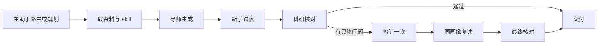

# 医学科研学习助手：初版实施方案

版本：v0.4 · 日期：2026-10-04 · 基线：本机 demo 0.1（`277aef8`）

本轮后端实施结果见 [主助手后端优化验收](主助手后端优化验收.md)。以下“当前”状态保留方案制定时的基线，已实现能力和验证边界以验收记录为准。

主智能体定位为科研学习助手，统一接住用户目标，组织论文带读、方法讲解、图表解读和汇报 PPT。导师、模拟新手和科研核对负责讲解、试读和证据检查。下一轮先完善主助手、连续会话与功能衔接，前端开发暂停。

本版承接 v0.3，更新已完成状态、主助手职责和调用预算。具体接口、字段、文件改造与评价案例见 [主助手多智能体落地方案](主助手多智能体_效率成本效果落地方案.md)。现有运行记录见 [初版验收与已知问题](初版验收与已知问题.md)。

## 1. 产品目标与当前状态

面向刚进入实验室的医学生和科研入门的医学研究生，帮助他们理解术语、方法、图表，以及实验如何支持结论。讲解按当前问题展开必要基础与推理步骤，学生可以自由追问、跳到指定内容，或独立制作汇报。默认直接讲解与示范，测验按用户意愿使用。

| 项目 | 当前约定 |
| --- | --- |
| 使用方式 | Windows 本机网页，单人使用；一次执行一个用户请求 |
| 核心功能 | 论文带读、方法讲解、图表解读、汇报 PPT，均可独立进入 |
| 主助手 | 理解目标、选择功能、绑定资料、保存上下文、组织交付 |
| 专业角色 | 导师、模拟新手、科研核对；每次采用一个新手画像 |
| 模型 | 沿用已接通的 Codex app-server 与 GPT-6.1 Sol |
| 首个完整局部场景 | Figure 1 带读＋相关方法解释＋三页汇报 |
| 开发顺序 | 主助手与会话 → 预算及输入合同 → 组合场景与评价 → 性能优化 → 前端 |
| 用户参与 | 完善助手职责、教学方式与实际使用体验；开发侧负责验收 |

已建立 React/TypeScript 网页、Node 后台、PDF 页面与圈选、三角色流程、学习记录、PPTX 导出、规则比较和启动脚本。类型检查、构建、13 项流程检查、浏览器操作与 PPT 文件检查的既有结果已归档；实时文本、图片输入和局部教学已运行。

当前任务仍由四个入口分别提交，主要接收上一段讲解；连续会话、主助手规划、完整 PPT 试读、内容验收条件执行和结果缓存是下一轮重点。基础医学为首个材料方向，临床研究后续补充独立案例。

## 2. 示例论文与资料

**Xu M, et al. Senolytics improve physical function and increase lifespan in old age. Nature Medicine. 2018;24:1246–1256.** DOI：`10.1038/s41591-018-0092-9`；PMCID：`PMC6082705`。

正文 PDF 已接入本机，共 15 页。Figure 1 定位 PDF 第 2 页，Figure 6 定位第 8 页，现有示例提供所在原页和图注。按用户选择，初版使用正文完成局部带读。来源与文件校验见 [示例论文下载记录](示例论文下载记录.md)；题录入口为 [Nature Medicine](https://www.nature.com/articles/s41591-018-0092-9) 和 [PMC](https://pmc.ncbi.nlm.nih.gov/articles/PMC6082705/)。

首轮组合任务固定 Figure 1 的原图、完整图注、对应结果与方法段，逐项核验来源位置。Figure 6 用于后续读图与结论范围练习。原文页与段落保留内容 ID、资料版本和文件哈希；基础方法知识另列来源。

现有自动提取文字作为检索与定位材料。进入教学案例的段落、分组、统计定义与图注由开发侧核验，并保存固定资料快照。

## 3. 四项功能如何配合

| 功能 | 输入 | 交付 | 与其他功能衔接 |
| --- | --- | --- | --- |
| 论文带读 | 用户问题、选中段落、相关图注与方法 | 一个学习单元：问题、基础、实验、观察、推理和来源 | 遇到必要方法时展开解释；确认内容可进入汇报 |
| 方法讲解 | 方法名称、当前疑问、基础资料；论文相关用法 | 解释测量对象、原理、信号、对照和读数含义 | 支持独立学习；绑定论文时说明其具体用法 |
| 图表解读 | 原图、完整图注、对应结果和方法 | 面板、坐标、分组、统计、观察与结论 | 补充相关方法；选定图件和解释进入 PPT |
| 汇报 PPT | 汇报目标、页数、有效学习单元与资料 | 可编辑大纲、页面要点、讲稿、来源和 PPTX | 可直接制作；也可复用带读结果与图件 |

普通学习采用一个问题或一个局部单元。复合需求优先共用资料，例如“读懂 Figure 1，再整理三页汇报”：导师同次生成学习单元和汇报大纲，新手整体试读，科研核对整体检查，程序导出文件。

PPT 默认提供八页结构：题目与来源、研究问题、必要基础、研究路径、两个关键结果、结论与局限、汇报小结。用户可调整页数与顺序；局部案例采用三页。文字可编辑，科研图以保留出处的图片嵌入，备注包含讲稿。导出后检查页面、图件、来源、备注和文件可打开性。

图件、图注或对应方法缺失时，助手指出具体待补材料并保存当前任务。用户补充后继续原目标。

## 4. 主助手与专业角色

### 4.1 主助手

主助手持有用户目标和会话状态。明确需求由程序直接调度；涉及多项功能或含糊指代时，最多调用一次模型规划。计划包含功能、资料 ID、产物要求、依赖与预算。存在多个合理解释时提出一个具体澄清问题，并记录待继续状态。

专业角色返回结构化内容和检查结果，程序组合为助手回复、产物链接与下一步。主助手使用的动作包括带读、方法解释、读图、制作 PPT、导出已有大纲和请求材料。

### 4.2 三个专业角色

| 角色 | 取得的内容 | 职责与输出 |
| --- | --- | --- |
| 导师 | 用户问题、相关原文和基础、已教概念、教学 skill；修订时加入具体问题 | 展开必要概念和推理，生成讲解或汇报，引用已有来源 ID |
| 模拟新手 | 固定画像、用户问题、学习者可见讲解、图件与图注；PPT 页面和讲稿 | 复述可理解部分，定位断点，指出缺失基础，提出自然追问；复读关联旧问题 |
| 科研核对 | 对应原文与原图、讲解／汇报、新手反馈 | 检查事实、证据、推理和教学问题，返回位置、来源及修改建议 |

默认画像是“医学科研初学者”：有基础医学背景，听过常用方法名称，需要术语、方法原理、读图和推理衔接解释。另有方法入门者与推理入门者画像；每次选择一个，修订后沿用同一画像。

新手输入由程序单独组装。参考答案、完整原文方法和核对报告留在相应角色与评价侧。新手反馈允许“可以理解”，问题项需要对应具体句子或步骤。事实判断依据原文；真实用户理解状态依据用户反馈。

### 4.3 单次教学流程

一次任务组最多修订一次。问题记录保留 ID、修改位置和处理结果；材料缺口进入补充队列，事实争议映射到相应段落或页面。确定部分交付，待处理项随任务保存。

## 5. 教学与上下文规则

学习单元按“研究问题 → 必要概念 → 方法与对照 → 观察 → 推理 → 结论范围”组织。术语采用中文名、英文／缩写、一句话解释及当前用途。类比后回到真实机制。用户表示仍不理解时，定位断点，换例子或缩小到一个步骤继续解释。

论文事实指向原文位置；基础知识指向独立资料；教学解释与推断标明依据。数字、分组、单位和统计定义要能回到对应来源。

会话保存目标、论文与来源版本、已交付单元、已教概念、用户主动反馈、未解决问题、任务依赖和产物。完整记录按 ID 保存，角色取得当前所需内容。已教概念与用户理解状态分别维护。

初始输入额度：最近两轮摘要合计 1,200 字符、20 个已教概念、5 个未解决问题、相关原文与基础资料合计 20,000 字符；图表任务提供一张图和完整图注。超过额度时重选段落或拆分任务，原始材料保持可定位。会话摘要从结构化结果提取。

## 6. 效率与成本控制

| 场景 | 首轮生成 | 包含一次修订的上限 |
| --- | ---: | ---: |
| 明确的教学任务 | 3 | 6 |
| 需要主助手规划 | 4 | 7 |
| 同资料组合：读图＋方法＋PPT | 3 或 4 | 6 或 7 |
| P2 扩展：两个教学任务组，共用规划 | 最多 7 | 13 |
| 查看 PDF、保存记录、导出已有大纲、精确结果缓存命中 | 0 | 0 |

以上为改造目标；现有运行时仍为每任务最多六次。每次实际尝试在发送前预留预算，失败、超时和取消保留记录。格式失败结束当前执行，后续主动重试建立新 attempt；网络状态不明确时先记录状态。

主助手规划初值 60 秒，单角色 180 秒，普通请求总时长 480 秒；各阶段采用自身上限与剩余总时长中的较小值。P2 双任务组总时长初值 900 秒。

成本记录采用生成次数、可取得的 token 用量、输入输出长度和耗时。当前接入标记为 `billingMode: chatgpt`，金额字段留空。模型、接入方式、画像、规则、资料和推理设置固定后比较。

优化顺序为：程序路由、同资料组合、材料去重、精确结果及基线缓存、连接复用、独立检查并行。默认检查沿用串行合同；并行候选先拆出独立事实检查，再与串行基线比较质量和耗时。每角色保持独立 thread，最大生成并发为 2。

## 7. 规则改进与验收

当次教学完成讲解、试读、核对与一次修订。开发迭代收集具体断点，形成候选规则，再用固定案例比较。规则版本升级依据断点、事实、回归条件和成本记录。

现有案例库为 6 个开发案例和 2 个留出案例。下一轮新增独立方法路由、连续追问、组合汇报、预算及取消、含糊需求澄清、材料切换六例，形成 10 个开发＋4 个留出，共 14 个案例。

每例固定问题、资料快照、画像、输出要求和可审阅条件。评价分三层：程序断言检查路由、结构、引用、预算及隔离；证据审阅定位事实与来源；教学审阅检查必要概念、推理和追问衔接。`required` 与 `condition` 转为可执行断言和内容 rubric。

每个开发批次最多 4 个案例、一个候选，最多 32 次生成，包含额外评价；对应基线另用最多 32 次。已保存的精确基线可复用，候选默认实跑。冷启动比较分两批，合计最多 64 次。现有旧回放一次比较八例基线与候选，运行上限仍为 96 次，待改造后切换新预算。

留出资料与审阅答案放在评价侧。根据留出失败修改规则后，该例转入开发集，并补充新的留出材料。发布时复查其他固定案例的必需条件；开发记录说明哪些已验证、哪些仍待评估。

已有一次两例比较使用 21 次生成，候选因留出案例出现退步被拒绝保留并撤回。该记录作为改进流程基线保存，详见验收文档。

## 8. 后端改造与交付顺序

| 阶段 | 改造 | 完成条件 |
| --- | --- | --- |
| P0：主助手与会话 | `assistant.ts`、`conversation.ts`，会话与规划类型、接口和主助手 skill | 自然问题正确路由；连续追问绑定当前内容；刷新可恢复；旧四入口调用统一服务 |
| P0：预算与角色合同 | `budget.ts`，orchestrator、provider、skills，新手与核对规则 | 总预算和取消覆盖全部阶段；PPT 页面与讲稿进入试读；失败可追踪 |
| P1：局部组合场景 | 真实材料快照、组合 skill、学习单元与大纲联动 | Figure 1＋相关方法＋三页 PPT 完整跑通，来源回到原页 |
| P1：评价与缓存 | 内容 rubric、14 案例、基线及结果缓存、批次账本 | 执行内容验收；缓存正确失效；候选退步可拒绝；批次符合预算 |
| P2：性能实验 | 连接复用、独立检查并行、两任务组调度 | 固定条件下比较质量、调用和耗时，依据报告启用 |
| 后续前端 | 主对话、论文侧栏、资料和产物入口 | 后端会话与功能衔接稳定后，按 [前端重做方向](前端重做方向.md)开发 |

主助手 API 采用会话、消息、轮次查询与取消接口；旧 `/api/tasks` 作为适配入口。重复消息按客户端 ID 去重，状态按版本原子保存；重启后恢复完成产物，进行中的请求标为中断。字段和接口详见落地方案第 9 节。

执行层沿用 React、Vite、Node、TypeScript、PDF.js、PptxGenJS、JSON 文件持久化与独立 provider。资料、运行记录与导出保存在 `data/`、`runs/`、`exports/`。文本型 PDF 支持单文件 30 MB、100 页；复杂页面提供圈选、图注和文本补充。

## 9. 开发职责与文案

开发侧完成资料核验、实现、规则迭代和验收。功能审阅看目标与模块衔接，内容审阅看原文依据与教学断点，工程审阅看预算、取消、缓存和文件。用户参与职责与体验完善，后续引入真实新手和老师的重点单元反馈。

本轮 GitHub 复查参考 Agents SDK 的主角色与专业角色组织、LangGraph 的状态与工作流、promptfoo 的断言与指标；固定提交和迁移决定见落地方案第 2 节。既有资料来源保留在 [参考来源与复用记录](参考来源与复用记录.md)。

文案遵循 [anti-defensive-writing](https://github.com/Kiterlin/anti-defensive-writing/blob/main/skill/anti-defensive-writing/SKILL.md)：直接写结论、依据和动作，缺失材料写成具体补充需求。开发文档记录预算与实现状态，产品回复围绕当前学习问题。

每个实现任务检查工作区、审查差异、运行相关验证，只提交本任务内容，并在 `main` 形成描述性提交。交付包括提交哈希、功能结果、验证证据、调用与耗时以及下一批待处理问题。
