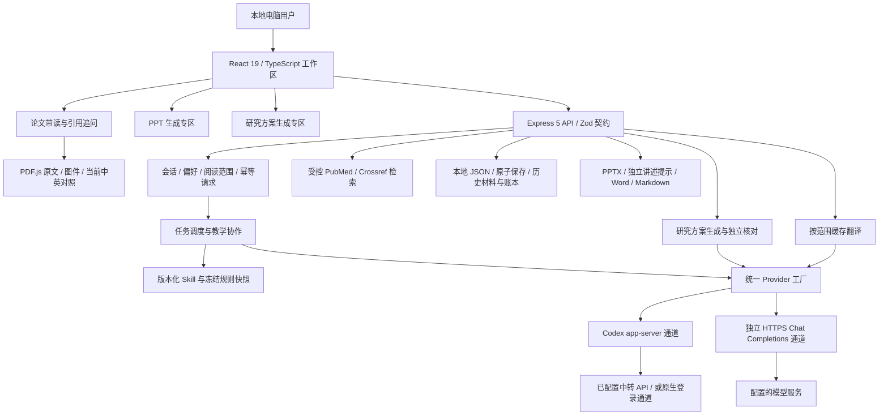

# 医学科研导师：需求、实现与验收落实清单

日期：2026-10-09。范围：本轮用户授权后的工作区版本。依据：[需求访谈基线](医学科研导师_需求访谈基线_2026-10-09.md)、[优化实施方案](医学科研导师_优化实施方案_2026-10-09.md)。本文用于后续开发接手、核对完成度和组织证据，不替代比赛说明书或用户验收。

> **整体复核纠正**：原表多项“已实现”只指规则配置或局部接线，不代表用户目标完成；此前遗漏的内部双闭环现已按 I01–I15 编号。全部 54 项复核、明确缺陷 F01–F15、成本与提供方 C01–C05 见[医学科研导师_整体复核与整改执行方案_2026-10-09](医学科研导师_整体复核与整改执行方案_2026-10-09.md)。本文保留历史证据，后续实施顺序以该方案为准。

用户再次明确：“少调用多 Agent”仅指当前开发会话的子代理委派，不限制产品内部三 Agent 迭代。内部带读、试讲、独立设计、补教、交叉核对和复验仍须充分执行；原有单次成本优化不能变成减少内部验证的理由。

## 1. 如何阅读完成状态

本清单逐条对应 54 个需求 ID，不计算笼统的“完成百分比”。实现、测试和教学效果属于不同层次：

- **工程已接通**：代码和界面已有实际行为路径，仍需相应行为证据。
- **规则已配置**：仅 Skill／提示词表达了要求，不能记为用户需求已完成。旧表未能区分两者，本次按下列状态纠正。
- **工程验证**：有确定性测试验证契约、状态、来源、恢复或文件结构；不能代替医学内容审阅。表中注明对应测试文件，最终整套测试结果由主执行者补记。
- **真实单例**：使用实际模型通道完成过该类任务，并有输入、材料、输出、用量及终态记录。只对该样本、该范围和该模型成立。
- **部分实现／待验**：已有基础，但目标仍有缺口、尚未覆盖足够复杂材料，或没有证据支持更强结论。

本轮实际提供方是 `codex-configured:klapi`，模型 `gpt-5.6-sol`。通过中转真实运行已经有证据；“已经完成国内模型适配”“全部医学类型已验收”“科研能力获得提升”均不是当前可作出的结论。

## 2. 当前产品与架构

产品主线是医学论文导师式带读。PPT 和研究方案拥有独立的输入、生成、预览及下载入口。生成专区省去应用内改稿编辑器；已有后端版本、审核、来源、取消和旧数据保留。普通用户不需要操作助手／小白／校验员的内部流程。



主要代码定位：

| 层次 | 主要文件 | 职责和约束 |
| --- | --- | --- |
| 工作区 | `app/research-workspace.tsx`、`research-navigation.tsx`、`research-settings.tsx` | 首页、左侧课题／论文、当前讨论、默认偏好；不启动云账号或多用户系统。 |
| 阅读呈现 | `app/research-discussion.tsx`、`markdown.tsx`、`research-reading.tsx`、`research-pdf.tsx` | 可读 Markdown、选句提问、PDF 跳页和原文、图件；HTML 不执行，模型远程图片不直接加载。 |
| 生成专区 | `app/generation-zones.tsx` | PPT 独立会话；方案完整生成；请求编号持久化、恢复、预览与下载，少量选项。 |
| 主服务 | `server/index.ts`、`assistant.ts`、`orchestrator.ts` | 参数校验、路由、来源绑定、角色协作、任务状态与取消。 |
| 阅读状态 | `server/reading-session.ts`、`shared/reading-session.ts` | 已交付字符范围及哈希、主线和专题光标、总结范围；新旧分段兼容。 |
| 偏好与辅助证据 | `server/depth.ts`、`tutor-settings.ts`、`tutor-research.ts`、`literature.ts` | 持续／局部程度、默认设置、轻术语记忆、联网补充与阅读层级。 |
| 翻译 | `server/source-translation.ts`、`app/source-translation.tsx` | 当前来源按块翻译、模型与材料绑定缓存、幂等、取消、失败和用量保存。 |
| PPT | `server/deck-versions.ts`、`export.ts`、`shared/slide-layout.ts` | 保留可编辑文字、来源图、版本和检查；讲述提示不进入 PPT 页面或备注。 |
| 研究方案 | `server/research-plans.ts`、`research-plan-schemas.ts`、`shared/research-plan.ts` | 六类医学设计提示、完整草案、来源检查、独立核对、明确失败及 Word/Markdown 导出。 |
| 运行和成本 | `server/model-config.ts`、`provider.ts`、`budget.ts`、`scheduler.ts`、`storage.ts` | 区分提供方、调用预占、终态／未知状态、并发、原子落盘与恢复。 |

开发和生产需要 Node 22.13 或以上。本机实际验证使用 `C:\Program Files\nodejs` 中的 Node 24；系统默认 PATH 中旧 Node 16 不能作为已验收运行环境。

## 3. 54 条需求落实对照

### 3.1 导师带读：T01—T20

| ID | 实现与可接手定位 | 已有证据／状态 | 仍需验收或限制 |
| --- | --- | --- | --- |
| T01 | `medical-paper-guide` 规则要求背景、目的、价值后直接讲第一单元；导入／开始带读连接阅读会话。 | 规则与局部起讲单例；普通全文入口待验。 | 真实完整 PDF 导入到首次呈现仍需逐次核对，不能把首单元等同全篇。 |
| T02 | `reading-session.ts` 按原文来源顺序推进，支持深化、专题跳转和回到主线；新分段采用句段边界。 | 部分实现：字符范围推进已接通，完整实验组织缺失（F04）。 | 4800 字符上限仍是有界文本组织，并非自动识别所有完整实验。长实验跨页与章节识别待验。 |
| T03 | Skill 将研究问题、方法、测量对象、对照、观察、证据和结论连接；核对员检查科学依据。 | 规则与局部单例；跨页实验／方法衔接待整改（F04）。 | 不同类型论文、复杂统计及方法细节需要独立病例，不作全医学质量保证。 |
| T04 | 首次术语中英对应；terms 可展开；对话正文为中文教学。 | 规则与单例；仍有真实术语问题，最终版待回归（F11）。 | 本次比较旧版在术语覆盖及推理桥梁上更好，候选不能宣称全面优于旧版。 |
| T05 | 支持普通单元和“一次多讲”连续三个单元，合理边界分段且记录范围。 | 部分实现：有界一块／三块，不等于完整实验单元（F04）。 | 三段有界输出不等于任意长度一次讲完；完整实验的自然跨度和超长响应阅读体验待真人验证。 |
| T06 | ReactMarkdown＋GFM 支持段落、列表、强调、表格；标题和正文使用独立排版。 | 已实现；可见引用文本工程验证；单例比较候选结构更紧凑。 | 表格、长公式、超宽内容及桌面不同宽度的最终视觉结果以本轮截图验收记录为准。 |
| T07 | 基础补充围绕当前理解断点，避免无限百科；基础来源与论文来源分开。 | 部分实现：本地补充有效，带读联网存在硬排除（F03）。 | 模拟新手已有模型知识，不能证明真实本科生都能理解。 |
| T08 | 方法默认讲原理、用途、对象、对照与判读；不默认实验 SOP。 | 已实现；带读与方案单例输出符合设计导向。 | 各类方法应另做样例；不可据此宣称实验操作培训能力。 |
| T09 | 规则允许必要替代方法比较并回到研究问题。 | 规则已配置，专项内容待验。 | 尚无足够独立对照证明比较总能适度、准确。 |
| T10 | 图表规则区分首次解释与后续同类图，坐标、单位、分组变化继续解释；轻术语记忆减少重复。 | 规则已配置；图型教学记忆及连续行为未完成（F09）。 | 暂非结构化“图型掌握”状态；连续多图是否自然减少重复尚待真实长会话。 |
| T11 | 图表 Skill 要求先共同问题，再相关小图，最后证据连接。 | 规则已配置；复杂多面板内容验收不足（F12）。 | 自动附图通常一张原图；复杂 panel 对应、局部放大及所有必要对照仍需人工查验。 |
| T12 | 关键位置连接问题—方法—对照—结果—结论，并提示可借鉴设计。 | 已实现；移植实验真实单例可见此链条。 | 不代表每一段都应重复模板；新论文迁移结果单列。 |
| T13 | 练习不作为继续门槛，用户说继续就继续。 | 已实现；UI 无用户考试门禁。 | 内部模拟仍存在，是开发与质量诊断，不应显示为强制用户作答。 |
| T14 | 规则要求具体纠正误解，不迎合；引用问题保留对应内容。 | 规则已配置；真实误解纠正场景待验。 | 科学纠正本身需要证据，不能把模型核对当最终专家判断。 |
| T15 | 局限贴近相关结论；缺证据不能支持的内容明确说明，其余继续。 | 有限改进证据，核对过严及重复叠甲尚未关闭（F11）。 | 对实际缺陷仍要指出；不能用“不要叠甲”删去影响结论的重要条件。 |
| T16 | 相关追问允许延伸，Skill 要求适度收住；主线光标保留。 | 规则与状态基础；实际延伸收束待验。 | 连续偏题对话尚无完整真人测试，不能靠提示词保证总能收敛。 |
| T17 | `TutorResearch` 根据问题决定是否补查，PubMed/Crossref 来源以外部背景保留，决定调用计预算。 | 部分实现：普通追问可补查，核心带读被排除（F03）。 | 当前按疑问关键词触发，显式 readingAction 带读路径通常不检索；尚非每个教学缺口均自主联网。无真实开放联网质量总体结论。 |
| T18 | 专题光标与主线光标分离，提供“回到主线”；规则要求必要时询问接回。 | 部分实现：有主线状态及最新折叠提示，自然提醒待验。 | 提醒时机和措辞依赖模型；不能声称已验证所有追问后自然接回。 |
| T19 | 泛指详细／简单调整持续到会话；显式局部或选区仅当前；默认设置为新会话快照。 | 部分实现：偏好基础有效，但重点路由与设置作用域有缺陷（F02、F10）。 | 模型实际篇幅仍有变动；用户应可继续改变偏好。 |
| T20 | 展示当前覆盖与继续／返回主线，回答规则提供下一步方向。 | 工程已接通；主要显示字符范围，研究问题层面的方向感待完善。 | 已覆盖标记表示交付，不表示掌握；读完后的深化及总结边界需保持回归。 |

### 3.2 原文、引用与保存：R01—R11

| ID | 实现与可接手定位 | 已有证据／状态 | 仍需验收或限制 |
| --- | --- | --- | --- |
| R01 | 对话为主，来源面板按需打开、固定或展开，返回保留讨论位置。 | 已实现。 | 面板组合与窗口宽度由实际 UI 验收补记。 |
| R02 | 来源入口放在对应讲解节后；PDF 页码、来源 ID 和材料快照支撑定位。 | 部分实现：页级入口已有，同页多来源及当前范围定位存在缺口（F05）。 | 段落内精确高亮、同页多个来源、多 panel 以及历史片段与当前全文的一致性不应假定全部准确。 |
| R03 | `BilingualSource` 按当前来源／图注最多 3500 字符一块翻译；模型、规则、原文及版本绑定缓存。 | 部分实现：翻译任务接通，当前相关范围对齐不足（F05）。 | 前端按整块展示，不是逐句对齐全文翻译；起始位置、返回缓存及断网后恢复仍需 UI 场景检查。 |
| R04 | 正文 Markdown 排版为主；图与引用按材料需要呈现，不每节生成装饰图。 | 已实现。 | 图片取舍的帮助程度待更多真实论文检验。 |
| R05 | PDF 自动文本和图件几何提取；自动选取正文实际引用的登记原图，保留手动局部查看作为补充。 | 部分实现：已有部分自动提取，复杂图表与版面未覆盖（F12）。 | 扫描 PDF、错序文本、补充图、表格、复杂跨页图和不规则版面存在边界；不保证任意论文免手动处理。 |
| R06 | 选中回答可引用到输入框自由问，保留 run／section／excerpt，发送前可撤引用；服务端校验所属会话和版本。 | 已实现；Markdown 可见内容、隐藏 URL 排除与完整选区归属工程验证。 | 浏览器鼠标、键盘、跨格式选区与取消引用以 UI 验收补记；不支持跨多个回答任意合并为一个片段。 |
| R07 | 回答引用使用 Markdown 可见文本；原文按 plain 文本及 PDF 文本层校验，分别走 focus 和 sourceAnchor。 | 已实现；原文含方括号链接样文本、HTML 样字符不再被 Markdown 错删，新增选择测试通过。 | PDF 提取顺序与可见文字不同仍可能无法引用，应保留明确失败而非伪造定位。 |
| R08 | 本地持久会话、turn、材料和阅读范围；浏览器保存位置；重新打开不自动起读；任务编号防重复提交。 | 已实现；会话快照、恢复、幂等工程验证。 | 浏览器存储禁用／满、任务受理后断网及服务器中断均应保持未知状态，不把重开当自动重试。 |
| R09 | 同 profile 的近期论文只复用有限已讲术语，最多有限条，设置可关闭。 | 轻术语记忆已接通；不代表图型教学或学习能力状态（F09）。 | 这是讲过的概念线索，不是能力测评；长期记忆质量及多使用者共享本机的影响待验。 |
| R10 | 主菜单删除新建专门笔记和学习记录入口，保留复制回答；原历史笔记仍可查看编辑。 | 已实现；历史数据不删除。 | 暂不额外做复制前小编辑器；用户复制后在自己的目标工具修改。 |
| R11 | 到可读范围结尾可在原对话总结，已读范围小时全提供，超限则跨范围抽样并注明限制。 | 部分实现：范围总结已有，长文关键证据覆盖待整改（F04）。 | 抽样不等于全文逐项复核；长 PDF 总结完整性、遗漏关键结论和重复总结的用户体验仍需验收。 |

### 3.3 PPT 生成：P01—P09

| ID | 实现与可接手定位 | 已有证据／状态 | 仍需验收或限制 |
| --- | --- | --- | --- |
| P01 | `medical-journal-club-ppt` 目标为给导师汇报背景、设计、方法、证据和创新局限。 | 已实现；UI 6 页汇报真实任务 completed。 | 内容及页图关系必须逐页看，任务 completed 不代替视觉与科学审阅。 |
| P02 | `purpose=ppt-generation` 独立会话，不成为论文主带读会话；选现有论文或独立导入即可生成。 | 已实现；默认会话不串线工程测试。 | 本轮 UI 任务已发生实际调用；切换到带读后的进度隔离仍应保留浏览器证据。 |
| P03 | 以真实材料快照生成并独立核对；用户已读不意味着省略模型证据。 | 部分实现：有实际材料与核对，关键方法／结果覆盖不能保证（F07）。 | 默认材料选择仍受额度上限约束，不能由一个 PPT 成功任务声称完整阅读所有 PDF。 |
| P04 | 一个生成按钮；补充要求选填；页数默认自动，细项折叠。 | 已实现；待全流程 UI 验收收尾。 | 提交不明先查询原任务；失败生成可以重来，不变成多轮编辑工作台。 |
| P05 | 系统选择已有图件、共享版式、裁剪来源几何，参考外部科研 PPT 流程。 | 部分实现；普通图提取、裁剪版本和版式有工程测试。 | 未把外部 Skill 整套安装视为已采用；复杂论文自动取图、最优裁剪和页数选择无总体质量结论。 |
| P06 | 新区仅预览和下载 PPTX；文字为可编辑形状，图为图片，不默认整页图片化；旧后台版本接口保留。 | 新产物可编辑导出已验；旧 PPT 新入口可达性缺口（F08）。 | PowerPoint/WPS 打开、字体替代、编辑和不同平台显示仍需实际成品验收。 |
| P07 | slides.notes 只作为独立简短讲述提示；独立 Markdown 下载；`export.ts` 不写 notes slide，不把它放正文。 | 已实现；PPTX 实际 ZIP 不含讲稿备注的工程断言。 | 需检查当前真实产物的提示是否确实短、准确，不以字段名 notes 误解为要写进 Office 备注。 |
| P08 | 未提供用户课题只提通用启发，规则禁止编造课题联系。 | 规则已配置；有／无课题输入专项待验。 | 有无课题背景两类输入应独立验收。 |
| P09 | 导出受状态和 blocking issue 限制；复用来源、布局、图件检查。 | 工程与单例证据；仍有真实内容缺陷，稳定质量未达成（F07、F12）。 | 最终导出文件逐页渲染和人工视觉验收未由账本状态代替；稳定质量需多篇论文与失败例。 |

### 3.4 研究方案：S01—S07

| ID | 实现与可接手定位 | 已有证据／状态 | 仍需验收或限制 |
| --- | --- | --- | --- |
| S01 | 输入方向或问题，默认生成 `full-plan`，适合带去与导师讨论。 | 已实现；基础研究方案真实第二稿完成。 | 这是草案，不是可直接执行的实验设计批准；结果存在 1 条非阻断警告。 |
| S02 | 六类：基础／转化、临床观察、临床干预、二次研究、生信／组学、医学影像；每类有针对性设计及核对提示。 | 类型合同与提示已接通；多类医学真实内容待验（F12）。 | 当前真实方案单例仍为基础研究；其余类型未做内容质量验收，绝不写“全医学已验证”。 |
| S03 | 研究问题必填，条件限制、自由要求和参考论文可选；输入本地保存。 | 输入已接通；自由要求未完整参与检索与选材（F06）。 | 初步想法可直接写问题或自由要求，不另加术语密集问卷。 |
| S04 | 支持导入／选择多篇论文并默认可检索；选取有界正文时保证每篇被覆盖，否则明确报错。 | 部分实现：选材按页序配额，缺少研究问题相关性（F06）。 | 选中的只是相关片段，不等于全文；真实检索精度与网络异常需单列验收。 |
| S05 | 一次提交完整草案；失败重试或调整输入新建；Word/Markdown 导出；主区无应用内逐节改稿。 | 已实现；请求键恢复与版本状态工程基础；真实方案已有 docx/md 文件。 | 后端和内部迭代仍可修订以提升质量，不应泄漏成用户必经多轮编辑；Word 页面渲染未由文件存在代替。 |
| S06 | 每节正文＋可折叠简短设计理由；未知资源、数值、伦理等写待确认；生成后一次独立核对，必要的有界修订保留记录。 | 部分实现：核对新增问题在网页预览缺失，与导出不一致（F07）。 | 真实第二稿仍有对照建议警告；不删除旧失败，也不冒称问题全消除。 |
| S07 | 已查阅公开假设／方案／检索 Skill 线索，采用适合的提问和检验设计维度，未引入固定文献数／博士申请门槛。 | 公开调研与部分规则吸收；成熟流程集成效果待验（F12）。 | 许可、依赖、原创贡献和具体复用范围以来源记录为准，尚未安装的不能写为集成成果。 |

### 3.5 整体体验：U01—U07

| ID | 实现与可接手定位 | 已有证据／状态 | 仍需验收或限制 |
| --- | --- | --- | --- |
| U01 | localhost 桌面 Web 工作区，响应式现有布局；不做手机专项。 | 已实现；TypeScript 与生产构建由最终整套验证记录。 | 合理窄窗、最大化、缩放、滚动和浅深主题需实际桌面截图。 |
| U02 | 启动进入无选中论文的主页；显式选择历史论文再恢复会话。 | 已实现。 | 浏览器重开与历史任务恢复同时存在，不能因生成专区记住选择就改变全局首页要求。 |
| U03 | 保留克制侧栏与对话布局，增加清晰 Markdown、生成卡片和柔和表面样式。 | 已实现；视觉偏好待用户最终确认。 | “iOS＋Codex”是方向，不是可由单测证明的满意度。 |
| U04 | 会话与论文保存在本地，左侧课题／论文层级、搜索与基本管理沿用；请求和生成草稿有恢复。 | 保存与分级基础已有；历史 PPT 新入口遗漏（F08）。 | 目录迁移／备份恢复和大型论文库性能尚待专门验收。 |
| U05 | 主对话聚焦带读，研究方案独立；不扩展通用实验数据分析平台。 | 已实现；主界面移除研究想法空状态快捷引导。 | 正常相关科研讨论仍可进行，范围收敛主要靠规则和路由。 |
| U06 | 内部状态合并为“正在思考”；排队和终态明确；保留取消与错误。 | 已实现；真实任务终态与取消通道探针，失败工程测试。 | 不同网络中断、服务重启后的 UI 不能长时间假思考，最终浏览器验收应覆盖。 |
| U07 | 隐藏低价值入口、新界面不暴露旧编辑器；旧笔记、来源、产物和账本不删除。 | 部分实现：数据保留，但旧 PPT 新入口无法完整回看（F08）。 | 旧入口仍在代码中不代表用户主流程继续依赖它；历史可达性应抽样验证。 |

## 4. 内部三 Agent：实现、真实运行与尚未证明的部分

### 4.1 三种职责与闭环目标（不是当前完整实现）

- **助手**：依据固定问题、当前 Skill、论文材料快照及用户程度生成教学内容；PPT 依据同样的来源合同生成页面和独立讲述提示。
- **模拟小白**：依据画像和实际可见教学内容提出疑问、复述或完成开放任务，产出理解断点；没有凭空访问整篇材料来替助手补课的授权。
- **校验者**：回到材料检查实际事实和推理，核对模拟断点是否成立，区分教学缺口、资料缺口和错误；不能把小白自述“懂了”当成功。

下图是目标链。当前实际仅有局部产物试读／修订证据；开放独立设计／汇报、补教、新情境复验和有效规则采用未完整贯通。不得把图中箭头视为已执行。


产品不是每个普通请求都强制三个角色完整往返。PPT 默认必要核对，模拟试读按任务需要；研究方案通常助手生成＋独立核对，模拟新手可用于内部评估。前台三个功能独立，内部可以用同一论文与证据检查跨产物一致性。相互一致不等于相互独立证据，三个产物可能复制同一个错误。

### 4.2 本轮已核实的真实训练批次

截至本清单采样，`runs/internal-training/mentor-2026-10-09/records/training/report.json` 显示：

| 项目 | 记录与可作结论 |
| --- | --- |
| 模型／通道 | `codex-configured:klapi` / `gpt-5.6-sol`，effort=low，经 app-server。 |
| 旧账本 | 历史累计 128 次；原报告哈希检查 `oldReportUnchanged=true`。历史取消／unknown 未删除、未按成功或零成本改写。 |
| 本批上限与实际 | 新追加上限 18，已记录 18 次，全部请求状态 succeeded；合并历史为 146 次。任务可能先失败后修订完成，不能把请求 succeeded 当产物首稿通过。 |
| 已知 token | 本批请求共 454857 total tokens；这不是人民币金额，也不包含另行列账的通道探针、UI 和后续留出批次。 |
| 真实材料 | Xu et al. 2018，DOI `10.1038/s41591-018-0092-9`，固定 PDF 第 1–2 页提取文本，未给全文和原图。 |
| 带读流程 | 旧版及候选各执行实际三角色产品流程，每侧 6 次；原始输入、规则哈希与输出保存。 |
| 比较纠错 | 第一次比较漏带产品自动补入的 `pvalue-basics`，来源合规结论不再采用；保留原件，并用双方最终材料另做 corrected 比较。 |
| 修正后比较 | 候选在分段可读性、来源与不猜图像数值、限制贴近结论三项更好；旧版在中英术语与推理桥梁一项更好；背景起讲顺序持平；“不冒称真人提升”维度被评审误解为临床外推，判定无效，不记有效平局。不能宣称候选全胜或有统计显著收益。 |
| 方案问题 | 首次曾因来源序列化顺序造成误报，未发模型的失败被保留；之后首稿被核对阻断，针对因果归因和测量混淆修订，再核对后 completed。 |
| 方案余留 | 第二稿仍有 1 条 warning：需考虑适当基线模型中的有效干预对照，排除对体能的直接影响等。产物不是“零问题”。 |
| 产物 | `baseline-reading.md`、`candidate-reading.md`、`candidate-plan.md`、`candidate-plan.docx`；文件存在和生成成功不替代 Office 渲染验收。 |

### 4.3 单独列账的 UI 与通道证据

本轮 `runs/mentor-ui-2026-10-09/data` 采样：

| 任务 | 终态／调用 | 证据性质 |
| --- | --- | --- |
| 带读 `d89b6957-0e6f-47dd-b87d-958c023f6ebf` | completed；4 次；87993 已知 total tokens。 | 实际模型产品任务，不能外推全文讲解效果。 |
| PPT `b2829d4f-316c-4a34-b9ee-3cd9a8c6d233` | completed；4 次；187122 已知 total tokens。 | 6 页要求的真实任务；页面版本存在；成品下载和逐页 QA由最终记录补记。 |
| 翻译 `5128adfa-4c4d-4399-b1d9-babee2430a5a` | completed；1 次；17146 已知 total tokens。 | 当前来源翻译实际成功；缓存／网络失联恢复另由工程与 UI 场景检查。 |

不要把 `turns` 和其同一任务的 `runs` 预算重复加总。上述同一 UI 批次已知消耗合计 292261 tokens，仅为采样时三项任务。通道探针另有真实文本与合成图理解成功；取消获远端 interrupted，但取消请求用量未返回，因此不可报零费用。

### 4.4 仍须由主执行者补齐的闭环结论

1. `runs/internal-training/mentor-2026-10-09-bell` 完成六步闭环，但有 blocking 时间顺序问题；相关段落被扣留，状态为 `partial-withheld`。本轮第 9 节与迭代报告记录最终结果，不能写成全内容通过。
2. 现有有效 Skill manifest 已更新版本，真实候选运行使用冻结快照；仍须将最终保留的 Skill 哈希、采用理由、未采用内容和后续请求实际加载哈希对应起来。**候选保存不是发布验收**。
3. 普通 API 通道不等于同样获得廉价调用。app-server 本机探针已有约 1.5 万 input token 的基础开销；优化应看完整实际输入与返回用量，不只看用户问题字数。
4. 真人本科生体验尚未进行；不能将模拟小白、模型核对或少数偏好维度写成真实学习改善或科研能力增长。
5. 与“通用 Agent 直接加载同一 Skill”的同条件体验比较尚未实施。独立应用的可证明工程收益是范围恢复、原文联动、持久化、生成产物和调用追踪；教学效果差异仍待比较。

## 5. 是否必须原生 Codex 额度、能否中转开发

**开发与真实调用需分开回答。** 修改 React、Express、Skill、文档以及运行不调用模型的测试，不依赖原生 Codex 订阅额度。使用 AI 辅助开发消耗哪种额度，取决于开发工具当前选择的通道。产品执行真实讲解和内部迭代，则需要选定模型服务有可用额度。

| 运行路径 | 依赖 Codex CLI | 使用的额度 | 当前证据 |
| --- | --- | --- | --- |
| 仓库传统默认 `codex` | 是，app-server | 按其原生登录配置，历史默认 ChatGPT 登录 | 默认行为保留；本机此前与实际中转配置不匹配，不能据此判定整个智能体只能用原生。 |
| `codex-configured`，本机 `klapi` | 是，复用现有 CLI 配置与 API 鉴权 | 配置中转的 API 额度，不要求原生 ChatGPT/Codex 订阅还有额度 | 本轮文本、图像、取消、三角色带读、方案及 UI 任务均有实际证据。 |
| `compatible` HTTPS Chat Completions | 否 | 所配置服务的 API 额度 | 独立适配器已有代码；具体目标服务的图像、结构、取消和教学质量需单独验收。 |

入口与安全配置参见 [中转运行说明](中转运行说明.md)。推荐启动脚本为 `scripts/start-configured.ps1`；它明确提供方、模型和鉴权类型，启动预检本身不做模型生成，也不把密钥复制到仓库。普通 `npm run dev` 不自动改成中转，避免不知情切换通道。

这仍是 Skill／流程优化，不是模型权重训练。国内模型迁移可复用界面、状态、来源、检查与大部分教学规则，但必须重新验证模型能力。中转地址和国内模型不是同一概念。

## 6. 工程证据索引和复验步骤

| 测试／证据文件 | 主要保护内容 |
| --- | --- |
| `checks/mentor-experience.test.ts` | Markdown 可见引用、新论文默认快照、PPT 主会话隔离、翻译缓存与失败、新旧阅读分段及总结。 |
| `checks/mentor-services.test.ts` | 翻译并发身份绑定、结束落盘失败、关闭停止；外部摘要 provenance、恢复、取消。 |
| `checks/source-selection.test.ts` | 原文 plain 与回答 markdown 分开；隐藏 URL 不能伪装引用；完整选区属于当前对象。 |
| `checks/generation-intake.test.ts` | 多篇参考公平覆盖、缺失或超限明确失败、去重和历史排序。 |
| `checks/medical-study-types.test.ts` | 六类型与旧记录兼容、保守推断、显式用户选择优先、不从来源论文偷推类型；生成与核对收到类型提示。 |
| `checks/research-plans.test.ts` | 方案来源、首稿保存、失败、修订、旧版本、取消、重启、导出及预算边界。 |
| `checks/configured-runtime.test.ts` | 中转明确配置、登录匹配、错误脱敏、不启用工具／自动重试、不允许静默回退、缺 CLI 时结束等待。 |
| `checks/mentor-iteration.test.ts` | 历史不确定调用保留、新增预算不重置、不可越界续跑。 |
| `checks/product-finish.test.ts` 等既有回归 | 原始图件、裁剪版本、可读布局、PPTX 文件结构、旧数据恢复。 |

已在子任务实际执行：`tsc --noEmit`；参考输入测试 4 项；医学类型＋原方案 23 项；原文／回答引用 3 项，均通过。最终 `npm run check` 通过，249 项测试全部通过。浏览器实测完成空首页、历史论文选择、中文带读、资料面板、原文中英对照、6 页 PPT 生成／预览／导出；PPTX 用 Microsoft PowerPoint 导出 6 页 PNG 检查，参赛 Word 设计说明用本机 Word 导出 PDF 并逐页检查 3 页。证据目录为 `runs/mentor-ui-2026-10-09/`、`runs/internal-training/mentor-ui-ppt-render/`。

复验先设置 Node 路径，再执行工程检查；这些检查不应发起真实模型调用：

```powershell
$env:Path = 'C:\Program Files\nodejs;' + $env:Path
npm.cmd run check
```

运行真实模型与内部迭代先读对应冻结合同及累计预算，不能为了“再试一次”删除 report、dispatch 标记或重置 unknown。历史失败可以继续诊断，新的请求须使用明确追加任务与原预算规则。

## 7. 原验收场景索引（执行顺序已由整体整改方案替代）

| 优先级 | 场景与操作 | 通过标准 | 失败时应记录 |
| --- | --- | --- | --- |
| P0 | 提交生成后立即断网／关闭面板，再重开 | 查回同一 requestKey/clientMessageId 对应任务；不因重开重复派发；明确原失败后才可新请求。 | 原任务 ID、是否发出模型、客户端记录与服务端终态，不能只报“按钮能点”。 |
| P0 | 最后一段读完后要求深入解释；旧 2600 字符边界会话继续 | 深化不自动变全文总结；旧范围不跳漏；不重复收费起读。 | 原 cursor、单元范围、source hash 与实际材料快照。 |
| P0 | 本轮真实 PPT 下载后逐页检查 | 图件与页文相符、无遮挡、字号可读、文字可编辑、备注不含讲稿；独立讲述提示可下载。 | PPTX、渲染图、布局异常及对应来源；不以 ZIP 存在代替可用。 |
| P0 | 打开后空首页、选择历史论文、引用一句追问、取消引用 | 首页不强制续读；原讨论与位置恢复；引用归属准确；输入可自由修改。 | 页面与任务 ID、截图、实际请求体中的范围字段。 |
| P1 | 20 页以上双栏论文，连续跨页实验，正文引用图／表／补充图 | 不把页码当精确段落；复杂图号不误配主图；摘要明确范围；后面方法不因额度静默丢失。 | 提取缺失、取图错误、未覆盖关键证据和用户可见说明。 |
| P1 | 多 panel 大图、扫描 PDF、公式／统计表 | 有真实可读原图或明确材料不足；不猜刻度、样本数与单位；手动补充有清晰回路。 | 原件与提取对照，区分提取失败和模型理解失败。 |
| P1 | 六类医学方案各独立样例，至少一个跨类型 | 生信处理批次/多重检验/泄漏；影像按患者划分/标注；临床关注混杂或分配；设计与真实问题匹配。 | 每类输入、依据、核对和导出，不合并为一个“全医学通过”。 |
| P1 | 国内目标模型迁移 | 文本、图像、结构化 JSON、长上下文、取消、成本及教学质量分别通过。 | 型号、提供方、参数、用量、失败与现版本差异；中转不作替代证据。 |
| P2 | 本科生试用＋同 Skill 通用 Agent 对照 | 看是否减少反复教法指令、能准确解释对照和证据、可顺畅对照原文；采集错误而非只问满意。 | 真人与模拟分开，避免用“已讲过”证明掌握。 |

## 8. 已有比赛材料记录（用户要求暂缓，专注智能体）

比赛公告见 [原始通知](https://mp.weixin.qq.com/s/HsvQoQ2nkWCmlQcnn5-VGA)。基线记录截止 2026-10-11，未确认具体时刻；涉及国内通用大模型／平台要求，用户拟在后续迁移，未得到主办方接受延后适配的确认。

本轮实现和真实运行不能自动算比赛材料完成。目前文档、视频和报名交付分别核对：

| 交付物 | 已有基础 | 当前状态／下一步 |
| --- | --- | --- |
| 5000 字内 Word 设计说明 | 基线、优化方案、本落实清单、代码与真实账本。 | **已制作并逐页验收**；约 1687 字符，三号黑体居中标题，小四宋体正文，1.5 倍行距。Word 与 3 页 PDF 见 `交付/参赛准备_2026-10-09/`。 |
| 3—6 分钟演示视频 | 已有可运行中转通道、真实带读／翻译／PPT 任务。 | **脚本已完成，视频待录制与检查**；包括搭建、使用、核心功能和真实效果，不用固定示例冒充现场生成。 |
| 实证支撑材料 | 固定材料、A/B 纠错记录、调用账本、可导出的真实产物。 | **脱敏支撑材料清单已整理**；正式提交时按清单选取材料，区分单例、模型偏好、工程检查与真人效果。 |
| 报名表 | 公告说明有报名环节。 | **字段尚待核对及填写**，不能宣称已报名或已提交。 |
| 国内模型说明 | 可迁移 Provider 接口与类型测试基础。 | 写“计划／正在适配”，当前实际模型据实写，不以界面看不到底层为理由省略。 |
| 原创与引用说明 | 公开 Skill 调研记录。 | 区分参考流程、实际复用代码及项目自有设计；未核许可的部分不直接搬运。 |

## 9. 主执行者最终补记位置

以下信息在本清单编写时仍可能继续变化；应在最终提交前用终态证据更新，不把运行中信息作为失败或成功结论：

- 最终全量构建／测试：Node 24 下 `npm.cmd run check`，构建与 249 项测试通过。Vite 有单包体积提示，不影响构建。
- 本轮 UI：1280×720 桌面，浅深主题与 Markdown 可读；实际拖选回答文字，引用进入输入区、编辑提问、取消引用均验证；默认程度保存重开仍为深入，原聊天保持常规。空首页、历史论文、来源 PDF／中英对照、PPT 生成预览与历史恢复已检查。未穷尽所有窗口尺寸和断网时序。浏览器截图为工具内观察，未把未保存截图列为磁盘证据。
- 真实 PPTX：`exports/f686608d-260e-49b7-b1e4-878b26f44e77.pptx`，PowerPoint 渲染 6 页均已检查，布局与图件可读，讲述提示独立。第 4 页仍有 vehicle 错译“车辆”，且“更易感”存在未做交互检验的科学警告；原产物保留，不宣称质量全面通过。公共规则 1.6.2 增补语境译法，未追加付费复验。参赛 Word/PDF 共 3 页已用 Word + Poppler 渲染，未见裁切／乱码；这不等于方案 DOCX 的逐页验收。
- Bell 跨论文回归：6 次、累计 152 次；流程发现一个观察性队列时间顺序的 blocking 问题，争议段被保留为草稿并从最终可交付内容中剔除，不能称整篇论文验收通过。另一次术语规则窄修回归累计至 157 次，第 5 次复读 transport-closed、用量未知，第 6 次未派发；无自动重试。两项结果均保留在独立账本和报告中。
- 最终 Skill：导师、图表、PPT、来源核对和公共规则的版本已更新并由产品请求加载；内部比较显示新版在段落组织等有限维度有偏好，旧版在术语与推理桥梁有优势，评审维度存在一次无效误判，不能宣布全面胜出或自动发布“候选”。
- 实际累计：旧账本 128 次原样保留；主扩展 18 次为 454,857 known tokens；Bell 6 次为 150,430；术语窄修 5 次为 98,673，另一次 transport-closed 用量未知；另有 3 次模型探针和 UI／PPT 实测调用。按唯一 attempt ID 去重，保留未知用量，不换算无依据的金额。
- Git：最终提交哈希由交付回复提供；不推送、不重写旧历史。比赛 Word 与脚本已完成，视频和报名表仍需完成；当前模型是 klapi API 通道的 gpt-5.6-sol，国内模型迁移仍是计划。

最后 UI 复核发现并修复两项工程问题：生成专区的 PPT 会话不再进入带读“继续上次讨论”；Vite 文件监听排除交付目录和 Office 临时文件，避免 Word 临时文件锁导致开发服务 EBUSY 退出。该退出已实际复现，修复后同目录排他锁检查与页面访问恢复正常。

### 最终实际加载的 Skill 标识

通过生产 `loadSkills` 只读加载取得，绑定当前工作区规则；不是新增模型评审。公共规则 1.6.2 的 vehicle 译法尚待真实回归。

```json
{
  "shared": "2a5634bf9c70",
  "medical-paper-guide": "1.1.0:804f899f88e8",
  "medical-term-explainer": "1.0.0:587eef2bec1f",
  "medical-evidence-chain": "1.0.0:00c7aba5b2ff",
  "medical-figure-tutor": "1.2.0:de0a2d7fdb89",
  "medical-journal-club-ppt": "1.3.1:41e0ffec9879",
  "medical-novice-simulator": "1.3.0:3badb4b41b98",
  "medical-grounding-check": "1.3.1:208cc88cf900"
}
```

补充检查：4 个更新的独立 Skill 均通过 `quick_validate.py`；Windows 默认 GBK 初次读取失败，启用 Python `-X utf8` 后通过，未修改环境 Skill。最终增补修复后再次执行 `npm.cmd run check`，249/249 通过。
