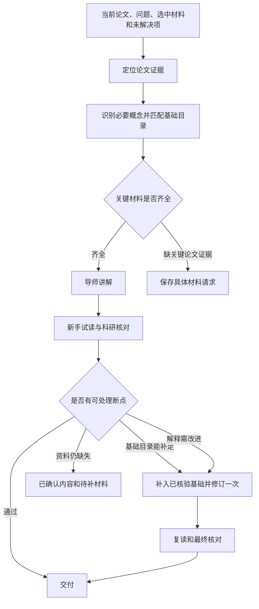

# 基础资料迁移与四场景验证：落地方案

版本：v0.1 · 日期：2026-10-04 · 实现基线：`7095a96`

状态：本文件保留实施前规格；实现与实际验证见[实施与验收](基础资料迁移与四场景验证_验收.md)。以下“拟／待”描述原计划，不代表最新验收结论。

依据：[主助手多智能体落地方案](主助手多智能体_效率成本效果落地方案.md)与[后端优化验收](主助手后端优化验收.md)。本方案落实下一步的两项工作：补足可迁移的基础资料流程，以及验证四个真实使用场景。主对话前端接入留到这两项完成后另行安排。

## 1. 要做成什么

助手根据当前论文、当前问题和理解断点，组织“论文证据＋必要基础”进行讲解。换论文时重新取得这篇论文的证据；遇到相同概念时复用有出处的基础条目。遇到资料库尚未覆盖的概念时，记录具体材料需求。

例如：

1. 阅读 Xu 2018 的 Figure 1 时，从其图注、结果和方法识别出 SA-βgal、p16INK4a、TAF 等需要解释的概念。
2. 给这些概念匹配独立的基础条目，解释“是什么、怎样形成读数、能支持什么判断”，并保留各自来源。
3. 换到 Hewitt 2012 时，重新绑定 Hewitt 的图件、图注和方法；遇到 TAF 时复用同一基础条目。
4. Hewitt 的细胞、处理条件、图号、样本量与结论均依据 Hewitt 原文核对。Xu 中的实验条件不进入这次讲解。

**这里迁移的是资料组织和教学流程。** 一篇论文提供具体研究证据，通用原理来自独立、可核查的资料。首批用衰老标记验证这套流程，后续新增主题通过登记条目和别名接入。

本轮完成后应具备三种结果：材料完整时给出可定位的讲解；必要基础可以从资料库补足时完成有界修订；材料仍缺失时交付已确认部分，并写出缺什么、用于回答哪一个问题。

## 2. 当前实现留下的问题

| 位置                                   | 当前行为                                                                | 本轮改造目标                                                   |
| -------------------------------------- | ----------------------------------------------------------------------- | -------------------------------------------------------------- |
| `server/assistant.ts`                  | 从示例包追加 PCR／流式基础；Figure 1 自动选材含 Xu 固定来源 ID          | 独立基础资料目录；依据当前资料的图号、位置和主题选材           |
| `server/materials.ts`                  | 超额选材优先级包含 Xu ID；`figureOneEvidence()` 为 Xu 定位固定段落      | 通用选材逻辑独立；Xu 固定提取仅作为示例适配和回归资料          |
| `server/pdf.ts`、`server/sample.ts`    | 上传 PDF 按页提取；示例有额外原图和方法整理                             | 为任意论文登记可定位的目标图、结果和方法；定位失败进入材料请求 |
| `server/orchestrator.ts`               | 缺资料能够报告，但未实现通用基础补入；`insufficient` 断点本身不触发修订 | 匹配到有效基础后，相关断点可触发剩余的一次修订                 |
| `shared/types.ts`、`server/schemas.ts` | 来源能区分 paper／foundation，缺条目版本、适用范围和核验记录            | 增加可追踪的基础条目、材料需求及任务资料快照                   |
| `server/cache.ts`、`cacheKey()`        | 对传入来源、规则等计算哈希                                              | 基础版本、选材规则和实际资料包变化均使缓存失效                 |
| `scripts/assistant-check.ts`           | 一次 Xu 组合任务，尚有两项逻辑材料缺口                                  | 保留原记录，新增迁移、跨轮和组合场景的真实验收                 |

已有三角色、调用账本、会话持久化、取消、完整 PPT 试读继续作为执行基础。上次 34 项工程测试通过，且一次真实组合流程完成；SA-βgal／p16INK4a 和 TAF 的基础解释尚未补齐。该结果只能作为工程基线。

## 3. 资料分成两层，按任务组合

### 3.1 论文证据层

每条论文证据绑定 `paperId`、论文版本、来源 ID 和原文位置。至少支持目标图的原图与完整图注、对应 Results、相关 Methods。保留原文、PDF 实际页码或网页章节；切出的段落记录字符范围，图像记录所在页或圈选区域。

选择顺序：用户明确选中的材料 → 当前图号及关联段落 → 可定位的相关方法。图号按完整编号匹配，Figure 1 不匹配 Figure 10。人工圈选资料依据独立图注确认目标；无法确定时提出具体澄清。

通用选材先按章节、图号引用和主题词建立候选，再检查证据是否齐全。关键词评分只帮助定位，不能证明某段方法适用于某个面板。若无法可靠建立关联，请用户补充方法段或记录待补项；不自动把论文前几页当作充分证据。

保留 Xu 的已定位片段作为示例资料。生产选择逻辑不能依赖 `xu-fig1-results`、`xu-fig1-methods` 等特定论文 ID；换论文测试必须走通用路径。

### 3.2 通用基础层

基础条目独立于 `PaperBundle` 保存，示例包和运行服务引用同一目录。现有 PCR／qPCR／流式条目迁入目录，保留兼容 ID；新增概念通过条目注册接入。

条目应包含以下字段，具体 TypeScript 名称在实现中统一：

| 字段                      | 作用                                                           |
| ------------------------- | -------------------------------------------------------------- |
| `id`、`version`、内容哈希 | 稳定标识、版本更新和缓存失效                                   |
| `concepts`、`aliases`     | 规范概念与中英文／缩写写法，例如 TAF、telomere-associated foci |
| `prerequisites`           | 必要前置概念；只加载任务需要的依赖，并检测循环依赖             |
| `text`、`claims`          | 短解释，以及各条事实与出处的对应关系                           |
| `scope`、`limitations`    | 适用对象、读数含义和解释边界                                   |
| `references`              | 原始题名、DOI／PMID、URL、章节／图号或页码                     |
| `verification`            | 核验日期、已读范围、支持的事实与状态                           |

条目状态为候选、可用或停用。可用状态要求正文或明确的已读摘要足以支持所登记的事实；只核对题录的条目保持候选。摘要支持的范围写明为摘要，具体操作条件必须另查方法。现有 `verified` 字段保持兼容，新增核验记录表达实际阅读范围。

进入模型输入时转换成现有 `Source(kind="foundation")`，保留条目引用和版本。导师与核对角色取得基础资料；模拟新手继续只取得学习者可见内容，维持角色隔离。

### 3.3 首批来源与条目

| 基础主题        | 拟覆盖范围                                                 | 首批来源及当前状态                                                                                                                                                                                                                        |
| --------------- | ---------------------------------------------------------- | ----------------------------------------------------------------------------------------------------------------------------------------------------------------------------------------------------------------------------------------- |
| SA-βgal         | 缩写、酶活读数、与细胞衰老的联系及解释边界                 | Lee et al., Aging Cell 2006，DOI `10.1111/j.1474-9726.2006.00199.x`，[PMID 16626397](https://pubmed.ncbi.nlm.nih.gov/16626397/)；已查阅 PubMed 摘要，条目待编写与逐项核验                                                                 |
| p16INK4a        | 细胞周期抑制相关原理、表达读数与功能的区别、情境限制       | Stein et al., Molecular and Cellular Biology 1999，DOI `10.1128/MCB.19.3.2109`，[PMID 10022898](https://pubmed.ncbi.nlm.nih.gov/10022898/)／[PMC84004](https://pmc.ncbi.nlm.nih.gov/articles/PMC84004/)；已查阅摘要，方法与拟用事实待核验 |
| TAF             | 全称、DNA 损伤信号与端粒信号的共定位、读数与结论之间的边界 | Hewitt et al., Nature Communications 2012，DOI `10.1038/ncomms1708`，[PMID 22426229](https://pubmed.ncbi.nlm.nih.gov/22426229/)；已查阅摘要与 Figure 1 图注，基础条目和正文快照待整理                                                     |
| PCR／qPCR／流式 | 保留当前基础课程，补齐版本与核验范围                       | 沿用[现有来源记录](参考来源与复用记录.md)，迁入目录时逐条检查链接与事实对应关系                                                                                                                                                           |

上述为首批资料范围；每项基础事实应在自己的证据范围内表达。例如，Lee 的摘要提供了衰老发生但 SA-βgal 缺失的实验依据，适合用来解释该读数的局限；不能据其摘要推断 Xu 的具体染色条件。[Lee et al.](https://pubmed.ncbi.nlm.nih.gov/16626397/)

文献检索采用 `nature-academic-search` 的来源核验流程。本次环境未提供该技能列出的学术 MCP，使用 PubMed 网页读取；PMC3292717 全文页返回访问验证页面，正文尚未完成读取。实现时从可访问的合法开放全文或用户提供正文补齐快照，成功读取并校验后再冻结材料。全文和图像保持本地保存，登记必要题录、短摘要及定位信息。

## 4. 一次请求怎样执行

### 4.1 讲解前补资料

从当前问题、选定图注、相关段落及当前未解决项提取概念。已登记的概念使用别名、规范写法与必要依赖匹配；泛化含糊缩写要求上下文支持。未知概念保存为候选需求。

该步骤使用本地资料匹配，不新增默认模型调用。明确请求保持规则路由；需要语义规划时沿用一次主助手规划。规划只能选择已登记来源，不能宣称新来源已被核验。

选材优先保留用户明确的目标、完整图注和关键论文证据，随后加入必要基础。去重后的正文与基础合计仍不超过 20,000 字符；来源目录及图注额外输入字符另行记账。超过额度时缩小问题或请求更准确的段落，禁止静默截去关键图注与方法。

### 4.2 首轮发现断点后补资料

根据新手的 `missingConcept` 与核对的具体建议，再查一次本地目录：

- 匹配到尚未提供的可用条目：保存补入记录，更新任务资料快照，在剩余的一次修订中解释断点，再复读和核对。
- 资料已经提供但解释不足：改写解释，保留原断点 ID。
- 没有可用资料、概念存在歧义或剩余额度不足：保留待处理问题，写出具体所需资料，不启动额外生成循环。

同一条目不重复补入；依赖展开有界且无环。首次补入遇到 `insufficient` 断点时，应检查能否修订，避免当前只因状态标为材料不足而跳过补讲的行为。

本轮运行服务只消费已核验目录和用户材料。新增主题的外部检索、事实核验与条目登记属于资料准备流程；完成后用一个明确的新请求继续。任意陌生主题的自动联网检索留待另行设计。

### 4.3 材料需求与溯源

材料需求至少记录：原断点 ID、概念、缺失原因、要回答的问题、所需材料类型、当前论文与来源版本、已匹配条目、状态。区别“缺通用定义”“缺论文具体方法”“缺图像／图注”，使下一次补入可直接回应原问题。

每次角色调用记录当时资料哈希，原输入保持不变。最终任务保存实际使用的来源、条目版本、补入原因与核验记录。论文版本和基础目录版本分别记录，最终资料包有自己的内容哈希。

## 5. 换论文、追问与缓存

| 操作                   | 论文证据                           | 通用基础                       | 学习上下文与缓存                                         |
| ---------------------- | ---------------------------------- | ------------------------------ | -------------------------------------------------------- |
| 同论文继续追问         | 继承上一单元证据并按问题缩小范围   | 按断点补入需要的条目           | 保留相关摘要、原断点 ID；解释应回应追问                  |
| 换图／换段落           | 重新选择当前目标的材料             | 按新目标匹配                   | 不把上一图的分组、数值和结论当作当前事实                 |
| 换论文                 | 清除旧论文证据绑定，取得新论文材料 | 全局目录保留，按新任务重新匹配 | 维持当前清理旧教学摘要的行为；不由复用资料推断用户已掌握 |
| 独立问方法             | 无须论文证据                       | 从方法主题选择基础条目         | 不默认附加 Xu 论文；缺方法名称则澄清                     |
| 基础条目或选材规则更新 | 当前论文快照保持可追踪             | 使用新版本                     | 内容、版本和规则进入缓存键，旧答案不命中                 |

交付内容继续区分 paper、foundation 和 interpretation。论文事实段必须引用当前论文材料，基础段必须引用适用的基础材料；混合推理明确标明原理与具体观察的出处。程序检查来源身份与引用类型，核对角色检查语义支持程度。

任务开始前固定的资料包可以使用精确结果缓存。若任务中途新增基础资料，首版实现保存完整结果但不发布答案缓存，避免把新材料生成的答案登记到旧键；后续请求在预处理时绑定完整资料后才具备缓存资格。原有“未解决项不缓存”规则继续生效。

导出 PPT 使用最终已核对资料快照，不能只比较论文版本而忽略基础资料变化。每页引用须能回到该次运行实际使用的来源。

## 6. 四个真实场景如何验收

先运行确定性工程检查，再冻结真实材料、问题、画像、规则、模型设置与内容条件。使用现有 GPT-6.1 Sol、low、Codex app-server、独立角色会话，保持同一条件记录。

### 6.1 固定材料

- **论文 A：Xu 2018**，DOI `10.1038/s41591-018-0092-9`。沿用本机正文，冻结 Figure 1 原图／完整图注、对应 Results 和相关 Methods，保留文件哈希与实际页序。
- **论文 B：Hewitt 2012**，DOI `10.1038/ncomms1708`。拟固定 Figure 1、对应结果和方法；用于验证 TAF 概念复用及论文证据替换。PubMed 已提供 Figure 1 图注，真实验收还需合法正文和原图快照。[Hewitt et al.](https://pubmed.ncbi.nlm.nih.gov/22426229/)
- **基础目录**：本轮登记的 SA-βgal、p16INK4a、TAF 及现有 PCR／qPCR／流式条目，逐条冻结内容与核验范围。

论文 B 先做身份、页码、图注和方法检查。资料获取或定位失败时标记“材料未就绪”，完成其他可执行检查；不得以摘要或生成图代替真实图件并宣称迁移验收通过。

### 6.2 问题与通过条件

| 场景                    | 实跑操作                                                                                                                                  | 必须通过的条件                                                                                                                 |
| ----------------------- | ----------------------------------------------------------------------------------------------------------------------------------------- | ------------------------------------------------------------------------------------------------------------------------------ |
| S1 连续追问             | A 中先讲 Figure 1 的功能比较与对照；同会话追问“还是没懂：SA-βgal、p16INK4a、TAF 分别测到了什么？为什么单靠一个指标不能把衰老判断讲完整？” | 正确继承当前论文及上一单元；补入适用基础；具体解释三个读数及其边界；回应追问并改变解释；原问题 ID 可追踪                       |
| S2 换论文读图           | 在上述会话切换到 B，请求“读懂这篇论文 Figure 1，重点解释 TAF 的读数与作者怎样支持其持续存在”                                              | 最终 paper 来源全部属于 B；TAF 基础条目可复用；图像、图注及方法来自 B；清除 A 的分组、数值、旧摘要和待处理绑定；新结论有新证据 |
| S3 独立方法             | 新建无论文绑定会话：“qPCR 的荧光怎样变成 Ct？为什么起始模板多通常较早过阈值，无模板对照又检查什么？”                                      | 方法规则路由，规划调用为 0；不附加 A／B 论文证据；解释扩增、荧光、阈值和 NTC 的衔接；说明比较条件、核酸信号与蛋白功能的区别    |
| S4 读图＋方法＋三页汇报 | A：“读懂 Figure 1，解释相关方法，整理成三页汇报；重点 d–f，k–m 解释测量含义与推理范围”                                                    | 一个组合任务组；三页、逐页讲稿、原图与来源齐全；新手实际收到完整汇报；基础读数解释不再停留在缩写；文件结构及内容条件均通过     |

新手没有提出断点不等于自动通过。每例执行独立的内容 rubric：记录具体段落／原句、来源 ID 和依据。缺必要解释、来源不足、仅出现关键词或评价未完成，均不能记为内容通过。已解决项保留修订前后的证据；资料不足项继续列出。

四个场景属于本轮开发验收；不能写作四个全新的留出案例。现有留出条件与参考答案保持隔离，后续另补陌生概念／图形类型作为留出材料。

### 6.3 批次与调用预算

S1 包含建立上下文和追问两个真实轮次。因此四个场景需要至少五个新生成轮次，前置轮次也计入账本。

| 批次 | 轮次                                 |                                  最坏预留 | 交付                         |
| ---- | ------------------------------------ | ----------------------------------------: | ---------------------------- |
| A    | S1 前置、S1 追问、S2 换论文，共 3 轮 | 每轮最多 7 次产品生成＋1 次评价，共 24 次 | 连续会话与跨论文来源隔离记录 |
| B    | S3 独立方法、S4 三页汇报，共 2 轮    |                   每轮最多 7＋1，共 16 次 | 独立课程、组合产物及内容报告 |

每批保持至多 4 个生成轮次、32 次调用。明确任务通常最多 6 次产品生成＋1 次评价；需要规划时最多 7＋1。上述两个批次最坏合计 40 次，按实际记录结算；不隐藏前置轮次、失败或额外评价调用。

产品请求维持 480 秒总截止时间；评价属于开发侧，使用单独的截止时间和预算记录，产品已完成后仍可按剩余开发额度执行。禁止直接延长已结束的产品请求。若现有评价账本只允许总计 7 次，应先修正含规划时的 8 次开发计数与截止时间合同。

候选真实验收跳过答案缓存，保留材料预处理缓存。之前的 Xu 实跑缺少本轮完整基础，只能作历史参照；不得拿它与新资料包直接计算同条件质量或性能提升。需要性能比较时另设冻结条件的基线批次。

## 7. 实现落点与顺序

| 步骤              | 拟更改位置                                                                 | 完成标志                                                                                                   |
| ----------------- | -------------------------------------------------------------------------- | ---------------------------------------------------------------------------------------------------------- |
| 1. 登记基础目录   | 新增 `server/foundations.ts` 与基础资料数据文件；调整 `examples/bundle.ts` | 基础脱离示例包；旧 ID 兼容；别名、依赖、范围和核验记录齐全                                                 |
| 2. 通用选材       | `server/materials.ts`、`server/assistant.ts`；按需更新 PDF 登记字段        | 无论文 ID 特判；不同图号精确匹配；原文可定位；超额或缺材料有明确结果                                       |
| 3. 断点补入与溯源 | `server/orchestrator.ts`、types、schemas、shared／新手／核对规则           | 有来源的补入进入一次修订；缺资料保持待处理；各阶段资料快照可回查                                           |
| 4. 会话与缓存     | assistant、cache、来源校验及导出路径                                       | 换论文隔离；基础版本变更失效；中途补入不发布旧键缓存；导出使用最终快照                                     |
| 5. 工程验证       | 新增资料迁移测试；扩展现有 assistant／core 检查                            | 注册新主题无须改路由代码；未知主题不默认转 PCR；缺图、错误图号、歧义缩写、依赖循环、过期缓存均得到预期处理 |
| 6. 真实验证       | 新增四场景脚本与固定开发案例；按需修正 evaluation 账本                     | 两批实跑，保存来源、角色输入、rubric、调用、耗时及 PPTX 结构检查                                           |
| 7. 验收与提交     | 新增验收报告；更新原验收文档与 README 的实现状态                           | 区分完成／待处理／失败；审查差异、验证并在 main 提交，报告哈希                                             |

实现以现有 TypeScript 状态机和 provider 为基础。基础目录入口先由本地登记和开发脚本维护，旧任务及会话接口保持兼容；本轮无需新增前端资料管理页面。字段新增采用兼容读取，历史任务维持其原始来源版本。

## 8. 验证与最终交付

工程验证至少覆盖：

1. 同一基础条目在两个不同论文 ID 的任务中复用，各任务论文引用仍隔离。
2. 注册一个额外主题后可以匹配；未登记的方法进入澄清／材料请求。
3. 不同图号、手动图件和缺图注的处理；材料限额下保留关键证据。
4. 断点在有基础时修订、无基础时保留；最多一次修订，取消和持久化失败仍能停止调用。
5. 基础内容、版本和选材规则变化使缓存失效；旧来源不能通过当前论文事实校验。
6. 新手输入隔离、整份汇报试读、逐页引用、三页 PPTX 及 notes／图像结构。

运行 `npm run check`，按变更范围执行接口／浏览器兼容检查；前端未改不新增前端功能验收。真实内容验证按第 6 节执行，不能以确定性测试替代。

最终交付包括：可迁移的基础目录与选材实现、已核验条目与来源清单、四场景逐项验收报告、真实任务与文件索引、实际调用／token／耗时及未解决项、Git 提交哈希。原文、图片和运行产物留在既有忽略目录，源码与必要题录／短摘要进入提交。

完成判定：第 1 项以通用流程、基础来源、未知概念处理与跨论文隔离通过为准；第 2 项以四场景的工程和内容条件通过为准。任一场景未通过，应说明具体缺口并继续修正，不将其计为完成。两项完成后，再安排主对话前端接入；连接复用、检查并行与长任务保持原 P2 范围。
