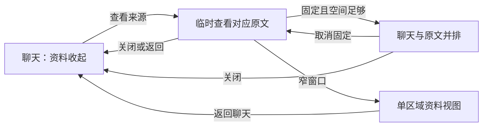

# 研究工作台第三轮：前端简化落地方案

版本：v1.1 · 日期：2026-10-06 · 文档基线：`9c43fa9` · 功能基线：`e451f38`。

v1.1 补充用户关于原文乱码、图件模糊及功能堆砌的反馈：按论文助手定位收窄范围，以聊天讲解、原论文核对和清晰看图为核心；复杂阅读器、自动分图与汇报扩建暂缓。本次仍为文档修订，以下改版能力均待实施。

本轮交付完整改版文档，前端实施与新一轮用户试用尚未开始。方案承接[设计学习与体验依据](研究工作台前端简化_设计学习与体验依据.md)，补充[第二轮落地方案](研究工作台第二轮优化_落地方案.md)。界面布局与操作位置以本方案为后续依据；单论文主聊天、附件检查、并行调度、证据边界及版本能力继续沿用第二轮安排。[第二轮 BCD 验收](研究工作台第二轮BCD阶段_实施验收.md)记录已交付的功能，不作为本轮改版验收。

## 1. 改版目标与优先级

用户明确反馈：界面太乱，希望简洁、导向清晰；希望利用右键等方式展开或选择；聊天区域被其他区域挤占；提取原文难以阅读，讲图时图片过小或模糊，无法对照论文理解。

本轮以连续阅读和提问为主要任务，按以下顺序落实：

1. **聊天空间与材料可读性**：聊天获得主要宽度与高度；查原文直接读原始 PDF，讲图能辨认目标细节，阅读区域随任务展开。
2. **操作层级**：主动作直接可见，对象操作通过右键、更多按钮、选区浮条出现。
3. **阅读连续性**：查看依据、返回回答、切换论文和恢复草稿都有清楚的上下文。
4. **一致且克制的展示**：统一核心流程的字体、间距和状态；汇报等辅助能力退到次级入口。

用户应随时能辨认当前论文、当前操作对象、任务状态和下一步。用户进一步明确：已有功能要批判审查，做得好的保留，不行的删减或优化。本轮按任务价值与实际质量取舍，保留有效流程和用户内容。

每个展示区域都要说明它帮助用户完成什么任务，并用实际材料验证。提取字符、缓存截图、模型输入和运行记录需要经过适合阅读的展示处理。无法帮助阅读的乱码长文、缩小整页图、无目标的原始日志退出默认视图；有明确用途的摘录、图注和状态保留。内容不可用时说明原因并给出恢复入口，不用空壳卡片表示功能已完成。

### 1.1 功能取舍：做好论文助手的核心任务

核心任务是“围绕当前论文连续提问，获得有依据的讲解，随时核对原论文和正在讲的图”。新增功能必须能解决这一过程中的具体障碍，并具备可用的最小实现和对应验收。功能数量、入口齐全和演示页丰富不作为完成指标。

| 取舍               | 本轮安排                                                                                 | 理由                                                       |
| ------------------ | ---------------------------------------------------------------------------------------- | ---------------------------------------------------------- |
| 必做               | 聊天空间、自由提问与连续追问、清楚的来源关系、任务取消和失败恢复                         | 用户的主任务，需要稳定且可理解                             |
| 必做               | 打开正确原 PDF 页、必要缩放与宽幅查看、清晰看图和完整图注、返回原回答                    | 讲解需要可核对、可辨认的材料                               |
| 合并与撤下劣质展示 | 默认提取长文区改为原 PDF；逐段按钮合并；整页低清图卡改为原页入口；合并重复标题与建议阵列 | 保留提取、追问和来源能力，改善用户真正看到的内容           |
| 保留并检验         | 实际选区引用、按论文恢复草稿、笔记收藏、等待／取消、PPT 按页修改与版本恢复               | 已有工程验收，继续验证其对核心任务的帮助和入口可发现性     |
| 收敛次级入口       | 论文／课题管理、设置、个人记录、已有 PPT                                                 | 复用现有能力，按对象或菜单提供                             |
| 暂缓               | 自动识别分图与复杂裁剪、OCR、翻译对照、完整 PDF 注释系统、定制阅读路线                   | 独立能力与质量成本较大，当前可通过原页和现有追问完成主任务 |
| 暂缓               | PPT 工作区全面重做、新版笔记／知识库、更多管理页面和额外生成建议                         | 先验证核心助手可用，再依据实际需求决定                     |

次级能力出现明显质量问题时修复必要缺陷；新能力不为展示完整性而上线。已有低清图不能作为合格讲解材料，优先返回可读原页；原件也无法读清时明确补图要求。每次交付一个能完整使用的核心流程，再决定是否增加能力。

### 1.2 现有功能逐项审查与处理决定

下表依据当前代码、既有截图及用户反馈形成判断；“工程可运行”和“体验值得保留”分别评估。尚无本轮真人试用，不能凭实现完成就判定功能优秀。收起入口不删除能力，撤下劣质展示不删除材料；需要永久移除业务能力时另列迁移与影响，当前方案没有删除用户数据的任务。

| 现有功能                           | 价值与当前问题                                                 | 决定及本轮处理                                                                                 |
| ---------------------------------- | -------------------------------------------------------------- | ---------------------------------------------------------------------------------------------- |
| 单论文主聊天与连续追问             | 符合助手定位；顶部重复问题、固定区域压缩正文                   | **保留并优先优化**：一条身份栏、足够正文空间、紧凑输入                                         |
| 实际文字选区引用、讲解深度         | 能精确表达哪里不懂；逐段“追问”和多组深度按钮重复               | **保留能力、合并入口**：选区浮条和回答菜单，完整引用保持                                       |
| 来源引用与证据边界                 | 帮助核对；长来源按钮反复占位，原文视图质量不足                 | **保留并修复**：轻量来源标签，直接到原 PDF 已知页                                              |
| 提取原文长列表                     | 对后台检索有用，乱序文字不适合通读                             | **撤下默认展示**：保留后台提取，仅展示有用的短摘录／图注                                       |
| 固定比例整页图卡                   | 可记录来源页，但无法承担细节讲解                               | **替换劣质展示**：合格图像可点开，只有整页时打开原 PDF；低清缓存留作内部用途                   |
| 图片附件与单项检查                 | 支持用户带图提问；展示复用压缩图，清晰度可能不足               | **保留并修复**：原件和模型图分开，失败项可就地补图／重试                                       |
| 等待、停止、取消及异步归属         | 让用户控制任务并避免串论文；状态易在多处重复                   | **保留**：关键控制在所属消息附近，重复状态收敛                                                 |
| 问题、引用、附件草稿与阅读位置恢复 | 连续工作必需，减少误丢内容                                     | **保留**：改版不改所属论文，迁移和返回继续验收                                                 |
| 阅读起点、阅读路线、下一步建议     | 可帮助起步；多套建议重复，自动整理还增加等待与调用             | **合并并减量**：空聊天一个起始问题，更多建议按需；主动整理保留，默认自动整理改为可选择的偏好   |
| 笔记、收藏                         | 可保存重要解释；收藏与保存按钮每条常驻                         | **保留并收敛**：回答菜单中明确“收藏”和“保存笔记”，不新建知识库                                 |
| “仍不理解／我已理解”反馈           | 用户主动标记有意义，不能证明实际掌握；每条常驻会干扰阅读       | **降级为可选操作**：保留历史和反馈入口，移入回答菜单，不扩建理解评分或进度体系                 |
| 课题、论文管理与讨论历史           | 材料多时有用；管理工具栏和最近讨论重复占位                     | **保留并简化**：对象菜单管理，最近讨论按需展开，主聊天优先                                     |
| PPT 按页修改、保存版本、恢复与导出 | 与科研汇报目标相关，已有工程检查；版本、预览、编辑并铺造成拥挤 | **保留并做必要优化**：次级入口、编辑区按需收起、版本列表紧凑；保留版本语义和导出，全面改造暂缓 |
| 设置、个人记录、核对与运行细节     | 配置和回看有用，内部 ID／日志不帮助日常阅读                    | **保留必要入口，撤下无用展示**：设置集中；内部诊断退出主界面，原有记录仍可回看                 |

审查依据：[聊天与操作](../app/research-discussion.tsx)、[主工作区与建议](../app/research-workspace.tsx)、[原文](../app/research-reading.tsx)、[PDF](../app/research-pdf.tsx)、[附件](../server/attachments.ts)、[PPT](../app/research-ppt.tsx)、[第二轮 BCD 工程验收](研究工作台第二轮BCD阶段_实施验收.md)。处理决定是本轮待实施安排，不能当作已完成改造。

## 2. 设计依据如何转为实施规则

| 依据                                                                                                                                                            | 本项目采用的规则                                                             |
| --------------------------------------------------------------------------------------------------------------------------------------------------------------- | ---------------------------------------------------------------------------- |
| [Design Council](https://www.designcouncil.org.uk/resources/framework-for-innovation/)、[IDEO](https://designthinking.ideo.com/introduction)                    | 从用户任务和中断点定义问题，先比较原型，再验证与迭代                         |
| [NN/G 渐进式披露](https://www.nngroup.com/articles/progressive-disclosure/)                                                                                     | 管理与高级选项按需展开；经常共同使用的内容允许同屏；阅读路线可跳过           |
| [Fluent 2 布局](https://fluent2.microsoft.design/layout)、[Material 3](https://m3.material.io/foundations/layout/canonical-examples/overview)                   | 明确主区域和支持区域，利用空间和间距建立主次，按容器空间适配                 |
| [Fluent 2 抽屉](https://fluent2.microsoft.design/components/web/react/core/drawer/usage)                                                                        | 区分临时查看与固定对照，控制遮挡和阻断，避免连续叠加面板                     |
| [Apple HIG](https://developer.apple.com/design/human-interface-guidelines/context-menus)、[W3C 菜单模式](https://www.w3.org/WAI/ARIA/apg/patterns/menu-button/) | 对象菜单简短且相关，有常规入口和键盘操作；菜单动作一致                       |
| [GOV.UK 可用性测试](https://www.gov.uk/service-manual/user-research/using-moderated-usability-testing)                                                          | 让真实或潜在用户完成任务，观察发现入口、误操作与恢复，任务措辞不提示操作方式 |
| [Mozilla PDF.js 渲染示例](https://mozilla.github.io/pdf.js/examples/)                                                                                           | 根据目标缩放重新渲染 PDF，并处理屏幕像素比；项目另行验证细节可读性与资源开销 |

下文尺寸、菜单项数和检查目标是本项目的初始设计值；设计系统没有规定本项目必须使用这些值。原型检验后更新文档并记录原因。

## 3. 信息架构与默认页面

### 3.1 研究模式

| 区域     | 默认内容                                   | 次要内容入口                                   |
| -------- | ------------------------------------------ | ---------------------------------------------- |
| 左侧导航 | 导入、搜索、课题下的论文列表、当前论文标识 | 论文／课题菜单；折叠的最近讨论；设置与个人记录 |
| 顶栏     | 当前论文名、资料入口、当前对象更多操作     | 汇报入口、题录、论文管理、讨论历史             |
| 中央聊天 | 用户问题、回答、轻量引用、局部任务状态     | 回答菜单、选区浮条、来源详情                   |
| 输入区   | 自由提问、一个附件入口、发送               | 附件类型菜单、长草稿展开                       |
| 支持面板 | 默认收起；打开时显示原文或笔记             | 完整来源、补正文、笔记管理                     |

顶部合并为一条工具行；完整用户问题保留在聊天消息中。论文名可截断，但能查看完整名称。讨论标题与论文身份分别保存，展示位置不重复铺满页面。

顶栏以当前论文身份和资料入口为主；已有“汇报”退到次级入口，带上当前论文和主聊天，不与提问竞争主要位置。首页无论文时提供导入和研究想法入口。

### 3.2 导航

导航展开默认 216px，初始可调整范围 200–280px。折叠为紧凑入口，保留展开按钮、导入和当前论文提示；完整论文列表通过导航抽屉恢复。

课题一级、论文二级，当前课题展开。其他课题的展开状态由用户控制并记忆；搜索时显示匹配项及归属。最近讨论默认收起，用于恢复近期工作，不重复作为第二套常驻论文列表。

课题与论文行的管理动作集中到一个更多入口。当前行、键盘聚焦和触屏场景有可见入口；鼠标右键提供相同动作。选中态只强调当前对象。

设置和个人记录保留稳定入口，窄屏时进入导航抽屉。历史讨论继续可回看，论文的主聊天仍是默认进入位置。

## 4. 聊天优先的布局规则

### 4.1 初始参数

| 项目         | 初始设计值                     | 行为                                               |
| ------------ | ------------------------------ | -------------------------------------------------- |
| 导航         | 默认 216px；展开范围 200–280px | 可折叠，可恢复；折叠态不占完整列表宽度             |
| 顶栏         | 约 52px                        | 常规窗口一行；窄屏保留身份和关键入口，其他进入菜单 |
| 聊天         | 使用剩余空间                   | 正文行宽与聊天容器宽度分别控制                     |
| 长回答正文   | 上限先试 820px，随容器缩小     | 用户消息、引用和浮条适配同一阅读区域               |
| 固定支持面板 | 默认 360px；调整范围 320–420px | 用于短摘录与定位；整页阅读和讲图有独立的展开视图   |
| 输入区       | 空输入先试约 104px             | 随内容增高；长输入支持展开，紧凑状态内部滚动       |

并排判断使用实际容器宽度：`聊天可用宽度 = 工作区宽度 − 当前导航占宽 − 支持面板占宽 − 分界占宽`。固定支持面板以聊天至少约 720px 为初始条件。这个条件仅决定桌面是否适合并排，不是窄屏聊天的最小宽度。

以 1440px 窗口、216px 导航和360px面板估算，聊天应仍有约840px；关闭面板后获得更宽区域。以上为布局预算，实施后测量实际尺寸与正文高度，不以计算代替截图验收。

### 4.2 空间变化的处理

- 宽度足够时，用户可以固定原文并排；关闭资料后立即还给聊天。
- 宽度不足时，以临时查看面板承接来源。用户主动固定时，可提示收起导航以便对照；满足空间条件后固定，不静默改变另一项用户设置。
- 已固定状态遇到窗口缩小，实际展示降级为临时查看或窄屏资料视图；记住固定偏好，空间恢复后按用户偏好恢复。资料位置与未保存内容保留。
- 手机与窄窗口采用单主区域，导航和资料按需进入；显示返回聊天入口。浏览器缩放和软键盘出现也按实际可用空间处理。
- 360px 面板不能作为整页 PDF 或多面板科研图的唯一阅读区域。“展开阅读／查看大图”进入宽幅资料视图，暂时使用工作区主要面积；返回时恢复聊天位置与原布局。用户主动展开才进入该状态，查看引用不会永久挤小聊天。
- 拖动分界不能把聊天压到桌面并排目标以下；越界时限制宽度或转为临时查看。保持键盘调整、上下限、重置和可恢复性。

输入区紧凑状态的最大占高先试聊天工作区的 28%；草稿更长时内部滚动或主动展开。附件、引用和错误提示出现后仍要保留足够的正文区域，紧凑状态不把历史回答完全推出窗口。

正文阅读上限用于控制长行；聊天容器仍使用剩余空间。输入区和回答的对齐关系保持一致，右侧关闭后不遗留空白占位。首版先做明确的关闭、临时查看和展开阅读；已有并排偏好继续兼容，新增精细分界定制不阻塞核心交付。

## 5. 原论文对照、图件讲解与材料质量

支持区域统一为“原文／笔记”两种内容，一次显示一种。面板有标题、固定／取消固定和关闭入口；内部自行滚动。

### 5.1 先读原始 PDF，按依据定位

“原文”默认打开上传的原始 PDF，保留论文的双栏排版、公式、图表与图注。点击回答来源时跳到真实已知页；只有坐标经验证时才高亮对应段落或图区。可在页旁显示短摘录帮助对照，但摘录不替代原页。面板保持论文名、来源类型和 PDF 实际页序；印刷页码另行标明，避免二者混用。

基础工具只保留翻页／页码、适合宽度、缩放、展开阅读和返回；打开原始 PDF 的入口可见。非核心题录、完整来源清单和补正文进入更多操作。本轮不建设书签、批注、翻译和多窗阅读器。论文页面保持原有背景和颜色，深色工作区不反转科研图的颜色或降低文字对比度。

缩放按目标比例重新渲染页面和同步文字层，支持滚动或拖动查看放大区域；不能只将旧 canvas 或低清截图用 CSS 拉大。用户连续缩放时取消过时渲染，按可见页加载并限制缓存与画布资源；资源不足时明确提示并保留原始文件阅读入口。具体缩放上限和像素预算在代表性论文与设备上测量。

临时宽幅阅读和固定对照共用来源状态；记住当前页、缩放和阅读位置。放大操作不能错位选区、丢失图注或把下一页引用留在上一页。打开原始 PDF 时尽可能带上已知页，现有材料身份保持可辨认。

### 5.2 提取文本只在适合阅读的场景出现

提取文本用于检索、引用定位和模型材料。默认页面取消逐页堆叠的大段提取文本；只有帮助核对当前回答的短摘录与图注才向用户展示，并带上来源与页码。本轮不新增全文文本模式来追求入口齐全。只做可核对的排版清理，保留科学符号、上下标、单位与实际引用内容；合并双栏、修复公式或翻译需有可靠依据。

文本出现明显乱序、重复页眉、乱码或公式损坏时，标明“文本提取异常，请查看原始 PDF”，停止将该文本呈现为完整可读原文。手动补正文是明确的修复入口，保存时记录来源与版本。PDF 加载失败不自动换成一长串提取字符。

扫描 PDF 即使没有可选文字，也应能阅读原页并放大。文字选择不可用时说明情况，保留页级引用；后续 OCR 的质量与定位须独立验证，本轮不承诺未实现的识别能力。没有原始 PDF 的历史材料可使用经过核对的结构化摘录，明确“仅有摘录”，提供补充原文件入口。

### 5.3 讲图使用目标图与足够清晰的细节

回答提到 Figure 2c 时，材料入口标明图号、真实已知分图和来源页；有合格图像时点图进入大图视图，没有则直接进入原 PDF 对应页。完整图注与讲解对应显示，支持必要的缩放、平移和返回原页。右键或更多提供相同的来源与图注动作。文字图注可折叠，图号和目标分图保持可见。

只有整页图像时，标明“图所在原页”，打开原页并提供放大；不能把整页缩成卡片后当作目标图。分图边界未验证时不自动宣称已定位 c 图。本轮先依赖原页缩放核对分图；已有可靠区域可复用，自动分图、区域编辑和新框选交互暂缓。

讲解区域需要保留分图标记、坐标轴、单位、图例、比例尺及必要统计标记。通过原页或大图局部放大，并能回到整图理解上下文；复用已有裁剪图时不能只留下曲线而移除解释它所需的轴和图例。表格、流程图、公式及补充材料图同样按实际阅读任务检查，不能统一压成小图片。

清晰度按用户能否读出讲解涉及的标签与数值验收。矢量 PDF 可按显示比例重新渲染；原图本身低清时，放大无法恢复缺失细节。此时标明质量不足，提供原论文或用户补充清晰图的入口；讲解注明受影响的细节，不据模糊标记补造数值。插值和生成式补图不能作为论文证据的清晰原图。

### 5.4 原件、显示图、缩略图与模型材料分开保存

| 材料层                 | 用途                           | 质量与来源约束                                               |
| ---------------------- | ------------------------------ | ------------------------------------------------------------ |
| 原始 PDF／原始上传图片 | 原论文对照、重新渲染、恢复质量 | 保留已接受原件的字节、身份和版本；可追溯到对应论文或附件     |
| 阅读与讲解显示图       | 大图、分图、图注对照、PPT 展示 | 根据当前显示面积与像素比生成，保留边界和来源；质量达标后使用 |
| 列表缩略图             | 导航、附件队列、页面列表       | 可压缩与缓存；点击后加载阅读资源，不复用为大图或汇报主图     |
| 模型输入图／拼图       | 附件检查和推理请求             | 沿用输入限额与压缩规则，与阅读资源分开；压缩不覆盖原件       |

当前代码的图件登记和示例使用 `scale: 1.3` 的整页缓存；附件最长边缩到 1800px 并保存 JPEG，原始上传字节尚未作为独立阅读资产保存；PDF 视图按容器宽度渲染，缺少主动缩放。固定比例与固定像素数都不能单独证明可读性。对应证据见[图件登记](../server/paper-assets.ts)、[示例图件](../server/sample.ts)、[附件保存](../server/attachments.ts)和[PDF 视图](../app/research-pdf.tsx)。

实施时只增加原件引用、实际像素尺寸和派生用途等必要元数据；先复用原 PDF 渲染与现有图像来源，不新建完整图件管理系统。缓存键区分原件版本、页、目标尺寸与渲染版本。已有 `source.image` 继续兼容，但不推定它就是高清原图；同一来源的不同派生图不改变证据身份。

旧材料按现有资产恢复：原始 PDF 存在则重新渲染；有可靠原图则重新派生；只剩压缩附件时标明原件缺失并允许补图。不能从旧缩略图反推原始细节，也不能静默替换历史证据或改变已保存 PPT 版本。新的原件保存遵守现有上传限制，历史恢复不发起模型调用。

### 5.5 查看与返回保持连续

来源展示区分论文事实、补充基础和用户截图观察。只有真实页码才显示“第 N 页”；无页码的附件显示其上传名称和来源身份。

临时查看优先采用不锁住聊天输入的非模态表面；明确关闭方式，避免遮住触发来源或关键回答。空间不足时使用单区域资料视图而非硬塞两栏。固定原文用于反复对照，避免每次点不同引用都重新打断布局。

记录打开来源前的消息和滚动位置。关闭面板或大图后回到原回答；固定面板时点击其他来源仅更新目标内容。只能返回已知页或现有来源片段时，界面按该定位层级表达。宽幅资料视图有稳定的返回入口，返回不重发问题。

面板切换与关闭保留笔记及补正文草稿；来源版本改变时提醒更新引用，不继续提交过期锚点。

## 6. 统一对象操作：右键、更多与浮条

### 6.1 动作清单

菜单围绕当前对象的常用操作。全局设置进入设置页；对象菜单不混入整站管理。

| 对象     | 主交互             | 菜单中的动作                                           |
| -------- | ------------------ | ------------------------------------------------------ |
| 论文     | 点击恢复主聊天     | 重命名、移动到课题、查看论文信息                       |
| 课题     | 展开／收起论文     | 讨论方向、重命名、归档；已归档课题提供恢复             |
| 完整回答 | 阅读与点击来源     | 复制、调整讲解、收藏、保存为笔记、理解反馈             |
| 文字选区 | 选区浮条           | 复制、解释选区、引用提问；选区来源可定位时提供查看来源 |
| 图片附件 | 点击查看预览       | 查看状态、补用途／单项重试；尚未发送时可移除           |
| 论文图件 | 点击查看大图或原页 | 查看完整图注、返回原论文页                             |
| 幻灯片   | 点击切换预览页     | 编辑这一页、提出修改要求、查看本页来源                 |

“调整讲解”可有一层子菜单：简单点、常规、详细点、从基础讲、重点解释机制。理解反馈提供既有的“仍不理解／我已理解”，不自动推断理解状态。

右键与更多按钮从同一动作注册表构造，使用相同对象 ID、可用条件和执行函数。打开菜单时记录当前对象，切换论文、版本或页面后关闭菜单，避免操作到后来选中的对象。

### 6.2 菜单行为

- 初始以 3–5 个相关动作组织菜单，最多一个子菜单层级。超出时先按任务重新分组，而不是持续追加。
- 菜单靠近触发对象，超出窗口时调整方向；外部点击和 Escape 关闭。只在支持对象上接管右键，空白区域、输入框保留浏览器行为。
- Enter／Space 可从更多按钮打开，方向键移动，Escape 返回合理焦点；可访问名称与展开状态完整。
- 上下文菜单只显示当前对象适用的动作；可见主按钮在暂不可用时保留状态与简短原因，例如未保存版本不能直接导出。
- 点击菜单“调整讲解／解释选区／引用提问”先形成可编辑的问题或引用，再由用户发送。打开菜单、移动焦点、悬停和选中文字均不触发模型请求。
- 收藏、笔记保存、重命名等明确的本地／后台动作可以直接执行并反馈；失败留在对应对象附近。

### 6.3 选区浮条

有可靠文字层的原文和已完成回答支持实际文字选区。浮条先显示“解释”“引用”“更多”，靠近选区并避开文字，重新选择后替换目标。点击浮条不因焦点转移丢失选区内容。扫描页或定位不可靠时保留明确的页级提问，不制造精确文字锚点。

来源归属、版本、回复 ID及现有长度校验继续使用。跨句与部分文字按实际选区处理；跨多个独立来源的选择需要拆分或明确提示，不默默截成另一段。

待发送引用在输入区上方显示短摘要、来源身份、查看和移除入口；摘要可收起，实际提交选区完整保留。解释深度对选区优先，否则使用上一轮完整问题及回答。

手机先保留系统文字选择和复制，再提供浮条及更多入口。文字区域不另外强制长按打开对象菜单；论文行、图片和幻灯片可通过明确的更多按钮操作。

## 7. 回答、输入与阅读引导

### 7.1 回答展示

正文按段落自然展开，减少重复边框和逐段按钮。来源改为局部编号或短标签，保留可点击关系；来源详情按需展开。

一条回答集中提供一个更多入口，鼠标悬停或键盘聚焦可显示轻量操作。触屏和辅助输入保持可发现、可访问的入口，不要求记住右键。

“已完成”弱化；等待、正在回答、缺材料和失败在对应轮次突出。取消等待、停止回答、编辑重发及必要的附件补充动作直接可见，不藏进多层菜单。

核对细节和术语释义可收起；影响当前结论的条件与证据边界保留在结论附近。长回答不通过默认截断关键内容来获得整洁。

讲图时，图卡放在相关解释附近，保持“讲哪张图／哪个分图”的关系；同一图不在每段重复贴出低清预览。长图注、来源详情和完整原页按需查看，大图入口直接可见。材料未达到展示要求时提示具体限制，不能用“已加载”替代可读性判断。

### 7.2 输入与附件

合并为一个“＋”入口，展开“添加 PDF”“添加图片”。拖入与粘贴图片继续可用，发送前显示文件名／缩略图与移除入口。

导航导入 PDF立即创建并进入对应论文主聊天；输入区的附件直到发送才上传。输入区选择 PDF后，就地显示“发送后进入这篇论文的聊天”，说明本次问题随文件带入；补图仍留在当前聊天。

输入区引用、附件和问题分别保留草稿。进入其他论文后恢复各自内容。附件检查只在发送后进行，单项失败仍按依赖程度处理，不新增自动模型调用。

快捷建议从常驻一排改为上下文的一条“接下来可以……”及更多入口。自由输入始终可用，用户写草稿时不覆盖问题。

### 7.3 空状态和路线

无论文时突出导入，并提供“讨论研究想法”的次入口。已导入且无聊天时呈现简短研究起点、一个具体起始问题及“更多问题”。点击建议先放入输入框，不直接发送。

研究起点沿用已实现的真实摘录、版本缓存、后台优先级和取消规则。默认先用一个静态起始问题帮助开始，整理阅读起点由用户主动触发；希望自动整理的用户可选择该偏好。已有缓存结果仍可查看；偏好缺失采用主动整理，已有明确偏好按迁移规则保留。不为菜单、路线或面板切换新增生成流程。

沿用已有简短起始问题，不扩建“研究问题／实验／结果／讨论”路线面板。用户更换目标后能继续自由提问。

## 8. 次级能力的保留与边界

本节记录已有能力的保留、必要优化和后续设计方向。PPT 的按页修改、版本恢复与导出继续可用；本轮收敛入口、按需编辑并修复明确缺陷，全面重做、精细版本视图和新设置／记录页暂缓。以下布局方向优先复用已有组件，超出必要优化的部分不作为本轮必须新增的功能。

### 8.1 PPT默认以预览为中心

左侧是当前汇报的页面列表，中央是预览。顶部给出汇报名称、版本选择、生成新汇报和导出；长名称的编辑进入更多菜单。讲稿与来源位于预览附近，可收起。

版本记录使用下拉或按需打开的列表，不与页面列表长时间上下并排堆叠。切换版本时明确保存版本及核对状态。

点击“编辑这一页”或缩略图菜单后才打开编辑区，提供手动编辑和自然语言修改。空间不够时编辑区使用独立视图，明确返回预览；保留当前页与草稿。编辑区不得将幻灯片预览挤成无法阅读的窄列。

保存与核对状态在当前页附近显示。关闭编辑不等于保存，草稿继续保留；主动放弃草稿需明确操作。导出仍绑定实际保存完成版本，未保存改动有明显提示，不把预览草稿当作已保存内容导出。

旧版本恢复继续创建新版本，单页修改隔离、取消、导出和论文来源归属沿用已有机制。

汇报中的科研图复用合格显示资产，列表缩略图单独派生。预览与导出都按幻灯片实际展示面积检查标签、分图和轴线；整图信息过密时拆成概览与分图讲解页，并保留来源与必要图例。保存版本绑定可持久读取的图像资产，导出不能依赖临时浏览器链接。旧版本保持原样，改善图件质量通过明确保存新版本完成。

### 8.2 设置与个人记录

设置集中管理学习背景、讲解偏好、模型连接检查和布局重置。偏好继续按聊天保存，生成期间修改不被任务完成覆盖。

个人记录保留收藏、主动反馈、待解决问题、编辑与回看。相关动作从回答菜单进入，回看仍返回原聊天或记录位置。

打开设置／个人记录时关闭临时菜单，避免多个表面叠加；关闭后恢复触发位置。PPT 和研究模式互切不丢草稿、页码和版本选择。

## 9. 状态、文案与视觉规则

| 情况                   | 展示位置和用户动作                         |
| ---------------------- | ------------------------------------------ |
| 论文解析／正文缺失     | 当前材料附近，提供重新上传或补正文         |
| 提取文字乱码／公式损坏 | 原页仍可读时直接使用 PDF，文本摘录标明异常 |
| 图件低清／原件缺失     | 图附近说明受影响细节，提供原页或补图入口   |
| PDF／大图加载失败      | 保留当前聊天，资料区域提供重试与原文件入口 |
| 回答等待／处理中       | 所属消息附近，提供取消等待／停止回答       |
| 图片用途不明／检查失败 | 对应附件附近，提供补用途／单项重试         |
| 来源版本变化           | 待发送引用附近，提示重新选择               |
| PPT未保存／保存核对中  | 当前页和编辑区附近，明确版本与导出可用性   |
| 操作保存成功           | 简短就地反馈，必要时短暂通知；不重复弹窗   |

统一深色背景与少量表面层次，主要动作和当前选择使用强调色。正文先试16px，辅助文字13–14px；长中文回答行距约1.75–1.9。以4px间距基础建立段落、操作和区域关系，实际触控目标单独验证。

普通文本链接和来源标签降低边框密度；区域分界视觉细淡，但拖动命中宽度保持可操作。状态同时有文字或图标表达，避免仅靠颜色。

提示说明当前状态和一个可执行的恢复动作，例如“这张图片尚未看清，请补充清晰版本”；不把内部阶段、调用预算或对象 ID当作主要界面说明。共享回答规则继续保持事实、来源和必要条件。

## 10. 状态持久化与旧设置迁移

持久化区分“用户偏好”与“当前实际展示”：固定偏好不等于窄屏一定展示并排。滚动和返回定位按论文／聊天保存；编辑状态按版本／页保存。

| 状态                                       | 范围和落地安排                                               |
| ------------------------------------------ | ------------------------------------------------------------ |
| 导航宽度／折叠、支持面板宽度、输入展开偏好 | 浏览器布局偏好，按新版本结构保存                             |
| 面板内容、来源目标、阅读位置               | 按现有论文／聊天位置恢复，扩展字段时保持旧接口兼容           |
| PDF 页码／缩放与当前图件目标               | 按论文和来源保存；失效目标返回已知原页                       |
| 是否自动整理阅读起点                       | 默认主动整理；保留明确偏好，服务端禁用自动整理时仍遵守该配置 |
| 临时菜单、浮条位置、临时遮挡状态           | 页面内状态，不在刷新后自动展开                               |
| 问题、实际引用、附件草稿                   | 保留现有按论文归属的存储键和 IndexedDB记录                   |
| PPT草稿、当前页、所选版本                  | 草稿沿用版本／页键；视图位置按论文／聊天保存                 |

新布局使用版本化存储，如 `research-layout-v2`。首次读取可迁移仍有效的导航宽度；旧阅读百分比和固定输入高度不机械映射为新布局。保留旧配置，不删除问题、引用、附件、笔记或PPT草稿。升级、字段异常、存储不可用时使用清楚的默认布局。

“恢复默认布局”只清理新布局偏好及相关展示偏好，保留业务内容。正文来源变化仍遵守现有锚点校验；切换论文时关闭旧菜单、清除瞬时选区并恢复该论文已保存的引用草稿。

模型任务继续归属于原论文和消息。布局、切换与菜单关闭不会取消已提交任务；取消只能由对应明确动作发起。异步保存结果更新原对象，并通过现有修订标识保护当前画面不被其他论文响应覆盖。

## 11. 实现范围与文件分工

| 位置                                                                                     | 主要变更                                                                   |
| ---------------------------------------------------------------------------------------- | -------------------------------------------------------------------------- |
| `app/research-workspace.tsx`                                                             | 顶栏合并、模式切换、支持面板状态与返回定位、草稿归属                       |
| `app/research-navigation.tsx`                                                            | 折叠导航、清晰论文层级、对象更多入口                                       |
| `app/research-layout.tsx`、`app/research-workspace.css`                                  | 容器空间判断、聊天优先、输入自适应、尺寸迁移和视觉规则                     |
| `app/research-discussion.tsx`、`app/research-selection.ts`                               | 轻量来源、回答动作、实际选区与浮条                                         |
| `app/research-reading.tsx`、`app/research-pdf.tsx`                                       | PDF 默认视图、宽幅阅读、缩放重绘、图注与已知来源页定位                     |
| `app/research-attachments.tsx`                                                           | 单一附件入口、紧凑预览、异常项就地操作                                     |
| `app/research-ppt.tsx`、`app/research-settings.tsx`                                      | 保留编辑／版本／偏好；必要的编辑区折叠、入口收敛与布局重置                 |
| 新增对象动作／菜单组件                                                                   | 同一动作清单供右键、更多、浮条及键盘使用                                   |
| 共用图件查看逻辑，必要时抽成组件                                                         | 讲解、资料与附件复用大图、缩放、图注和返回原页行为；避免独立开发多个阅读器 |
| `shared/types.ts`、`server/paper-assets.ts`、`server/sample.ts`、`server/attachments.ts` | 原件与派生图分工、质量元数据、旧资产恢复；保留模型输入限额                 |
| `server/index.ts`，必要时 `server/export.ts`                                             | 原件资产读取；已有导出确有图像质量缺陷时补修，复用所属对象校验             |
| `shared/workspace.ts`、`server/projects.ts`、`server/index.ts`                           | 仅在阅读／视图位置需要新增持久化字段时扩展并保持兼容                       |

前端操作优先复用已有重命名、归组、笔记、设置、附件、聊天及汇报接口。材料可读性涉及必要的原件保存、资产读取与派生渲染，列入本轮范围。新增状态和资产字段需列出默认值、迁移规则与校验；不重建模型调度和版本服务。本轮不增加数据删除入口或未经验证的格式能力。

文件清单是允许触及的位置，不要求每个位置都改造。先走通“提问→讲解→核对原页／看图→继续提问”，其余文件只有本次收敛入口或必要缺陷确实涉及时才修改。

## 12. 实施阶段与交付

| 阶段             | 工作                                                                                         | 完成标准                                                                                   |
| ---------------- | -------------------------------------------------------------------------------------------- | ------------------------------------------------------------------------------------------ |
| P0：阅读与布局   | 代表性真实论文原型；聊天优先、PDF 默认与宽幅阅读、可清晰讲图的资产路径、原件保存、输入自适应 | 原文能直接对照，多面板图能读出目标标签；验证三种面板状态和大图返回，记录聊天宽高与材料质量 |
| P1：对象操作     | 统一菜单、右键、更多、选区浮条、轻量来源                                                     | 主任务入口可发现；选区准确；键盘／触屏可完成；打开菜单零模型调用                           |
| P2：连续阅读     | 已知来源页定位、缩放与位置恢复、旧材料恢复和必要草稿迁移                                     | 查完来源可继续原回答；旧材料可恢复或明确补充；切换和刷新不丢归属、草稿或位置               |
| P3：收敛与修缺陷 | 核心视觉文案统一、次级入口收敛；已确认的 PPT 等材料质量缺陷按需修复                          | 主界面只承载核心任务，已有数据和次级能力可访问；不以辅助区全面重做作为交付条件             |
| P4：验收与修正   | 工程回归、固定内容比较、真实目标用户任务观察                                                 | 分别记录工程和用户结果，修正中断与不可发现的入口并复测                                     |

每阶段交付实现、对应验证与已知问题，按仓库要求在`main`提交，报告哈希；不捆绑不相关修改、不主动推送或重写历史。

## 13. 工程验收标准

| 编号 | 场景                                         | 验收要求                                                                                   |
| ---- | -------------------------------------------- | ------------------------------------------------------------------------------------------ |
| L1   | 1440px及更宽桌面默认打开                     | 聊天获得主要区域，右侧默认收起；顶栏无完整问题大标题和管理工具栏                           |
| L2   | 宽屏固定原文并调整分界                       | 满足约720px聊天并排目标，真实尺寸测量通过；不出现空白占位                                  |
| L3   | 1366、1280、1024、768、390px窗口及200%缩放   | 自适应为并排、临时查看或单主区域；无页面横向溢出，操作和返回可见                           |
| L4   | 长输入、引用和四项附件                       | 输入能滚动／展开、引用可移除、附件可查看；紧凑态仍能读历史回答                             |
| M1   | 论文、回答、选区、附件、幻灯片菜单           | 右键与更多动作一致，对象归属明确；越界定位、外部关闭、键盘和焦点恢复正确                   |
| M2   | 原文／回复部分文字与跨句选择                 | 浮条使用实际选区，移焦不丢引用；选择、菜单展开和建议预填不提交模型请求                     |
| R1   | 连续查看来源再关闭／返回                     | 到达正确片段或已知页，回到原消息和阅读位置；固定态不反复重排布局                           |
| R2   | A论文草稿→B论文→返回A→刷新                   | 问题、附件、引用与位置无串用；临时菜单不自动恢复                                           |
| R3   | 旧布局升级、损坏字段、重置                   | 新默认和兼容恢复正确，重置不删除业务草稿与记录                                             |
| Q1   | 双栏、公式、表格、扫描页及乱码提取结果       | 默认读原始 PDF；页面版式和科学符号保留；扫描页无文字层仍可读，异常摘录有说明               |
| Q2   | 窄面板查看整页→展开→放大→返回                | 放大重新渲染，文字层与选区同步；能读目标细节，返回保留页码与聊天位置，无页面横向溢出       |
| Q3   | 多分图、密集图注、轴单位、图例及比例尺       | 原页或大图可读讲解涉及的标签与数值；缩放保留必要上下文，无误标与关键裁切；不要求自动分图   |
| Q4   | 新上传清晰图、模型压缩图和列表缩略图         | 原件独立保留；讲解加载合格显示资产，模型限额不导致展示同步降质；所属论文与版本可追溯       |
| Q5   | 旧整页缓存、仅剩压缩附件、低清原件、加载失败 | 可用原 PDF 重新渲染；无法恢复时明确补充入口；不伪造细节、不静默退回乱码原文                |
| Q6   | 高频缩放、快速切页、不同像素比与大图         | 过时渲染不会覆盖当前页；资源占用受控，文字与定位不漂移；失败仍可返回聊天或原文件           |
| P1   | 本轮确有调整的 PPT 入口或编辑布局            | 页面和草稿保留，主要预览可读，保存状态明确；未改造部分沿用已有回归                         |
| P2   | PPT未保存、修改完成、恢复旧版与导出          | 导出绑定保存完成版本；其他页隔离与来源关系不受UI变化影响                                   |
| P3   | 本轮确有修复的科研图预览与导出文件           | 使用版本绑定的合格图像资产；按实际显示面积检查分图、轴和图注，关闭浏览器后导出仍能取得资产 |
| S1   | 等待、回答、附件失败及异步切换               | 继续遵守双任务、同论文顺序及局部取消，响应不覆盖其他论文                                   |
| K1   | 改版后选区引用、笔记收藏、PPT 按页修改与恢复 | 已有有效流程仍可完成，入口能找到；内容保留，核心精简不造成能力回退                         |
| K2   | 新默认阅读起点、主动整理和旧缓存／偏好       | 导入默认不新增整理调用；主动操作和自动偏好有效；旧结果与草稿不丢失                         |

相关改动运行类型检查、正式构建及必要回归。浏览器检查使用隔离数据目录、固定内容和`TUTOR_READING_GUIDES=manual`，避免界面回归产生自动云端调用；保留第二轮核心能力检查。

新增测试重点放在布局状态切换、对象动作归属、缩放与选区同步、原件与派生图归属、旧材料恢复、焦点和保存版本等真实风险；纯样式改动使用截图与尺寸检查。材料检查使用真实双栏论文、公式页、扫描页、密集多面板图和低清反例，记录原件及显示像素尺寸、窗口与缩放状态，并人工核读指定标签／单位，不能只检查图片成功加载。模拟响应只验证工程行为。确有新模型行为才补充限次真实样本，不重复消耗额度验证菜单外观。

## 14. 用户体验验收

使用同一材料与代表性内容比较当前界面和改版原型，先覆盖科研入门者、熟悉论文者及不同输入方式。小规模观察用于发现问题，结果不自动推广到所有用户。

核心任务按目标描述：导入并开始读一篇论文；针对一句话继续提问；在原论文核对结论再继续读；找到讲解所指分图，读出目标轴单位并对照图注；切换论文后恢复草稿。PPT 有实际改动时再增加相应汇报任务。测试开始不教授“右键／更多按钮／放大”的具体位置，以便观察发现性。以任务中能否读取指定细节检查材料可读性，另行评价科研理解。

记录独立完成、需要提示、未完成，另记首次找到入口的过程、误操作、阅读中断、来源往返、任务时间与困难评价。对常用任务出现的新阻断优先修正，不用按钮数下降或截图整齐代替体验结果。

工程已完成与用户观察分别标注。判断是否读懂科研内容需要独立的内容评价，不以界面通过、模型核对或用户一次自称理解代替。

## 15. 交付与完成定义

实施完成须同时提供：可运行前端、旧数据与布局／材料迁移说明、关键窗口及大图细节截图、工程验收记录、用户体验观察或明确的待试用状态，以及当前提交哈希。乱码正文仍是默认原文、目标图细节无法辨认或导出仍使用缩略图时，相关阅读／汇报项不能标为完成。

整体完成按已验证范围报告；目标用户试用缺失时保留待验收项。下一步从P0的聊天空间、原始 PDF 阅读和清晰讲图开始，随后推进对象操作与连续对照。辅助能力扩建不计入本轮完成条件；核心任务验收之后，再用真实需求决定下一轮范围。
