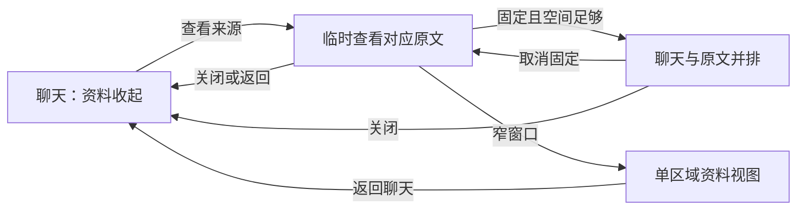

# 研究工作台第三轮：前端简化落地方案

版本：v1.0 · 日期：2026-10-06 · 文档基线：`df825da` · 功能基线：`e451f38`。

本轮交付完整改版文档，前端实施与新一轮用户试用尚未开始。方案承接[设计学习与体验依据](研究工作台前端简化_设计学习与体验依据.md)，补充[第二轮落地方案](研究工作台第二轮优化_落地方案.md)。界面布局与操作位置以本方案为后续依据；单论文主聊天、附件检查、并行调度、证据边界及版本能力继续沿用第二轮安排。[第二轮 BCD 验收](研究工作台第二轮BCD阶段_实施验收.md)记录已交付的功能，不作为本轮改版验收。

## 1. 改版目标与优先级

用户明确反馈：界面太乱，希望简洁、导向清晰；希望利用右键等方式展开或选择；聊天区域被其他区域挤占。

本轮以连续阅读和提问为主要任务，按以下顺序落实：

1. **聊天空间**：聊天获得主要宽度与高度，原文、导航及输入区适配当前空间。
2. **操作层级**：主动作直接可见，对象操作通过右键、更多按钮、选区浮条出现。
3. **阅读连续性**：查看依据、返回回答、切换论文和恢复草稿都有清楚的上下文。
4. **汇报与视觉统一**：PPT 以预览为中心，编辑按需出现，再统一字体、间距和状态。

用户应随时能辨认当前论文、当前操作对象、任务状态和下一步。现有功能在对应场景提供，不把所有能力同时铺到首页。

## 2. 设计依据如何转为实施规则

| 依据                                                                                                                                                            | 本项目采用的规则                                                             |
| --------------------------------------------------------------------------------------------------------------------------------------------------------------- | ---------------------------------------------------------------------------- |
| [Design Council](https://www.designcouncil.org.uk/resources/framework-for-innovation/)、[IDEO](https://designthinking.ideo.com/introduction)                    | 从用户任务和中断点定义问题，先比较原型，再验证与迭代                         |
| [NN/G 渐进式披露](https://www.nngroup.com/articles/progressive-disclosure/)                                                                                     | 管理与高级选项按需展开；经常共同使用的内容允许同屏；阅读路线可跳过           |
| [Fluent 2 布局](https://fluent2.microsoft.design/layout)、[Material 3](https://m3.material.io/foundations/layout/canonical-examples/overview)                   | 明确主区域和支持区域，利用空间和间距建立主次，按容器空间适配                 |
| [Fluent 2 抽屉](https://fluent2.microsoft.design/components/web/react/core/drawer/usage)                                                                        | 区分临时查看与固定对照，控制遮挡和阻断，避免连续叠加面板                     |
| [Apple HIG](https://developer.apple.com/design/human-interface-guidelines/context-menus)、[W3C 菜单模式](https://www.w3.org/WAI/ARIA/apg/patterns/menu-button/) | 对象菜单简短且相关，有常规入口和键盘操作；菜单动作一致                       |
| [GOV.UK 可用性测试](https://www.gov.uk/service-manual/user-research/using-moderated-usability-testing)                                                          | 让真实或潜在用户完成任务，观察发现入口、误操作与恢复，任务措辞不提示操作方式 |

下文尺寸、菜单项数和检查目标是本项目的初始设计值；设计系统没有规定本项目必须使用这些值。原型检验后更新文档并记录原因。

## 3. 信息架构与默认页面

### 3.1 研究模式

| 区域     | 默认内容                                               | 次要内容入口                                   |
| -------- | ------------------------------------------------------ | ---------------------------------------------- |
| 左侧导航 | 导入、搜索、课题下的论文列表、当前论文标识             | 论文／课题菜单；折叠的最近讨论；设置与个人记录 |
| 顶栏     | 当前论文名、阅读／汇报切换、资料入口、当前对象更多操作 | 题录、论文管理、讨论历史                       |
| 中央聊天 | 用户问题、回答、轻量引用、局部任务状态                 | 回答菜单、选区浮条、来源详情                   |
| 输入区   | 自由提问、一个附件入口、发送                           | 附件类型菜单、长草稿展开                       |
| 支持面板 | 默认收起；打开时显示原文或笔记                         | 完整来源、补正文、笔记管理                     |

顶部合并为一条工具行；完整用户问题保留在聊天消息中。论文名可截断，但能查看完整名称。讨论标题与论文身份分别保存，展示位置不重复铺满页面。

论文研究与 PPT 通过顶栏的“阅读／汇报”切换，带上当前论文和主聊天。首页无论文时仍提供导入和研究想法入口，汇报入口给出选择论文的明确提示。

### 3.2 导航

导航展开默认 216px，初始可调整范围 200–280px。折叠为紧凑入口，保留展开按钮、导入和当前论文提示；完整论文列表通过导航抽屉恢复。

课题一级、论文二级，当前课题展开。其他课题的展开状态由用户控制并记忆；搜索时显示匹配项及归属。最近讨论默认收起，用于恢复近期工作，不重复作为第二套常驻论文列表。

课题与论文行的管理动作集中到一个更多入口。当前行、键盘聚焦和触屏场景有可见入口；鼠标右键提供相同动作。选中态只强调当前对象。

设置和个人记录保留稳定入口，窄屏时进入导航抽屉。历史讨论继续可回看，论文的主聊天仍是默认进入位置。

## 4. 聊天优先的布局规则

### 4.1 初始参数

| 项目         | 初始设计值                     | 行为                                               |
| ------------ | ------------------------------ | -------------------------------------------------- |
| 导航         | 默认 216px；展开范围 200–280px | 可折叠，可恢复；折叠态不占完整列表宽度             |
| 顶栏         | 约 52px                        | 常规窗口一行；窄屏保留身份和关键入口，其他进入菜单 |
| 聊天         | 使用剩余空间                   | 正文行宽与聊天容器宽度分别控制                     |
| 长回答正文   | 上限先试 820px，随容器缩小     | 用户消息、引用和浮条适配同一阅读区域               |
| 固定支持面板 | 默认 360px；调整范围 320–420px | 最大可调宽度还受聊天可用宽度限制                   |
| 输入区       | 空输入先试约 104px             | 随内容增高；长输入支持展开，紧凑状态内部滚动       |

并排判断使用实际容器宽度：`聊天可用宽度 = 工作区宽度 − 当前导航占宽 − 支持面板占宽 − 分界占宽`。固定支持面板以聊天至少约 720px 为初始条件。这个条件仅决定桌面是否适合并排，不是窄屏聊天的最小宽度。

以 1440px 窗口、216px 导航和360px面板估算，聊天应仍有约840px；关闭面板后获得更宽区域。以上为布局预算，实施后测量实际尺寸与正文高度，不以计算代替截图验收。

### 4.2 空间变化的处理

- 宽度足够时，用户可以固定原文并排；关闭资料后立即还给聊天。
- 宽度不足时，以临时查看面板承接来源。用户主动固定时，可提示收起导航以便对照；满足空间条件后固定，不静默改变另一项用户设置。
- 已固定状态遇到窗口缩小，实际展示降级为临时查看或窄屏资料视图；记住固定偏好，空间恢复后按用户偏好恢复。资料位置与未保存内容保留。
- 手机与窄窗口采用单主区域，导航和资料按需进入；显示返回聊天入口。浏览器缩放和软键盘出现也按实际可用空间处理。
- 拖动分界不能把聊天压到桌面并排目标以下；越界时限制宽度或转为临时查看。保持键盘调整、上下限、重置和可恢复性。

输入区紧凑状态的最大占高先试聊天工作区的 28%；草稿更长时内部滚动或主动展开。附件、引用和错误提示出现后仍要保留足够的正文区域，紧凑状态不把历史回答完全推出窗口。

正文阅读上限用于控制长行；聊天容器仍使用剩余空间。输入区和回答的对齐关系保持一致，右侧关闭后不遗留空白占位。

## 5. 支持面板与查看依据

支持区域统一为“原文／笔记”两种内容，一次显示一种。面板有标题、固定／取消固定和关闭入口；内部自行滚动。

点击回答来源时，打开相关片段或已知页，优先呈现当前结论的依据。面板保持论文名、来源类型和页码；完整来源列表、题录、PDF视图切换及补正文可在面板的更多操作中找到。

来源展示区分论文事实、补充基础和用户截图观察。只有真实页码才显示“第 N 页”；无页码的附件显示其上传名称和来源身份。

临时查看优先采用不锁住聊天输入的非模态表面；明确关闭方式，避免遮住触发来源或关键回答。空间不足时使用单区域资料视图而非硬塞两栏。固定原文用于反复对照，避免每次点不同引用都重新打断布局。

记录打开来源前的消息和滚动位置。关闭面板后回到原回答；固定面板时点击其他来源仅更新目标内容。PDF只能返回已知页或现有来源片段时，界面按该定位层级表达。

面板切换与关闭保留笔记及补正文草稿；来源版本改变时提醒更新引用，不继续提交过期锚点。

## 6. 统一对象操作：右键、更多与浮条

### 6.1 动作清单

菜单围绕当前对象的常用操作。全局设置进入设置页；对象菜单不混入整站管理。

| 对象     | 主交互         | 菜单中的动作                                           |
| -------- | -------------- | ------------------------------------------------------ |
| 论文     | 点击恢复主聊天 | 重命名、移动到课题、查看论文信息                       |
| 课题     | 展开／收起论文 | 讨论方向、重命名、归档；已归档课题提供恢复             |
| 完整回答 | 阅读与点击来源 | 复制、调整讲解、收藏、保存为笔记、理解反馈             |
| 文字选区 | 选区浮条       | 复制、解释选区、引用提问；选区来源可定位时提供查看来源 |
| 图片附件 | 点击查看预览   | 查看状态、补用途／单项重试；尚未发送时可移除           |
| 幻灯片   | 点击切换预览页 | 编辑这一页、提出修改要求、查看本页来源                 |

“调整讲解”可有一层子菜单：简单点、常规、详细点、从基础讲、重点解释机制。理解反馈提供既有的“仍不理解／我已理解”，不自动推断理解状态。

右键与更多按钮从同一动作注册表构造，使用相同对象 ID、可用条件和执行函数。打开菜单时记录当前对象，切换论文、版本或页面后关闭菜单，避免操作到后来选中的对象。

### 6.2 菜单行为

- 初始以 3–5 个相关动作组织菜单，最多一个子菜单层级。超出时先按任务重新分组，而不是持续追加。
- 菜单靠近触发对象，超出窗口时调整方向；外部点击和 Escape 关闭。只在支持对象上接管右键，空白区域、输入框保留浏览器行为。
- Enter／Space 可从更多按钮打开，方向键移动，Escape 返回合理焦点；可访问名称与展开状态完整。
- 上下文菜单只显示当前对象适用的动作；可见主按钮在暂不可用时保留状态与简短原因，例如未保存版本不能直接导出。
- 点击菜单“调整讲解／解释选区／引用提问”先形成可编辑的问题或引用，再由用户发送。打开菜单、移动焦点、悬停和选中文字均不触发模型请求。
- 收藏、笔记保存、重命名等明确的本地／后台动作可以直接执行并反馈；失败留在对应对象附近。

### 6.3 选区浮条

原文和已完成回答都支持实际文字选区。浮条先显示“解释”“引用”“更多”，靠近选区并避开文字，重新选择后替换目标。点击浮条不因焦点转移丢失选区内容。

来源归属、版本、回复 ID及现有长度校验继续使用。跨句与部分文字按实际选区处理；跨多个独立来源的选择需要拆分或明确提示，不默默截成另一段。

待发送引用在输入区上方显示短摘要、来源身份、查看和移除入口；摘要可收起，实际提交选区完整保留。解释深度对选区优先，否则使用上一轮完整问题及回答。

手机先保留系统文字选择和复制，再提供浮条及更多入口。文字区域不另外强制长按打开对象菜单；论文行、图片和幻灯片可通过明确的更多按钮操作。

## 7. 回答、输入与阅读引导

### 7.1 回答展示

正文按段落自然展开，减少重复边框和逐段按钮。来源改为局部编号或短标签，保留可点击关系；来源详情按需展开。

一条回答集中提供一个更多入口，鼠标悬停或键盘聚焦可显示轻量操作。触屏和辅助输入保持可发现、可访问的入口，不要求记住右键。

“已完成”弱化；等待、正在回答、缺材料和失败在对应轮次突出。取消等待、停止回答、编辑重发及必要的附件补充动作直接可见，不藏进多层菜单。

核对细节和术语释义可收起；影响当前结论的条件与证据边界保留在结论附近。长回答不通过默认截断关键内容来获得整洁。

### 7.2 输入与附件

合并为一个“＋”入口，展开“添加 PDF”“添加图片”。拖入与粘贴图片继续可用，发送前显示文件名／缩略图与移除入口。

导航导入 PDF立即创建并进入对应论文主聊天；输入区的附件直到发送才上传。输入区选择 PDF后，就地显示“发送后进入这篇论文的聊天”，说明本次问题随文件带入；补图仍留在当前聊天。

输入区引用、附件和问题分别保留草稿。进入其他论文后恢复各自内容。附件检查只在发送后进行，单项失败仍按依赖程度处理，不新增自动模型调用。

快捷建议从常驻一排改为上下文的一条“接下来可以……”及更多入口。自由输入始终可用，用户写草稿时不覆盖问题。

### 7.3 空状态和路线

无论文时突出导入，并提供“讨论研究想法”的次入口。已导入且无聊天时呈现简短研究起点、一个具体起始问题及“更多问题”。点击建议先放入输入框，不直接发送。

研究起点沿用已实现的真实摘录、版本缓存、后台优先级和取消规则。本轮调整展示方式，不为菜单、路线或面板切换新增生成流程。

“研究问题／实验／结果／讨论”属于可跳转的阅读建议，不形成强制完成步骤。更换目标后能继续自由提问。

## 8. PPT、设置与个人记录

### 8.1 PPT默认以预览为中心

左侧是当前汇报的页面列表，中央是预览。顶部给出汇报名称、版本选择、生成新汇报和导出；长名称的编辑进入更多菜单。讲稿与来源位于预览附近，可收起。

版本记录使用下拉或按需打开的列表，不与页面列表长时间上下并排堆叠。切换版本时明确保存版本及核对状态。

点击“编辑这一页”或缩略图菜单后才打开编辑区，提供手动编辑和自然语言修改。空间不够时编辑区使用独立视图，明确返回预览；保留当前页与草稿。编辑区不得将幻灯片预览挤成无法阅读的窄列。

保存与核对状态在当前页附近显示。关闭编辑不等于保存，草稿继续保留；主动放弃草稿需明确操作。导出仍绑定实际保存完成版本，未保存改动有明显提示，不把预览草稿当作已保存内容导出。

旧版本恢复继续创建新版本，单页修改隔离、取消、导出和论文来源归属沿用已有机制。

### 8.2 设置与个人记录

设置集中管理学习背景、讲解偏好、模型连接检查和布局重置。偏好继续按聊天保存，生成期间修改不被任务完成覆盖。

个人记录保留收藏、主动反馈、待解决问题、编辑与回看。相关动作从回答菜单进入，回看仍返回原聊天或记录位置。

打开设置／个人记录时关闭临时菜单，避免多个表面叠加；关闭后恢复触发位置。PPT 和研究模式互切不丢草稿、页码和版本选择。

## 9. 状态、文案与视觉规则

| 情况                   | 展示位置和用户动作                       |
| ---------------------- | ---------------------------------------- |
| 论文解析／正文缺失     | 当前材料附近，提供重新上传或补正文       |
| 回答等待／处理中       | 所属消息附近，提供取消等待／停止回答     |
| 图片用途不明／检查失败 | 对应附件附近，提供补用途／单项重试       |
| 来源版本变化           | 待发送引用附近，提示重新选择             |
| PPT未保存／保存核对中  | 当前页和编辑区附近，明确版本与导出可用性 |
| 操作保存成功           | 简短就地反馈，必要时短暂通知；不重复弹窗 |

统一深色背景与少量表面层次，主要动作和当前选择使用强调色。正文先试16px，辅助文字13–14px；长中文回答行距约1.75–1.9。以4px间距基础建立段落、操作和区域关系，实际触控目标单独验证。

普通文本链接和来源标签降低边框密度；区域分界视觉细淡，但拖动命中宽度保持可操作。状态同时有文字或图标表达，避免仅靠颜色。

提示说明当前状态和一个可执行的恢复动作，例如“这张图片尚未看清，请补充清晰版本”；不把内部阶段、调用预算或对象 ID当作主要界面说明。共享回答规则继续保持事实、来源和必要条件。

## 10. 状态持久化与旧设置迁移

持久化区分“用户偏好”与“当前实际展示”：固定偏好不等于窄屏一定展示并排。滚动和返回定位按论文／聊天保存；编辑状态按版本／页保存。

| 状态                                       | 范围和落地安排                                     |
| ------------------------------------------ | -------------------------------------------------- |
| 导航宽度／折叠、支持面板宽度、输入展开偏好 | 浏览器布局偏好，按新版本结构保存                   |
| 面板内容、来源目标、阅读位置               | 按现有论文／聊天位置恢复，扩展字段时保持旧接口兼容 |
| 临时菜单、浮条位置、临时遮挡状态           | 页面内状态，不在刷新后自动展开                     |
| 问题、实际引用、附件草稿                   | 保留现有按论文归属的存储键和 IndexedDB记录         |
| PPT草稿、当前页、所选版本                  | 草稿沿用版本／页键；视图位置按论文／聊天保存       |

新布局使用版本化存储，如 `research-layout-v2`。首次读取可迁移仍有效的导航宽度；旧阅读百分比和固定输入高度不机械映射为新布局。保留旧配置，不删除问题、引用、附件、笔记或PPT草稿。升级、字段异常、存储不可用时使用清楚的默认布局。

“恢复默认布局”只清理新布局偏好及相关展示偏好，保留业务内容。正文来源变化仍遵守现有锚点校验；切换论文时关闭旧菜单、清除瞬时选区并恢复该论文已保存的引用草稿。

模型任务继续归属于原论文和消息。布局、切换与菜单关闭不会取消已提交任务；取消只能由对应明确动作发起。异步保存结果更新原对象，并通过现有修订标识保护当前画面不被其他论文响应覆盖。

## 11. 实现范围与文件分工

| 位置                                                           | 主要变更                                               |
| -------------------------------------------------------------- | ------------------------------------------------------ |
| `app/research-workspace.tsx`                                   | 顶栏合并、模式切换、支持面板状态与返回定位、草稿归属   |
| `app/research-navigation.tsx`                                  | 折叠导航、清晰论文层级、对象更多入口                   |
| `app/research-layout.tsx`、`app/research-workspace.css`        | 容器空间判断、聊天优先、输入自适应、尺寸迁移和视觉规则 |
| `app/research-discussion.tsx`、`app/research-selection.ts`     | 轻量来源、回答动作、实际选区与浮条                     |
| `app/research-reading.tsx`、`app/research-pdf.tsx`             | 来源定位、临时／固定阅读、笔记草稿与面板菜单           |
| `app/research-attachments.tsx`                                 | 单一附件入口、紧凑预览、异常项就地操作                 |
| `app/research-ppt.tsx`、`app/research-settings.tsx`            | 版本选择、按页展开编辑、布局重置与偏好                 |
| 新增对象动作／菜单组件                                         | 同一动作清单供右键、更多、浮条及键盘使用               |
| `shared/workspace.ts`、`server/projects.ts`、`server/index.ts` | 仅在阅读／视图位置需要新增持久化字段时扩展并保持兼容   |

前端操作优先复用已有重命名、归组、笔记、设置、附件、聊天及汇报接口。新增状态字段需列出默认值、迁移规则与校验；不重建模型调度和版本服务。本轮不增加数据删除入口或未经验证的格式能力。

## 12. 实施阶段与交付

| 阶段           | 工作                                                         | 完成标准                                                         |
| -------------- | ------------------------------------------------------------ | ---------------------------------------------------------------- |
| P0：原型与布局 | 固定内容原型；聊天优先、顶栏合并、导航与面板适配、输入自适应 | 先验证关闭／临时／固定三种阅读状态，记录聊天实际宽高和视觉对照   |
| P1：对象操作   | 统一菜单、右键、更多、选区浮条、轻量来源                     | 主任务入口可发现；选区准确；键盘／触屏可完成；打开菜单零模型调用 |
| P2：连续阅读   | 原文定位与返回、状态恢复、迁移、上下文建议                   | 查完来源可继续原回答；切换和刷新不丢归属、草稿或位置             |
| P3：汇报与统一 | PPT按需编辑、版本选择、设置／记录及视觉文案统一              | 预览可读、指定页编辑与导出正确，当前前端操作连贯                 |
| P4：验收与修正 | 工程回归、固定内容比较、真实目标用户任务观察                 | 分别记录工程和用户结果，修正中断与不可发现的入口并复测           |

每阶段交付实现、对应验证与已知问题，按仓库要求在`main`提交，报告哈希；不捆绑不相关修改、不主动推送或重写历史。

## 13. 工程验收标准

| 编号 | 场景                                       | 验收要求                                                                 |
| ---- | ------------------------------------------ | ------------------------------------------------------------------------ |
| L1   | 1440px及更宽桌面默认打开                   | 聊天获得主要区域，右侧默认收起；顶栏无完整问题大标题和管理工具栏         |
| L2   | 宽屏固定原文并调整分界                     | 满足约720px聊天并排目标，真实尺寸测量通过；不出现空白占位                |
| L3   | 1366、1280、1024、768、390px窗口及200%缩放 | 自适应为并排、临时查看或单主区域；无页面横向溢出，操作和返回可见         |
| L4   | 长输入、引用和四项附件                     | 输入能滚动／展开、引用可移除、附件可查看；紧凑态仍能读历史回答           |
| M1   | 论文、回答、选区、附件、幻灯片菜单         | 右键与更多动作一致，对象归属明确；越界定位、外部关闭、键盘和焦点恢复正确 |
| M2   | 原文／回复部分文字与跨句选择               | 浮条使用实际选区，移焦不丢引用；选择、菜单展开和建议预填不提交模型请求   |
| R1   | 连续查看来源再关闭／返回                   | 到达正确片段或已知页，回到原消息和阅读位置；固定态不反复重排布局         |
| R2   | A论文草稿→B论文→返回A→刷新                 | 问题、附件、引用与位置无串用；临时菜单不自动恢复                         |
| R3   | 旧布局升级、损坏字段、重置                 | 新默认和兼容恢复正确，重置不删除业务草稿与记录                           |
| P1   | PPT版本选择、指定页编辑、关闭后恢复        | 页面和草稿保留，编辑不遮蔽主要预览，保存状态明确                         |
| P2   | PPT未保存、修改完成、恢复旧版与导出        | 导出绑定保存完成版本；其他页隔离与来源关系不受UI变化影响                 |
| S1   | 等待、回答、附件失败及异步切换             | 继续遵守双任务、同论文顺序及局部取消，响应不覆盖其他论文                 |

相关改动运行类型检查、正式构建及必要回归。浏览器检查使用隔离数据目录、固定内容和`TUTOR_READING_GUIDES=manual`，避免界面回归产生自动云端调用；保留第二轮核心能力检查。

新增测试重点放在布局状态切换、对象动作归属、选区保持、焦点、恢复和保存版本等真实风险；纯样式改动使用截图与尺寸检查。模拟响应只验证工程行为。确有新模型行为才补充限次真实样本，不重复消耗额度验证菜单外观。

## 14. 用户体验验收

使用同一材料与代表性内容比较当前界面和改版原型，先覆盖科研入门者、熟悉论文者及不同输入方式。小规模观察用于发现问题，结果不自动推广到所有用户。

任务按目标描述，示例为：导入并开始读一篇论文；针对一句话继续提问；查明结论出处再继续读；切换论文后恢复草稿；修改一页并导出正确汇报。测试开始不教授“右键／更多按钮”的具体位置，以便观察发现性。

记录独立完成、需要提示、未完成，另记首次找到入口的过程、误操作、阅读中断、来源往返、任务时间与困难评价。对常用任务出现的新阻断优先修正，不用按钮数下降或截图整齐代替体验结果。

工程已完成与用户观察分别标注。判断是否读懂科研内容需要独立的内容评价，不以界面通过、模型核对或用户一次自称理解代替。

## 15. 交付与完成定义

实施完成须同时提供：可运行前端、旧数据与布局迁移说明、关键窗口截图、工程验收记录、用户体验观察或明确的待试用状态，以及当前提交哈希。

整体完成按已验证范围报告；目标用户试用缺失时保留待验收项。下一步从P0的聊天空间与三种原文查看状态开始，随后依据观察推进对象操作和汇报布局。
