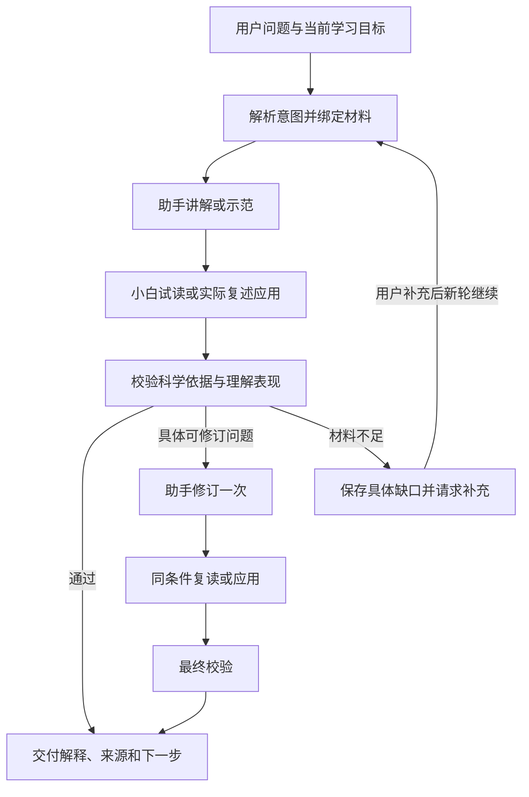
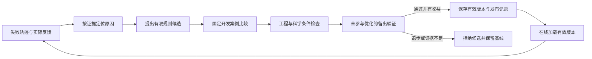

# 科研能力培养与三类 Agent 协作：整体落地方案

版本：v1.0 · 日期：2026-10-06 · 核查代码基线：4902fa2（main）· 状态：整体设计与实施规格，新增能力待实施。

本文整理截至本日的完整讨论，承接[原整体方案](Skill与工作流驱动的科研学习助手_落地方案.md)、[多智能体效率方案](主助手多智能体_效率成本效果落地方案.md)与[电脑端前端方案](研究工作台第三轮前端简化_落地方案.md)。最新目标、角色职责和后续行为以本文为准；历史验收保留其当时的材料、版本与结论。本文不能作为新增能力已经交付的证明。

本次只交付文档、GitHub 学习依据和[成稿复查记录](科研能力培养与三类Agent协作_方案复查记录.md)，没有修改产品代码、安装框架或发起模型生成。比赛提交用 Word 和视频另行制作，本文是完整工程规格，不受参赛说明的 5000 字限制。

## 1. 产品目的与能力形成

面向刚进入实验室、开始科研的医学生及医学研究生。通过真实论文和连续讨论，帮助他们理解研究为什么开展、研究怎样设计、方法怎样产生观察、观察怎样支持结论，以及结论有哪些边界；进一步提炼可迁移的方法和思路，在新的问题中尝试运用，逐步形成自己的科研能力，能够用自己的话解释和汇报。

论文是学习科研的具体材料。教学、读图、方法讲解和 PPT 共同服务于这一目标；功能完成不能仅凭“回答了问题”或“导出了文件”判定。每项新增能力应说明帮助用户跨越哪个学习障碍，并提供相应的证据和验收场景。

### 1.1 两条学习主线并进

| 主线               | 学习内容                                                                   | 希望出现的行为                                                     |
| ------------------ | -------------------------------------------------------------------------- | ------------------------------------------------------------------ |
| 科研思路与研究设计 | 问题与假设、设计选择、对照、替代解释、证据链、结论边界、局限与下一步       | 能解释为什么这样研究，判断设计解决了什么问题，提出有条件的改进思路 |
| 概念、方法与图表   | 必要术语、测量对象与原理、实验单位、归一化、坐标与分组、不确定性和统计含义 | 能解释测到了什么、怎样读图、这些观察允许推出什么                   |

两条主线在当前问题内交织。例如讲一个对照，既要解释其操作和测量意义，也要解释它排除了哪种替代解释。“补基础”不能丢失研究问题，“研究思路”不能跳过理解设计所需的方法基础。

### 1.2 能力形成的具体路径

1. 理解本文的一个真实问题或局部证据链。
2. 提炼一个可借鉴的研究做法，例如对照设置、排除替代解释或组合不同测量。
3. 说明适用条件、依赖前提及不能直接照搬的地方。
4. 在新的例子或用户自己的研究问题中，尝试选择、解释或修改该做法。
5. 根据反馈修正，再积累可回看的学习记录。

默认直接讲解与示范，用户可以自由追问、跳转内容或独立制作汇报。实际作答、练习和研究问题讨论按用户意愿进入，不将整套过程变成强制课程。模拟学生的表现只帮助检查系统；真实用户的能力需要其实际行为支持。

## 2. 固定约定与范围

- **三类角色：助手、小白、校验。** 用户澄清的是三类人，不是三位小白再加两位其他角色。
- 主助手负责承接目标、教学、产物组织和修订；程序负责调度、资料、状态、预算、保存与导出。协调程序不是第四类教学 Agent。
- 小白承担试读、学习后的解释／应用，以及基于 PPT 的汇报模拟。不同模式不增加角色类别。
- 校验兼顾科研专业性、证据、教学衔接与汇报质量；不能为面向新手而放宽事实要求。
- 后台完整磨合与在线轻量使用共享任务合同、有效 Skill 和失败样本；用户使用时按任务选择必要检查。
- 只做电脑端，沿用 iOS／iPadOS 视觉语言、现有本地思源黑体与主题机制，鼠标、键盘、桌面缩放优先。字体舒适度仍需真人验证。
- 前端以论文主聊天为中心，资料和 PPT 按需展开；内部角色对话、评分答案、训练轨迹和预算明细留在开发侧。
- 保留现有论文、笔记、收藏、对话及 PPT 版本，不通过重建库或删除旧数据实现升级。
- 本项目所说“训练 Skill”是优化工作指引、案例、评价和工作流。当前没有训练模型权重，不能据此归入垂直模型训练路线。

## 3. 当前基础与缺口

以下为代码核对及已有验收记录的边界，本次没有重跑实时模型测试。

| 部分             | 已有基础                                                                    | 本轮需要补齐                                                                      |
| ---------------- | --------------------------------------------------------------------------- | --------------------------------------------------------------------------------- |
| 教学协作         | 助手讲解、小白试读、来源核对、一次修订与复读；有完整真实运行记录            | 共同学习目标、实际复述／应用、教学效果分类反馈                                    |
| 主助手与连续会话 | 路由、上下文、问题承接、来源绑定和任务保存                                  | 将能力迁移纳入目标，避免只总结论文或重复加长解释                                  |
| 学习模拟         | 独立 LearnerEnvironment／LearnerStore，状态、可见历史、实际选择题作答与恢复 | 接入教学流程，扩展开放复述、应用和 PPT 汇报；当前选择题合同不足以直接承载这些行为 |
| 模拟可靠性       | 一个固定画像、虚构规则的已知／未知／缺前提／学习后应用检查                  | 真实医学内容、多种任务、知识泄漏和同状态比较；未证明真人学习效果                  |
| Skill            | 十个标准入口，按任务由程序加载、保存版本哈希                                | 完善研究思路、专业校验、能力迁移及汇报检验的规则和案例                            |
| 后台磨合         | 回放、基线／候选比较、保留或撤回记录                                        | 失败归因、自动提出有限候选、开发集／留出集隔离和发布控制的完整流程                |
| 讲解方式         | 五个选项能传至助手并按聊天保存                                              | 分离讲解程度与学习重点；小白、校验也取得明确的共同目标                            |
| 检查策略         | 普通任务可完整检查；局部提问、附件和深度调整默认可跳过试读                  | 改为按学习内容和风险选择；“从基础讲”不因深度调整而自动省略试读                    |
| PPT              | 生成、页面与讲稿核对、单页修改、手动保存、版本恢复、导出                    | 学过论文后的讲述、陌生听众试读、错误归因、修改影响范围和实际渲染检查              |
| 图件与阅读       | 原 PDF、文字圈选、来源定位、显示原件与模型压缩图分开                        | 提升目标图在汇报中的可读性，避免整页高分辨率被缩得过小                            |
| 阅读起点         | 现有生成读取有限正文片段，单独缓存                                          | 标明材料覆盖范围；缓存加入模型、规则及相关目标版本，不能表示已经读完全文          |
| 基础知识资料     | 已登记有限基础来源和定位信息                                                | 按需要扩展可信资料；当前没有运行时任意联网检索能力                                |
| 前端             | 电脑端苹果风格、聊天优先、附件、PPT、设置与个人记录                         | 从共同学习目标驱动交互，显示具体缺口和下一步，完成真人体验核对                    |
| 成本与状态       | 总预算、一次修订、取消、失败记录、同论文串行与全局两任务调度                | 新模式全部进入同一预算与版本体系，比较质量和等待时间                              |
| 模型             | Provider 接口已抽象，入口仍实例化 CodexProvider                             | 国内多模态适配、配置切换、图像／结构化输出／取消能力验证和重新验收                |

代码定位：shared/types.ts、shared/learner.ts、server/assistant.ts、server/orchestrator.ts、server/learner.ts、server/replay.ts、server/reading-guides.ts、server/provider.ts、server/budget.ts、app/research-settings.tsx。

历史三页汇报仍有 Figure 1m 计数分母缺依据及论文事实引用缺口，见[四场景迁移验收](基础资料迁移与四场景验证_验收.md)。后续简单 PPT 样本通过不等于该旧案例通过。现有高清原页导出也不能证明投影可读；第三轮验收仍保留真人体验和 PowerPoint／LibreOffice 实际渲染缺口。

## 4. GitHub 学习与采用方式

本轮实际检索并阅读上游文件，下面链接固定到 2026-10-06 查询到的仓库提交。借鉴机制，继续改进现有 TypeScript 实现；仓库的功能描述不能当成医学教学有效性的证明。没有安装下列框架或复制整套 Skill。

| 阅读来源                                                                                                                                                                         | 借鉴机制                                               | 用在本项目哪里                                     | 取舍                                                                    |
| -------------------------------------------------------------------------------------------------------------------------------------------------------------------------------- | ------------------------------------------------------ | -------------------------------------------------- | ----------------------------------------------------------------------- |
| [TinyTroupe README](https://github.com/microsoft/TinyTroupe/blob/a6244b358a1fe1c71bf751f7ba0f8dfa368ec5a4/README.md)                                                             | 人物状态、环境约束、checkpoint、模拟与真实数据比较     | 小白可见历史、恢复、实验条件固定及模拟校准         | 复用已有 LearnerStore；外部模拟工具不能直接证明医学新手真实性           |
| [DSPy GEPA](https://github.com/stanfordnlp/dspy/blob/bc8af7ed3d5ee0b892211e5c03274396442a413c/docs/docs/diving-deeper/gepa-in-depth.md)                                          | 用具体失败反馈提出指令候选，在评价集比较并限制预算     | 后台 Skill 磨合、候选生成、回归与拒绝退步          | 第一阶段独立实现小规模优化，保留科学事实硬性条件                        |
| [LangGraph 工作流](https://github.com/langchain-ai/docs/blob/9e88062916107128a28c10e8233ec0d17da86c86/src/oss/langgraph/workflows-agents.mdx)                                    | 显式状态、路由、评价后修订、独立步骤并行               | 教学与 PPT 流程状态、停止、检查依赖                | 现有状态机继续使用；只并行不依赖彼此结果的检查                          |
| [AgentEvals README](https://github.com/langchain-ai/agentevals/blob/946ad15b9f2ce9bc9843edd2bb773bd07d78ca7e/README.md)                                                          | 执行轨迹匹配与模型评价分开                             | 必要检查有没有运行、输入有没有越界、内容有没有依据 | 程序条件确定性检查；专业内容另设可定位的评价条件                        |
| [Scientific Critical Thinking](https://github.com/K-Dense-AI/scientific-agent-skills/blob/92ace75ac21efe19a620434e0ca4e356081fe807/skills/scientific-critical-thinking/SKILL.md) | 先取证再判断，检查设计、混杂、实验单位、统计和结论范围 | 校验的专业维度与科研思路教学                       | 根据研究类型选标准；不能给所有基础实验套用 GRADE 或用检查项数量当质量分 |
| [teach](https://github.com/mattpocock/skills/blob/4588b32ecab9ecc9fc8cc6b6c5e7d675b6004b0d/skills/productivity/teach/SKILL.md)                                                   | 学习任务、可信资源、实际应用反馈与可修订学习记录       | 从论文理解走向科研能力，记录当前表现和下一步       | 借鉴目标与行为组织；不改为强制 HTML 课程，不把即时流畅当长期掌握        |
| [Anthropic PPTX 指引](https://github.com/anthropics/skills/blob/683bc88e56f3e09ba94f7055977f3d3aa499f202/skills/pptx/SKILL.md)                                                   | 文件结构检查、实际渲染、字体与布局核对                 | PPT 可打开性、文字／图片／备注、投影可读性         | 仅学习检查方法；该文件标注 Proprietary，不复制脚本、文本或资源进项目    |

上游教学、科学审阅和 PPT 指引作为方法参考。专业规则落地后仍需回到真实论文、图注、方法和基础来源验证。后续确需复用代码时，单独登记对应文件版本、许可证和依赖，再决定是否引入。

## 5. 前后端共同的学习意图

### 5.1 分开三个问题

1. **讲多少：** 简洁、常规、深入。
2. **重点学什么：** 综合理解、补基础、研究思路、方法与图表、机制。
3. **这次完成什么：** 理解论文、提炼并尝试迁移、讨论自己的研究问题、组织汇报。

前端显式呈现前两组轻量选择，第三项优先从当前请求识别。学习背景单独保存；简洁不等于已经掌握基础，深入也不等于需要堆砌术语。

### 5.2 拟新增的统一合同

以下是待实现类型，不是现有 API。

```ts
type LearningIntent = {
  version: "1";
  verbosity: "brief" | "standard" | "deep";
  focus:
    | "balanced"
    | "foundations"
    | "research-reasoning"
    | "methods-figures"
    | "mechanism";
  goal: "understand" | "transfer" | "discuss-research" | "report";
  scope: {
    paperId: string | null;
    sourceVersion: string | null;
    sourceIds: string[];
    selection: string | null;
    artifactVersion: string | null;
  };
  backgroundRef: string;
  preferenceScope: "turn" | "conversation";
};
```

后端解析并校验实际意图，保存到轮次。助手、小白和校验共享目标、重点、范围与公开交付要求；各角色取得的材料按职责组装。小白不得取得参考答案、隐藏评分条件或完整校验报告。“共享目标”不代表共享所有输入。

校验取得公开学习目标以及开发侧的独立评价条件；小白只取得完成当前任务需要的公开要求。修订仍针对同一任务，不能通过悄悄降低目标解决失败。

### 5.3 旧选项兼容与优先级

| 现有值      | 新合同映射     |
| ----------- | -------------- |
| brief       | 简洁＋综合理解 |
| standard    | 常规＋综合理解 |
| deep        | 深入＋综合理解 |
| foundations | 常规＋补基础   |
| mechanism   | 常规＋机制     |

优先级为：当前明确请求／本轮显式选择 → 当前聊天偏好 → 默认常规＋综合理解。旧值只作为没有新合同的历史数据兜底，不覆盖新选择。“这一段简单点”作为本轮调整，“以后都简洁些”更新聊天偏好；设置中的明确选择按聊天保存。切换学习重点不重置背景或丢失当前问题。

选区限定任务范围，但允许补理解它必需的上下文。切换论文时重新绑定材料，用户长期背景可复用，论文事实与待处理任务不可串用。

## 6. 三类角色的输入、行为和判断

| 角色 | 核心输入                                                       | 核心工作                                                 | 返回内容                                             |
| ---- | -------------------------------------------------------------- | -------------------------------------------------------- | ---------------------------------------------------- |
| 助手 | 学习意图、相关原文／基础资料、已交付解释、明确反馈、有效 Skill | 沿双主线教学，必要时制作 PPT；根据具体问题修订           | 讲解或页面、来源、推理边界、可选迁移提示、材料缺口   |
| 小白 | 稳定背景、实际可见教学／图件、自己的历史与状态、公开学习目标   | 自然提问、复述、应用或汇报，表现具体理解                 | 自己的解释、疑问、应用选择及理由、可见依据、断点     |
| 校验 | 学习意图、源材料、候选输出、小白表现、原问题记录               | 检查科学专业性与证据；判断理解表现和断点；给出可操作修改 | 问题位置、依据、原因、影响、修订建议、处理状态和限制 |

助手的论文带读、方法讲解、读图和 PPT 是工作能力，不各自增加一个常驻 Agent。校验的事实审阅、教学评价和汇报评价属于同一类角色的不同职责，可以按任务加载相应规则。

现有 planning／teaching 等调用阶段归入助手类，novice／learner 行为归入小白类，grounding／内容评价归入校验类。阶段名称与兼容 Skill ID 可以保留，不能因此把协调、导师或学习模拟重复算成额外角色。

### 6.1 各重点在三类角色中的对应

| 学习重点   | 助手                                | 小白                             | 校验                                           |
| ---------- | ----------------------------------- | -------------------------------- | ---------------------------------------------- |
| 补基础     | 补必需概念，并回到当前问题          | 用自己的话连接概念和实验         | 基础准确、前提足够、没有脱离论文               |
| 研究思路   | 问题→假设→设计／对照→观察→推理→边界 | 解释为何这样研究和对照排除了什么 | 设计逻辑、替代解释、因果与相关、推断范围       |
| 方法与图表 | 测量对象、原理、分组、坐标和读数    | 读出图意并说明回答的问题         | 单位、分母、归一化、实验单位、统计及证据一致性 |
| 机制       | 分清过程、联系和已证明／待验证环节  | 解释关键环节及关系               | 有无把机制推测写成事实                         |
| 综合理解   | 按当前问题连接两条主线              | 复述当前证据链并提出必要疑问     | 必要基础和科研逻辑都没有断裂                   |

能力迁移任务还要求说明新情境、可借鉴的方法、适用条件和不能直接照搬的因素。专业性以准确和有依据判断，详细程度以任务需要判断，二者不能互相替代。

### 6.2 校验的五个维度与错误归因

分别记录：事实与来源、科研设计与证据链、基础与可理解性、迁移适用性、汇报叙事与可读性。没有涉及的维度标记不适用，不能制造问题凑满检查项。

问题至少包含稳定 ID、当前轮次／产物版本、精确位置、类型、来源或行为依据、影响、建议、严重程度和是否已解决。原因区分：内容错误、教学前提缺口、PPT 组织缺口、小白误解、模拟越界、原始材料不足。

助手只据此修改对应内容。校验也可能出错：反馈无依据、与当前目标无关或依赖未提供材料时，记录争议并回到证据；相同模型的不同角色互相同意不能代替事实核验。来源缺口不能靠重复讨论补出原文没有的信息。

### 6.3 一段配合示例

以下是教学设定，不是当前论文的实验结果：用户问“为什么作者要用两种方法验证同一结论”，并选择研究思路重点。

助手先据实际材料说明两种方法各测什么、各自可能的误差，以及为什么组合它们；小白复述“两个结果一致就证明原因唯一”；校验指出其理解越界，要求区分交叉支持与排除全部替代解释；助手补讲独立性、共同偏差及结论边界，小白再解释这两种证据能支持到哪里。

阶段小结可以提炼“用不同测量交叉支持一个判断，但需检查其是否共享偏差”。迁移到新问题时，小白或自愿参与的用户说明怎样选第二种测量，以及它补充了什么。整理 PPT 时，校验再检查讲述是否保留上述边界。三个环节始终围绕同一科研能力，而非各自生成一份互不关联的答案。

## 7. 小白环境与状态

### 7.1 同一角色的四种行为模式

| 模式             | 起点与可见内容                           | 检验什么                                       |
| ---------------- | ---------------------------------------- | ---------------------------------------------- |
| 试读             | 指定背景＋本次实际展示的讲解／图件       | 术语和推理是否能接上，有无必需前提缺口         |
| 学习后解释／应用 | 已记录的可见学习历史＋当前问题           | 是否能用自己的话解释或在新情境使用方法         |
| 基于 PPT 汇报    | 学习检查点＋当前 PPT 和讲稿              | 能否组织研究叙事，是否重复、跳步或过度依赖讲稿 |
| 首次听众试读     | 初始背景＋实际对听众展示的页面／口头内容 | 没有先读论文的听众能否跟上                     |

汇报者与首次听众是不同的实验条件。听众不应取得未展示的 notes；听众实际听到的模拟讲述可以作为可见输入。背景不一致时不得直接比较理解率，也不把两种模式解释为新增 Agent 类别。

### 7.2 学过论文的判定

导入 PDF、提供全文、出现“已教概念”或小白自称理解，都不能自动标记学过。记录实际读过／听过的单元、对应材料版本、复述／应用表现和未解决问题。覆盖部分论文时明确范围，不把其状态写成掌握全文。

完整论文汇报的后台条件应先建立整篇研究路线的学习历史，覆盖研究问题、关键方法、主要结果、结论和局限，并检查正文及汇报必需补充资料的覆盖情况；用实际解释／应用核对关键衔接。局部图表案例仍可独立运行，但必须标明局部范围，不能替代完整论文背景下的 PPT 验收。

首次完整汇报模拟前，按当前任务需要准备相关学习单元并检查必要理解；准备调用进入预算。后续复用只有在论文、资料、规则、背景和可见历史版本相容时成立。

### 7.3 状态与输入隔离

复用已有 LearnerStore，在现有画像、概念状态、可见教学与作答记录上增加行为模式、开放复述／应用／汇报记录、资料和意图版本、检查点。先扩展 shared/learner.ts 和输出 schema，再接入工作流，不能直接拿现有选择题输出冒充汇报。

将“讲过”“自述理解”“本次表现可解释／可应用”“待进一步观察”分别保存。模拟状态与真实用户学习记录分开；用户真实反馈优先用于理解其需要，不能由小白表现替用户打分。真实记录保留依据和可修改入口，不自动给用户贴“不会科研”的标签。

学习者输入由程序白名单组装，不含原始隐藏资料、导师内部反馈、参考答案和评分规则；存储与日志也不能把这些字段回填到学习者历史。允许正常答对、答错或不知道，不为了人设固定装傻或强行找错。

输入隔离只能限制显式材料，不能保证预训练知识完全关闭。因此必须检查未教规则、缺关键前提、伪造可见依据及恢复后状态；涉及新知识却无可见支持的表现标为模拟越界，不能计作教学收益。

### 7.4 比较与恢复

正常教学连续承接同一学习者。比较基线与候选时，从同一学习检查点克隆状态，各自学习对应版本；不能让候选继承基线额外教学。首次听众比较从独立初始检查点开始。

取消、失败、未知调用状态或保存失败不能产生有效学习证据。回滚输出后保留历史版本，旧学习证据仍指向旧教学内容；新的当前状态只采用适用证据。画像版本变化需要重建比较条件，不静默修改正在运行的小白。

## 8. 教学闭环与科研能力迁移



核心教学首轮采用助手→小白→校验。小白根据任务进行简短实际复述、理由说明或应用，校验判断其是否抓住关键；自述“能听懂”不能单独决定通过。在线轻量检查聚焦当前单元，完整多轮教学与迁移对照留到后台。

出现必要断点时，校验向助手提供具体缺口、位置、依据及修订目标；助手修订，小白沿用当前状态和问题 ID 再试，最终校验确认。每个任务组最多一次自动修订，材料不足保留待补，修订后仍有问题就如实交付有效部分与限制，不能无限循环或冒称通过。

能力迁移输出按“本文做法→作用→适用条件→新情境尝试→反馈”组织。新情境的设定与讨论假设明确标注，不能被当作本文实验事实。用户自己的研究想法先梳理问题和可行证据，不保证创新性或直接形成可执行实验方案；详细实验设计需结合实际条件继续核验。

普通讲解不每次追加迁移模块。研究思路、方法应用、阶段小结或用户主动提出新问题时，再提供贴合当前内容的迁移机会。真实用户不参与练习时，继续完成原来的阅读和汇报目标。

## 9. PPT 的教学与汇报检验闭环

### 9.1 完整后台流程

1. 固定材料范围、汇报对象、时间、重点和页数，确定相关学习检查点。
2. 助手组织研究叙事，生成页面、原图、讲稿和来源。
3. 学习过相关内容的小白基于 PPT 进行连贯讲述，回答一个不照抄讲稿的关键追问。
4. 初始听众条件下的小白试读实际展示／讲述的内容，指出必要衔接缺口。
5. 校验结合原文、两个条件下的表现和页面渲染，判断专业性、叙事、冗余、理解及可读性。
6. 按原因分类给助手具体修订；必要时修订一次，再做同条件检查。

先检查“该汇报者实际学过哪些内容”。准备不足时补教学或保留前提缺口，不能把所有讲不清的问题归咎于 PPT。首次听众不能继承汇报者的学习历史。

一次首轮有 4 次生成：助手、小白汇报、小白听众、校验；同样完整修订再需 4 次，合计最多 8 次。学习准备、规划、候选提出和独立评价额外计入后台批次总预算。因此这条完整后台链不能直接塞入现有在线 6／7 次上限。

上述 4／8 次计算将讲述和一个公开应用问题放在同一次小白任务中。若需要校验听完后临时提出新追问，再由小白回答，新增调用必须另计；不能在实施时增加对话却继续报告原来的调用数。

### 9.2 在线使用的对应

生成或重要修改 PPT，至少做助手生成→一次针对当前用途的小白检验→校验，最多一次修订。准备充分且目标是汇报时，优先检验小白讲述；讲给首次接触者时优先听众试读。后台固定案例同时检验两种条件，在线记录本次采用哪一种和检查范围，不能只运行一种却宣称两种都通过。

小白尚无适用学习检查点时，在线先用听众试读，明确汇报模拟尚未完成；用户希望进一步检查讲述时，在预算内补教学或建立新的可继续任务。跨轮继续保留关联和累计成本，不通过拆轮绕过调用额度。

### 9.3 四方面验收

| 方面       | 必须检查                                                                                        |
| ---------- | ----------------------------------------------------------------------------------------------- |
| 科学内容   | 数值、分组、对照、方法、来源、结论边界；必要基础与专业性共同成立                                |
| 研究叙事   | 问题、设计、关键结果和结论形成链条；讲述能说明为何做及如何推理                                  |
| 表达与时间 | 页内重点、页间衔接、术语首次出现、冗余和追问；字数只能粗估时长，实际讲述另记                    |
| 视觉与文件 | 原图细节、字号、对比度、比例、溢出／遮挡、备注、来源以及 PowerPoint／LibreOffice 实际打开和渲染 |

资料图不能凭空重画成新的实验结果。原页保留出处；目标图过小时采用可核对的清晰补图、扩大图件或调整版面。准确区域信息具备时才能裁切，不把整页图片冒称单个 panel。原始图的高分辨率不等于缩小后适合投影。

### 9.4 修改与版本

单页修改区分文字润色、事实改变、图件更换和结构改变，记录受影响范围。当前检查结果绑定页面内容、材料及产物版本；事实／图件修改需重新核验，衔接改变还要检查相关前后页。旧版本的报告留作历史，不能被当作新版本已检查。

保存、恢复和导出始终绑定用户选定版本。发现阻断性事实错误或资料不足以支持关键结论时，保留草稿及具体缺口；完成对应检查前不作为正式已核对产物导出。后台视觉检查失败时显示尚待排版处理，不用内容通过覆盖视觉失败。增删／重排页面作为后续完整编辑能力另行实现和验收，不把目前单页修改算作已支持全部操作。

## 10. Skill 组织与自动磨合

### 10.1 工作规则分层

- 公共规则：来源与推理边界、当前目标、输入隔离、产物版本、失败和停止条件。
- 助手规则：带读、方法、图表、研究思路、能力迁移、PPT 组织及局部修订。
- 小白规则：稳定背景、自然疑问、实际复述／应用／汇报、可见依据、允许不知道。
- 校验规则：科研专业性、证据、教学衔接、迁移和汇报；按研究类型加载相关审阅条件。

沿用十个 Skill 的目录和兼容 ID。先在现有对应 Skill 增补规则与参考材料，确有独立触发和维护需要时再增加入口。研究思路和迁移可以先作为助手模块，不因功能增加而增加常驻 Agent。

后端继续负责读取选中的 Skill。当前运行时没有开放原生文件、搜索或动态工具，不在文案里声称模型会自行去 GitHub 学习。开发侧寻找参考、核对、转为有效规则后，再由运行时按任务加载。

### 10.2 完整磨合循环



“磨合”同时改进助手教学、小白行为约束、校验条件和流程路由。先定位根因，再修改相应层：原文缺失补材料，意图错误改路由，讲解断裂改教学，小白越界改模拟，校验无依据改判断合同。不能把所有失败都归因于助手提示词。

每个候选记录变更文件／规则、目标缺口、受影响功能、禁止退步项、材料快照、模型和预计预算。默认一次只试一个候选、少量案例；优化器属于后台开发工具，不是产品新增第四类角色。

开发阶段可自动生成候选、执行比较和归档报告。候选不能自行降低判定标准、修改事实答案、扩大来源白名单或改生产有效版本。通过规定条件后，由版本管理程序提升有效版本，并保留上一版和回滚记录；证据不足则维持基线，不要求用户逐个手动裁判。

### 10.3 评价与发布条件

先执行不可抵消的条件：关键事实与引用准确、没有编造材料、小白没有隐藏答案泄漏、版本隔离正确、调用不超预算。任何阻断项失败都拒绝候选，再比较可理解性、科研思路、迁移、叙事、冗余和等待时间。汇总分只能辅助排序，不能用“更易懂”抵消错误事实。

基线和候选使用同模型、材料、背景、任务、起始状态及评价版本。关注结论对随机生成是否稳定；差异小、判断矛盾或收益仅见于一个案例时，在剩余额度内重复关键案例或标为证据不足。

留出题目、材料、答案和评价备注不进入候选生成输入。根据留出失败调整规则后，该例转入开发集，补充新的未见案例；不能继续称原例为独立留出。需要共享用户失败样本时，只在本机开发资料中保留必要内容，默认不上传 GitHub 或提交私人运行数据。

### 10.4 后台和在线的联系

在线采用已验证的 Skill、轻量检查策略、任务合同和可复用的材料；后台使用相同合同开展完整检验，并从具体失败补充案例。在线一次修订不等于 Skill 已永久改进，离线成功也不能代替目标模型下的在线验收。

真实用户的主动反馈、局部追问和可选应用尝试，可作为后台问题来源。真实理解和模拟理解分别记录，不将两个比例混合成学习提升数据。

## 11. 在线效率、成本、失败与缓存

### 11.1 调用策略

下表为后续目标合同。首轮和上限均是实际模型尝试次数；独立准备、补基础生成、规划和评价也要计入对应总账本。

| 场景                                             | 默认检查                                                         | 首轮／修订上限                                                   |
| ------------------------------------------------ | ---------------------------------------------------------------- | ---------------------------------------------------------------- |
| 新的核心教学、补基础、研究思路、方法与读图       | 助手＋针对性小白＋校验                                           | 3／6；需要一次规划时总上限 7                                     |
| 在线 PPT 生成或重要内容修改                      | 助手＋一种适用小白检验＋校验                                     | 3／6；规划包含在 7 次总上限内                                    |
| 仅压缩已核对表述或微小样式调整                   | 使用已有有效依据；生成后检查变化范围，涉及新知识则升级到核心流程 | 程序处理为 0；需要模型改写为 1，必要核验为 2；不自动重跑完整模拟 |
| 查看、笔记、收藏、保存已有内容、导出有效保存版本 | 版本与有效检查状态由程序确认                                     | 0                                                                |
| 后台完整 PPT 双条件验证                          | 生成＋汇报＋听众＋校验，必要时完整修订一次                       | 4／8，学习准备和独立评价另计入批次                               |

简短独立背景解释可以保留当前直接回答能力，但要标明核验范围；涉及论文事实、专业细节、研究设计或迁移任务时进入相应检查。不能把核心教学归为“普通背景”规避小白和校验，也不能因为选区、附件或深度调整而机械跳过试读。

任务采用哪种检查必须记录原因、实际阶段和范围。前端不将部分检查显示为全面通过。低风险改写不得添加数字或扩大结论；无法可靠确认变化范围时升级核验。

### 11.2 预算与停止

在线继续以每任务组最多 6 次、含必要规划整轮最多 7 次、总截止 480 秒为初始合同。首轮 3 次和一次修订 3 次之外，额外生成必须先核算剩余预算；不足时保留具体待继续项，不静默超额。完整双条件 PPT 留在独立后台预算内。

后台每个优化批次初始总上限 64 次，覆盖基线、候选、学习准备、候选提出、独立评价及失败尝试；最多两轮优化，每轮最多两个候选，并受同一批次总上限约束。初批优先一个候选和两个关键案例。运行前按实际节点预算核算，容纳不下就缩小批次，不能把每个候选的额度重复相加。

预算达到上限、无可行动反馈、材料缺失、硬性条件失败或用户停止时结束对应执行。失败、超时、取消和传输状态未知都保留 attempt；状态未知不自动补发。恢复后台作业时确认账本和阶段，不能重复执行已预留的网络调用。

### 11.3 调度与体验

沿用不同论文最多两个生成任务、同论文顺序执行，前台任务优先。后台磨合也经过同一调度入口或共享资源限额，不能另起无限并发占满模型连接。PDF 解析与生成分别管理。

先减少重复材料、重复生成和无目标的长输出，再试独立检查并行。小白表现依赖讲解，教学校验依赖小白反馈，这些步骤保持依赖顺序；单独事实检查只有拆出独立输入、合并规则并验证后才能并行。

记录端到端等待时间、各阶段时间、调用数、可取得的 token、未知用量、修订率、通过范围和金额来源。ChatGPT 额度调用当前没有金额信息，保持空值；国内 API 金额只按实际价格与用量计算。历史约 5.5 分钟的六阶段单例作为问题证据，不能充当同条件性能基线；后续分场景报告中位数和高分位等待时间。

用户看到真实等待、停止、待补材料与已保存状态。必要时先展示明确标记的草稿，涉及阻断事实的内容不能提前作为已核对结论交付。验证等待时间改善时同时检查质量，不能只报告调用减少。

### 11.4 缓存与失效

区分来源解析缓存、基础资料缓存、生成结果缓存、学习检查点、PPT 检查报告和阅读起点缓存。复用条件覆盖：provider 身份、模型及设置、意图、问题／选区、资料和图件哈希、学习背景／状态版本、Skill／schema／评价版本以及产物版本。

当前核心生成缓存已有多项版本因素，应扩展而不是删除这些条件。阅读起点缓存目前缺少模型与规则版本，需单独修补；读取有限片段时保存覆盖范围。阶段结果只有输入相同且适用检查有效时才能复用。换模型、规则、图件或重点后，不返回另一条件下的旧结论。

## 12. 前后端逐项对应与界面改进

### 12.1 行为合同

| 前端选择／动作                   | 后端行为                                                 | 前端交付和检查                                   |
| -------------------------------- | -------------------------------------------------------- | ------------------------------------------------ |
| 简洁／常规／深入                 | 调整展开程度，保持必要事实与推理                         | 内容长度与展开程度有差异，关键条件仍在           |
| 补基础／研究思路／方法图表／机制 | 三类角色使用同一学习重点                                 | 输出重点真实变化；当前选择可辨认，切换不丢问题   |
| 圈选论文或回答的一段             | 绑定选区、当前版本与必要上下文                           | 解释对应内容，来源能回到原位置；不重复整篇       |
| “仍不理解”                       | 结合具体位置和已有解释调整教学；无法定位时给一个简短澄清 | 换步骤、例子或基础补充；避免仅加长原回答         |
| “我已理解”                       | 保存用户自述，可承接下一步                               | 不显示已经测得掌握或能力等级                     |
| 研究思路阶段小结／联系我的问题   | 提炼方法、适用条件并讨论新情境                           | 可以接受、修改或继续讨论，练习保持可选           |
| 上传 PDF／补图                   | 检查材料身份和可用性，绑定相应论文与任务                 | 显示实际附件状态；补图能继续原问题，缺图注给入口 |
| 查原文／放大图件                 | 使用显示原件与可定位来源                                 | 阅读清晰、能返回回答，模型压缩图不冒充原件       |
| 阅读起点                         | 按已读范围组织问题／设计／图表线索                       | 标明覆盖范围与可继续位置，不能宣称学完全文       |
| 生成 PPT                         | 绑定对象、目标、重点、页数和材料                         | 草稿、已检查内容和限制明确，进入预览或编辑       |
| 修改／恢复／导出 PPT             | 绑定版本和受影响范围，重新确认必要检查                   | 不沿用失效报告，未影响页面保持；导出版本一致     |
| 收藏、笔记、学习记录             | 保存内容与原始依据，用户反馈和模拟证据分开               | 可编辑、撤销、删除和回到原讲解                   |
| 切换论文、刷新、排队、停止       | 论文隔离、持久化、任务取消、预算和恢复                   | 草稿／引用／任务归属正确；没有假完成状态         |

### 12.2 后端推动前端优化

后台发现读图障碍，前端优先提供对应图件及原页；发现具体材料缺口，提供对应补充入口；研究思路讲解后，按当前内容提供可选的“这个设计还能排除什么解释”等下一步。推荐必须有当前上下文依据，避免堆叠泛化功能卡片。

问题摘要只呈现与用户任务有关的内容：缺什么、影响什么判断、接下来能做什么。角色对话、内部断点 ID、评分标准、候选版本和训练账本留在开发记录中；真实的不确定性和来源限制仍应让用户看见。

### 12.3 电脑端视觉和交互验收

沿用聊天优先、资料默认收起、右键／更多与 PPT 预览优先，不新增常驻角色面板。两组学习设置采用轻量菜单；高频追问可以自然语言触发。恢复原回答的位置、焦点和草稿比增加面板更优先。

继续以 iOS／iPadOS 的排版、配色、控件与材质作为视觉参考，实际运行是电脑网页。核对字体、行高、字重、信息层级、边框、分隔线、圆角、菜单锚点、按钮状态和深色对比度；不能为接近移动界面牺牲桌面鼠标、键盘或可访问性。

使用 1280、1440、1920 像素典型桌面窗口和 100%／125%／150% 缩放，覆盖长论文标题、长引用、正文／原图／PPT、菜单、窄桌面窗口、深浅色、加载与错误状态。开发侧先做截图和交互检查，再记录真人字体舒适度、入口可发现性和视觉相似度；自动截图不能代替用户体验结论。

## 13. 国内多模态适配与模型迁移

Codex 可以继续用于开发、调试和 Skill 优化。比赛运行方案按国内通用多模态模型路线准备；Skill 优化不能替代模型迁移验收。现有代码入口仍是 CodexProvider，本节新增能力待实施。

1. 在现有 Provider 上增加配置与能力声明，明确结构化输出、图像输入、取消、上下文额度和用量字段。
2. 接入一个符合实际参赛需求的国内多模态模型，先验证文本、图表、JSON schema 和停止；没有原生严格结构化输出时由本地校验拒绝不合格结果，失败计入预算。
3. 保持三类角色合同、来源绑定、状态、缓存和预算一致，仅允许有记录的模型适配规则。
4. 在该模型上重跑核心教学、试读／实际复述、PPT、未知／材料缺口及前后端场景；不能沿用 Codex 的通过率。
5. 报告实际 provider、模型版本、图像处理、失败率、调用和等待时间；切换后让旧缓存正确失效。

国内适配从第一实施阶段开始验证，不拖到前端和规则全部完成后才首次接入。候选先控制在少量模型，以同一材料比较；最终型号、平台能力和可用凭据由真实接入决定，本次文档不猜测未验证能力。

开发用 Codex、后台优化模型与用户运行模型可以不同，但所有发布判断以用户运行模型为准。目标模型失败时不能悄悄回退到国外 provider 并将其结果当成国内模型产出。密钥从运行配置取得，不进入前端、Git 或普通日志。

## 14. 验收体系与固定场景

### 14.1 四层证据分别报告

| 层次       | 能说明什么                                           | 不能据此推出什么               |
| ---------- | ---------------------------------------------------- | ------------------------------ |
| 工程检查   | 意图传递、隔离、状态、引用、版本、预算和操作符合合同 | 教学一定有效                   |
| 源材料审阅 | 当前事实与推理有可定位依据                           | 用户已经理解                   |
| 模拟行为   | 指定背景下的复述、应用和汇报表现，以及模拟缺陷       | 真实医学生的能力提升或长期掌握 |
| 真实使用   | 用户实际解释、可选应用、反馈和操作表现               | 少量样本已证明普遍有效         |

内容评价结合可执行条件、源文定位和独立审阅，不能只问 Agent 自己“是否通过”。保留输入、版本、失败和未评估项；必要的专业审阅与真人试用需要实际安排，不能用模拟替换。

### 14.2 场景清单

以下是后续验收要求，全部待本方案实施后验证。已有检查可复用，补充测试须验证实际边界和行为，不只匹配提示词字面。

| 编号 | 固定场景与通过条件                                                                                                             |
| ---- | ------------------------------------------------------------------------------------------------------------------------------ |
| T01  | 简洁／深入与研究思路／补基础可组合；前端、轮次及三类角色意图一致，必要证据不丢失                                               |
| T02  | 五种旧选项正确迁移，设置持久化；本轮自然语言不擅自改长期偏好                                                                   |
| T03  | “从基础讲”仍有针对性小白检查；基础和当前科研问题能接上                                                                         |
| T04  | 小白复述存在遗漏或误解时被准确定位，助手按反馈修订而非无限加长                                                                 |
| T05  | 已知基础可正常答对、未教规则允许不知道、缺关键前提不会猜出隐藏答案                                                             |
| T06  | 小白伪造可见来源／利用未授权知识时拒绝计学习收益；参考答案与校验报告没有进入输入                                               |
| T07  | 学习后在新情境解释／应用，能说明适用条件和变化；仅复述旧例不算迁移完成                                                         |
| T08  | 状态恢复、不同学生隔离、同检查点基线／候选比较；失败和取消不更新有效证据                                                       |
| T09  | 新论文图表的分组、坐标、分母、归一化和结论范围可定位；事实与基础引用类型正确                                                   |
| T10  | 材料缺失保留准确缺口；历史 Figure 1m 未知分母不被通用知识或新一轮优化掩盖                                                      |
| T11  | PPT 汇报者与首次听众条件隔离，能够发现叙事断点；全篇汇报具备整篇研究路线学习历史，局部案例标明范围，未学过不能冒称汇报模拟通过 |
| T12  | PPT 问题区分教学、小白、页面和材料原因，修订命中对应位置；事实错误不能被易懂评分抵消                                           |
| T13  | PPT 实际打开／渲染，原图、字号、比例、讲稿、来源与投影可读性经过核对                                                           |
| T14  | 单页修改、相邻衔接、图件更换、恢复和导出均绑定正确版本，旧报告按影响范围失效                                                   |
| T15  | 选区追问、“仍不理解”、补材料与任务恢复承接正确；切论文不串事实／问题                                                           |
| T16  | 所有新模式遵守在线 6／7 次与总截止、离线批次额度；失败尝试、准备和评价不漏计                                                   |
| T17  | 前台优先、同论文串行、全局资源上限、排队与取消恢复正确；后台不额外抢占无限资源                                                 |
| T18  | 换模型、Skill、schema、重点、材料或 PPT 版本时缓存按合同失效，阅读起点覆盖范围正确                                             |
| T19  | 候选硬性条件失败或其他案例退步被拒绝；留出未泄漏、评价版本固定、发布可回滚                                                     |
| T20  | 国内模型真实完成核心链及图表任务；格式失败／停止／缓存隔离有效，无隐式国外回退                                                 |
| T21  | 电脑端不同窗口、缩放、主题、长内容与状态下布局清晰；鼠标／键盘和原文返回路径可用                                               |
| T22  | 真实用户自主反馈及可选应用有可追溯记录，和模拟表现分开；未做真人试用如实标未验证                                               |

首次开发批次优先 T01、T03、T04、T05、T09、T10、T11 和 T20 的核心部分；工程边界同步覆盖。固定留出至少包含陌生论文／图、缺前提及迁移情境，开发过程不得使用留出答案优化指令。扩大材料时优先增加不同研究与图形类型，不只反复打磨一个 Figure。

### 14.3 交付记录

每个实施阶段记录：目标、变更、代码／规则／材料／模型版本、验证层次、通过和失败、调用与用量、等待时间、限制、提交哈希及待办。完成状态以实际证据为准，文档中的“设计完成”不替代工程和内容验收。

## 15. 实施任务、依赖与交付顺序

| 任务               | 改造位置                                                                           | 交付                                                | 验收对应                     |
| ------------------ | ---------------------------------------------------------------------------------- | --------------------------------------------------- | ---------------------------- |
| F01 共同目标与兼容 | shared/types.ts、server/schemas.ts、server/depth.ts、server/assistant.ts、设置接口 | 学习意图、旧值迁移、偏好范围、三角色输入与检查策略  | T01–T03、T15                 |
| F02 科研教学与校验 | skills/shared、助手／带读／方法／图表／证据链／核对 Skill                          | 双主线、专业条件、具体错误归因、迁移教学            | T04、T07、T09、T10、T12      |
| F03 小白环境接入   | shared/learner.ts、server/learner.ts、server/orchestrator.ts、小白／学习模拟 Skill | 开放行为、可见历史、检查点、状态与教学承接          | T04–T08、T11                 |
| F04 PPT 闭环       | PPT Skill、orchestrator、server/deck-versions.ts、导出与显示资产代码               | 汇报／听众两种条件、修改影响、内容和视觉报告        | T11–T14                      |
| F05 磨合与评价     | server/replay.ts、evals、检查脚本、拟新增候选／发布管理模块                        | 有限候选、失败归因、基线／留出、拒绝退步与回滚      | T07、T10、T19                |
| F06 成本与版本     | server/budget.ts、server/scheduler.ts、缓存、server/reading-guides.ts              | 全部尝试计账、前台优先、检查点和缓存失效            | T16–T18                      |
| F07 前后端适配     | app/research-settings.tsx、app/research-discussion.tsx、PPT／附件／记录视图及 API  | 两组学习选择、有效状态、材料缺口、任务承接和桌面 QA | T01、T02、T14、T15、T21、T22 |
| F08 国内模型       | server/provider.ts、server/index.ts、拟新增配置／adapter、模型检查脚本             | 可切换接入、能力验证、目标模型完整记录              | T16、T18、T20                |
| F09 验收与参赛材料 | 验收文档、真实案例、另行制作的 Word／视频／支撑材料                                | 当前能力说明、演示、证据及尚未完成项                | 第 14、16、17 节             |

顺序为：F01 与 F08 早期接入验证 → F02／F03 核心教学 → F04 PPT 检验 → F05 后台磨合 → F07 完整交互与 F09 验收。F06 从第一阶段贯穿所有任务，前端在合同稳定后同步接入，不能最后只补按钮。

### 15.1 截止前推进建议

比赛截止为 2026-10-11，以下为优先顺序和目标日期，不是已完成承诺：

| 日期  | 优先结果                                                               |
| ----- | ---------------------------------------------------------------------- |
| 10-06 | 整体方案与复查；实施时先做共同意图及国内模型的文本／图片／格式最小验证 |
| 10-07 | 核心教学的小白实际复述与专业校验，科研思路和基础重点对应               |
| 10-08 | PPT 汇报／听众后台检验与在线轻量链，补内容和视觉证据                   |
| 10-09 | 首批有界磨合、回归／留出、国内运行模型复测和预算报告                   |
| 10-10 | 前后端完整走查、实际演示、参赛 Word／视频／支撑材料整理                |
| 10-11 | 留出修复与提交缓冲；准确标明参赛版本及范围                             |

国内模型能力或关键内容验收不通过时，优先解决阻断项，演示只涵盖实际通过范围，并将其余完整目标保留为待办。不能为了赶日期把失败改成通过，也不能把缩小演示范围写成整体目标被取消。提交到外部报名系统需要用户明确授权；当前任务只制作本工程方案。

## 16. 参赛初衷与材料要求

目标比赛是南方医科大学 SMU“智学智创”智能体大赛（第二期）。本轮重新读取[教学发展中心补充通知](https://mp.weixin.qq.com/s/HsvQoQ2nkWCmlQcnn5-VGA)，确认作品征集截止延长至 2026-10-11，支持个人或不超过四人的团队，方向包括学业提升、科研辅助、医学特色和综合创新。

本项目定位可围绕医学科研入门与学习能力培养，具体分类以报名选项为准。差异化通过以下实际机制说明：专业和基础并进、模拟小白实际行为、双线教学、PPT 汇报检验、可迁移的科研思路、有限磨合及证据约束。不能只靠 Agent 数量、Skill 数量或漂亮页面表述创新。

通知列出国内通用大模型／平台开发的智能体，以及训练打造的垂直领域模型两种形式。本项目按前者准备；Skill 指令优化并非垂直模型权重训练。通知没有明确解释境外模型作为内部运行后端是否允许，不能推断“后端隐藏就不受要求影响”；本方案选国内运行模型并在目标模型验证。若需其他路线解释，应以主办方答复为准。

| 参赛材料      | 通知要求                                                   | 本项目准备内容                                                            |
| ------------- | ---------------------------------------------------------- | ------------------------------------------------------------------------- |
| Word 设计说明 | 不超过 5000 字；标题三号黑体居中，正文小四宋体、1.5 倍行距 | 从本工程方案提炼目的、功能、架构、场景、创新和验证边界                    |
| 功能演示视频  | 3–6 分钟，画面和音质清晰，展示搭建、操作、功能和实际效果   | 围绕真实材料完成研究思路／基础切换、局部追问及 PPT 片段，说明实际运行模型 |
| 支撑材料      | 真实有效，佐证实用性、创新性和应用成效                     | 可定位材料、实际结果、调用／耗时记录、通过与失败、实际使用反馈            |

展示可以配架构图说明后台机制，但日常用户界面保持简洁。没有真实学习效果数据时，只说明工程和模拟结果，不写已经证明医学生能力提升。

## 17. 风险、阻断项与尚未确定事项

| 风险／事项                               | 处理方式与交付边界                                                           |
| ---------------------------------------- | ---------------------------------------------------------------------------- |
| 小白借用预训练知识，看似学得很好         | 输入隔离＋实际行为＋未知／缺前提检查；越界不算收益，真实用户另验             |
| 三类角色共享错误                         | 引用、数值、结构与版本由程序检查，科学内容回到源文并独立审阅                 |
| 过于基础导致专业性下降，过于专业导致断点 | 同时检查证据链和必需前提，按共同目标修订，不能以一个维度抵消另一个           |
| 阅读范围不足、原图／方法缺失             | 保存范围和具体缺口；不能把导入全文当学完全文                                 |
| PPT 内容通过但投影难读                   | 独立视觉状态、实际软件渲染及目标图细节检查                                   |
| 在线全流程过慢                           | 轻量针对性检查、材料复用、有限修订；后台承担双条件完整比较                   |
| 自动磨合过拟合或改评价自证               | 固定条件、隔离留出、硬性门槛、版本和拒绝／回滚记录                           |
| 国内模型格式、图像或效果不达标           | 早期接入，按同一合同复测，保留真实失败，不静默回退                           |
| 前端承诺超过后端能力                     | 显示实际检查范围与状态；功能入口和输出必须对应验收                           |
| 现有运行服务仍加载旧代码                 | 实施后在隔离服务验证，再按明确运行版本重启与复核；本次文档任务不重启用户服务 |

最终国内模型／平台和接入配置、真实使用参与者、实际 PPT 渲染工具及目标投影条件尚需落实。它们是后续执行事项，不阻止当前工程规格成稿；满足相应条件前不能关闭对应验收。

## 18. 完整讨论覆盖表

本表同时用于成稿复查和后续实施追踪。覆盖表示需求已经写进规格，不表示功能完成。

| 要求                                   | 设计位置           | 实施任务      | 验收                           |
| -------------------------------------- | ------------------ | ------------- | ------------------------------ |
| R01 医学生科研入门的原始目标           | 1、2               | F02、F09      | 双主线案例与真实使用边界       |
| R02 从论文形成自己的科研方法和能力     | 1.2、8、14         | F02、F03、F05 | T07、T22                       |
| R03 科研思路和概念／方法／图表齐头并进 | 1.1、6.1           | F01、F02      | T01、T03、T09                  |
| R04 固定为小白、助手、校验三类角色     | 2、6、7.1          | F02、F03      | 输入／流程及角色数量核对       |
| R05 小白先试读并提问，校验判断理解     | 6、8               | F02、F03      | T04、T05                       |
| R06 助手与校验交流，改进指导方式       | 6.2、8             | F02、F03      | T04、T12                       |
| R07 学过论文的小白基于 PPT 讲给校验    | 7、9               | F03、F04      | T08、T11                       |
| R08 PPT 思路断点、冗余与专业性检验     | 6.2、9.3           | F02、F04      | T11–T14                        |
| R09 专业性和基础性同时保证             | 1、6               | F02、F05      | T03、T09、T12                  |
| R10 小白后端能力作为关键设计           | 7、8、9            | F03           | T04–T08、T11                   |
| R11 借鉴 GitHub 教学／审阅／PPT 方法   | 4、10.1            | F02、F04、F05 | 来源、版本、取舍与实际验证     |
| R12 批判接受建议并提出改进             | 6.2、7.2、9、17    | 全部相关任务  | 原因分类与未验证边界           |
| R13 后台自动完整磨合                   | 10、11.2           | F05、F06      | T19                            |
| R14 在线轻量但保留必要检验             | 8、9.2、11.1       | F03、F04、F06 | T03、T11、T16                  |
| R15 后台与实际使用相联系               | 10.4、12           | F05、F07      | T15、T19、T22                  |
| R16 成本、效率、效果和体验一起考虑     | 11、12、14         | F06、F07      | T16、T17、T21                  |
| R17 讲解程度及学习重点在后端对应       | 5、6.1、12.1       | F01、F02、F07 | T01–T03                        |
| R18 其余前后端功能也对应，后端反推交互 | 12                 | F04、F07      | T14、T15、T18、T21             |
| R19 内部多 Agent 调用不展示给用户      | 2、12.2            | F07           | UI 不泄露内部报告和编号        |
| R20 桌面限定、苹果风格、字体与排版自查 | 2、12.3            | F07           | T21、T22                       |
| R21 Codex 开发后适配国内多模态         | 13、15             | F08           | T20                            |
| R22 Skill 磨合和模型权重训练区分       | 2、10、16          | F05、F09      | 文案、架构和材料核对           |
| R23 参赛初衷、要求和截止时间           | 15.1、16           | F09           | 参赛材料与真实能力一致         |
| R24 全局整理后再检查遗漏和偏差         | 本节及独立复查记录 | 本次文档任务  | 文档链接、完整覆盖和一致性复查 |

## 19. 本轮文档完成与实施完成的区别

本轮交付为整体落地规格、固定 GitHub 来源、旧方案与 README 入口、讨论覆盖表及成稿后的复查记录。F01–F09 的新增代码、真实模型验证和参赛材料制作属于下一步实施，尚未完成。

后续每个改文件的实现任务都先检查 Git 状态，只提交本任务文件／块；审查最终差异并运行相关验证，在 main 使用简洁描述性提交，报告哈希，未经请求不推送或重写历史。预先存在或并发的改动视为用户拥有。
