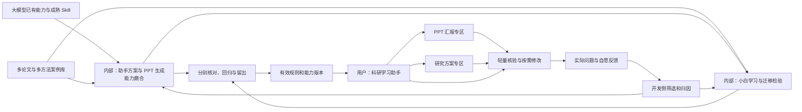
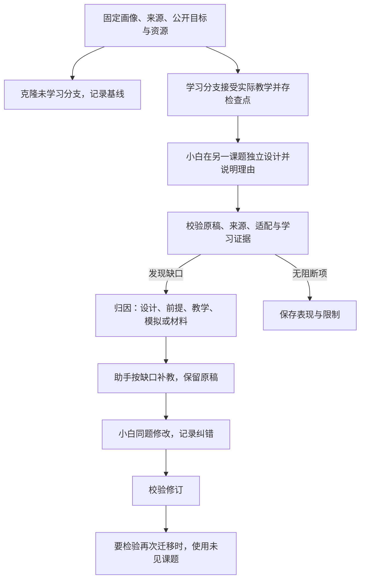

# 科研能力培养与三类 Agent 协作：整体落地方案

版本：v2.0 · 日期：2026-10-06 · 核查代码基线：3381558（main）· 状态：整体实施规格；首轮基础已实现，新增闭环待实施。

本版把研究方案融入产品目标、学习状态、三类角色、内部与在线工作流、前后端合同、版本、成本、磨合和验收。按最新澄清，内部基于大模型、成熟 Skill 和多论文案例，分别磨合助手的产物能力与检验教学后的迁移能力；用户端使用已验证能力并做轻量核验。承接[原整体方案](Skill与工作流驱动的科研学习助手_落地方案.md)、[效率方案](主助手多智能体_效率成本效果落地方案.md)和[电脑端方案](研究工作台第三轮前端简化_落地方案.md)，后续建设以本文为准。[v1.0 原文](科研能力培养与三类Agent协作_整体落地方案_v1.0归档.md)与历史验收保留当时的版本和结论。

本轮按用户明确选择，只交付新版方案与[复查记录](科研能力培养与三类Agent协作_方案复查记录.md)，不实施新增产品代码，不发起模型生成。拟新增合同、接口和界面均为待实施规格。Word、视频及外部报名另行制作；本文不受参赛说明 5000 字限制。

## 1. 产品目的与能力形成

面向刚进入实验室、开始科研的医学生及医学研究生。帮助他们理解研究问题、设计理由、方法原理、观察与结论的关系，并逐步在新的课题中选择、调整和解释研究方法，用自己的话讨论与汇报。产物完成与能力形成分别评价：流畅的方案或 PPT 不能单独证明用户学会。

两条学习主线始终并进：

| 主线             | 内容                                                         | 希望观察到的行为                                     |
| ---------------- | ------------------------------------------------------------ | ---------------------------------------------------- |
| 科研思路与设计   | 问题、假设、设计、对照、混杂、替代解释、证据链、边界与下一步 | 解释为何这样研究，判断设计回答什么，提出有条件的改进 |
| 概念、方法与图表 | 必要术语、测量原理、实验单位、分组、归一化、坐标与统计含义   | 解释测到什么、怎样读图、哪些推断成立                 |

补基础要回到当前问题，讲研究思路也要补足必要方法知识。能力依托大模型既有知识、成熟 Skill，以及持续积累的多论文、方法和设计案例，不是学一篇论文就能迁移出任意新方案。

内部同时建设两项能力：**助手能否生成合适的研究方案／PPT**，以及**助手的指导能否帮助小白在新情境中独立设计／汇报**。前者产物变好不能代替后者，后者答得好也不能代替前者。两者各有输入、反馈、比较与发布证据。

内部路径为多论文案例积累、产物生成与教学诊断、归因、规则调整、回归／留出、有效版本发布。用户路径为提出问题或课题、助手帮助生成、轻量核对、修改／保存／导出；不强加完整内部训练或迁移考试。

用户可以自由追问、跳转或只完成当前需要的部分，不强制上课与考试。模拟学生帮助检查系统，真实用户能力须由其实际行为支持；即时迁移不等于长期掌握。

## 2. 产品形态与固定约定

### 2.1 主体加两个功能模块

| 部分             | 用户用途                                                       | 与能力闭环的关系                               |
| ---------------- | -------------------------------------------------------------- | ---------------------------------------------- |
| 科研学习助手主体 | 读论文、理解方法与图表、讨论研究思路、补基础、保存记录         | 提供学习过程、共同目标、来源与可回看证据       |
| PPT 汇报专区     | 从论文或研究方案组织汇报，预览、修改、核对、恢复、导出         | 检查研究叙事的解释、回答问题与表达质量         |
| 研究方案专区     | 从课题形成方案，分节讨论、修改、核对、恢复、导出；可先自己尝试 | 在新问题中应用所学，区分设计质量与独立迁移表现 |

PPT 与研究方案在同一前端导航中并列，主体聊天仍为主入口。“插件”指产品内部可扩展模块，不是要求安装 Codex 插件，也不是两个隔离应用。共用来源、学习意图、调度、检查、版本与记录，各自拥有产物结构、编辑和导出能力。

### 2.2 角色、界面与边界

固定为**助手、小白、校验三类角色**。助手教学、组织产物与修订；小白试读、复述、应用、独立设计或汇报；校验检查科学依据、设计、教学与表达。规划、候选优化、汇报者与首次听众是阶段或模式，不增加角色类别；调度程序也不是第四类 Agent。

明确分为内部训练／磨合和用户使用两个运行面。内部包含助手产物能力与教学迁移能力两条闭环；用户端默认直接帮助与轻量核验，不要求学习前后测、留出评测或评分达标。共享有效规则、来源规范和基础机制，执行政策、预算与报告分别配置。真实用户、小白模拟和助手内容分别记录。

只做电脑端，沿用 iOS／iPadOS 视觉语言、本地思源黑体与主题。内部角色轨迹、隐藏评分答案和成本明细留在开发侧；用户能看到影响操作的材料缺口、检查范围、版本与建议。保留既有论文、笔记、收藏、聊天与 PPT。

Skill 磨合是优化工作指引、案例、评价与流程，不是模型权重训练。当前运行时不开放任意联网、shell 或动态工具，不声称会自动检索全部文献或执行实验。

### 2.3 两个运行面与共享能力



| 运行路径         | 主要检验对象                 | 成功依据                                           | 默认触发               |
| ---------------- | ---------------------------- | -------------------------------------------------- | ---------------------- |
| 内部产物能力磨合 | 助手生成的方案／PPT          | 来源、逻辑、适配、叙事／渲染、跨案例稳定性         | 有界开发批次           |
| 内部教学迁移检验 | 小白独立设计／组织／解释表现 | 学习可见证据、条件变化、独立理由、前后与未见题表现 | 指定学习单元与评测批次 |
| 用户使用         | 当前问题和当前产物           | 实用性、显见错误核对、透明缺口、可修改与可导出     | 用户提出请求；练习可选 |

有效能力提升由校验和版本管理支撑，既能用于用户产出，也能用于内部教学材料与诊断。内部发现的问题回馈对应层，而非统一改助手提示词。

## 3. 当前基础、缺口与历史证据

对照代码与[首轮实施验收](科研能力培养首轮_实施验收.md)，本轮没有重跑产品测试或真实模型。

| 部分       | 基线 3381558 已有能力                                                         | 本版仍需实现或验证                                       |
| ---------- | ----------------------------------------------------------------------------- | -------------------------------------------------------- |
| 共同目标   | LearningIntent v1、三种程度与五个重点、旧值兼容、本轮／聊天偏好、角色输入传递 | 课题、多来源、产物用途、独立作答条件；教学内容实际效果   |
| 在线教学   | 助手、小白试读、核对、有限修订；核心教学不因程度调整省略检查                  | 开放复述／应用真正接入学习状态，具体补教与迁移反馈       |
| 小白环境   | LearnerStore／Environment、画像、可见教学、实际选择题、恢复                   | 开放设计、讲述、理由与未知项；选择题合同不能直接改名复用 |
| PPT        | 生成、单页编辑、保存、恢复、导出、意图接入                                    | 双条件、修改影响、真实软件渲染与方案汇报                 |
| 研究方案   | 课题分组与研究讨论，尚无独立方案产物                                          | 课题约束、多来源、结构化方案、专区、版本、核对、导出     |
| 规则与磨合 | 公共／小白／核对规则已补双主线与原因反馈；有限回放比较                        | 完整归因、候选、留出、发布与跨功能回归                   |
| 前端与资料 | 桌面工作台、附件、原 PDF、精确选区、笔记、PPT、设置与记录                     | 并列入口、无论文起步、分节编辑、实际用户体验             |
| 预算与缓存 | 在线预算、停止、全局两任务、同论文串行；provider 隔离、阅读覆盖               | 多课题／产物锁、检查点隔离、后台账本、跨产物失效         |
| 国内模型   | 显式配置兼容接口、图像声明、JSON／schema、本地校验、探针                      | 最终平台、凭据与真实教学、PPT、方案效果；T20 未通过      |

首轮记录 105 项工程测试与三组浏览器检查通过，生产模型调用为 0；不能据此证明学习效果。代码位置包括 shared/types.ts、shared/learner.ts、shared/workspace.ts、server/assistant.ts、server/orchestrator.ts、server/learner.ts、server/model-config.ts、server/scheduler.ts 与 app/research-workspace.tsx。

历史[四场景迁移验收](基础资料迁移与四场景验证_验收.md)的 Figure 1m 分母与事实引用缺口保留；其他 PPT 通过不能覆盖旧失败。高清图不证明投影可读。真人学习、原生缩放和 PowerPoint／LibreOffice 实际渲染仍需验收。

## 4. GitHub 学习依据与采用方式

沿用 v1.0 已实际读取的七份固定文件；本版另外实际读取 Research Grants v1.5 的固定源码，补上方案生成与可行性指引。成熟 Skill 提供工作方法，仍需科学核对、适配和实际比较，不因仓库流行就认定效果可靠；未安装框架或复制整套 Skill。

| 固定来源                                                                                                                                                                         | 采用机制与落点                                     | 取舍                                                               |
| -------------------------------------------------------------------------------------------------------------------------------------------------------------------------------- | -------------------------------------------------- | ------------------------------------------------------------------ |
| [TinyTroupe](https://github.com/microsoft/TinyTroupe/blob/a6244b358a1fe1c71bf751f7ba0f8dfa368ec5a4/README.md)                                                                    | 画像、可见历史、检查点与实验条件；独立迁移比较分支 | 复用现有 Store，模拟真实性仍须校准                                 |
| [DSPy GEPA](https://github.com/stanfordnlp/dspy/blob/bc8af7ed3d5ee0b892211e5c03274396442a413c/docs/docs/diving-deeper/gepa-in-depth.md)                                          | 失败反馈提出有限候选，回归主体／方案／PPT          | 不允许候选降低科学判定条件                                         |
| [LangGraph](https://github.com/langchain-ai/docs/blob/9e88062916107128a28c10e8233ec0d17da86c86/src/oss/langgraph/workflows-agents.mdx)                                           | 显式状态、路由、评价与修订，共享执行机制           | 延续 TypeScript 状态机，不迁移框架                                 |
| [AgentEvals](https://github.com/langchain-ai/agentevals/blob/946ad15b9f2ce9bc9843edd2bb773bd07d78ca7e/README.md)                                                                 | 轨迹合规与内容评价分开，查独立作答前的泄漏         | 程序检查不能代替专业判断                                           |
| [Scientific Critical Thinking](https://github.com/K-Dense-AI/scientific-agent-skills/blob/92ace75ac21efe19a620434e0ca4e356081fe807/skills/scientific-critical-thinking/SKILL.md) | 设计、混杂、实验单位、统计与推理边界               | 按研究类型选条件，不给所有实验套用 GRADE                           |
| [teach](https://github.com/mattpocock/skills/blob/4588b32ecab9ecc9fc8cc6b6c5e7d675b6004b0d/skills/productivity/teach/SKILL.md)                                                   | 目标、实际应用反馈和可修订学习记录                 | 不强制课程，不把流畅当长期掌握                                     |
| [Anthropic PPTX 指引](https://github.com/anthropics/skills/blob/683bc88e56f3e09ba94f7055977f3d3aa499f202/skills/pptx/SKILL.md)                                                   | 结构、渲染、字体与布局；论文和方案汇报             | 文件为 Proprietary，只借鉴检查方法，不复制资源                     |
| [Research Grants v1.5](https://github.com/K-Dense-AI/scientific-agent-skills/blob/92ace75ac21efe19a620434e0ca4e356081fe807/skills/research-grants/SKILL.md)                      | 目标、论证、研究路径、可行性、风险、里程碑与修订   | 原文面向资助申请，只抽取通用方法；不搬国外申报要求、阈值或外部工具 |

另参考本地 researchwrite 的证据表、论证图与分节合同，仅用于模块规格；本轮未执行科研申请书写作流程，也不引入其动态专家或申报级 QA。上游须经过版本／许可／依赖核查、三角色适配、开发集比较、留出和发布，不自动更新生产规则。

专业规则回到真实原文、图注、方法和基础来源核验。后续复用代码须登记版本、许可证与依赖。开发侧学习后转为版本化规则，运行时只读取程序允许的 Skill 和材料。

## 5. 前后端共同合同与数据关系

### 5.1 扩展任务上下文，保留学习意图

继续分开“讲多少”“重点学什么”“完成什么”。程度为简洁／常规／深入；重点为综合理解／补基础／研究思路／方法与图表／机制；目标仍用理解、迁移、研究讨论、汇报，不把模块变成新的学习重点。

现有 LearningIntent v1 保留，拟用 TaskContext v2 包装，区分学习来源与目标课题：

```ts
type TaskContextV2 = {
  schemaVersion: "2";
  learningIntent: LearningIntent; // 既有 v1，单论文字段绑定真实主来源或为空
  topicRef: { id: string; version: string } | null;
  artifactRef: {
    kind: "explanation" | "research-plan" | "ppt";
    id: string | null;
    version: string | null;
  };
  executionMode: "online" | "internal-evaluation";
  workMode: "assisted" | "independent-attempt";
  reviewPolicy: "lightweight" | "development-evaluation";
  evaluationTarget: "artifact-capability" | "learning-transfer" | null;
  learningSourceRefs: SourceRef[];
  targetSourceRefs: SourceRef[];
  learnerCheckpointRef: string | null;
  parentJobId: string | null;
};
```

这是概念合同，导出类型在 F01 扩展时确定。多来源完整清单以 TaskContext 的 SourceRef 为准；没有单一主论文时 v1.scope.paperId／sourceVersion 为空，避免双合同重复且矛盾。用户模式 backgroundRef 可用当前背景默认值，不要求先创建内部 LearnerState。SourceRef 由来源种类、所属论文／资料、来源版本、sourceId、定位和实际可见片段确定，不能只用可能重复的 sourceId。学习论文 A 不等于 A 的数据可作课题 B 的事实。后端重新校验引用、权限与来源，不信任前端的“已学习”“已通过”。

优先级为本轮明确请求／选择 → 聊天偏好 → 默认。旧 brief／standard／deep 对应程度＋综合，foundations 对应常规＋补基础，mechanism 对应常规＋机制。设置按聊天保存；“这一段”仅改本轮，“以后都……”才改偏好。跨专区初次带入有效偏好，之后其他聊天的修改不悄悄覆盖已有方案设置。简洁不等于懂基础，深入不等于堆术语。

### 5.2 核心实体与证据关系

| 实体                     | 内容与边界                                                                        |
| ------------------------ | --------------------------------------------------------------------------------- |
| Project                  | 沿用课题分组，不把分组名称当完整研究问题                                          |
| ResearchTopic            | Project 可空；问题、对象／场景、目标、已知条件、资源、未知项和版本；无 PDF 可起步 |
| SourceSnapshot           | 多论文、基础资料、用户事实与约束，各自定位；用户陈述不伪装为核实文献              |
| CorpusCase／SkillRelease | 论文与方法簇、案例、开发／留出划分、教学单元、目标课题、评价与有效规则版本        |
| LearningCheckpoint       | 背景、可见教学、行为证据、来源范围与覆盖，和真人记录分开                          |
| ResearchPlanVersion      | 分节内容、理由、来源、未知项、作者／参与方式、上游版本与影响范围                  |
| ReviewReport             | 产物、材料、目标、评价规则版本；具体问题、阻断项、范围、未评价项                  |
| TransferAttempt          | 独立原稿、作答前可见内容、课题与检查点、反馈、补教、再尝试；不等于方案最新版本    |
| DeckVersion              | 保留页面／讲稿；新增 paper-report／proposed-study 用途和方案版本引用              |
| JobLedger                | 根任务、子阶段、所有尝试、调用／用量／截止与运行版本；继续任务保留累计            |

只把核对后的实际行为写入学习证据。看过页面、助手改好方案、自称理解都不能单独升级为掌握。用户可不参加评测而正常使用专区。

### 5.3 模块机制、旧数据与并发

建立内部模块注册合同：输入、产物 schema、角色输入构建、必要检查、修改影响、预览／导出能力。共用预算和存储机制，不允许模型动态加载代码。

现有 TaskInput.module 仅为 paper／method／figure／ppt，不能类型强转承载研究方案。F10 同步扩展 shared/types、server/schemas、路由、执行、存储与前端，使用有版本的判别合同。无论文任务不能虚构 paperId，多来源不能塞成一篇论文。

升级非破坏、可回退；新方案与尝试独立命名空间，旧对话／PPT 缺字段走明确兼容。迁移前保存快照，重复迁移幂等。并发编辑携带 expectedVersion，冲突保留双方草稿。恢复旧内容创建新当前版本，不修改历史内容或核对结论；历史缓存可留但不得返回为当前有效结果。

## 6. 三类角色的行为与校验交流

| 角色 | 可见输入                                                           | 工作与返回                                                |
| ---- | ------------------------------------------------------------------ | --------------------------------------------------------- |
| 助手 | 共同目标、允许材料、已交付教学、用户约束、反馈                     | 双线教学、方案／PPT、理由、来源、未知项、按根因补教或修订 |
| 小白 | 稳定背景、实际可见教学、公开任务与约束、自己的历史；按模式取得产物 | 自己解释、设计或讲述，承认缺条件，说明依据、选择与理由    |
| 校验 | 共同目标、允许完整核对材料、产物、小白原答、独立评价条件           | 位置、依据、影响、根因、建议、处理对象与未评价项          |

严格学习归因主要用于内部检验。用户端不需要每个人的完整模拟学生，也不以内部考核达标作为生成／导出前提。独立迁移时，小白看不到目标助手方案、参考答案、完整校验报告或评分备注。试读成品可看产物，但只检验可理解性／解释表现，不能计独立设计。公开要求可说明需对照、依据和边界，不能把隐藏目标答案改成提示。

校验检查事实、推理、教学衔接、迁移条件和表达；方案增加设计适配与可行性，PPT 增加叙事与视觉。根因包括材料缺失、事实错、设计／推理错、必要基础未教、讲解断点、小白越界或误读、表达问题、实际条件不具备。每项有位置和下一步，不能只给分或笼统要求“更详细”。

助手据此判断改哪层：材料不足请求补资料，设计错改关联章节，基础没教补原理，PPT 冗余改页面。通俗、字数和总分不能抵消事实错。允许多个合理方案，不按参考措辞机械判错；争议保留，必要内容回源文或独立专业审阅。

补基础要连接实验与概念；研究思路要呈现问题到设计到推理；方法图表关注测量对象、单位、分母与实验单位；机制区分已证实和待验证环节；综合按当前问题平衡双线。三类角色都收到同一重点，不能只改变助手篇幅。

## 7. 小白学习环境与独立迁移证据

### 7.1 从选择题扩展为开放行为

保留选择题回归，新增复述、情境应用、方案与汇报的判别 schema。记录理由、可见依据、缺口、选用／弃用方法和适用条件，各模式有对应评价合同；expectedChoice 和 requiredVisibleIds 不能评价开放设计。

稳定画像明确已知、未知、误解。状态区分已教、观察到表现、在新条件下表现及待检验；研究做法关联必要前提。补教不直接设为掌握，失败／取消／无效作答不写有效收益。全篇汇报需真实覆盖研究路线、设计与结果到结论的衔接；导入全文或局部 Figure 不等于学完全文。

独立尝试保存白名单、检查点、可见教学与原稿。恢复／比较深拷贝分支，不污染其他学生或线上状态。依据区分初始已知、可见教学、公开目标材料、未知／无法归因。流畅不证明增益；预训练知识不可彻底观测，不能宣称提示词消除全部泄漏。

程序查非法引用、输入越界与答案泄漏，内容检查未教前提、机械套用和条件不匹配。已知基础、公开题目材料可正常用，不一概判泄漏；疑似越界或无法归因的项不计教学增益。

### 7.2 多论文积累、学习前后与候选比较

内部检查点包含多个相关论文与教学单元，按能力组织，覆盖同一做法在不同对象、资源与失败情境中的适用／不适用。先小批次跑通，再逐步扩大真实文献与方法覆盖；小批次通过不表示能力全面成熟。大模型基础知识不会因新建画像消失，未学习分支刻画已有表现，教学分支观察额外作用。

需要评价教学增益时，同初始检查点分出未学习分支和实际学习分支，前者答案／反馈不进入后者。目标课题预先准备、难度和评价条件匹配且不同，必要时对调顺序，减少同题记忆和测试影响。记录任务差异及无法比较项，单次分差不能推出普遍有效。

基线与候选从同初始状态分别教学，固定模型、材料、任务条件和评价版本。同题反馈后修改反映纠错；再次迁移须另一个未看答案的课题。即时迁移、保持和真人有效性分别报告，无数据留空。

### 7.3 贯通例子

以下仅用一个局部案例展示一项原理的检查方式，完整内部学习仍需多论文单元，不是论文事实或实验结果：从论文 A 学习“两种测量相互支持仍需说明各自对象与混杂”。课题 B 的资源只允许一种方法。小白独立解释哪些原理能迁移、为什么不能照搬、需哪些对照、还缺什么。校验发现机械套用后，助手补教“证据目的与方法选择的区别”。同题修改记录纠错，另一个不同限制的课题 C 检验再次迁移。有效方案可转开题 PPT，说明拟做什么和怎样判断可能结果，不虚构已取得结果。

## 8. 在线主体教学：必要核验，不变成内部考试

用户端目标是理解和完成当前任务。现有核心教学的助手 → 小白试读 → 校验作为已有轻量路径保留，小白用于发现当前解释断点，不必完整维护每位用户的内部训练画像、前后测或严格掌握报告。简短定义和压缩已有文字保留轻量来源核验。

后续按任务选择助手＋校验，或按需要增加小白试读／用户自愿练习。方法、研究思路和基础前提仍核对，但不把“没通过内部迁移评测”当继续使用门槛。当前三阶段路由不在文档中冒称已完成改造，新策略由 F02／F07 实现与验收。

具体错误或“仍不理解”触发针对性修订，自动最多一次；不足保留未知并建议补充，不自动猜齐。事实或设计变化不因“润色”跳过检查，每条回复不追加整套方案或训练。用户看到讲解、缺口与下一步，不看内部评分；补材料后绑定新版本，保留任务关联与累计成本。练习自愿，真人行为不由模拟替代。

## 9. 研究方案专区与内外闭环

### 9.1 输入与结构

从论文聊天带入所学、直接填新课题或继续旧方案均可。最少输入问题或方向；对象、观察、类型、资源、时间与条件逐步补。信息不足先形成框架、备选路径和待确认项，不能编造完整条件。无 PDF 可以开始，无学习经历不能声称已经检验迁移。

| 部分             | 设计时关注的问题                                                     |
| ---------------- | -------------------------------------------------------------------- |
| 问题、背景与依据 | 对象和范围，证据支持什么，未知在哪里；创新点是待核查主张             |
| 假设或探索目标   | 怎样被支持／反驳；观察性／探索性研究不强套机制假设                   |
| 设计与方法选择   | 为什么适合问题，备选如何取舍，原论文做法为何能／不能迁移             |
| 分组、对照与混杂 | 排除哪些解释，实验单位、独立重复、随机／盲法等是否适用               |
| 测量与结果判读   | 对象、原理、条件与误差，可能观察支持什么、不能推出什么               |
| 分析与样本依据   | 指标、统计前提与实验单位；缺依据列待计算条件，不编效应量或固定 n     |
| 可行性与路径     | 材料、设备、技能、时间、成本、里程碑、风险和替代路径                 |
| 边界与下一步     | 未验证假设、缺文献／条件、需导师或专业审阅的决策；相关研究的伦理要求 |

这张表是助手组织内容和内部开发审阅的方向，不是要求用户一次填完或逐项达标的表单。可只生成所需部分，其余留待确认。每节同时写“拟做什么”和“为什么”。区分事实、文献方法、设计提议、假设与可能结果。操作参数只有可靠依据和实际条件具备时才写成可执行步骤；方案不等于 SOP、伦理批准或已证实可行的实验。当前不自动实验或全网检索，导出保留范围、依据、版本和待确认。

### 9.2 在线用户两条路径

**帮助我形成方案：** 默认助手起草／修改 → 校验一次轻量核对 → 返回方案、修改建议和待确认项。明显问题时助手修订并复核，首轮 2 次、含修订最多 4 次。只有需要解释设计、用户希望练习或存在理解断点时才加一次小白，首轮 3、完整修订最多 6，含必要规划总上限 7。

轻量检查关注问题与设计衔接、显见事实错误、方法明显不适用、关键条件缺失和假设／结果混淆。不默认全量文献综述、所有样本量推导、跨学科审查、前后测、多学生多题与高分阈值。能支持部分方案就先交付可讨论草稿，不要求条件全填齐才继续；未知透明保留。它是实用闭环，不证明独立迁移或用户已学会。

**我先试一试：** 用户在看示例前提交目标、设计与理由，保留原稿 → 校验 → 助手针对缺口解释 → 自愿修改或另题。用户写作不计调用，校验＋助手 2 次，修改后主动核对另 1，仍受任务额度约束。用户没继续不制造完成记录。

默认服务真实需求，不强制内部训练。独立尝试前不显示目标示范，已看过标受助表现。模拟小白只在内部明确模式运行，不替用户写“自己的方案”。

### 9.3 内部独立迁移、归因与补教



目标与公开条件作答前固定，参考方案只供核对侧；助手不能先给目标答案再叫小白独立设计。校验向助手说明错在哪里、相关前提是否教过、是不是资源不足、补什么原理、如何再验证。可公开关键纠错点，含答案反馈后的同题答对仍归纠错。

已有学习检查点时小白＋校验为 2 次；失败后补教＋小白修改＋校验新增 3，共 5。未学习对照另 2；学习、题目准备、独立审阅和新题验证另计。完整内部流程分依赖阶段，教学检查点优先由多论文学习单元积累形成；单篇只作局部教学或冒烟样本，不宣称成熟迁移。不是每次请求都重做全部，也不在每条用户消息后自动触发。

通过要求包括条件变化下调整方法、解释适用前提、对照与推断匹配、承认缺口并提出下一步。只改病名、照抄方法清单、套模板或加长均不足；多个合理路径可以通过，研究类型不同用不同标准。

### 9.4 修改、版本与导出

问题／假设变更影响设计、测量与分析；对象／资源变更影响方法与可行性；对照变更影响判读；来源变更影响关联事实。分节保存但跨节检查依赖，纯润色可缩范围，科学含义变化须重核。报告绑定精确产物和来源，旧报告不能显示为新版本通过。

支持预览、分节编辑、自然语言修改指定节、保存、核对、比较、恢复、导出。独立原稿保留为历史证据，助手改写产生派生版本，不覆盖作者归属。首期导出 Markdown 和可编辑 DOCX，PDF 后续另行验收。普通保存／导出不要求内部严格评测通过；当前草稿附实际轻量核对状态、来源和待确认项。发现事实错误不能标已核对，但用户可导出准确标记的草稿；不因没前后测、内部低分或非关键条件未齐而阻断。核对只表示所列范围，不显示可直接执行实验。

## 10. PPT 与研究方案共同服务能力形成

### 10.1 内部双条件与在线轻量链

后台为助手制作 → 学过相关内容的小白汇报并答一个公开关键问题 → 初始听众小白试读 → 校验 → 最多一次完整修订。首轮 4、修订后最多 8。学习准备、规划及核对后另提问题／作答额外计账。汇报者须有相关真实学习历史，首次听众不继承；全篇不得以局部学习替代。

在线默认助手制作／修改 → 轻量内容与基本表达核对，首轮 2、修订后最多 4。需检验讲述／理解时才增加一种小白条件，首轮 3、最多 6，含必要规划上限 7；不默认内部双条件与严格迁移测试。无学习检查点用首次听众条件，不称汇报者也通过；补学习显式建立有额度任务。方案 PPT 检查设计理由与可能结果判读，论文 PPT 检查实际证据讲述。

### 10.2 小白独立组织 PPT 的迁移检验

助手生成 PPT 的质量与小白会不会组织汇报分别检验。内部能力模式给小白实际学过的资料、公开时间／听众条件和允许来源，让其在新的材料组合或课题下独立提出结构化页面／讲稿与取舍理由；不能先展示目标助手 PPT 或照抄讲稿。程序按同一可编辑产物 schema 保存／渲染，小白输出仍归属小白，再由校验检查叙事、事实、信息选择与迁移理由。材料中的新事实须公开提供，不能要求凭旧论文发明新结果。

该模式的小白生成＋校验为 2 次，失败后的助手补教＋小白修订＋校验另 3，共 5；准备与新题另计。已经看助手 PPT 后的讲述／听众表现能检验可理解性和表达，不能替代独立组织能力。要验证再次迁移仍需未见目标条件。

### 10.3 方案转 PPT 与同步

用户主动选“用此版本制作汇报”，绑定明确 ResearchPlanVersion、来源和 proposed-study 用途。叙事为问题 → 依据 → 目标／假设 → 拟用设计与对照 → 可能结果与判读 → 条件、风险和下一步。拟进行内容用计划语气，假设、模拟图和可能结果不能成为实际研究结果。

PPT 保存上游版本；方案更新提示受影响内容，用户选同步才生成新 PPT 并重核，不覆盖旧版本或手工编辑。PPT 编辑不悄悄反改方案；要求回写须选择内容并生成新方案版本。论文汇报无需绑定方案。

### 10.4 内容、视觉与修改

科学检查数值、来源、分组、方法、单位与边界；叙事检查证据链或拟验证路径；表达检查术语、冗余、衔接与讲述时间；文件视觉检查实际软件打开、字体、比例、遮挡、备注、出处和投影细节。字数仅粗估时长，实际讲述另记。

原图不凭空重画为新结果，有准确区域才裁切；目标过小须清晰补图、扩大或改布局。事实、图件、结构与纯文字分别确定核对范围，衔接变化查相邻页。增删／重排仍待补，单页编辑不算全编辑。普通保存／导出不受内部能力评分限制，实际核对与排版状态随版本显示，用户可导出准确标记的草稿；不能把视觉失败标通过。

## 11. 内部训练的两条闭环与有效能力发布

### 11.1 基础能力、成熟 Skill 与多论文案例库

底座是大模型既有能力与经过核查的 Skill。内部训练是规则、案例、路由和评价的有界磨合，不是从零学习所有知识或训练模型权重。公共规则统一来源、目标、权限、停止、版本和归属，三类角色分别加载教学／产物、模拟行为和核对规则。沿用兼容 ID，确有需要再加方案入口，不增加角色类别。

案例库持续登记真实论文、方法和基础来源，形成问题、设计、对照、测量、推断、局限的案例卡，按能力组成多论文单元，并准备不同目标课题。逐批加载相关片段和图，不把大量全文一次塞上下文；资料缺失和未读范围登记，不能仅凭标题当训练证据。

开发／留出按论文、研究系列、方法案例簇与课题来源划分。同论文不同 panel 不冒称独立留出。64 次限制一次运行，不限制长期文献库总规模。上游新 Skill 经版本、许可证和依赖核查，适配后三角色与任务回归，不能自动替换生产版本。

### 11.2 闭环 A：助手真正生成方案／PPT 的能力

成熟指引＋多论文设计／汇报案例 → 助手针对指定新任务生成 → 校验依据、逻辑、适配、可行性／叙事与文件 → 按具体失败修订规则或产物 → 基线／候选比较 → 未参与优化的任务验证 → 发布有效能力。

研究方案评价问题到设计、方法取舍、约束、判读与未知项；PPT 评价科学内容、结构、表达、图件和实际渲染。校验需要真实材料与程序检查，不能只让助手自评分。首轮助手＋校验 2 次，一次产物修订及复核共 4，渲染为程序操作，额外模型视觉审阅另计。

这一条直接服务用户的生成需求。助手产物失败即使小白表现好也不能放行；学习数据不足时亦可准确报告已验证的生成能力，不必把两种结论绑成同一个分数。

### 11.3 闭环 B：利用已验证能力促进并检验学习迁移

助手使用有效教学与产物能力组织多论文学习 → 小白实际学习 → 新情境独立方案／独立 PPT 组织 → 校验学习证据、理由、适配与未知 → 反馈助手补教／调整 Skill → 同题纠错与未见题再迁移。

已生成的方案／PPT 可作为先前案例示范和教学材料；检验独立能力时目标课题的助手答案仍隔离，避免看完答案再照抄。研究方案对应第 9.3 节，独立 PPT 对应第 10.2 节，讲述／听众诊断对应第 10.1 节。

闭环 B 的失败不自动归咎产物：也可能基础没教、案例不足、解释断裂、小白模拟不可靠或条件不具备。校验向助手指出应补哪种知识、教学或产物能力。助手方案／PPT 更好、小白独立能力更好、校验更准确，分别记证据并回馈相应规则。

### 11.4 合并发布与线上复用

共同优化过程：失败轨迹 → 根因 → 有限候选 → 固定开发比较 → 工程／科学硬条件 → 留出 → 提升或拒绝。候选记录缺口、改动、受影响模块、初始状态、模型、材料、预算和禁止退步项。

候选不改事实答案、判定标准、输入权限或自行换生产版本；程序在固定条件满足后提升并保留回滚。事实错、虚构来源、泄漏、版本混用与超预算不可被总分抵消。分别看产物质量、学习迁移、校验准确性和等待，三模块回归，不能用方案进步换基础教学退步。

小差异／矛盾在额度内复验，否则证据不足。留出不进优化输入；据留出改规则后该例转开发，补新留出。线上失败先筛选，不自动发昂贵训练，私人课题不默认上传 GitHub。真人与模拟分开，用户端加载有效能力与轻量核验政策，不重放内部完整训练。

## 12. 成本、调度、缓存与停止

### 12.1 各闭环开销

| 路径                  | 基础生成                         | 修订／比较                      | 上限归属                       |
| --------------------- | -------------------------------- | ------------------------------- | ------------------------------ |
| 在线现有核心教学      | 助手＋轻量试读小白＋校验 = 3     | 完整修订最多共 6                | 每任务 6，含一次必要规划总 7   |
| 在线新增轻量路径      | 助手＋校验 = 2                   | 修订＋复核另 2，共 4            | 同一在线上限，按任务选择       |
| 在线助手方案          | 默认助手＋轻量校验 = 2           | 修订后共 4；可选理解检查为 3／6 | 同一在线上限，不计独立迁移     |
| 在线用户先尝试        | 校验＋助手 = 2，用户写作不计调用 | 用户修改后主动核对另 1          | 同一在线上限，累计账本保留     |
| 在线 PPT              | 默认助手＋轻量校验 = 2           | 修订后共 4；可选小白路径为 3／6 | 同一在线上限                   |
| 内部助手产物能力      | 助手＋校验 = 2                   | 产物修订＋校验另 2，共 4        | 后台实际路径预约，额外审阅另计 |
| 内部 PPT 双条件       | 助手＋汇报者＋听众＋校验 = 4     | 完整修订另 4，最多共 8          | 后台专用组 8，受批次额度约束   |
| 内部小白独立方案／PPT | 小白＋校验 = 2                   | 补教＋修改＋校验另 3，共 5      | 后台组按实际路径预约           |
| 内部前后比较          | 未学习小白＋校验另 2             | 学习、准备、新题、独立审阅另计  | 全部进同一后台批次             |

准备、题目生成、规划、追问、评价和失败都计尝试，不把多角色藏在一轮漏计。可用预先编写任务减少准备调用，不能省掉必要检查。

在线总截止沿用 480 秒并受 provider 限制。后台初始批次最多 64 次、最多 2 轮且每轮最多 2 候选，均为上限，不要求跑满。首批从 1 候选、2 开发例开始，多论文单元的教学与两种能力的基线、留出、独立审阅也在 64 内；小批次只验证指定范围。根任务预约最坏路径，额度不足不启动半条必要链；不能覆盖全套回归则缩本批范围并明确未验。

首批预算可采用预先准备的多论文材料、1 个候选、2 个开发任务（方案／PPT 各一），分别评价两项能力，示例预占如下：

| 项目                         | 计算                                    | 尝试数 |
| ---------------------------- | --------------------------------------- | ------ |
| 助手产物基线／候选           | 2 任务 × 2 版本 × 助手和校验 2 次       | 8      |
| 两个教学单元的基线／候选     | 2 单元 × 2 版本 × 教学、试读、校验 3 次 | 12     |
| 小白独立任务基线／候选       | 2 任务 × 2 版本 × 小白和校验 2 次       | 8      |
| 未学习分支                   | 2 任务 × 小白和校验 2 次                | 4      |
| 提出规则候选                 | 1 次                                    | 1      |
| 一个留出任务分别检验两项能力 | 2 版本 × 助手产物 2 次及小白独立 2 次   | 8      |
| 基础预占合计                 | 8＋12＋8＋4＋1＋8                       | 41     |

最多给四个开发独立尝试各一次补教／修订／复核，另需 12 次，合计 53，余下最多 11 次用于必要准备、双条件或独立内容／视觉审阅及复验。固定材料准备不生成时不计模型；任何新增节点仍计入 64。此表是预算方案，不是已经运行的结果。无法在余额内完成必要审阅或双条件时拆为下一次明确预算的批次，并如实保持本批未验证；不能用 41／53 宣称已做所有内部检查。

### 12.2 中断、恢复与资源

请求前预占尝试，失败、取消、超时计账；状态未知不自动重发。输入／输出额度、用量、缓存、等待和执行分记，无可靠价格金额为空。跨轮继续保留根任务累计，自动继续不重置上限；用户明确发起新工作预算仍显示累计，不拆轮绕限。

生成槽位最多 2，前台排队优先，不强行中断正在运行任务。同课题／产物写入与同学习状态串行；只读来源快照不必把所有引用同论文的课题锁死。多资源按固定顺序预约，不占槽等待自己子锁；评测用克隆，线上写入校验版本。

停止传播所有子阶段，停止后结果不写有效产物或学习证据，保留失败草稿和成本。离开页面不等于停止；刷新查服务端状态，不再提交。保存、恢复与导出绑定确切版本。

### 12.3 缓存

键含 provider／model／能力、Skill、schema、意图、材料、选区、课题约束、产物、作者／模式、reviewPolicy、evaluationTarget 及必要检查点；严格内部报告与线上轻量报告不得互相冒用。独立迁移不能命中助手示范或他人答案，受助结果不能进入独立证据缓存。

阅读起点标真实覆盖，不等于全文阅读；现有最多 10 来源、每项 1800 字符的规则维持，改范围需重验。来源、规则、目标和上游产物变更触发相应失效，历史报告保留。复用结果说明范围，不冒称本次新行为。

## 13. 前后端同步与桌面交互

### 13.1 并列入口与路径

PPT 汇报旁并列“研究方案”。方案以课题／方案列表为起点，主区优先预览，按需展开资料、分节编辑与聊天。跨专区保留阅读位置、草稿与任务；无论文直接输入课题，不要求占位 PDF。

先输入问题，其他条件逐步补。“帮助我形成方案”直接产出，“我先试一试”可选独立路径。轻量显示有效程度／重点；用户看理由、缺口与建议，内部 checkpoint、Agent 对话和评分面板不进入日常操作。

### 13.2 操作、后端与显示逐项对应

| 操作             | 后端                                                         | 显示与恢复                                                   |
| ---------------- | ------------------------------------------------------------ | ------------------------------------------------------------ |
| 从聊天进入       | 选择／创建 Topic，携带指定目标、来源、学习记录               | 显示带入范围可删选，不复制全部私人聊天                       |
| 直接新课题       | 保存问题和未知条件，课题聊天不伪造论文                       | 无 PDF 可起草，缺口可操作                                    |
| 生成／修改       | 版本化输入、预算预约、online＋lightweight 政策，按需要加小白 | 等待、生成、核对、完成／待确认，支持停止，不显示内部评分门槛 |
| 先自己尝试       | 原稿、先前可见内容、示例隔离                                 | 可看原稿和反馈，受助状态准确                                 |
| 分节保存         | expectedVersion、派生版本、依赖失效                          | 未保存／待重核显示，冲突保留草稿                             |
| 补材料／条件     | 新快照、影响定位、重绑定任务                                 | 明确哪些判断更新，旧核对不冒充通过                           |
| 核对／修订       | 当前内容和依赖、范围与未评价项                               | 具体位置、原因、建议与待补条件                               |
| 比较／恢复       | 不可变历史、新当前版本                                       | 原稿、助手／用户改稿归属清晰，报告按版本                     |
| 制作 PPT         | 绑定方案版本、用途、来源及 PPT 检查                          | 上游更新提示，按需同步                                       |
| 导出             | 保存版本、实际核对／视觉状态、格式能力                       | 草稿状态准确，不把内部严格达标作为普通导出门槛               |
| 切换／刷新／停止 | job 查询、恢复、子阶段取消                                   | 不串课题、不丢草稿、不重复生成                               |
| 用户主动反馈     | 实际问题／版本、真人记录                                     | 建议下一步，不默认增加评测调用                               |

### 13.3 待实现接口与权限

拟新增 Topic、ResearchPlan、TransferAttempt 及关联查询。建议路由为 POST /api/research-topics、POST /api/research-plans、GET /api/research-plans/:id、POST /api/research-plans/:id/jobs、POST /api/research-plans/:id/versions、POST /api/research-plans/:id/reviews、POST /api/research-plans/:id/exports；名称以实现为准。跨产物转换显式提交 planVersion。

创建／提交有幂等键防双击／刷新重扣，编辑带 expectedVersion。返回规范化 TaskContext、jobId、状态、产物版本、来源、核对范围和错误；结构／权限／版本错误与生成错误分开。沿用现有查询机制，首期不引入第二套消息系统。

online 默认由服务端固定 lightweight 政策；授权内部任务使用 development-evaluation 并明确 artifact-capability 或 learning-transfer，不能因共用校验角色而加载同一张严格评分表。内部评测接口隔离，用户不能伪造 internal-evaluation、隐藏规则或 checkpoint 授权。入口、API、schema、存储与必要验证同批交付，后端不具备实际能力不显示可用生成按钮。

### 13.4 排版与体验

**前端风格与质感优化：** 在现有电脑端基础上进一步强化 iOS／iPadOS 的视觉质感，统一圆角、留白、字体层级与控件细节，通过克制的半透明材质、细腻边框、柔和阴影和清晰的背景层次提升界面品质；完善悬停、选中、按下与切换动效，主体、PPT 和研究方案专区保持一致，并以长文可读性、操作清晰度及浅深色实际体验验收，纳入 F07、T21／T22。

长方案有清晰标题、适中行宽和连续理由，编辑不遮挡预览，来源／缺口按需展开。检查鼠标键盘、焦点、保存、错误恢复、返回原文，1280／1440／1920、100%／125%／150% 原生缩放、主题、长标题／长文及并发状态。等效 CSS 视口不能代替原生缩放，截图不能代替真人字体舒适、可发现性和长文阅读。

## 14. 国内模型与发布环境

已有 createProvider／CompatibleProvider，显式选择 Codex 或兼容 HTTPS 接口；服务端密钥不入前端、Git、普通日志。图像、输出模式和限额显式配置，本地校验失败不重试不隐式回退；配置不代表认证，HTTP 中止不代表远端计算／收费停止。

下批同步安排目标国内模型的文本、图像、结构与停止探针，再固定材料实测主体、方案理由与未知项、PPT 图件及双条件。长方案检查截断、schema、范围与核对一致性；无图像能力不能称看图通过，应缩到明确文字范围或选择可用模型。

开发、优化与用户模型可以不同，发布以用户模型复测为准，跨模型缓存隔离。同模型共享错误仍需引用与独立审阅。最终平台、型号、凭据尚未落实，真实验收继续待办，不猜能力。

## 15. 验收体系与固定场景

工程检查证明合同与操作，源材料审阅证明当前内容有依据，模拟行为说明指定条件下表现，真实使用说明实际用户行为和体验。四层分开；方案质量、受助表现、独立迁移、长期保持分开。采用源文定位、程序条件及独立审阅，不只让 Agent 自评。

T01–T22 保留编号并扩展范围，T23–T39 新增。内部严格评价，线上检验实用性、显见错误和透明范围；不要求线上通过内部题库或学习增益考核。以下是验收要求，实际通过以阶段记录为准。

| 编号 | 场景与通过条件                                                                |
| ---- | ----------------------------------------------------------------------------- |
| T01  | 程度／重点组合，三模块前后端与三角色目标一致                                  |
| T02  | 旧值、偏好范围、持久化与跨专区带入正确                                        |
| T03  | 补基础仍有理解检查，回到问题；成品试读不伪装迁移                              |
| T04  | 开放复述错误可定位，修订命中而非无差别加长                                    |
| T05  | 已知／公开材料可用，未知与缺前提不猜隐藏答案                                  |
| T06  | 输入越界、非法引用与泄漏发现，无法归因不计增益                                |
| T07  | 新条件调整方法并说明范围，改名和复述不算迁移                                  |
| T08  | 克隆、恢复、学生／候选隔离；失败取消不写有效证据                              |
| T09  | 图表分组、坐标、分母、归一化与结论可定位                                      |
| T10  | 缺材料与历史 Figure 1m 问题不被新例掩盖                                       |
| T11  | 内部 PPT 双条件隔离、全篇覆盖；在线轻量／一种不称两种通过                     |
| T12  | 教学、小白、页面、材料、设计原因分清，事实错不可抵消                          |
| T13  | PPT 实际打开／渲染，原图、字号、比例、备注、投影核对                          |
| T14  | 单页、相邻衔接、图件、恢复、导出版本与范围正确                                |
| T15  | 选区、仍不理解、补材料、切换和恢复不串任务                                    |
| T16  | 尝试、准备、评价、新问题全计账，各上限与截止有效                              |
| T17  | 两槽、前台优先、资源锁、克隆、取消正确，无死锁                                |
| T18  | 模型、规则、schema、目标、材料、产物、状态缓存失效                            |
| T19  | 硬条件失败或跨模块退步拒绝，留出隔离、发布可回滚                              |
| T20  | 国内模型真实教学、图像、PPT、方案，无隐式回退                                 |
| T21  | 桌面、原生缩放、主题、长文和状态清晰，键鼠返回可用                            |
| T22  | 真人自愿行为可追溯、和模拟分开，未试用如实标明                                |
| T23  | 无 PDF 可起步，多来源定位，学习论文事实不搬到新课题                           |
| T24  | 问题、目标、设计、对照、测量、分析、可行性、边界衔接                          |
| T25  | 独立先于示范，原稿／可见快照保留，助手润色不冒充成果                          |
| T26  | 前后／候选同起点，难度匹配，基线答案不泄漏                                    |
| T27  | 独立失败、归因、补教、修改、复核可追溯，再迁移用未见题                        |
| T28  | 不适用、资源缺、混杂及多合理设计正确处理，不夸创新／因果                      |
| T29  | 无样本依据／参数／原文不编造，可能结果不当实测或 SOP                          |
| T30  | 跨节失效、并发、恢复、来源更新与作者归属正确                                  |
| T31  | 方案转 PPT 绑定版本与计划用途，同步不覆盖旧编辑                               |
| T32  | 导出选定保存版本、来源／限制／状态，DOCX 实际渲染，不受内部评分阻断           |
| T33  | 两入口并列、直接起步、分节讨论、草稿与刷新形成真实路径                        |
| T34  | 旧数据幂等迁移、幂等提交、内部权限隔离，不能伪造状态                          |
| T35  | 多论文单元覆盖不同方法／条件，单篇冒烟不能标成熟迁移                          |
| T36  | 在线默认轻量方案／PPT 2／4，不暗跑前后测或严格训练，非关键条件缺失仍可用      |
| T37  | 上游 Skill 版本、许可、适配与留出可追溯，有效规则不自动升级                   |
| T38  | 助手方案／PPT 生成质量与小白迁移分别有基线、反馈、回归与结果，不能互相代替    |
| T39  | 小白独立组织 PPT 时没见目标助手 PPT，有公开事实与新约束；复读讲稿不算独立组织 |

开发例覆盖已知、未知、误解、缺前提、缺材料和资源变化，研究类型不只一种；留出有陌生论文／图及不同课题，不只磨一个 Figure。先完成最小闭环硬条件，再扩大。真人、长期保持和临床适配不因工程通过关闭。

阶段记录目标、代码／规则／材料／模型／评价版本、通过／失败／未评价、调用／用量／等待、限制、提交与待办。文档成稿不替代行为验收。

## 16. 实施任务、依赖与发布门槛

### 16.1 完整任务

保留 F01–F09，并扩展原任务；F10／F11 承载产物与独立迁移，不是只追加两项。

| 任务               | 改造与交付                                                                                              | 状态／验收                                                         |
| ------------------ | ------------------------------------------------------------------------------------------------------- | ------------------------------------------------------------------ |
| F01 共同目标       | shared/types、learning-intent、schemas、depth；TaskContext、课题与多来源                                | v1 基础已做，扩展待做；T01–T03、T15、T23                           |
| F02 科研教学与校验 | 公共／教学／方法／证据链／核对规则；双线、理由、归因                                                    | 部分规则已做，完整案例待做；T04、T07、T09、T10、T12、T24、T28、T29 |
| F03 小白环境       | shared/learner、server/learner、orchestrator；开放任务、历史、检查点                                    | 待做；T04–T08、T11、T25–T27                                        |
| F04 PPT 闭环       | PPT、deck-versions、显示／导出；助手产物能力、双条件、影响、计划汇报与独立组织                          | 待做；T11–T14、T31、T38、T39                                       |
| F05 磨合评价       | replay、evals、案例库、候选／发布；多论文、两种能力、三模块回归与留出                                   | 完整流程待做；T07、T19、T26、T27、T35、T37、T38                    |
| F06 成本版本       | budget、scheduler、cache、reading-guides；后台账本、锁与失效                                            | 基础已做，扩展待做；T16–T18、T30、T34                              |
| F07 前后端         | research-workspace/navigation/api、设置、聊天、专区与记录；线上轻量政策                                 | 两组设置已做，方案与同步待做；T01、T02、T15、T21、T22、T33、T36    |
| F08 国内模型       | provider、model-config、探针及三模块真实复测                                                            | 接口已做、国内实测待做；T20                                        |
| F09 验收材料       | 阶段报告、真实案例、Word／视频／支撑材料                                                                | 待做，范围以证据为准                                               |
| F10 研究方案       | 拟新增 shared/research-plan、server/research-plans、app/research-plan；课题、版本、编辑、轻量核对、导出 | 待做；T23、T24、T28–T34、T36、T38                                  |
| F11 独立迁移       | learner 开放设计／PPT 组织、尝试／证据、评测；原稿、前后、补教、再检验                                  | 待做，依赖 F02／F03；T05–T08、T25–T27、T35、T38、T39               |

### 16.2 后续落地顺序

1. **有效能力起点与在线纵向路径：** F02 成熟规则适配＋F01／F06＋F10／F07，先落实助手生成方案和轻量核验，从无 PDF 课题到保存、编辑、核对、导出。同步登记多论文开发来源，内部先评测助手产物质量，不冒称完整教学迁移。先固定响应工程验证，再真实内容核查，F08 探针同步。在线基本路径不必等待完整内部学习平台。
2. **内部方案与教学双闭环：** F02／F03／F05／F11，扩展多论文单元、小白开放任务、未见课题、归因与补教，同时分别比较助手方案质量和小白迁移。按预算做未学习对照与另题，逐批扩大覆盖，只报告实际范围。
3. **PPT 产物与教学双闭环：** F04／F07／F11，分别完善助手制作、双条件与小白独立组织，落实计划／实测边界、方案转 PPT、版本同步与实际渲染。
4. **磨合与发布：** F05／F06／F08，同状态比较、跨模块回归、留出、国内复测和回滚。
5. **真实体验与展示：** F07／F09，实际用户、桌面走查、范围明确后制作材料。

F06 贯穿。合同、后端、界面和必要验证纵向同批交付，不能只堆入口。门槛是数据／权限／预算正确、对外能力有证据、目标模型通过、界面／导出符合范围；成熟 Skill 发布另过内部严格回归。用户正常使用不要求本人通过内部测试。模拟不替代真人。

### 16.3 时间与优先级

按 v1 核查记录，截止 2026-10-11。10-06 本轮交付方案与复查；后续按上述顺序，10-10 前冻结实际展示版本，10-11 留修复和提交缓冲。仅排序建议，不保证剩余日期可完成全部。

时间不足完整目标保留，展示缩到实际通过范围；静态页面、固定响应和未接入小白不能冒充完整运行。国内、科学内容和恢复阻断优先，更多题型／格式／后台优化可后续但标待办。外部报名须明确授权，本轮不提交。

## 17. 参赛路线与真实性

沿用 v1 于 2026-10-06 对[南方医科大学 SMU“智学智创”第二期补充通知](https://mp.weixin.qq.com/s/HsvQoQ2nkWCmlQcnn5-VGA)原文的核查：延期至 2026-10-11，个人或最多四人。v2 未重新联网核对后续通知，正式提交前需再确认。

按国内通用模型／平台智能体路线准备，Skill 不称权重训练；隐藏国外后端不代表满足国内要求。分类和歧义以报名及主办方解释为准，模型以真实接入为准。

Word 不超过 5000 字，标题三号黑体居中、正文小四宋体、1.5 倍行距；视频 3–6 分钟；支撑材料真实有效。提炼主体＋双模块、三角色、双线教学与迁移证据，演示真实流程。没验证医学生效果只报告工程与模拟，不以功能数量或文件产出自证学习成效。

## 18. 风险与未定事项

| 事项                       | 处理与边界                                                 |
| -------------------------- | ---------------------------------------------------------- |
| 预训练或目标答案被当学习   | 输入隔离、原稿、对照；无法归因不计增益，不宣称彻底消除泄漏 |
| 助手产物被当学生学会       | 质量、归属、帮助程度与独立证据分开，真人另验               |
| 照搬、假创新、过度可行性   | 检查目标条件、资源、替代解释和未知项，允许多设计           |
| 角色共同出错               | 源文、程序硬条件、独立专业审阅                             |
| 过拟合与跨模块退步         | 固定状态／评价／留出，三模块回归                           |
| 缺材料与图／方法           | 真实覆盖与缺口，不冒称全读或 SOP，旧失败保留               |
| 状态串用、死锁、停止后保存 | 锁预约、克隆、版本校验，停止结果无效，幂等恢复             |
| 方案与 PPT 不同步          | 上游版本、影响提示、显式同步，不覆盖编辑                   |
| 迟缓和费用失控             | 在线必要链、后台有界、准备全计账、共享两槽                 |
| 前端承诺或国内能力超范围   | 按实际能力显示，真实模型重验，无静默回退                   |
| 迁移和运行服务版本不一致   | 非破坏迁移、快照、隔离服务；本轮不重启用户服务             |

国内平台／型号／凭据、专业审阅人员、真实用户与 PPT／DOCX 渲染工具仍需安排。用户研究条件逐步补；满足前相应验收不关闭。长期保持与真实人群效果需要后续实际研究，不靠本次模拟补齐。

## 19. 完整讨论覆盖

R01–R24 沿用并融入新范围，R25–R39 对应新增要求与最新澄清。覆盖只表示有规格、任务与验收。

| 要求                                     | 设计位置            | 任务                    | 验收                         |
| ---------------------------------------- | ------------------- | ----------------------- | ---------------------------- |
| R01 医学生科研入门目的                   | 1、2                | F02、F09                | T22、T24                     |
| R02 从论文形成迁移能力                   | 1、7–9              | F02、F03、F11           | T07、T25–T27                 |
| R03 思路与方法基础并进                   | 1、6、9.1           | F01、F02                | T01、T03、T09、T24           |
| R04 三类角色                             | 2.2、6              | F02、F03                | 输入轨迹、T06                |
| R05 小白试读提问与理解                   | 6–8                 | F02、F03                | T04、T05                     |
| R06 校验与助手交流                       | 6、8、9.3           | F02、F11                | T12、T27                     |
| R07 学后基于 PPT 汇报                    | 7、10               | F03、F04                | T08、T11                     |
| R08 PPT 专业、叙事与冗余                 | 10                  | F04                     | T11–T14                      |
| R09 专业与基础兼顾                       | 1、6、9             | F02、F05                | T03、T09、T12、T24           |
| R10 小白关键后端能力                     | 7–10                | F03、F11                | T04–T08、T11、T25–T27        |
| R11 GitHub 借鉴                          | 4、11               | F02、F04、F05           | 来源、版本与取舍             |
| R12 批判建议与根因                       | 6、7、18            | 相关任务                | T12、T28、未评价项           |
| R13 后台自动完整磨合                     | 11、12              | F05、F06                | T16、T19                     |
| R14 在线轻量必要闭环                     | 8、9.2、10.1、12    | F03、F04、F06、F10      | T03、T11、T16                |
| R15 内部与真实使用衔接                   | 9、11、13           | F05、F07、F11           | T19、T22、T27                |
| R16 成本、效率、效果、体验               | 12、13、15          | F06、F07                | T16、T17、T21                |
| R17 前端选择后端对应                     | 5、6、13            | F01、F02、F07           | T01–T03                      |
| R18 其他前后端与反推交互                 | 5、13               | F04、F07、F10           | T14、T15、T30–T34            |
| R19 不展示内部角色                       | 2.2、13             | F07                     | UI 隔离、T34                 |
| R20 电脑苹果风格与字体                   | 2、13.4             | F07                     | T21、T22                     |
| R21 国内多模态适配                       | 3、14、16           | F08                     | T20                          |
| R22 Skill 与权重区别                     | 2、11、17           | F05、F09                | 架构与措辞                   |
| R23 比赛格式截止真实性                   | 16.3、17            | F09                     | 材料与能力一致               |
| R24 整理后复查                           | 本节、复查记录      | 本轮文档                | 链接、编号、一致性           |
| R25 另一课题独立方案                     | 7、9.3              | F03、F11                | T07、T25、T26                |
| R26 校验后补教再尝试                     | 6、9.3              | F02、F11                | T12、T27                     |
| R27 主体＋双模块                         | 2.1、5.3、10        | F04、F07、F10           | T31、T33                     |
| R28 两专区并列                           | 13.1                | F07、F10                | T21、T33                     |
| R29 内外各自闭环                         | 8–12                | F03–F06、F10、F11       | T11、T16、T22、T25–T27       |
| R30 原方案方向一起融入                   | 1、5–15             | 相关任务                | T01–T22 扩展                 |
| R31 代写、受助与独立区分                 | 5.2、7、9、15       | F03、F10、F11           | T25、T27、T30                |
| R32 课题、多来源与产物同步               | 5、9.4、10.3、13    | F01、F04、F06、F07、F10 | T23、T30、T31、T34           |
| R33 理由、适配、可行性与边界             | 6、9.1、18          | F02、F10                | T24、T28、T29                |
| R34 重写整体并仔细复查                   | 全文、复查记录      | 本轮文档                | 覆盖、预算、依赖、状态、差异 |
| R35 大模型＋成熟 Skill＋多论文积累       | 1、4、7、11         | F02、F05、F11           | T35、T37                     |
| R36 内部训练和用户使用分开               | 2.2、5、8–13、15    | F01、F02、F06、F07、F10 | T16、T34、T36                |
| R37 用户轻量核验，不苛刻考核             | 8、9.2、9.4、10、13 | F02、F07、F10           | T32、T36                     |
| R38 先训练助手真实生成能力，再分别验小白 | 1、11.2–11.4、16    | F02、F04、F05、F10、F11 | T38                          |
| R39 PPT 同样有制作能力与教学迁移两线     | 10、11、16          | F04、F05、F11           | T11、T13、T38、T39           |

## 20. 本轮交付与后续边界

本轮完成 v2.0 规格、复查、入口和 v1 归档，产品代码基线仍为 3381558。研究方案专区、开放学习环境、独立迁移、PPT 联动、完整磨合与真实国内验收尚未完成，本文不是产品交付证明。

后续代码从第 16.2 节第一步实施，同步有效规则、助手生成、轻量核验、前后端、持久化与验证，再迭代内部多论文与开放小白检验。每个改文件任务先检查 Git，尊重已有／并发改动，只暂存任务文件／块，审查差异并验证，在 main 描述性提交并报告哈希，不推送或重写历史。
