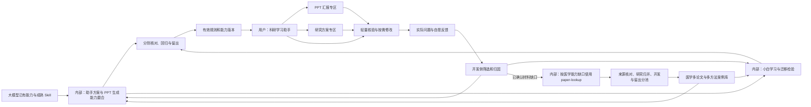

# 科研能力培养与三类 Agent 协作：整体落地方案

版本：v2.5 · 日期：2026-10-06 · 产品代码基线：3381558（main）· 本次复查起点：caaf6db（main）· 状态：整体实施规格；首轮基础已实现，新增闭环待实施。

本版以医学相关科研为主要能力范围，把研究方案融入产品目标、学习状态、三类角色、内部与在线工作流、前后端合同、版本、成本、磨合和验收。内部选用固定版本 paper-lookup 定向补充文献，材料获取、核对、分池与能力发布相接；用户端保持已有上传／阅读及轻量制作路径。按最新澄清，内部基于大模型、成熟 Skill 和多论文案例，分别磨合助手的产物能力与检验教学后的迁移能力；用户端使用已验证能力并做轻量核验。承接[原整体方案](Skill与工作流驱动的科研学习助手_落地方案.md)、[效率方案](主助手多智能体_效率成本效果落地方案.md)和[电脑端方案](研究工作台第三轮前端简化_落地方案.md)，后续建设以本文为准。[v1.0 原文](科研能力培养与三类Agent协作_整体落地方案_v1.0归档.md)与历史验收保留当时的版本和结论。

本轮完成[全链路覆盖与交接边界的整体复查](科研能力培养与三类Agent协作_整体复查与优化记录.md)；[v2.4 原文](科研能力培养与三类Agent协作_整体落地方案_v2.4归档.md)与[v2.4 复查](科研能力培养与三类Agent协作_整体复查与优化记录_v2.4归档.md)保留医学范围和采集选型依据；[v2.3 原文](科研能力培养与三类Agent协作_整体落地方案_v2.3归档.md)与[v2.3 复查](科研能力培养与三类Agent协作_整体复查与优化记录_v2.3归档.md)保留当时结论；[v2.2 原文](科研能力培养与三类Agent协作_整体落地方案_v2.2归档.md)与[上轮优化复查](科研能力培养与三类Agent协作_批判性优化记录.md)保留原结论；[v2.1 原文](科研能力培养与三类Agent协作_整体落地方案_v2.1归档.md)、[二次复查](科研能力培养与三类Agent协作_二次复查记录.md)与[历史复查](科研能力培养与三类Agent协作_方案复查记录.md)保留当时结论。不实施新增产品代码、不发起模型生成。本轮进行本地规格审查，外部来源保留此前核查日期与限制，不新增接口、法规或比赛信息已核验的声明。拟新增合同、接口和界面均为待实施规格。Word、视频及外部报名另行制作；本文不受参赛说明 5000 字限制。

## 1. 产品目的与能力形成

面向刚进入实验室、开始科研的医学生及医学研究生。帮助他们理解研究问题、设计理由、方法原理、观察与结论的关系，并逐步在新的课题中选择、调整和解释研究方法，用自己的话讨论与汇报。产物完成与能力形成分别评价：流畅的方案或 PPT 不能单独证明用户学会。

两条学习主线始终并进：

| 主线             | 内容                                                         | 希望观察到的行为                                     |
| ---------------- | ------------------------------------------------------------ | ---------------------------------------------------- |
| 科研思路与设计   | 问题、假设、设计、对照、混杂、替代解释、证据链、边界与下一步 | 解释为何这样研究，判断设计回答什么，提出有条件的改进 |
| 概念、方法与图表 | 必要术语、测量原理、实验单位、分组、归一化、坐标与统计含义   | 解释测到什么、怎样读图、哪些推断成立                 |

补基础要回到当前问题，讲研究思路也要补足必要方法知识。能力依托大模型既有知识、成熟 Skill，以及持续积累的多论文、方法和设计案例，不是学一篇论文就能迁移出任意新方案。

内部同时建设两项能力：**助手能否生成合适的研究方案／PPT**，以及**助手的指导能否帮助小白在新情境中独立设计／汇报**。前者产物变好不能代替后者，后者答得好也不能代替前者。两者各有输入、反馈、比较与发布证据。

内部路径为多论文案例积累、产物生成与教学诊断、归因、规则调整、回归／留出、有效版本发布。用户路径为提出问题或课题、助手帮助生成、轻量核对、修改／保存／导出；不强加完整内部训练或迁移考试。

用户可以自由追问、跳转或只完成当前需要的部分，不强制上课与考试。模拟学生帮助检查系统，真实用户能力须由其实际行为支持；即时迁移不等于长期掌握。

### 1.1 医学范围、研究类型与首批能力

能力建设和发布聚焦基础医学、临床研究及服务医学问题的转化、生物医学与数据方法。任务对象是科研学习与研究计划，不把患者个体诊疗当研究任务。医学用途是范围约束，研究对象、设计和证据条件决定使用什么规则；纯非医学课题说明当前支持范围，不自动扩展成泛学科训练任务。必要的通用统计／方法来源可作为医学任务的基础资料，记录适用前提。已有论文上传／阅读服务保留，新增自动文献检索与入库只用于内部材料建设，不提供用户端文献代搜／自动导入专区。

| 医学研究类型       | 设计与教学重点                               | 校验需防止的误用                                   |
| ------------------ | -------------------------------------------- | -------------------------------------------------- |
| 基础／转化实验     | 测量对象、对照、实验单位、干预与机制证据     | 把重复测量当独立样本，把模型系统结果直接当人群证据 |
| 临床观察研究       | 人群、暴露／结局、时间顺序、选择偏倚与混杂   | 把相关关系直接写成因果，对照和分析照搬实验模板     |
| 临床干预研究       | 研究问题、比较条件、结局与实施约束           | 无依据编样本量、操作参数或把研究计划写成已获得结果 |
| 二次研究／数据分析 | 原始数据或研究来源、纳入依据、重叠、方法前提 | 无数据编分析结论，同一研究多份报告当独立证据       |

类型是可并列的标签，复合课题不硬塞单一分类。助手在现有请求中识别设计，校验核对；不确定标待确认，仅在影响方案时渐进追问，不强制用户先选类型或填完表。首批以基础／转化实验中的“测量对象、对照与结论边界”为纵向路径，与已有图表教学衔接；临床与二次研究按各自材料、规则和评测逐批扩展，不把首批通过写成全医学成熟。

领域收敛减少检索来源、案例与规则适配面；仍须按“研究类型 × 具体能力 × 对象／资源条件”检验覆盖。材料的专业性、来源核对及实际调用成本不会因限定医学自动消失。迁移主要指医学课题中条件改变后的原理应用，跨研究类型的迁移需另有证据。

## 2. 产品形态与固定约定

### 2.1 主体加两个功能模块

| 部分             | 用户用途                                                       | 与能力闭环的关系                               |
| ---------------- | -------------------------------------------------------------- | ---------------------------------------------- |
| 科研学习助手主体 | 读论文、理解方法与图表、讨论研究思路、补基础、保存记录         | 提供学习过程、共同目标、来源与可回看证据       |
| PPT 汇报专区     | 从论文或研究方案组织汇报，预览、修改、核对、恢复、导出         | 检查研究叙事的解释、回答问题与表达质量         |
| 研究方案专区     | 从课题形成方案，分节讨论、修改、核对、恢复、导出；可先自己尝试 | 在新问题中应用所学，区分设计质量与独立迁移表现 |

PPT 与研究方案在同一前端导航中并列，主体聊天仍为主入口。“插件”指产品内部可扩展模块，不是要求安装 Codex 插件，也不是两个隔离应用。共用来源、学习意图、调度、检查、版本与记录，各自拥有产物结构、编辑和导出能力。

### 2.2 角色、界面与边界

固定为**助手、小白、校验三类角色**。助手教学、组织产物与修订；小白试读、复述、应用、独立设计或汇报；校验检查科学依据、设计、教学与表达。规划、候选优化、汇报者与首次听众是阶段或模式，不增加角色类别；调度程序也不是第四类 Agent。

明确分为内部训练／磨合和用户使用两个运行面。内部包含助手产物能力与教学迁移能力两条闭环；用户端默认直接帮助与轻量核验，不要求学习前后测、留出评测或评分达标。共享有效规则、来源规范和基础机制，执行政策、预算与报告分别配置。真实用户、小白模拟和助手内容分别记录。

只做电脑端，沿用 iOS／iPadOS 视觉语言、本地思源黑体与主题。内部角色轨迹、隐藏评分答案和成本明细留在开发侧；用户能看到影响操作的材料缺口、检查范围、版本与建议。保留既有论文、笔记、收藏、聊天与 PPT。

Skill 磨合是优化工作指引、案例、评价与流程，不是模型权重训练。当前产品尚未接入内部文献采集。待实施的采集由开发侧白名单程序有界执行，角色不获得任意联网、shell 或动态工具；用户在线生成不触发自动检索，也不声称会检索全部文献或执行实验。

### 2.3 两个运行面与共享能力



| 运行路径         | 主要检验对象                 | 成功依据                                           | 默认触发               |
| ---------------- | ---------------------------- | -------------------------------------------------- | ---------------------- |
| 内部产物能力磨合 | 助手生成的方案／PPT          | 来源、逻辑、适配、叙事／渲染、跨案例稳定性         | 有界开发批次           |
| 内部教学迁移检验 | 小白独立设计／组织／解释表现 | 学习可见证据、条件变化、独立理由、前后与未见题表现 | 指定学习单元与评测批次 |
| 用户使用         | 当前问题和当前产物           | 实用性、显见错误核对、透明缺口、可修改与可导出     | 用户提出请求；练习可选 |

有效能力提升由校验和版本管理支撑，既能用于用户产出，也能用于内部教学材料与诊断。内部发现的问题回馈对应层，而非统一改助手提示词。

### 2.4 本版的收敛方向

保留主体、双专区、三类角色和两条内部闭环，收敛首批实施与每批结论。先交付有用且范围明确的生成／修改能力；内部用具体能力、可解释失败和固定比较验证改进，再扩大多论文覆盖。材料积累、当前产物修订、工作规则发布、小白模拟表现与真人能力变化分别记录，不能用一个“训练成功”状态包办。

内部可复用成果是有来源与适用边界的规则／案例卡及能力清单，线上按任务装载；同课题的方案、PPT 和稿件按依赖提示更新，生成、核验、文件和行为各有状态。v2.4 将医学范围与内部采集回写整个路径：保留 R01–R41、F01–F11、T01–T58，新增两项范围／采集需求 R42／R43 和四项针对性验收 T59–T62。内部采集是材料准备程序，三类角色和两个专区保持。

v2.5 保留 43 项需求、11 项任务和 62 组验收，补强既有场景中的交接边界，不增加专区或角色。复查覆盖产品、科研依据、角色与学习、运行与数据、交互及发布；覆盖意味着找到设计和验证责任，未实现或未实测的内容继续待办。

### 2.5 从材料到用户收益的完整关系

| 层次           | 输入与配合                                                     | 可交付成果与下一层关系                                                     |
| -------------- | -------------------------------------------------------------- | -------------------------------------------------------------------------- |
| 医学材料与原理 | 内部定向获取；程序归并分池；助手提炼，校验回源                 | 有前提、反例与冲突的来源卡，支撑生成和教学；检索数不计掌握                 |
| 助手制作能力   | 方案／PPT／可选稿生成，校验直接核对；PPT 加代表性试讲          | 具体产物与范围明确的能力改进证据，进入闭环 A                               |
| 教学与迁移     | 助手实际教学；小白在隔离的新条件下独立应用；校验归因、助手补教 | 原稿、辅助记录、纠错与未见题表现，进入闭环 B；与产物质量分开               |
| 有效版本       | 程序固定条件、账本、回归／留出和发布清单                       | 两类能力按各自证据开放，固定模型／规则／材料及回滚指针                     |
| 日常使用       | 主体聊天与并列双专区；助手帮助，校验轻量核对，小白按需诊断     | 可讨论、修改、保存和导出的方案／PPT／稿件；练习不成为门槛                  |
| 反馈与持续改善 | 本轮建议即时适配；获准反馈进入开发筛选；真人行为独立记录       | 缺陷回对应层，材料缺口回采集；无授权不转通用案例，无真人证据不宣称真人进步 |

角色交流传递的是具体问题、依据、允许公开的反馈和下一步，而非整份隐藏答案。程序负责输入权限、版本、资源和发布，角色负责内容；凡涉及外部实际效果的结论都回到对应实测记录。

## 3. 当前基础、缺口与历史证据

对照代码与[首轮实施验收](科研能力培养首轮_实施验收.md)，本轮没有重跑产品测试或真实模型。

| 部分       | 基线 3381558 已有能力                                                         | 本版仍需实现或验证                                       |
| ---------- | ----------------------------------------------------------------------------- | -------------------------------------------------------- |
| 共同目标   | LearningIntent v1、三种程度与五个重点、旧值兼容、本轮／聊天偏好、角色输入传递 | 课题、多来源、产物用途、独立作答条件；教学内容实际效果   |
| 在线教学   | 助手、小白试读、核对、有限修订；核心教学不因程度调整省略检查                  | 开放复述／应用真正接入学习状态，具体补教与迁移反馈       |
| 小白环境   | LearnerStore／Environment、画像、可见教学、实际选择题、恢复                   | 开放设计、讲述、理由与未知项；选择题合同不能直接改名复用 |
| PPT        | 生成、单页编辑、保存、恢复、导出、意图接入                                    | 双条件、修改影响、真实软件渲染与方案汇报                 |
| 研究方案   | 课题分组与研究讨论，尚无独立方案产物                                          | 课题约束、多来源、结构化方案、专区、版本、核对、导出     |
| 规则与磨合 | 公共／小白／核对规则已补双主线与原因反馈；有限回放比较                        | 完整归因、候选、留出、发布与跨功能回归                   |
| 前端与资料 | 桌面工作台、附件、原 PDF、精确选区、笔记、PPT、设置与记录                     | 并列入口、无论文起步、分节编辑、实际用户体验             |
| 预算与缓存 | 在线预算、停止、全局两任务、同论文串行；provider 隔离、阅读覆盖               | 多课题／产物锁、检查点隔离、后台账本、跨产物失效         |
| 国内模型   | 显式配置兼容接口、图像声明、JSON／schema、本地校验、探针                      | 最终平台、凭据与真实教学、PPT、方案效果；T20 未通过      |

首轮记录 105 项工程测试与三组浏览器检查通过，生产模型调用为 0；不能据此证明学习效果。代码位置包括 shared/types.ts、shared/learner.ts、shared/workspace.ts、server/assistant.ts、server/orchestrator.ts、server/learner.ts、server/model-config.ts、server/scheduler.ts 与 app/research-workspace.tsx。

历史[四场景迁移验收](基础资料迁移与四场景验证_验收.md)的 Figure 1m 分母与事实引用缺口保留；其他 PPT 通过不能覆盖旧失败。高清图不证明投影可读。真人学习、原生缩放和 PowerPoint／LibreOffice 实际渲染仍需验收。

## 4. GitHub 学习依据与采用方式

沿用 v1.0 已实际读取的七份固定文件；v2.0 成稿时另读取 Research Grants v1.5 的固定源码，补上方案生成与可行性指引。成熟 Skill 提供工作方法，仍需科学核对、适配和实际比较，不因仓库流行就认定效果可靠；未安装框架或复制整套 Skill。

| 固定来源                                                                                                                                                                         | 采用机制与落点                                     | 取舍                                                               |
| -------------------------------------------------------------------------------------------------------------------------------------------------------------------------------- | -------------------------------------------------- | ------------------------------------------------------------------ |
| [TinyTroupe](https://github.com/microsoft/TinyTroupe/blob/a6244b358a1fe1c71bf751f7ba0f8dfa368ec5a4/README.md)                                                                    | 画像、可见历史、检查点与实验条件；独立迁移比较分支 | 复用现有 Store，模拟真实性仍须校准                                 |
| [DSPy GEPA](https://github.com/stanfordnlp/dspy/blob/bc8af7ed3d5ee0b892211e5c03274396442a413c/docs/docs/diving-deeper/gepa-in-depth.md)                                          | 失败反馈提出有限候选，回归主体／方案／PPT          | 不允许候选降低科学判定条件                                         |
| [LangGraph](https://github.com/langchain-ai/docs/blob/9e88062916107128a28c10e8233ec0d17da86c86/src/oss/langgraph/workflows-agents.mdx)                                           | 显式状态、路由、评价与修订，共享执行机制           | 延续 TypeScript 状态机，不迁移框架                                 |
| [AgentEvals](https://github.com/langchain-ai/agentevals/blob/946ad15b9f2ce9bc9843edd2bb773bd07d78ca7e/README.md)                                                                 | 轨迹合规与内容评价分开，查独立作答前的泄漏         | 程序检查不能代替专业判断                                           |
| [Scientific Critical Thinking](https://github.com/K-Dense-AI/scientific-agent-skills/blob/92ace75ac21efe19a620434e0ca4e356081fe807/skills/scientific-critical-thinking/SKILL.md) | 设计、混杂、实验单位、统计与推理边界               | 按研究类型选条件，不给所有实验套用 GRADE                           |
| [teach](https://github.com/mattpocock/skills/blob/4588b32ecab9ecc9fc8cc6b6c5e7d675b6004b0d/skills/productivity/teach/SKILL.md)                                                   | 目标、实际应用反馈和可修订学习记录                 | 不强制课程，不把流畅当长期掌握                                     |
| [Anthropic PPTX 指引](https://github.com/anthropics/skills/blob/683bc88e56f3e09ba94f7055977f3d3aa499f202/skills/pptx/SKILL.md)                                                   | 结构、渲染、字体与布局；论文和方案汇报             | 文件为 Proprietary，只借鉴检查方法，不复制资源                     |
| [Research Grants v1.5](https://github.com/K-Dense-AI/scientific-agent-skills/blob/92ace75ac21efe19a620434e0ca4e356081fe807/skills/research-grants/SKILL.md)                      | 目标、论证、研究路径、可行性、风险、里程碑与修订   | 原文面向资助申请，只抽取通用方法；不搬国外申报要求、阈值或外部工具 |

另参考本地 researchwrite 的证据表、论证图与分节合同，仅用于模块规格；本轮未执行科研申请书写作流程，也不引入其动态专家或申报级 QA。上游须经过版本／许可／依赖核查、三角色适配、开发集比较、留出和发布，不自动更新生产规则。

专业规则回到真实原文、图注、方法和基础来源核验。后续复用代码须登记版本、许可证与依赖。开发侧学习后转为版本化规则，运行时只读取程序允许的 Skill 和材料。

### 4.1 内部文献采集 Skill 的选型与适配

本轮选定 [K-Dense paper-lookup v2.4](https://github.com/K-Dense-AI/scientific-agent-skills/blob/a92663a0214b3b9fa1ba6b958284ffd919c00a0c/skills/paper-lookup/SKILL.md)，固定提交 a92663a0214b3b9fa1ba6b958284ffd919c00a0c。已核查说明、PubMed／Europe PMC 来源指引及仓库 [MIT 许可证](https://github.com/K-Dense-AI/scientific-agent-skills/blob/a92663a0214b3b9fa1ba6b958284ffd919c00a0c/LICENSE.md)，前轮已查看分页／JATS 解析源码；这些是选型依据，尚未安装或集成，不代表脚本与所有接口已实测。

它提供学术数据库检索、标识符定位、可获取全文及来源记录方法；附带脚本处理分页与正文解析。首期只启用 Europe PMC 检索／开放正文和 PubMed 定位／元数据核对，按任务使用所需接口，不默认遍历全部 18 个来源。首次适配核对 Python 3.11+、脚本依赖与目标 API；保留现有 TypeScript 调度，在独立内部工作进程中调用固定审查脚本，结构化参数传递、路径固定，模型不拼接 shell 命令。缺依赖／接口不可用则材料准备待处理，已有可用来源继续服务。

接口文档、API 错误形状、分页／限流、来源身份与正文覆盖均须有适配验证；不把 HTTP 200 或下载成功当内容完整。本轮 Europe PMC 官方文档访问未成功，固定上游指引已读，真实目标 API 探针仍为实施待办。软件的 MIT 许可与论文／图件的使用许可分别登记，复制脚本时保留许可证及版权说明；内部材料并不因“内部”二字自动具有所有复用权限。

## 5. 前后端共同合同与数据关系

### 5.1 扩展任务上下文，保留学习意图

继续分开“讲多少”“重点学什么”“完成什么”。程度为简洁／常规／深入；重点为综合理解／补基础／研究思路／方法与图表／机制；目标仍用理解、迁移、研究讨论、汇报，不把模块变成新的学习重点。

现有 LearningIntent v1 保留，拟用 TaskContext v2 包装，区分学习来源与目标课题：

```ts
type TaskContextV2 = {
  schemaVersion: "2";
  learningIntent: LearningIntent; // 既有 v1，单论文字段绑定真实主来源或为空
  topicRef: { id: string; version: string } | null;
  capabilityRef: { id: string; version: string } | null; // 生产发布或内部候选的不可变清单
  backgroundRef: { id: string; version: string } | null;
  researchProfile: {
    domain: "medical";
    studyTypes: (
      | "basic-translational"
      | "clinical-observational"
      | "clinical-interventional"
      | "secondary-research"
    )[];
    status: "confirmed" | "provisional" | "unknown";
  };
  artifactRef: {
    kind: "explanation" | "research-plan" | "ppt";
    id: string | null;
    version: string | null;
  };
  executionMode: "online" | "internal-evaluation";
  workMode: "assisted" | "independent-attempt";
  requestedScope: "direction" | "design-draft" | "full-plan" | null;
  requestGuidance: {
    currentInstructions: string[];
    preferenceRef: { id: string; version: string } | null;
    feedbackRefs: string[];
  };
  reviewPolicy: "lightweight" | "development-evaluation";
  evaluationTarget: "artifact-capability" | "learning-transfer" | null;
  reviewPurposes: (
    "artifact-quality" | "presentation-diagnostic" | "learning-transfer"
  )[];
  protocolRef: string | null;
  learningSourceRefs: SourceRef[];
  targetSourceRefs: SourceRef[];
  learnerCheckpointRef: string | null;
  parentJobId: string | null;
};
```

这是概念合同，导出类型在 F01 扩展时确定。多来源完整清单以 TaskContext 的 SourceRef 为准；没有单一主论文时 v1.scope.paperId／sourceVersion 为空，避免双合同重复且矛盾。用户模式 backgroundRef 仅在有版本化背景记录时绑定，否则为空并采用本轮公开背景，不要求为普通生成建立模拟状态。SourceRef 由来源种类、所属论文／资料、来源版本、sourceId、定位和实际可见片段确定，不能只用可能重复的 sourceId。学习论文 A 不等于 A 的数据可作课题 B 的事实。后端重新校验引用、权限与来源，不信任前端的“已学习”“已通过”。requestGuidance 只装当前用户建议与获准的个人偏好／反馈，不复制整段历史；权限从服务端记录解析，前端不能把一个训练同意布尔值伪造成真实用途授权。

优先级为本轮明确请求／选择 → 当前聊天／课题偏好 → 获准跨聊天偏好 → 默认。旧 brief／standard／deep 对应程度＋综合，foundations 对应常规＋补基础，mechanism 对应常规＋机制。设置按聊天保存；“这一段”仅改本轮，“以后都……”才改偏好。跨专区初次带入有效偏好，之后其他聊天的修改不悄悄覆盖已有方案设置。简洁不等于懂基础，深入不等于堆术语。

capabilityRef 由服务端在任务开始时解析并固定，关联第 11.4 节的模型配置、角色规则、案例包和检索政策；内部候选独立命名空间，不能由在线请求指定。旧记录可为空，新任务补成明确的有限初始清单，无需先建设完整发布平台。清单在任务中保持一致，发布切换只影响随后新任务；用途授权撤回或来源失权按第 8.2 节实时阻止对应用途的未发阶段，优先于快照复用。

researchProfile 绑定 Topic 的实际问题与设计，材料卡／能力清单／核验使用相同研究类型和确认状态；来源论文的类型不直接充当新课题类型。未知可用空 studyTypes＋unknown，按明确假设起草，不强套已发布模板。跨模块沿用当前课题版本，若用户改设计则更新标签及相关依赖。旧数据按任务重新识别，不凭“医学论文”就默认临床干预。超出医学范围的请求不构造假的 medical 任务或自动检索，保留原输入并说明支持范围。

### 5.2 核心实体与证据关系

| 实体                     | 内容与边界                                                                                                         |
| ------------------------ | ------------------------------------------------------------------------------------------------------------------ |
| Project                  | 沿用课题分组，不把分组名称当完整研究问题                                                                           |
| ResearchTopic            | Project 可空；问题、对象／场景、目标、已知条件、资源、未知项和版本；无 PDF 可起步                                  |
| SourceSnapshot           | 论文／资料、用户条件各自定位；内部来源另记检索批次、DOI／PMID／PMCID与版本、实际覆盖、用途许可及更正／撤回检查范围 |
| LiteratureIntakeJob      | 内部采集目标、医学研究类型、能力缺口、查询／接口版本、HTTP 尝试／字节／截止、游标和材料状态；按需关联模型评测账本  |
| CorpusCase／SkillRelease | 原理／反例、研究类型、研究／报告家族及开发／留出分池；发布绑定规则、材料包、检索政策、模型与评价证据               |
| LearningCheckpoint       | 背景、可见教学、行为证据、来源范围与覆盖，和真人记录分开                                                           |
| ResearchPlanVersion      | 分节内容、理由、来源、未知项、作者／参与方式、上游版本与影响范围                                                   |
| ReviewReport             | 产物、材料、目标、评价规则版本；核对目的、具体问题、试讲／作答证据、范围、未评价项                                 |
| PresentationAttempt      | 精确 PPT 版本、学习检查点、汇报者／听众条件、可见页面／讲稿、讲述、问题与回答                                      |
| TransferAttempt          | 独立原稿、作答前可见内容、课题与检查点、反馈、补教、再尝试；不等于方案最新版本                                     |
| DeckVersion              | 保留页面／逐页备注；新增汇报用途、方案引用与可选完整演讲稿关联                                                     |
| SpeechScriptVersion      | 完整演讲稿、稳定页面 ID、条件、作者、精确 PPT／来源版本、核对与同步状态                                            |
| JobLedger                | 根任务、子阶段、所有尝试、调用／用量／截止与运行版本；继续任务保留累计                                             |

只把核对后的实际行为写入学习证据。看过页面、助手改好方案、自称理解都不能单独升级为掌握。用户可不参加评测而正常使用专区。

workMode 是任务起始方式，不能替代段落级归属。方案章节、PPT 页面与稿件段落保留稳定内容 ID、作者和变更来源；TransferAttempt 保存提交时原稿、各次可见教学／提示、具体受助部分与时间顺序。用户独立写完再让助手修改一节，原稿仍可供评价，新节标受助，不把整篇新稿算独立。按既定协议区分通用过程提醒、目标内容提示、示范／直接改写，记录真实曝光；目标答案只要已交付并可访问，就不以未点击为理由称未见。未保存手稿先保留本地草稿，提交／制作以用户确认的保存版本为准。首期采用章节／页面粒度，不要求逐字追踪；无法确定的归属标未知。

evaluationTarget 表示根任务主要目标，reviewPurposes 表示本次核对实际覆盖的维度。一次内部试讲可以同时产生 PPT 质量诊断和当前理解表现，分别出结论并引用同一 PresentationAttempt；没有独立作答的证据时不能追加 learning-transfer 通过。protocolRef 固定背景、输入可见性、角色及评价版本、有效用户指导与偏好版本、比较条件和必要阶段，不能由运行中 Agent 自行改写。内部比较协议另记录未学习／只给材料／教学分支、材料覆盖与采样配置；后台比较和在线复合任务由程序生成协议，简单在线任务可为空，不让用户填写内部条件。

### 5.3 模块机制、旧数据与并发

建立内部模块注册合同：输入、产物 schema、角色输入构建、必要检查、修改影响、预览／导出能力。共用预算和存储机制，不允许模型动态加载代码。

现有 TaskInput.module 仅为 paper／method／figure／ppt，不能类型强转承载研究方案。F10 同步扩展 shared/types、server/schemas、路由、执行、存储与前端，使用有版本的判别合同。无论文任务不能虚构 paperId，多来源不能塞成一篇论文。

升级非破坏、可回退；新方案与尝试独立命名空间，旧对话／PPT 缺字段走明确兼容。迁移前保存快照，重复迁移幂等。并发编辑携带 expectedVersion，冲突保留双方草稿。恢复旧内容创建新当前版本，不修改历史内容或核对结论；历史缓存可留但不得返回为当前有效结果。

### 5.4 主张、来源与派生产物的依赖

以既有版本实体保存轻量依赖记录：内容 ID／版本 → 主张与事实类别 → SourceRef 的确切位置／用户条件 → 上游内容 ID／版本 → 核对范围。首期结构化字段即可，不建设额外知识图谱平台。来源编号可以为阅读重新排序，内部引用标识保持稳定；方案转 PPT、稿件或导出时转换表现形式，不丢主张依据、图件出处与计划语气。没有来源的设计提议保留其类别，不能转换后变成文献事实。

影响判断区分科学含义／条件变化、表达／顺序变化和来源许可／身份变化。前者沿内容依赖传播，表达变化核对本段及衔接／讲述，来源失效传播至所有引用对象；无法可靠判断影响时扩大待核范围。旧版本保留当时依据，新版本无直接关系的部分可复用已核事实，但报告须列本次重核、继承的版本／范围和未评价项，整份旧报告不直接复制为新版本通过。

同步采用当前手稿、其上游基线和新上游的三方差异：未改且受影响的部分可预览更新，双方均改的部分交用户选择；增删／重排按稳定内容 ID 处理，不按页码覆盖。保存新的依赖版本与未同步项，局部同步不冒称全部已跟随新方案。转换任务须同时校验上游与目标版本，避免目标未变但上游已变时写入过期结果。PPT 写入备注和稿件同步沿用第 10.5 节同一规则。

## 6. 三类角色的行为与校验交流

| 角色 | 可见输入                                                           | 工作与返回                                                |
| ---- | ------------------------------------------------------------------ | --------------------------------------------------------- |
| 助手 | 共同目标、允许材料、已交付教学、用户约束、反馈                     | 双线教学、方案／PPT、理由、来源、未知项、按根因补教或修订 |
| 小白 | 稳定背景、实际可见教学、公开任务与约束、自己的历史；按模式取得产物 | 自己解释、设计或讲述，承认缺条件，说明依据、选择与理由    |
| 校验 | 共同目标、允许完整核对材料、产物、小白原答、独立评价条件           | 位置、依据、影响、根因、建议、处理对象与未评价项          |

严格学习归因主要用于内部检验。用户端不需要每个人的完整模拟学生，也不以内部考核达标作为生成／导出前提。独立迁移时，小白看不到目标助手方案、参考答案、完整校验报告或评分备注。试读成品可看产物，但只检验可理解性／解释表现，不能计独立设计。公开要求可说明需对照、依据和边界，不能把隐藏目标答案改成提示。

校验检查事实、推理、教学衔接、迁移条件和表达；方案增加设计适配与可行性，PPT 增加叙事与视觉。根因包括材料缺失、事实错、设计／推理错、必要基础未教、讲解断点、小白越界或误读、表达问题、实际条件不具备。每项有位置和下一步，不能只给分或笼统要求“更详细”。

助手据此判断改哪层：材料不足请求补资料，设计错改关联章节，基础没教补原理，PPT 冗余改页面。通俗、字数和总分不能抵消事实错。允许多个合理方案，不按参考措辞机械判错；争议保留，必要内容回源文或独立专业审阅。

反馈按结构返回：问题位置 → 可定位依据或实际行为 → 受影响对象 → 根因与判断把握 → 修改建议 → 下一次要检验什么。不确定原因明确标记，不强行选一项归因。完整校验输入与内部评分备注留在核对侧，助手补教后向小白只提供公开教学／反馈摘要，不能把隐藏评分答案随报告转发。用户端把这些信息压缩为可操作建议，不展示内部轨迹。

源材料、论文正文、用户笔记和未批准的上游 Skill 文本作为待处理数据，不能改写角色权限、核对标准或预算；适配后的有效规则由程序按发布版本加载。核对至少区分可定位文献事实、用户提供条件、模型一般知识但未核实的陈述、设计推论、待验证假设与未知；引用存在不代表支持主张，须核对“这条依据支持什么”。未有原文时可交付通用框架与明确假设，不能给出文献已核实或新方案已证实可行的状态。科学含义、事实数值和用途边界不因线上轻量策略省略，轻量主要缩减评价范围和非必要阶段。

补基础要连接实验与概念；研究思路要呈现问题到设计到推理；方法图表关注测量对象、单位、分母与实验单位；机制区分已证实和待验证环节；综合按当前问题平衡双线。三类角色都收到同一重点，不能只改变助手篇幅。

在线新增方案／PPT 的助手＋校验是基本路径，小白按明确用途接入：用户要求解释或练习、生成结果出现具体理解断点，才做对应诊断；既有核心教学的 3／6 路径保持。内部代表性 PPT 做试讲／听众诊断，独立迁移另走隔离条件。程序在发出前固定必要阶段、允许输入和预算，Agent 不自行增加角色回合。用户说“更简洁”可以改呈现方式，不自动触发小白考试。

校验问题保留稳定 issueId、依据、受影响版本、应修条件及处理结果。科学错误／引用不支持属于待修问题；材料缺口标未评价；表达建议允许合理不同写法。助手一次修订须指出哪些问题已处理、哪些待补及新影响，复核按原问题与受影响内容检查，不因换了写法另造一整套目标。在线最多一次自动修订；仍有争议就交付带说明的草稿，后续由用户选择继续，不循环追求一个总分。

问题另记类别、影响与状态：已确认错误、待补依据、合理取舍／表达建议、有依据争议分别处理；状态保留提出、已修改待复核、已解决、待材料或争议。助手声称修好不能直接关闭问题；已解决须有同一范围的复核依据。事实错误阻止标为对应范围已核对，争议或缺材料保留透明草稿；格式／权限／预算错误由程序处理，不让校验用科学评分代替。用户提出反证时按原 issueId 保存材料并回源重核，不删除原意见、不机械服从参考模板；额外模型核对仍预约，专业审阅不可用就保留争议。通用改进候选也不能把用户满意或助手辩解当真值。

医学研究类型影响助手的设计指引、小白的公开目标条件和校验侧的判断依据，不增加专科 Agent。通用来源／证据规则共享，研究类型规则按已确认设计选用；不同类型可有合理多方案，不能用一套机制实验模板评临床观察研究。类型不明时校验指出影响而不是猜；科学事实与研究设计讨论保持各自来源和未核范围。

## 7. 小白学习环境与独立迁移证据

### 7.1 从选择题扩展为开放行为

保留选择题回归，新增复述、情境应用、方案与汇报的判别 schema。记录理由、可见依据、缺口、选用／弃用方法和适用条件，各模式有对应评价合同；expectedChoice 和 requiredVisibleIds 不能评价开放设计。

稳定画像描述待检验的已知、未知与误解；这些是模拟条件，不把画像声明当作大模型真实知识边界。状态区分已教、观察到表现、在新条件下表现及待检验；研究做法关联必要前提。补教不直接设为掌握，失败／取消／无效作答不写有效收益。全篇汇报需真实覆盖研究路线、设计与结果到结论的衔接；导入全文或局部 Figure 不等于学完全文。

独立尝试保存白名单、检查点、可见教学与原稿。恢复／比较深拷贝分支，不污染其他学生或线上状态。依据区分初始已知、可见教学、公开目标材料、未知／无法归因。流畅不证明增益；预训练知识不可彻底观测，不能宣称提示词消除全部泄漏。

程序查非法引用、输入越界与答案泄漏，内容检查未教前提、机械套用和条件不匹配。已知基础、公开题目材料可正常用，不一概判泄漏；疑似越界或无法归因的项不计教学增益。

### 7.2 多论文积累、学习前后与候选比较

内部检查点包含多个相关论文与教学单元，按能力组织，覆盖同一做法在不同对象、资源与失败情境中的适用／不适用。先小批次跑通，再逐步扩大真实文献与方法覆盖；小批次通过不表示能力全面成熟。大模型基础知识不会因新建画像消失，未学习分支刻画已有表现，教学分支观察额外作用。

需要评价教学增益时，从同初始检查点分出未学习、只给材料、材料加实际教学三个隔离分支；未学习分支刻画底座已有表现，只给材料与教学分支使用相同可访问事实和目标条件，区别是有无教学解释。所有分支答同一个预先固定且未见参考答案的目标任务，各自答案／反馈不进入其他分支。使用平行题时跨独立重复对调分配并记录难度，不能只把不同题的分差当教学作用。模型／采样设置、辅助程度和评价固定；上下文长度差异等残余影响仍记录。第三分支是内部归因对照，不进入用户默认流程；没有这项对照时只报告“教学与材料共同作用下的表现”。

基线与候选从同初始状态分别教学，固定模型、材料、任务条件和评价版本。同题反馈后修改反映纠错；再次迁移须另一个未看答案的课题。即时迁移、保持和真人有效性分别报告，无数据留空。

题目陌生程度与原理迁移层级分别记录。隐藏目标答案的留出例仍可要求应用教学中学过的同一原理，这是同原理换条件；要声称跨方法或研究类型，则增加对应的新条件并补覆盖证据。公开论文可能已在底座知识中，工程隔离不能证明预训练未见；可组合新的资源约束／任务，记录可观察曝光与残余不确定。每次实际运行的失败、缺材料、超时和未完成保留在批次总记录，重试另记，不只选成功稿计算改善；资料／工具故障与内容错误分开，不把网络故障归小白能力。内部停留在预先固定范围的逐例比较，小样本不外推为医学教育普遍有效。

评测助手产物变化时使用相同学习检查点的独立克隆，只变更方案／PPT；评测教学变化时固定适用的产物和任务条件，只变更教学。重试的学生分支不继承前一分支的评分反馈或试讲练习。若教学、产物、小白规则同时改变，只能报告整体变化，另做单因素比较才归因到某层。内部记录每类角色 Skill／模型版本；校验规则变更时不能继续当作同一评价尺度比较旧分数。

大模型不会因“小白”提示词而真的失去预训练知识。先观察未学习分支的真实表现，不指令它故意出错来制造低基线；若任务已被底座很好完成，记为教学增益暂不可测，调整下一批任务或关注解释缺口，不倒推本批教学有效。教学历史是本次调用实际可见的上下文和可检索记录，不是权重更新或永久学会。多次比较记录逐例结果、失败和波动；小样本作为方向性诊断，不给总体有效率或因果承诺，若需要复验必须预占所有调用。

### 7.3 贯通例子

以下仅用一个局部案例展示一项原理的检查方式，完整内部学习仍需多论文单元，不是论文事实或实验结果：从论文 A 学习“两种测量相互支持仍需说明各自对象与混杂”。课题 B 的资源只允许一种方法。小白独立解释哪些原理能迁移、为什么不能照搬、需哪些对照、还缺什么。校验发现机械套用后，助手补教“证据目的与方法选择的区别”。同题修改记录纠错，另一个不同限制的课题 C 检验再次迁移。有效方案可转开题 PPT，说明拟做什么和怎样判断可能结果，不虚构已取得结果。

### 7.4 按可观察能力组织材料与任务

以能力矩阵连接“前提 → 教学材料 → 新条件任务 → 可观察行为 → 证据范围”。例如对照选择需理解测量对象与替代解释，再在对象、资源或混杂变化时提出对照并说明它排除什么；汇报需选择证据主线、解释关键图件和回应公开问题。各能力记录材料簇、教学覆盖、原始作答、允许辅助和未覆盖场景，不只记阅读篇数或累计总分。

材料库可持续扩大，但每批只选择明确能力和任务族；覆盖适用／不适用及失败情境，优先用暴露缺口的案例。迁移结论按同原理换条件、跨方法／课题、长期与真人证据分层；窄范围通过不升级为广泛科研能力。模拟与自愿真人尝试共用可追溯记录结构，但数据和结论分开，未参加者没有能力判定。

医学材料按研究类型、具体原理和适用条件组织；同一主题下包含条件改变、反例或限制证据，不只收近期正结果、高引用或方便下载的论文。英文开放材料优先可实现采集不表示覆盖所有医学文献；语言、全文可得性、研究类型和亚领域缺口登记。临床或国内语境材料不足时缩小发布范围／按合法可用来源补充，不自动承诺中文库和机构访问。

## 8. 在线主体教学：必要核验，不变成内部考试

用户端目标是理解和完成当前任务。现有核心教学的助手 → 小白试读 → 校验作为已有轻量路径保留，小白用于发现当前解释断点，不必完整维护每位用户的内部训练画像、前后测或严格掌握报告。简短定义和压缩已有文字保留轻量来源核验。

后续按任务选择助手＋校验，或按需要增加小白试读／用户自愿练习。方法、研究思路和基础前提仍核对，但不把“没通过内部迁移评测”当继续使用门槛。当前三阶段路由不在文档中冒称已完成改造，新策略由 F02／F07 实现与验收。

生成过程中优先呈现当前问题的设计理由和关键取舍；用户自愿时可从“换一个条件会如何调整”“为什么选这个对照”等单个追问进入练习，并保留原答、反馈与受助程度。看过助手答案后的复述可以帮助理解，不补记为独立作答；不为收集证据额外打断每轮聊天。

具体错误或“仍不理解”触发针对性修订，自动最多一次；不足保留未知并建议补充，不自动猜齐。事实或设计变化不因“润色”跳过检查，每条回复不追加整套方案或训练。用户看到讲解、缺口与下一步，不看内部评分；补材料后绑定新版本，保留任务关联与累计成本。练习自愿，真人行为不由模拟替代。

### 8.1 用户建议驱动的灵活调整

Skill 提供工作方法、检查边界和默认结构，程度／重点提供起始偏好；助手仍利用大模型理解本轮目标与用户建议，选择解释、例子、顺序、格式、产物范围及需要哪种核对。无需为“先举例再讲原理”“别再重复定义”“给我两种设计的取舍”每次新增 Skill。可调整教学与呈现方式，科学依据、事实诚实、独立作答权限、预算和已批准工具能力继续由程序约束；用户希望简短时压缩表达，保留必要事实限定。

| 用法           | 如何生效与保存                                                                       | 与内部训练的关系                                                 |
| -------------- | ------------------------------------------------------------------------------------ | ---------------------------------------------------------------- |
| 本轮建议       | 默认立即用于当前任务与相关修订，不因一条建议改长期设置；明确撤销时恢复               | 当前上下文适配，不是权重训练或通用规则发布                       |
| 聊天／课题偏好 | “这个课题以后先讲理由”等明确范围可直接保存，显示可撤销摘要；普通重复行为只作暂时线索 | 同一用户、同一范围复用，不扩散到其他用户                         |
| 跨聊天个人偏好 | 默认关闭；用户启用或明确要求后只存必要摘要，支持查看、编辑、关闭、删除               | 个性化记忆，不等于掌握水平或全局 Skill 改进                      |
| 改进通用能力   | 默认关闭；用户选择某条反馈和必要上下文，预览提交范围，再进入内部案例筛选             | 获准反馈形成失败案例／候选，校验、开发比较、留出通过后按范围发布 |

产品的两个独立开关是“跨聊天记住我的偏好”和“允许选中的反馈用于通用改进”；关闭二者仍可正常使用，本轮适配照常。选择通用改进不自动上传全部聊天、附件或允许模型权重微调。单条提交支持用途选择与撤回，保存授权版本、时间、范围、用途和实际接收方；旧反馈不因后来打开开关而批量回溯入库。保存偏好和共享案例不是同一个授权，不能互相推导。

适配流程为用户请求／建议 → 助手识别任务、表达偏好、背景条件或事实纠错 → 程序确定有效范围、冲突和预算 → 助手据此生成／修改 → 校验事实与必要设计／页面一致性 → 返回并显示必要偏好变化。明确建议优先于本轮默认程度；相互冲突先按明确范围和时间处理，只在实质影响任务时澄清。在合法与科学事实边界内，用户主动要求“这个回答先详细一点”只影响本轮，不能悄悄改整个账号。基于措辞推测水平是可纠正线索，不给用户贴永久“小白”标签，也不从语言自动推断病史等敏感背景。

事实纠错先回源核对，建议不能直接成为科学真值；满意度／流畅程度不代替教学迁移证据。获准通用反馈归为表达、教学、事实、设计或交互缺陷，保留反例与相反偏好；一般个人喜好留在个性化层。候选比较双方采用同样有效用户指导；换了偏好后的改善不能直接记为同条件能力提升。助手提出有限调整，校验按第 11.6 节独立核对和回归，小白在固定公开条件试读／迁移；不能为迎合反馈让它故意答错或把私人上下文送入其他小白。未经批准的反馈不进入共享训练或留出题库。

现有 server/assistant.ts 已把最近主动反馈／未解决问题作为后续上下文，LearningIntent 支持本轮和聊天设置；这是适配基础，尚无完整跨聊天记忆、通用改进授权或反馈候选管线。F01／F02／F05／F06／F07 扩展 requestGuidance、PreferenceRecord、FeedbackCase 的范围／版本／归属／授权合同、缓存失效与撤回。真正用户请求与建议单独建输入区，引用材料仍是数据，避免“防注入”把正常建议也当作不可执行文本。

默认复用已预约的助手调用提取本轮有效建议，程序校验结构并应用；明确偏好可直接保存，模糊建议不隐形触发额外分析链。摘要、嵌入、分类、候选或独立核对只要实际调用模型都进入账本。每次发出和入库前校验用途权限，撤回后终止未发出的共享阶段、清理派生记录／缓存并重审发布；删除偏好同步失效摘要、索引与缓存，不能再从旧聊天自动重建已删除记忆；已发出的远端请求按提供方能力处理，不承诺能即时召回。初期采用规则／案例优化，不实施模型权重训练。

### 8.2 数据使用的研究结论与产品边界

v2.2 修订时已按中国大陆使用场景查阅官方文本，本轮保留该核查范围。《个人信息保护法》要求合法处理依据、目的与必要范围；基于同意的用途改变、撤回，医疗健康敏感信息、匿名化及境外提供另有规则。不能把去掉姓名视为不可复原匿名化，也不能用上传者同意覆盖患者或他人的权利。具体方案须结合实际数据、提供方关系和部署地区判断，两个开关不是合规证明。[法律原文](https://www.cac.gov.cn/2021-08/20/c_1631050028355286.htm)

《生成式人工智能服务管理暂行办法》第七、十一条涉及训练数据合法来源、知识产权及用户输入保护；第二条区分向境内公众提供服务与未面向公众的研发应用。内部研发的该项适用差别不等于免除个人信息等其他义务。普通使用和通用训练应分开设计。[办法原文](https://www.cac.gov.cn/2023-07/13/c_1690898327029107.htm)

本产品决策：初期共享案例不接收可识别患者资料或未获授权的第三方材料，优先提交已抽象的问题／期望／实际结果与获准片段；去标识化材料仍按可能有个人信息处理。数据说明分别列当前服务、记忆、通用改进的用途、保存期限、模型接收方和权利入口。必要服务不能靠可选“通用改进”开关取得权限，不同用途不能混装到一个包；处理基础和告知在实际上线前落实。

本地网页／存储不等于离线推理：server/compatible-provider.ts 会把允许的输入发送给配置端点，其他提供方也须核查实际数据路径。共享改进默认关闭不能阻止正常推理所需的远端传输；模型提供方是否保留、用于自身训练、涉及境外及承担什么处理责任须分别确认、按适用规则处理，未知时不宣称零留存或无跨境。改变提供方或用途重新检查，不通过一个同意按钮兜底。

## 9. 研究方案专区与内外闭环

### 9.1 输入与结构

从论文聊天带入所学、直接填新课题或继续旧方案均可。最少输入问题或方向；对象、观察、类型、资源、时间与条件逐步补。信息不足先形成框架、备选路径和待确认项，不能编造完整条件。无 PDF 可以开始，无学习经历不能声称已经检验迁移。服务端区分方向框架、设计草案与较完整方案的 requestedScope，按当前请求选择部分，不把空白章节包装为完成。只追问会实质改变设计方向的条件，每轮最多三个合并问题；其他未知在稿内显示可编辑假设或备选，不反复要求填表。用户条件标为陈述而非核实事实。

| 部分             | 设计时关注的问题                                                     |
| ---------------- | -------------------------------------------------------------------- |
| 问题、背景与依据 | 对象和范围，证据支持什么，未知在哪里；创新点是待核查主张             |
| 假设或探索目标   | 怎样被支持／反驳；观察性／探索性研究不强套机制假设                   |
| 设计与方法选择   | 为什么适合问题，备选如何取舍，原论文做法为何能／不能迁移             |
| 分组、对照与混杂 | 排除哪些解释，实验单位、独立重复、随机／盲法等是否适用               |
| 测量与结果判读   | 对象、原理、条件与误差，可能观察支持什么、不能推出什么               |
| 分析与样本依据   | 指标、统计前提与实验单位；缺依据列待计算条件，不编效应量或固定 n     |
| 可行性与路径     | 材料、设备、技能、时间、成本、里程碑、风险和替代路径                 |
| 边界与下一步     | 未验证假设、缺文献／条件、需导师或专业审阅的决策；相关研究的伦理要求 |

这张表是助手组织内容和内部开发审阅的方向，不是要求用户一次填完或逐项达标的表单。可只生成所需部分，其余留待确认。每节同时写“拟做什么”和“为什么”。区分事实、文献方法、设计提议、假设与可能结果。操作参数只有可靠依据和实际条件具备时才写成可执行步骤；方案不等于 SOP、伦理批准或已证实可行的实验。当前不自动实验或全网检索，导出保留范围、依据、版本和待确认。

把帮助形成能力嵌入实际制作：在关键方法选择附近简短解释“此设计回答什么、为什么适合当前条件、还有什么替代与限制”，用户按需展开或追问，不另塞一份课程。用户改资源时助手说明取舍怎样改变；转成 PPT 时把同一设计理由组织成可讲的主线和图件解释，而非复制章节。用户要求只要成品时收起展开解释，仍保留必要来源与假设。

自愿学习可从本次产物选择一个问题，如“这个对照排除了什么解释”；校验依据真实回答给助手具体缺口，再按需补教。展示过目标答案后只能记受助解释／纠错；要看独立迁移需另一个未见答案的情境。用户不作答照常编辑、保存和导出，不把产物完成自动转成学习掌握。

方案结构按研究类型取舍：基础／转化实验连接测量与对照，临床观察连接人群／时间／混杂，干预连接比较／结局／可行性，二次研究连接来源／数据与分析前提。只有直接影响当前设计的未知才追问；同一课题切换 PPT 时保留研究类型、来源边界和计划语气。首次生成使用用户已提供来源与已发布卡片，不因材料缺口自动为该用户去外部检索；无法支撑的部分保留待核查。

### 9.2 在线用户两条路径

**帮助我形成方案：** 默认助手起草／修改 → 校验一次轻量核对 → 返回方案、修改建议和待确认项。明显问题时助手修订并复核，首轮 2 次、含修订最多 4 次。只有需要解释设计、用户希望练习或存在理解断点时才加一次小白，首轮 3、完整修订最多 6，含必要规划总上限 7。

轻量检查关注问题与设计衔接、显见事实错误、方法明显不适用、关键条件缺失和假设／结果混淆。不默认全量文献综述、所有样本量推导、跨学科审查、前后测、多学生多题与高分阈值。能支持部分方案就先交付可讨论草稿，不要求条件全填齐才继续；未知透明保留。它是实用闭环，不证明独立迁移或用户已学会。

**我先试一试：** 用户在看示例前提交目标、设计与理由，保留原稿 → 校验 → 助手针对缺口解释 → 自愿修改或另题。用户写作不计调用，校验＋助手 2 次，修改后主动核对另 1，仍受任务额度约束。用户没继续不制造完成记录。

默认服务真实需求，不强制内部训练。独立尝试前不显示目标示范，已看过标受助表现。模拟小白只在内部明确模式运行，不替用户写“自己的方案”。

### 9.3 内部独立迁移、归因与补教

```mermaid
flowchart TD
  S[固定画像、来源、公开目标与资源] --> B[克隆未学习分支，记录基线]
  S --> L[学习分支接受实际教学并存检查点]
  L --> A[小白在另一课题独立设计并说明理由]
  A --> V[校验原稿、来源、适配与学习证据]
  V -->|发现缺口| D[归因：设计、前提、教学、模拟或材料]
  D --> H[助手按缺口补教，保留原稿]
  H --> R[小白同题修改，记录纠错]
  R --> C[校验修订]
  C --> N[要检验再次迁移时，使用未见课题]
  V -->|无阻断项| P[保存表现与限制]
```



目标与公开条件作答前固定，参考方案只供核对侧；助手不能先给目标答案再叫小白独立设计。校验向助手说明错在哪里、相关前提是否教过、是不是资源不足、补什么原理、如何再验证。可公开关键纠错点，含答案反馈后的同题答对仍归纠错。

已有学习检查点时小白＋校验为 2 次；失败后补教＋小白修改＋校验新增 3，共 5。未学习对照另 2；学习、题目准备、独立审阅和新题验证另计。完整内部流程分依赖阶段，教学检查点优先由多论文学习单元积累形成；单篇只作局部教学或冒烟样本，不宣称成熟迁移。不是每次请求都重做全部，也不在每条用户消息后自动触发。

第 7.2 节只给材料的对照在声称教学额外作用时必需，与未学习／教学分支独立保存。材料未覆盖必要前提时先定位缺口；不能一边缺前提一边用“小白没有迁移”证明助手产物差。单次方案稿件修改与 Skill 规则升级分别进入产物版本和候选发布记录。

通过要求包括条件变化下调整方法、解释适用前提、对照与推断匹配、承认缺口并提出下一步。只改病名、照抄方法清单、套模板或加长均不足；多个合理路径可以通过，研究类型不同用不同标准。

### 9.4 修改、版本与导出

问题／假设变更影响设计、测量与分析；对象／资源变更影响方法与可行性；对照变更影响判读；来源变更影响关联事实。分节保存但跨节检查依赖，纯润色可缩范围，科学含义变化须重核。报告绑定精确产物和来源，旧报告不能显示为新版本通过。

支持预览、分节编辑、自然语言修改指定节、保存、核对、比较、恢复、导出。独立原稿保留为历史证据，助手改写产生派生版本，不覆盖作者归属。首个可用阶段导出 Markdown，可编辑 DOCX 在具备真实渲染检查后交付，PDF 后续另行验收；完整目标保留，界面只显示实际可用格式。普通保存／导出不要求内部严格评测通过；当前草稿附实际轻量核对状态、来源和待确认项。发现事实错误不能标已核对，但用户可导出准确标记的草稿；不因没前后测、内部低分或非关键条件未齐而阻断。核对只表示所列范围，不显示可直接执行实验。

## 10. PPT 与研究方案共同服务能力形成

### 10.1 内部双条件与在线轻量链

后台为助手制作 → 学过相关内容的小白汇报并答一个公开关键问题 → 初始听众小白试读 → 校验 → 最多一次完整修订。首轮 4、修订后最多 8。学习准备、规划及核对后另提问题／作答额外计账。汇报者须有相关真实学习历史，首次听众不继承；全篇不得以局部学习替代。

**小白试讲既用于检查理解，也直接为 PPT 质量提供证据。** 校验结合原始材料、实际页面、试讲及追问表现，定位页面叙事断点、遗漏、冗余、术语跳跃和图件表达问题，反馈助手修改对应页面／讲稿，再在同等条件下检查。不能仅看小白分数；科学内容和文件视觉仍直接核验。此诊断是第 11.2 节助手 PPT 能力磨合的一部分，不只是第 11.3 节学生能力测试。

| 条件               | 可以看什么                                                       | 核对用途与不能混用的结论                                           |
| ------------------ | ---------------------------------------------------------------- | ------------------------------------------------------------------ |
| 学习过的小白汇报者 | 实际可见教学、当前页面和公开问题；若允许讲稿，记录辅助程度       | 检查能否讲通及页面支撑；有讲稿的流畅复述不等于独立组织能力         |
| 首次听众条件的小白 | 实际展示页面和实际讲述，不看隐藏备注、原文核对包或汇报者学习历史 | 检查听众可跟随性；只有读页面时标页面试读，不冒称听过真实讲述       |
| 校验               | 原始核对材料、实际页面／渲染、双方行为和背景覆盖                 | 分开判断 PPT、教学准备、小白理解／模拟和材料缺口，允许原因尚未确定 |

若汇报者准备不足，先标教学前提不足，不把所有讲述失败判成 PPT 失败。对叙事和理解表现，比较旧／新 PPT 要克隆同一已学状态并保持问题和辅助条件一致；比较教学效果则固定 PPT。现场试讲文本只能提供内容与叙事证据，不能证明实际口语时长、发音、真人听众效果或投影可读性。

在线默认助手制作／修改 → 轻量内容与基本表达核对，首轮 2、修订后最多 4。需检验讲述／理解时才增加一种小白条件，首轮 3、最多 6，含必要规划上限 7；不默认内部双条件与严格迁移测试。无学习检查点用首次听众条件，不称汇报者也通过；补学习显式建立有额度任务。方案 PPT 检查设计理由与可能结果判读，论文 PPT 检查实际证据讲述。

### 10.2 小白独立组织 PPT 的迁移检验

助手生成 PPT 的质量与小白会不会组织汇报分别检验。内部能力模式给小白实际学过的资料、公开时间／听众条件和允许来源，让其在新的材料组合或课题下独立提出结构化页面／讲稿与取舍理由；不能先展示目标助手 PPT 或照抄讲稿。程序按同一可编辑产物 schema 保存／渲染，小白输出仍归属小白，再由校验检查叙事、事实、信息选择与迁移理由。材料中的新事实须公开提供，不能要求凭旧论文发明新结果。

该模式的小白生成＋校验为 2 次，失败后的助手补教＋小白修订＋校验另 3，共 5；准备与新题另计。已经看助手 PPT 后的讲述／听众表现能检验可理解性和表达，不能替代独立组织能力。要验证再次迁移仍需未见目标条件。

### 10.3 方案转 PPT 与同步

用户主动选“用此版本制作汇报”，绑定明确 ResearchPlanVersion、来源和 proposed-study 用途。叙事为问题 → 依据 → 目标／假设 → 拟用设计与对照 → 可能结果与判读 → 条件、风险和下一步。拟进行内容用计划语气，假设、模拟图和可能结果不能成为实际研究结果。

PPT 保存上游版本；方案更新提示受影响内容，用户选同步才生成新 PPT 并重核，不覆盖旧版本或手工编辑。PPT 编辑不悄悄反改方案；要求回写须选择内容并生成新方案版本。论文汇报无需绑定方案。

### 10.4 内容、视觉与修改

科学检查数值、来源、分组、方法、单位与边界；叙事检查证据链或拟验证路径；表达检查术语、冗余、衔接与讲述时间；文件视觉检查实际软件打开、字体、比例、遮挡、备注、出处和投影细节。字数仅粗估时长，实际讲述另记。

原图不凭空重画为新结果，有准确区域才裁切；目标过小须清晰补图、扩大或改布局。事实、图件、结构与纯文字分别确定核对范围，衔接变化查相邻页。增删／重排仍待补，单页编辑不算全编辑。普通保存／导出不受内部能力评分限制，实际核对与排版状态随版本显示，用户可导出准确标记的草稿；不能把视觉失败标通过。

### 10.5 可选完整演讲稿

现有 PPT 的逐页 notes 已有生成、展示和编辑基础。此处扩展为可选完整演讲稿：用户可勾选“同时生成演讲稿”，也可对已保存的指定 PPT 版本选择“补写演讲稿”；默认不生成完整稿，保留现有逐页备注功能。可选输入目标时长、听众背景和汇报场景，不要求填全才能使用；缺省采用当前 PPT 的有效设置并显示采用的条件。

完整稿含开场、按稳定页面 ID 对应的逐页讲述、转场和结尾；可选的预期问题与回答提示单列，不混入实际要讲的正文。基于当前页面、真实来源与上游方案解释图件和设计理由，不把每条 bullet 简单复读，也不添加不存在的结果。研究方案汇报坚持拟进行、假设与可能结果语气。校验联合检查页面与稿子的事实、术语、顺序、衔接、冗余和目标时长；按字数估计的时长与真实试讲计时分开显示。

SpeechScriptVersion 独立保存作者、生成条件、段落／页面对应、精确 DeckVersion 与来源版本、核对状态和上游依赖。支持预览、编辑、比较、恢复和 Markdown 导出；用户可选择把逐页讲述写入 PPT 备注，产生新的 DeckVersion 并重核相关内容；有手改备注时先展示差异，由用户选择合并或替换，保留旧版。备注写入后生成关联新 DeckVersion 的派生稿件记录，不沿用旧版通过状态，避免稿件仍指向写入前版本。页面、顺序、图件或上游方案变化时，标明受影响段落与转场；用户确认同步才产生新稿版本并保留手工改稿。改稿不自动改页面。新稿部分生成、超时或取消均沿用第 12.2 节阶段状态，不把旧报告套到新稿。

内部闭环 A 同时训练助手组织页面与可讲述稿件的能力：校验直接核对 PPT／稿件，小白试讲发现断点，再反馈助手改页或改稿并复核。PresentationAttempt 记录无稿、提纲或完整稿的辅助条件及实际看见的稿件版本；同等条件比较固定该辅助。首次听众只看实际展示和讲述，不看隐藏备注或未讲出的备答。参考稿试讲可以提供产物质量与受助理解证据，不能仅凭流畅读稿认定独立组织能力或新增学习收益；闭环 B 的独立目标任务隔离对应助手 PPT 和演讲稿，按公开允许条件检验。

在同一次生成中附完整稿，助手和联合校验仍各 1 次，在线基本路径为 2／4；须预检输出长度、用量与截止，必要拆分的每次实际调用另计。对已有 PPT 补稿默认增加生成和联合核对 2 次，累计到根任务账本；额度或长度不足时缩小明确范围、另开用户确认的新任务或标待处理，不能自动清零绕限。选项、条件和稿件版本进入服务端合同、缓存键、阶段预约与恢复，不增加第四类 Agent 或第三个专区。

## 11. 内部训练的两条闭环与有效能力发布

### 11.1 基础能力、成熟 Skill 与多论文案例库

底座是大模型既有能力与经过核查的 Skill。内部训练是规则、案例、路由和评价的有界磨合，不是从零学习所有知识或训练模型权重。公共规则统一来源、目标、权限、停止、版本和归属，三类角色分别加载教学／产物、模拟行为和核对规则。沿用兼容 ID，确有需要再加方案入口，不增加角色类别。

案例库以第 7.4 节能力矩阵组织，持续登记真实论文、方法和基础来源，形成问题、设计、对照、测量、推断、局限的案例卡，按能力组成多论文单元，并准备不同目标课题。逐批加载相关片段和图，不把大量全文一次塞上下文；资料缺失和未读范围登记，不能仅凭标题当训练证据。

每张可复用卡写清原理／设计目的、适用前提、可调整条件、失败或不适用例、可定位来源和已核对范围。把“控制某种替代解释”与某论文的具体设备／参数分开，不能从出现频率高推成所有课题的通用做法。论文卡先是材料；来源与内容核对后可进入有限初始案例包，标为能力改进发布时还须候选比较支持。能力矩阵记录其支撑的具体行为，能否提高生成／教学仍分别检验。

多论文单元还需比较“同一问题、不同条件下为什么采用不同方法”，保留相反发现、失败／限制与证据强弱。冲突先核对对象、设计、测量、实验单位和适用条件，能解释就形成条件化原理卡，不能解释就保留争议及不能迁移的范围，不用多数票、引用量或更新日期选科学真值。单篇论文的方法描述是研究采用的做法，不能仅因发表就变成应照搬的规范；报告完整、模型判断和真实设计可靠性分别检查。结论关键证据超过单次输入时先拆材料核对并保留定位，不靠无来源摘要串联补全；每次模型处理照常计账。

开发／留出按论文、研究系列、方法案例簇与课题来源划分。同论文不同 panel 不冒称独立留出。64 次限制一次运行，不限制长期文献库总规模。上游新 Skill 经版本、许可证和依赖核查，适配后三角色与任务回归，不能自动替换生产版本。

内部 paper-lookup 管线按第 11.7 节补材料；同一论文跨库记录、预印本／正式版和同一研究的不同报告先归并再分池，重复数量不当多论文独立覆盖。新增原文先是来源快照，未核案例不能直接进入线上能力包。分池冻结后才给开发侧助手提炼学习材料，留出解答和评测反馈不进入开发检索／候选优化。

### 11.2 闭环 A：助手真正生成方案／PPT 的能力

成熟指引＋多论文设计／汇报案例 → 助手针对指定新任务生成 → 校验依据、逻辑、适配、可行性／叙事与文件 → 按具体失败修订规则或产物 → 基线／候选比较 → 未参与优化的任务验证 → 发布有效能力。

研究方案评价问题到设计、方法取舍、约束、判读与未知项；PPT 评价科学内容、结构、表达、图件和实际渲染。校验需要真实材料与程序检查，不能只让助手自评分。首轮助手＋校验 2 次，一次产物修订及复核共 4，渲染为程序操作，额外模型视觉审阅另计。

这里的 2／4 是直接产物核对路径。PPT 的完整内部质量验证还须在代表性案例中接入第 10.1 节的小白试讲／听众证据：可合并为助手 → 汇报者 → 听众 → 校验，共 4 次；若先完成直接核对，再补汇报者、听众和综合校验，额外 3 次，合计 5。小白独立组织 PPT 属于另一项能力，不替代这条质量诊断。未做试讲时仅报告直接内容／文件检查，不发布“已通过完整小白试讲质量验证”的结论。

这一条直接服务用户的生成需求。助手产物失败即使小白表现好也不能发布为验证通过的能力；学习数据不足时亦可准确报告已验证的生成能力，不必把两种结论绑成同一个分数。

### 11.3 闭环 B：利用已验证能力促进并检验学习迁移

助手使用有效教学与产物能力组织多论文学习 → 小白实际学习 → 新情境独立方案／独立 PPT 组织 → 校验学习证据、理由、适配与未知 → 反馈助手补教／调整 Skill → 同题纠错与未见题再迁移。

已生成的方案／PPT 可作为先前案例示范和教学材料；检验独立能力时目标课题的助手答案仍隔离，避免看完答案再照抄。研究方案对应第 9.3 节，独立 PPT 对应第 10.2 节，讲述／听众诊断对应第 10.1 节。

闭环 B 的失败不自动归咎产物：也可能基础没教、案例不足、解释断裂、小白模拟不可靠或条件不具备。校验向助手指出应补哪种知识、教学或产物能力。助手方案／PPT 更好、小白独立能力更好、校验更准确，分别记证据并回馈相应规则。

### 11.4 合并发布与线上复用

共同优化过程：失败轨迹 → 根因 → 有限候选 → 固定开发比较 → 工程／科学硬条件 → 留出 → 提升或拒绝。候选记录缺口、改动、受影响模块、初始状态、模型、材料、预算和禁止退步项。

候选不改事实答案、判定标准、输入权限或自行换生产版本；程序在固定条件满足后提升并保留回滚。事实错、虚构来源、泄漏、版本混用与超预算不可被总分抵消。分别看产物质量、学习迁移、校验准确性和等待，按能力范围做三模块必要回归，不能用方案进步换基础教学退步。

小差异／矛盾在额度内复验，否则证据不足。留出不进优化输入；据留出改规则后该例转开发，补新留出。线上失败先筛选，不自动发昂贵训练，私人课题不默认上传 GitHub。真人与模拟分开，用户端加载有效能力与轻量核验政策，不重放内部完整训练。

内部沉淀到线上使用的交付关系如下，F01／F05／F06 共用同一不可变能力清单；初期用本地版本文件和确定性筛选即可，不先建设向量库或另一套 Agent 平台：

| 沉淀对象   | 内容与进入条件                                                           | 线上实际怎样使用                                                             |
| ---------- | ------------------------------------------------------------------------ | ---------------------------------------------------------------------------- |
| 角色规则   | 允许方法、来源规范、具体纠错指引；初始版标未验，改进发布需比较与回归支持 | 装载当前任务适用的助手／校验规则，小白仅在选定阶段装载                       |
| 发布案例包 | 经核对的原理、正反例、前提和来源卡；权限有效，不含隐藏留出答案           | 按能力／研究类型／约束选少量相关卡，实际片段进入 SourceRef，遵守单次材料上限 |
| 能力清单   | 模型配置、规则与案例包／检索政策版本、证据、限制和回滚指针               | 开始任务固定 capabilityRef；后台候选独立比较，发布原子切换新任务的默认引用   |

程序先筛权限、来源与开发／留出隔离，再匹配目标能力和条件；不足或命中冲突时少用／不用案例，助手仍可用底座提出标为设计提议或待核查的路径，不硬套最相似论文。记录实际加载卡片、来源和覆盖，不能只存“检索成功”。相似度不是科学依据；错误命中、缺反例、跨研究类型误用须作为开发例。更换案例包或检索政策也改变行为，按第 11.6 节单层比较并重验受影响范围，不能只重验 Skill 文本。内部教学可复用已发布卡片，目标留出解答仍不能进入小白输入。

### 11.5 校验自身的可靠性

校验也是需验证的角色。内部用已核实的正确案例、已知错误、材料不足以及多种合理设计检查漏报、误报和无依据归因；支持合理替代方案，缺依据可判未评价。测试答案由源文、程序事实或独立专业审阅确定，不能由候选助手或候选校验自己生成再自己证明。

基线／候选尽量匿名并打乱顺序，固定评价版本；若优化校验 Skill，先用独立保留案例校准，再用共同评价版本重评受影响结果。角色意见冲突或关键证据不足则保留争议，不强行通过。校验模拟真实性未建立时，报告限制而非替代真人；内部诊断与线上轻量政策分别校准。

角色协作也需证明实际价值。开发侧对一组固定已核实的产物，比较直接核对与加入试讲／听众诊断后的报告，逐例看新增发现的真实断点、误报、修订是否改善、调用与等待；准备／对照／复核全计账。优先复用同一不可变产物与外部依据，避免把换了稿件的差异误当诊断收益。小白说困惑只是线索，校验须判断是否来自页面、教学、材料或模拟，不能据此删掉必要科学内容。

这项开发诊断帮助选择哪些任务值得加小白；不是每次上线请求增加消融实验，也不取消内部 PPT 代表性试讲要求。效果不清则限定用途／记录未验，不按角色数量或自评分宣称闭环有效。首次发布仍以范围清楚的来源／科学条件和实际可用性为门槛，真人帮助程度另以行为证据判断。

### 11.6 单批优化、比较决定与发布范围

每批先固定待解决缺陷、目标能力、公开任务、来源快照、评价依据、保留能力和预算，再运行候选。默认只改一类对象：助手产物指引、教学指引、发布案例包／检索政策、小白模拟校准或校验校准；其余角色冻结。小白规则不得为通过率而故意降低基线、配合助手或复述目标答案。联合改动允许作为后续系统实验，但不能归因为其中某个角色变好。归因不清先补诊断，不自动堆新规则。

候选以逐例证据决定：指定缺陷是否解决、是否新引入科学／引用／权限／版本硬错误、是否保住已有相关能力、实际调用／用量／等待是否在本批约定内；总分或更长文本不替代这些判断。留出须与基线按同条件比较，记录改善、持平、退步和未评价；结果不稳定、只有微小分差或材料不足则保留候选，补充证据或拒绝，不自动提升。每批开跑前记录可接受的缺陷修复和禁止退步项，不看结果后重写成功条件。扩大范围需要新证据，不采用凭空指定的统一高分或论文数门槛。

SkillRelease 是范围明确的发布清单，记录 provider／model 及影响生成的配置、各角色规则、医学亚领域／任务族／研究类型、案例包／检索政策／分池版本、材料与能力覆盖、逐例评价／渲染记录、获准反馈来源及用途版本、模拟／真人分别支持什么、未验范围及回滚基线；既有或新规则没有充分比较时可作为有限范围初始版本试用，但不能标为训练提升或成熟教学能力。校验和小白的校准状态是开发侧约束；用户能否用某个生成能力看实际合同与核对是否可用，不要求用户完成内部测试。改变模型配置、规则、案例包、检索政策或适用条件时重验受影响能力，不能自动继承所有结论。

发布决定与用户任务收尾分开：当前可标记的草稿允许交付，已知硬错误却不能提升为已验证能力。清单变更先在固定回放验证，再以有限范围试用、记录实际错误／等待／成本；实际暴露新的硬错误时暂停对应能力、保留其他可用范围并回滚有效基线。监测只使用必要运行信息或获准样本，不默默收集完整私人内容做训练；模型账单不明、日志缺失或反馈稀少时如实保留限制。此处是待实现的发布流程，不新增定时任务或对外自动发布。

当前产物在一次任务内修好不等于全局 Skill 变好；新增论文记录不等于能力发布；模拟收益不等于真人进步。用户材料默认用于当前服务与本地记录，转为共享内部案例须明确选择、去除识别信息并保留来源权限与撤回方式，不自动吸收私人课题为通用训练库。撤回后停止用于新调用与新候选，失效相关缓存并重审受影响发布；已经发生的比较不能抹成未发生，但需标来源撤回并仅保留获准的审计记录，内容删除按用户选择处理。

### 11.7 内部医学文献准备与更新

这是一条服务两条内部闭环的材料准备管线，归 F05／F06，不增加第四类角色、第三个专区或用户自动导入 API。按内部测试失败、已获准通用改进的反馈或明确开发批次形成需求，不默认把普通用户对话转为检索／训练任务，也不在每条用户消息后运行。首期开发侧命令／受限接口即可，长期库以可追溯的小批次积累，不新增自动定时任务。

| 阶段           | 程序与现有角色如何配合                                                                     | 产出与进入下一阶段的条件                                       |
| -------------- | ------------------------------------------------------------------------------------------ | -------------------------------------------------------------- |
| 固定需求与检索 | 开发侧固定医学类型／能力／条件、查询和范围；paper-lookup 白名单程序执行，按预算记HTTP 尝试 | 查询、日期、接口、结果／分页及覆盖缺口；检索量不是学习增益     |
| 获取与身份归并 | 程序定位来源、标识符、版本、用途许可和实际正文；归并跨库重复与同一研究多报告               | 有正文／仅摘要／不可得分别记录，许可未明不进入可复用全文池     |
| 核对与分池     | 程序校验响应和来源身份；先按研究家族冻结开发／留出，校验仅在获准阶段核对材料与主张         | 隐藏留出不交开发提炼；错误、撤回与待定来源隔离，检查范围可追溯 |
| 开发案例提炼   | 助手提取原理、前提、证据定位和反例，校验核对；程序保存实际读过的片段／图                   | 核对后的有限初始案例包；只有摘要不生成完整方法或图件证据卡     |
| 能力检验与发布 | 助手制作／教学、小白对应试讲／独立迁移、校验按既定协议评价；程序处理候选与版本             | 闭环 A／B 结论分别成立才发布对应改进，未评价范围保留           |

检索记录、取得材料、已核案例、能力发布是四个状态，不把找到论文直接计入“已学习”。每条案例保留原文版本与证据位置、实际覆盖、类型／能力标签、正反适用条件、研究家族、分池版本与核对记录。研究归并结合注册号、队列、对象／时间范围与版本关系；无法确认独立性时保守同组或隔离待核，不仅凭不同 DOI 判独立。材料不足优先报告明确缺口；仅缺原文的候选留在待取池，不靠模型补写方法和结果。来源内文本始终作为资料，不获得调用工具或修改内部规则的权限。

优先通过官方允许的 API 获取可使用的开放材料，逐篇记录论文／图件许可与提供给所选模型的用途条件；软件 MIT 许可不替代论文许可。[PMC 官方说明](https://pmc.ncbi.nlm.nih.gov/tools/openftlist/)明确并非所有收录文章都可进行文本挖掘或复用，许可及自动获取方式须分别检查。当前批次不绕过付费墙、不接用户机构凭据，也不把私人课题／患者资料发成外部搜索查询；通用改进反馈仍遵循第 8.2 节的独立选择。

材料复核时间与已查更正／撤回状态进入快照；没有查到通知只能记录检查范围。发现撤回、正文更正、许可或来源失权时，隔离受影响案例、失效派生缓存／案例包并重审发布。旧报告保留历史条件且标需重核，线上新任务不继续装载已失效卡片。新的论文补充也不默默改变现有能力清单；按第 11.6 节冻结旧包、比较新包再决定发布。

留出源材料只在对应评测权限内供校验使用，小白只看协议允许的公开目标事实；隐藏参考设计、评分依据和目标答案不入学习材料。材料引起的表现变化与教学额外作用仍按第 7.2 节区分；换新材料包的比较先固定教学、模型及评价，不能同时换论文与解释后只归因为教学提升。

## 12. 成本、调度、缓存与停止

### 12.1 各闭环开销

| 路径                        | 基础生成                                             | 修订／比较                      | 上限归属                                      |
| --------------------------- | ---------------------------------------------------- | ------------------------------- | --------------------------------------------- |
| 在线现有核心教学            | 助手＋轻量试读小白＋校验 = 3                         | 完整修订最多共 6                | 每任务 6，含一次必要规划总 7                  |
| 在线新增轻量路径            | 助手＋校验 = 2                                       | 修订＋复核另 2，共 4            | 同一在线上限，按任务选择                      |
| 在线助手方案                | 默认助手＋轻量校验 = 2                               | 修订后共 4；可选理解检查为 3／6 | 同一在线上限，不计独立迁移                    |
| 在线用户先尝试              | 校验＋助手 = 2，用户写作不计调用                     | 用户修改后主动核对另 1          | 同一在线上限，累计账本保留                    |
| 在线 PPT                    | 默认助手＋轻量校验 = 2                               | 修订后共 4；可选小白路径为 3／6 | 同一在线上限                                  |
| 内部助手产物能力            | 助手＋校验 = 2                                       | 产物修订＋校验另 2，共 4        | 后台实际路径预约，额外审阅另计                |
| 内部 PPT 双条件             | 助手＋汇报者＋听众＋校验 = 4                         | 完整修订另 4，最多共 8          | 后台专用组 8，受批次额度约束                  |
| 内部 PPT 直接核对后补双条件 | 已有助手＋校验 2，再加汇报者＋听众＋综合校验 3，共 5 | 再完整修订另 4，共 9            | 此拆分路径专用组预占 9，不能按合并路径 8 计账 |
| 内部小白独立方案／PPT       | 小白＋校验 = 2                                       | 补教＋修改＋校验另 3，共 5      | 后台组按实际路径预约                          |
| 内部前后比较                | 未学习小白＋校验另 2                                 | 学习、准备、新题、独立审阅另计  | 全部进同一后台批次                            |

同次附演讲稿按实际助手／联合校验各 1 次计，补稿另增加 2 次并累计；分段生成、额外审阅及失败重试逐次计账。只给材料的对照每个目标任务增加小白＋校验 2 次，材料预先准备时不额外计生成，动态筛选或生成仍另计；重复采样、消融与真人核对所需模型调用分别预约。准备、题目生成、规划、追问、评价和失败都计尝试，不把多角色藏在一轮漏计。可用预先编写任务减少准备调用，不能省掉必要检查。

在线总截止沿用 480 秒并受 provider 限制。后台初始批次最多 64 次、最多 2 轮且每轮最多 2 候选，均为上限，不要求跑满。进入候选比较阶段可从 1 候选、2 开发例开始，多论文单元的教学与两种能力的基线、留出、独立审阅也在 64 内；小批次只验证指定范围。根任务预约最坏路径，额度不足不启动半条必要链；不能覆盖全套回归则缩本批范围并明确未验。

以下保留的联合冒烟预算用于展示成本组成，不作为第 16.2 节首批必跑配置；优先批次按一个能力范围的实际阶段重新预约，未预约必要对照／核对不作对应结论。联合预算可采用预先准备的多论文材料、1 个候选、2 个开发任务（方案／PPT 各一），分别评价两项能力，示例预占如下：

| 项目                         | 计算                                    | 尝试数 |
| ---------------------------- | --------------------------------------- | ------ |
| 助手产物基线／候选           | 2 任务 × 2 版本 × 助手和校验 2 次       | 8      |
| 两个教学单元的基线／候选     | 2 单元 × 2 版本 × 教学、试读、校验 3 次 | 12     |
| 小白独立任务基线／候选       | 2 任务 × 2 版本 × 小白和校验 2 次       | 8      |
| 未学习分支                   | 2 任务 × 小白和校验 2 次                | 4      |
| 提出规则候选                 | 1 次                                    | 1      |
| 一个留出任务分别检验两项能力 | 2 版本 × 助手产物 2 次及小白独立 2 次   | 8      |
| 基础预占合计                 | 8＋12＋8＋4＋1＋8                       | 41     |

最多给四个开发独立尝试各一次补教／修订／复核，另需 12 次，合计 53，余下最多 11 次用于必要准备、双条件或独立内容／视觉审阅及复验。固定材料准备不生成时不计模型；任何新增节点仍计入 64。此表是预算方案，不是已经运行的结果。无法在余额内完成必要审阅或双条件时拆为下一次明确预算的批次，并如实保持本批未验证；不能用 41／53 宣称已做所有内部检查。

该 41 次是受限开发冒烟预算：未学习分支只覆盖开发任务，不含留出前后对照；同一留出任务测试的是一个明确产物种类，不能算方案与 PPT 两种留出都完成。若该批要同时验收两种产物的留出，各需 8，共 16，基础合计改为 49。开发 PPT 已直接核对的基线／候选补双条件各 3 次，共加 6，合计 55；剩余 9 次由执行器按实际需要预约，不能再把四次补教的 12 次全部塞入。必要修订、视觉审阅、校验校准或留出双条件余额不足时，缩减本批结论或明确新批次预算；新增模型依然计账，不自动拆批绕限。完整发布要求以执行清单为准，不以此示例数字自证。若给 55 次示例的两个开发目标基线／候选各补一次只给材料对照，新增 2 目标 × 2 版本 × 2 次＝8，共 63，仅余 1，尚未覆盖留出对照、必要校准与复验，不能声称全链科学验证齐全。教学未改且材料／模型／评价／采样条件完全相同时，可复用明确绑定的已有对照，但须报告复用范围，不把它当新的独立重复。

内部采集同时有独立的网络工作量预算和既有模型预算。首期建议每个采集根任务最多 20 次 HTTP 尝试、50 条候选记录、6 篇全文、20 MiB 原始载荷，单请求最长 30 秒，总截止 480 秒；这些是待实测的资源上限，不是论文数量或能力成熟门槛。作为主批次子任务时同时服从主截止，采集完成不让后续阶段重新取得整段时间。总尝试、字节或截止耗尽即停止新增 HTTP；候选／全文数量达到上限只停止相应获取，其他预算允许时可继续处理已取得材料。预留正文与身份核对请求，不先用检索耗尽额度；字节按实际接收计，不下载完任意大响应才检查。到界限保存 partial、游标和覆盖，不自动换根任务或展开其他数据库补齐。

同一来源串行、后台采集 HTTP 并发最多 1；429／503 仅在 Retry-After、剩余额度和截止允许时重试一次，失败同样计尝试。HTTP 获取不占模型生成槽，但解析、下载、存储和字节仍受约束，不能用“不调用模型”无限抓取。筛选／摘要／案例提炼／材料核对凡调用模型，都先预约到关联的内部评测账本并受 64 次限制；尚未关联时须先建立明确预算的准备批次，自动采集不能自行开启免费模型链。

现有 41／53、49／55、63 次示例不包含新增采集后的模型提炼／核对，HTTP 次数也不冒充模型次数。开跑前按实际材料与必要阶段重新预约，余额不足缩小本批材料和结论；共用主批次材料时不拆准备任务重置模型上限。长期库总量依多次明确批次增长，每次执行仍有终点。

### 12.2 中断、恢复与资源

请求前预占尝试，失败、取消、超时计账；状态未知不自动重发。输入／输出额度、用量、缓存、等待和执行分记，无可靠价格金额为空。跨轮继续保留根任务累计，自动继续不重置上限；用户明确发起新工作预算仍显示累计，不拆轮绕限。

幂等键由服务端绑定调用者、用途、规范化请求摘要与确切输入版本；同键同请求返回原 jobId／结果，同键不同请求返回冲突，客户端不能靠沿用旧键改任务。模型调用先持久化预占和阶段标识，收到结果后先持久化草稿再进入核验。连接中断／服务重启时区分未发出、已发结果未知、已完成未展示；对未知调用先查询可用状态或人工确认，不自动重发。不能假设外部提供方支持幂等或撤销收费；无用量返回记未知，失败仍计尝试。文件重试使用同保存内容摘要与渲染配置，避免只为重新下载而重复生成。

生成槽位最多 2；后台最多占 1，另一个优先保留给前台。仅排队优先不能避免两条后台任务同时占满，所以后台空闲槽也不自动扩到 2；额外改变政策须重新验收。前台不强行中断正在运行任务，记录排队与执行等待，长后台任务在阶段边界让出资源。同课题／产物写入与同学习状态串行；只读来源快照不必把所有引用同论文的课题锁死。多资源按固定顺序预约，不占槽等待自己子锁；评测用克隆，线上写入校验版本。

模型生成和文件渲染使用只读输入快照，不持有跨阶段的生产写锁；后台案例、学习克隆与候选独立命名空间，不占用真实用户草稿。结果落库时短事务核对当前写入任务身份、expectedVersion 及输入依赖，原子写入内容与对应状态；用户在运行中改变指令／条件时保留原任务快照，采用新的请求记录；输入或写入任务身份已变化则保存为旧条件候选并提示，不覆盖当前版本。候选发布只短暂切换默认清单指针，失败保留基线。预留模型槽之外，也要对共享渲染／存储资源验证前台不会被长后台写锁阻塞。

每个阶段都有独立截止且受根任务剩余时间限制，重试和修订不重新获得 480 秒；所有模型调用从检查并扣减根账本的执行入口发出，多角色或分段不能绕过。缓存、材料准备、渲染等程序阶段也有失败与超时状态，不以“未花模型调用”无限等待。

停止传播所有子阶段，停止后响应不写有效产物或学习证据，保留失败草稿和成本。离开页面不等于停止；刷新查服务端状态，不再提交。保存、恢复与导出绑定确切版本。

复合任务按 protocolRef 保存请求阶段、已完成／失败／未运行检查、输入快照、预算余额和产物版本。可复用同一次生成的页面与试讲记录，但新增综合校验按一次新调用计；单个阶段完成不等于完整闭环完成。额度耗尽或材料不足时保存 partial／needs-material 状态及下一步，不显示全链通过。恢复先核对依赖和余额，旧来源／旧页面下的检查只留历史。

已成功交付且确实可见的教学在后续取消时仍保留可见历史；取消后的响应、未完成校验的作答和失效产物不能写入通过／迁移收益。实际看到什么与是否形成有效能力证据分开保存。

任务结束把内容、核验、文件三个状态分别持久化并返回，UI 根据服务端状态恢复：

| 发生的情况                       | 保存与显示                                                                 | 继续的条件                                                                     |
| -------------------------------- | -------------------------------------------------------------------------- | ------------------------------------------------------------------------------ |
| 已生成，核验失败／超时           | 保留候选草稿、失败阶段与未核验标记，可查看、保存或按草稿导出               | 输入不变、根截止和余额允许时只补失败阶段；否则由用户明确发起新任务，累计仍可见 |
| 核验发现问题或材料不足           | 保存 issueId、已核范围、待修／未评价项，不把总任务完成显示为全通过         | 一次自动修订后交回用户，补条件／主动继续才产生后续任务                         |
| 内容已保存，文件渲染失败         | 内容与核验结论保留，文件单独标失败，其他已支持格式仍可用                   | 仅重试同保存版本的文件阶段，新增模型处理仍计账                                 |
| 运行中被编辑、切换发布或撤回权限 | 正常发布切换不改在途清单；编辑后的旧条件结果只作候选；撤回阻止未发共享阶段 | 当前版本确认合并并重核；失权材料不因历史快照或缓存重新投入调用                 |

用户保存未核验／待修草稿是内容保存，不是校验通过；报告与文件状态只关联确切版本。停止后迟到响应不成为新候选或当前内容，只保留已允许的运行元数据；停止前已持久化的草稿与可见教学仍可回看。只补失败阶段不清空预算，也不重置根截止。

### 12.3 缓存

键含 provider／model／能力、capabilityRef／案例包／检索政策／分池版本、researchProfile、各角色 Skill、schema、意图、材料、选区、课题约束、产物、作者／模式、reviewPolicy、evaluationTarget、reviewPurposes、protocolRef、requestedScope、requestGuidance／偏好版本／用途权限、背景版本、演讲稿选项／条件／版本及必要检查点；严格内部报告与线上轻量报告不得互相冒用。独立迁移不能命中助手示范或他人答案，受助结果不能进入独立证据缓存。

阅读起点标真实覆盖，不等于全文阅读；现有单次最多 10 来源、每项 1800 字符的规则维持，改范围需重验。多论文单元分批提供所需证据，关键方法缺上下文则先补材料，不把截断摘要当完整阅读；扩大整个资料库不扩大单次输入上限。来源、规则、目标和上游产物变更触发相应失效，历史报告保留。复用结果说明范围，不冒称本次新行为。

### 12.4 数据生命周期与持续积累

用户文档／学习记录、内部来源／案例包、短期任务载荷／渲染缓存、必要审计记录分开管理，分别规定所有者、用途、关联、保存规则和删除效果。先按现有部署能力落实文件与索引的归属隔离；未来多人部署时逐项校验列表、引用、导出、缓存及内部接口，不以随机 ID 代替权限。学习记录用于当前／明确范围的回看，不自动成为跨聊天个人记忆或通用训练授权。

归档、删除文档、删除偏好与撤回通用改进是不同操作。归档只隐藏；删除前展示对关联课题／方案／PPT／稿件的影响和可选处理，不自动级联销毁手稿；实际删除资料后依赖显示不可得，后续不能从快照继续投喂已要求删除的内容。用户选择删除关联副本时按依赖清理原文、片段、摘要、索引、缓存及副本，独立撰写内容按所选范围处理；保留过往发生过任务所需的最小元信息须有适用依据，不用“审计”无期限保留正文。已导出的用户文件与已发送的远端请求按可控制范围说明，不能承诺全部回收。

内部库的长期增长另设配置化总容量／空闲空间门槛；首期开发侧显式配置，未配置或空间不足不启动新增采集，已有可读内容仍可用。来源正文按身份／版本去重，释放临时下载、失败渲染和无引用候选须遵守用途／保存规则，活跃产物、留出与有效发布所需材料不能被普通缓存清理误删。任务内 20 MiB 上限不替代全库上限；每批记录新增／复用／隔离材料与磁盘量。无论自动清理或删除，都不能绕过失权与引用失效机制。

## 13. 前后端同步与桌面交互

### 13.1 并列入口与路径

PPT 汇报旁并列“研究方案”。方案以课题／方案列表为起点，主区优先预览，按需展开资料、分节编辑与聊天。跨专区保留阅读位置、草稿与任务；无论文直接输入课题，不要求占位 PDF。

先输入问题，其他条件逐步补。“帮助我形成方案”直接产出，“我先试一试”可选独立路径。轻量显示有效程度／重点；用户看理由、缺口与建议，内部 checkpoint、Agent 对话和评分面板不进入日常操作。

同一课题的聊天、方案、PPT／演讲稿通过明确关联和来源快照连续工作；从产物返回聊天携带当前保存版本与选定段落，回答后用户确认应用才改稿，不另开一套失去上下文的问答。切换专区不必重新上传已有来源，不把全部聊天历史复制为新模块输入。学习提示贴近当前设计或页面，跨模块沿用同一原理与用户条件，各自保留适合阅读／演讲的表达。

用户端保持主体、PPT 和研究方案三部分，研究类型由请求渐进识别，需要时在条件中轻量确认，不新增医学分类向导或文献代搜按钮。用户能看到本次内容实际引用的来源、覆盖和待核项；内部检索任务、材料池／留出答案与训练统计不出现在日常界面，来源可追溯不等于暴露内部评测答案。

### 13.2 操作、后端与显示逐项对应

| 操作             | 后端                                                          | 显示与恢复                                                       |
| ---------------- | ------------------------------------------------------------- | ---------------------------------------------------------------- |
| 从聊天进入       | 选择／创建 Topic，携带指定目标、来源、学习记录                | 显示带入范围可删选，不复制全部私人聊天                           |
| 直接新课题       | 保存问题和未知条件，课题聊天不伪造论文                        | 无 PDF 可起草，缺口可操作                                        |
| 生成／修改       | 版本化输入、预算预约、online＋lightweight 政策，按需要加小白  | 等待、生成、核对、完成／待确认，支持停止，不显示内部评分门槛     |
| 先自己尝试       | 原稿、先前可见内容、示例隔离                                  | 可看原稿和反馈，受助状态准确                                     |
| 分节保存         | expectedVersion、派生版本、依赖失效                           | 未保存／待重核显示，冲突保留草稿                                 |
| 补材料／条件     | 新快照、影响定位、重绑定任务                                  | 明确哪些判断更新，旧核对不冒充通过                               |
| 核对／修订       | 当前内容和依赖、范围与未评价项                                | 具体位置、原因、建议与待补条件                                   |
| 比较／恢复       | 不可变历史、新当前版本                                        | 原稿、助手／用户改稿归属清晰，报告按版本                         |
| 制作 PPT         | 绑定方案版本、用途、来源及 PPT 检查                           | 上游更新提示，按需同步                                           |
| 生成／补写演讲稿 | 显式选项、目标条件、deckVersion、稿件版本、联合核对与累计预约 | 可选完整稿预览／编辑／导出；失效提示与显式同步，讲述辅助程度准确 |
| 导出             | 保存版本、实际核对／视觉状态、格式能力                        | 草稿状态准确，不把内部严格达标作为普通导出门槛                   |
| 切换／刷新／停止 | job 查询、恢复、子阶段取消                                    | 不串课题、不丢草稿、不重复生成                                   |
| 用户主动反馈     | 实际问题／版本、真人记录                                      | 建议下一步，不默认增加评测调用                                   |

### 13.3 待实现接口与权限

拟新增 Topic、ResearchPlan、TransferAttempt 及关联查询。建议路由为 POST /api/research-topics、POST /api/research-plans、GET /api/research-plans/:id、POST /api/research-plans/:id/jobs、POST /api/research-plans/:id/versions、POST /api/research-plans/:id/reviews、POST /api/research-plans/:id/exports；名称以实现为准。跨产物转换显式提交 planVersion。PPT 任务合同扩展 speechScript 的显式开关与可选时长／听众／场景；补写、编辑、核对、同步和导出按 deckVersion／scriptVersion 绑定，写入备注携带 expectedVersion。任务查询返回两种产物的独立状态和关联，不因页面已完成而把稿件标完成；路由沿用 PPT 服务扩展，具体名称在 F04／F07 实现时确定。

创建／提交有幂等键防双击／刷新重扣，编辑带 expectedVersion。返回规范化 TaskContext／capabilityRef、jobId、生成／核验／文件阶段状态、产物版本、来源、核对范围和错误；结构／权限／版本错误与生成错误分开。沿用现有查询机制，首期不引入第二套消息系统。

online 默认由服务端固定 lightweight 政策；授权内部任务使用 development-evaluation 并明确 artifact-capability 或 learning-transfer，不能因共用校验角色而加载同一张严格评分表。内部评测接口隔离，用户不能伪造 internal-evaluation、隐藏规则或 checkpoint 授权。入口、API、schema、存储与必要验证同批交付，后端不具备实际能力不显示可用生成按钮。返回实际能力清单：生成范围、格式、演讲稿和试讲功能是否可用，前端据此显示操作；科研内容状态、文件状态、来源覆盖和未评价项分别显示，不合成一个含混的“通过”。理由和缺口贴近对应内容，严格内部评分不进入用户操作。设置区分跨聊天记忆与通用改进；反馈提交、偏好修改、撤回／删除按用户归属与 expectedVersion 操作，显示实际范围。服务端在任务发出前重查授权，UI 开关不能替代真实权限。

### 13.4 排版与体验

**前端风格与质感优化：** 在现有电脑端基础上进一步强化 iOS／iPadOS 的视觉质感，统一圆角、留白、字体层级与控件细节，通过克制的半透明材质、细腻边框、柔和阴影和清晰的背景层次提升界面品质；完善悬停、选中、按下与切换动效，主体、PPT 和研究方案专区保持一致，并以长文可读性、操作清晰度及浅深色实际体验验收，纳入 F07、T21／T22。

长方案有清晰标题、适中行宽和连续理由，编辑不遮挡预览，来源／缺口按需展开。检查鼠标键盘、焦点、保存、错误恢复、返回原文，1280／1440／1920、100%／125%／150% 原生缩放、主题、长标题／长文及并发状态。等效 CSS 视口不能代替原生缩放，截图不能代替真人字体舒适、可发现性和长文阅读。

半透明和动效保留低透明／减少动效的可读替代，正文、图件与焦点在浅深主题下清晰；检查键盘顺序、控件可访问名称、非颜色状态提示及长任务状态播报，保存／错误信息不能只靠短暂浮层。全屏预览、窄窗口和长参考文献不遮住编辑、停止或返回。iOS 质感以实际阅读和编辑体验验收，新增材质不增加用户必须理解的内部流程。

## 14. 国内模型与发布环境

已有 createProvider／CompatibleProvider，显式选择 Codex 或兼容 HTTPS 接口；服务端密钥不入前端、Git、普通日志。图像、输出模式和限额显式配置，本地校验失败不重试不隐式回退；配置不代表认证，HTTP 中止不代表远端计算／收费停止。

下批同步安排目标国内模型的文本、图像、结构与停止探针，再固定材料实测主体、方案理由与未知项、PPT 图件及双条件。长方案检查截断、schema、范围与核对一致性；无图像能力不能称看图通过，应缩到明确文字范围或选择可用模型。

开发、优化与用户模型可以不同，发布以用户模型复测为准，跨模型缓存隔离。同模型共享错误仍需引用与独立审阅。最终平台、型号、凭据尚未落实，真实验收继续待办，不猜能力。

## 15. 验收体系与固定场景

工程检查证明合同与操作，源材料审阅证明当前内容有依据，模拟行为说明指定条件下表现，真实使用说明实际用户行为和体验。四层分开；方案质量、受助表现、独立迁移、长期保持分开。采用源文定位、程序条件及独立审阅，不只让 Agent 自评。

T01–T22 保留编号并扩展范围，T23–T39 为 v2.0 新增，T40–T45 为 v2.1 重要复查补强，T46／T47 对应可选演讲稿的整合，T48–T54 为 v2.2 批判性优化验收，T55–T58 覆盖 v2.2 追加的用户建议与数据使用研究；v2.3 补强能力装载、协作价值、结果收尾与跨专区连续性；v2.4 新增 T59–T62 验证医学范围、内部材料获取、网络资源和分池更新；v2.5 补强归属、依赖、争议、恢复、生命周期、证据与体验的既有验收组，每组实施时展开其具体断言，不把一行当一个已写好的测试。内部严格评价，线上检验实用性、显见错误和透明范围；不要求线上通过内部题库或学习增益考核。以下是验收要求，实际通过以阶段记录为准。

| 编号 | 场景与通过条件                                                                                                                                                                                   |
| ---- | ------------------------------------------------------------------------------------------------------------------------------------------------------------------------------------------------ |
| T01  | 程度／重点组合，三模块前后端与三角色目标一致                                                                                                                                                     |
| T02  | 旧值、偏好范围、持久化与跨专区带入正确                                                                                                                                                           |
| T03  | 补基础仍有理解检查，回到问题；成品试读不伪装迁移                                                                                                                                                 |
| T04  | 开放复述错误可定位，修订命中而非无差别加长                                                                                                                                                       |
| T05  | 已知／公开材料可用，未知与缺前提不猜隐藏答案                                                                                                                                                     |
| T06  | 输入越界、非法引用与泄漏发现，无法归因不计增益                                                                                                                                                   |
| T07  | 新条件调整方法并说明范围，改名和复述不算迁移                                                                                                                                                     |
| T08  | 克隆、恢复、学生／候选隔离；失败取消不写通过／收益，已交付教学保留可见历史                                                                                                                       |
| T09  | 图表分组、坐标、分母、归一化与结论可定位                                                                                                                                                         |
| T10  | 缺材料与历史 Figure 1m 问题不被新例掩盖                                                                                                                                                          |
| T11  | 内部 PPT 双条件隔离、全篇覆盖；在线轻量／一种不称两种通过                                                                                                                                        |
| T12  | 教学、小白、页面、材料、设计原因分清；试讲困惑经依据核对，科学错不可抵消，稳定问题按原修复条件复核；问题类别／状态明确；用户反证回源，助手声明不能代替复核关闭，争议不强行通过                   |
| T13  | PPT 实际打开／渲染，原图、字号、比例、备注、投影核对                                                                                                                                             |
| T14  | 单页、相邻衔接、图件、恢复、导出版本与范围正确                                                                                                                                                   |
| T15  | 选区、仍不理解、补材料、切换和恢复不串任务                                                                                                                                                       |
| T16  | 尝试、准备、评价、新问题全计账，各上限与截止有效                                                                                                                                                 |
| T17  | 两槽、前台优先、短写锁、克隆与候选隔离、取消正确；后台生成／渲染不持有生产写锁，版本冲突不覆盖，无死锁                                                                                           |
| T18  | 模型配置、规则、案例包／检索政策、schema、目标、材料、产物与状态缓存失效，失权快照不得复用；主张／内容依赖按科学、表达、来源变化传播，无关部分继承列明范围                                       |
| T19  | 硬条件失败或跨模块退步拒绝，留出隔离、发布可回滚；新硬错误暂停相应范围并回滚，固定回放与有限试用分开，其他有效能力可保留                                                                         |
| T20  | 国内模型真实教学、图像、PPT、方案，无隐式回退                                                                                                                                                    |
| T21  | 桌面、原生缩放、主题、长文和状态清晰，键鼠返回可用；减少动效／低透明、焦点／名称、非颜色状态和持续错误提示可用                                                                                   |
| T22  | 真人自愿行为可追溯、和模拟分开，未试用如实标明；真人学习、辅助、未见题、未返回分别记录，满意或自愿者表现不泛化                                                                                   |
| T23  | 无 PDF 可起步，多来源定位，学习论文事实不搬到新课题                                                                                                                                              |
| T24  | 问题、目标、设计、对照、测量、分析、可行性、边界衔接                                                                                                                                             |
| T25  | 独立先于示范，原稿／可见快照保留，助手润色不冒充成果；局部受助按章节／页面标记，已交付可访问答案算曝光，后改稿不回写原稿独立结论                                                                 |
| T26  | 前后／候选同起点，难度匹配，基线答案不泄漏；同原理换条件与跨方法／类型分层，公开材料预训练曝光不明如实保留                                                                                       |
| T27  | 独立失败、归因、补教、修改、复核可追溯，再迁移用未见题                                                                                                                                           |
| T28  | 不适用、资源缺、混杂及多合理设计正确处理，不夸创新／因果                                                                                                                                         |
| T29  | 无样本依据／参数／原文不编造，可能结果不当实测或 SOP                                                                                                                                             |
| T30  | 跨节依赖、并发、恢复、来源与作者归属正确；旧条件结果只保留候选，内容和状态原子绑定；未保存草稿先保留，写入同时校验上游／目标，局部同步和混合归属真实                                             |
| T31  | 方案转 PPT 绑定版本与计划用途，同步不覆盖旧编辑；主张／图件来源跨产物保留，三方差异按稳定 ID 合并，未同步部分不假最新                                                                            |
| T32  | 导出选定保存版本、来源／限制／状态，DOCX 实际渲染，不受内部评分阻断；引用重编号不丢定位，保存内容摘要和导出格式／状态一致                                                                        |
| T33  | 并列入口、直接起步、聊天选段到改稿及返回、共享来源／保存版本、分节讨论、草稿和刷新形成连续路径                                                                                                   |
| T34  | 旧数据幂等迁移、幂等提交、内部权限隔离，不能伪造状态；同键同请求返回原任务，同键不同输入冲突；重启未知调用不自动重发                                                                             |
| T35  | 多论文单元覆盖不同方法／条件，单篇冒烟不能标成熟迁移；多论文冲突按对象／设计／条件处理，不能按多数、引用或日期选真值                                                                             |
| T36  | 在线默认轻量方案／PPT 2／4，不暗跑前后测或严格训练，非关键条件缺失仍可用                                                                                                                         |
| T37  | 上游 Skill 版本、许可、适配与留出可追溯，有效规则不自动升级                                                                                                                                      |
| T38  | 助手方案／PPT 生成质量与小白迁移分别有基线、反馈、回归与结果，不能互相代替                                                                                                                       |
| T39  | 小白独立组织 PPT 时没见目标助手 PPT，有公开事实与新约束；复读讲稿不算独立组织                                                                                                                    |
| T40  | 试讲断点经依据核对后用于改页／稿，科学／渲染检查保留；固定产物开发比较记录新增真问题、误报、修复、调用和等待                                                                                     |
| T41  | 比较 PPT 固定教学／辅助条件并克隆状态，比较教学固定 PPT；共同改变不能单独归因                                                                                                                    |
| T42  | 汇报者、首次听众、校验输入各有白名单；听众不看隐藏备注，修订反馈不泄漏答案                                                                                                                       |
| T43  | 校验正确／错误／缺材料／多合理方案均校准；评价改版重评，不自行生成事实答案                                                                                                                       |
| T44  | 合并 4／8 与先核对后补诊断 5／9 不混算；方案／PPT 留出分别计账，所有新增阶段预约                                                                                                                 |
| T45  | 生成／核验／文件分别持久化；失败保留草稿／内容，恢复不重置预算／截止；取消、超预算或来源改变不冒充全链通过，报告引用确切行为版本；生成成功先持久化再核验，已发结果未知／已完成未展示分别恢复     |
| T46  | 可选完整稿随 PPT 生成或指定版本补写；编辑／导出／写入备注、依赖失效与显式同步正确，调用与用量全计账；同步保留段落／页面稳定 ID、手改差异和主张来源，备注关联不丢失                               |
| T47  | 稿件与页面、来源及计划语气一致；实际讲述与备答隔离，辅助版本明确，读稿流畅不算独立迁移，粗估时长不称真实计时                                                                                     |
| T48  | 能力矩阵与原理卡绑定前提、正反例、来源、目标条件和原始行为；装载失配不硬套，阅读篇数不算掌握，窄／广迁移、长期／真人结论不越级                                                                   |
| T49  | 未学习／只给材料／材料加教学三分支固定各自可见输入与评价；不制造低基线，波动与不可测保留，对照和重复全计账                                                                                       |
| T50  | 文献事实、用户条件、设计推论和假设分开；引用实际支持主张，外部文本不改权限，缺原文只交付对应范围；论文已发表／报告完整不自动变可靠规范，无依据设计提议转换后仍非事实                             |
| T51  | 单批固定成功条件和其他角色；规则或案例包／检索改动分别比较，修稿不自动发布，留出与基线比较，争议候选不自动提升；全部失败／超时／未完成纳入批次，重试另记，不只统计成功样本                       |
| T52  | 渐进范围与实际能力对应，设计理由贴近内容并可展开；自愿练习记录辅助，未作答不计掌握                                                                                                               |
| T53  | 清单绑定模型配置／角色规则／案例包／检索与证据及未验项；在途正常版本固定，候选隔离；私人资料不自动入共享，选择／撤回影响未来阶段、发布和缓存                                                     |
| T54  | 两槽中后台最多占一槽；阶段截止服从根截止，中央账本计全部调用，排队、取消、恢复与部分状态可验证；崩溃前预占可恢复，用量未知如实记载，下载重试不触发模型重生成                                     |
| T55  | 用户建议优先于默认程度与模板；当前／长期范围与冲突明确，正文引用不当用户指令，事实与预算不随喜好改变                                                                                             |
| T56  | 记忆和通用改进独立选择、默认关闭；选定范围／用途／接收方可追溯，普通聊天不默认入库，拒绝不阻断非必要服务                                                                                         |
| T57  | 删除／撤回失效摘要、索引、缓存和未发共享阶段，旧聊天不自动重建记忆；实际推理接收方及留存未知不称离线或零留存；归档／资料删除／记忆删除／撤回分别执行，关联副本及缓存清理与影响可见               |
| T58  | 获准反馈经分类、科学纠错／风格区分、候选、校验、小白固定条件和留出；费用计账，不把满意或个性化当能力增益                                                                                         |
| T59  | 医学类型随实际设计／课题版本传到三角色和双模块；未知不硬套，非医学不伪造 medical 任务，首批能力不宣称全医学成熟                                                                                  |
| T60  | 内部采集保留来源／查询／身份／正文覆盖与许可，DOI 错配、无正文、仅摘要和无法取文不假成功；软件许可不替代材料用途                                                                                 |
| T61  | HTTP 200 错误体、分页／重复游标、429、超时、字节／条目／尝试上限和恢复正确，实际模型准备调用进同账本，用户请求不触发采集；总库容量未配置／空间不足不新增采集，去重与清理不误删活跃发布／留出材料 |
| T62  | 同一研究多报告／预印本正式版归并后分池；隐藏留出不入开发提炼，恶意资料不改权限；材料更正／撤回失效卡片、缓存和发布                                                                               |

完整医学范围的开发例覆盖已知、未知、误解、缺前提、缺材料和资源变化，研究类型不只一种；首批按第 1.1 节窄范围执行，不声称已覆盖所有类型；留出有陌生论文／图及不同课题，不只磨一个 Figure。先完成最小闭环硬条件，再扩大。真人、长期保持和临床适配不因工程通过关闭。

阶段记录目标、代码／规则／材料／模型／评价版本、通过／失败／未评价、调用／用量／等待、限制、提交与待办。文档成稿不替代行为验收。

真人效果验证自愿且另有预先固定的目标／条件：记录实际学习、辅助程度、独立原稿和未见题行为；用户体验、产物质量、即时迁移、长期保持分别判断。要提出教学增益或更广泛效果主张时安排相应比较与样本设计，给出不足和未完成，不能以愿意参加或满意者代表所有用户。需要延时再测时按明确安排和实际作答记录，未返回标未测；本轮不创建回访自动化或补造学习结果。

## 16. 实施任务、依赖与发布门槛

### 16.1 完整任务

保留 F01–F09，并扩展原任务；F10／F11 承载产物与独立迁移，不是只追加两项。

| 任务               | 改造与交付                                                                                                                                                                 | 状态／验收                                                                                                                         |
| ------------------ | -------------------------------------------------------------------------------------------------------------------------------------------------------------------------- | ---------------------------------------------------------------------------------------------------------------------------------- |
| F01 共同目标       | shared/types、learning-intent、schemas、depth；TaskContext、医学 researchProfile、课题、多来源与 capabilityRef                                                             | v1 基础已做，扩展待做；T01–T03、T15、T23、T50、T52、T53、T55、T56、T59                                                             |
| F02 科研教学与校验 | 公共／教学／方法／证据链／核对规则；医学类型适配、双线、理由、反馈、校验校准与案例证据核对；问题状态、争议反证与条件化原理                                                 | 部分规则已做，完整案例待做；T04、T07、T09、T10、T12、T24、T28、T29、T42、T43、T48、T50、T52、T55、T58–T60、T62                     |
| F03 小白环境       | shared/learner、server/learner、orchestrator；医学课题条件与开放任务、历史、检查点                                                                                         | 待做；T04–T08、T11、T25–T27、T48、T49、T59                                                                                         |
| F04 PPT 闭环       | PPT、deck-versions、显示／导出；医学研究类型与用途、可选稿／页面关联、试讲质量、双条件、影响、计划汇报与独立组织；跨产物主张来源、稳定 ID 与三方同步                       | 待做；T11–T14、T31、T38–T42、T44、T46、T47、T59                                                                                    |
| F05 磨合评价       | F05A内部 paper-lookup适配、医学材料池／原理卡／分池；F05B replay／evals、候选／清单、两种能力、协作收益与留出；多论文冲突、全批结果与有限试用                              | 未安装／接入，完整流程待做；T07、T12、T18、T19、T26、T27、T35、T37、T38、T40、T41、T43、T44、T48、T49、T51、T53、T56、T58、T60–T62 |
| F06 成本版本       | budget、scheduler、cache、reading-guides；采集HTTP／字节与模型账本、复合协议／稿件、阶段状态、短写锁、原子收尾与失效；持久化预占、未知调用恢复、依赖传播与库容量／生命周期 | 基础已做，扩展待做；T16–T18、T30、T34、T44、T45、T46、T49、T51、T53、T54、T56、T57、T58、T61、T62                                  |
| F07 前后端         | research-workspace/navigation/api、设置、三部分关联；医学条件、稿件选项、版本／阶段恢复、同步与可选练习；内部采集权限隔离；未保存草稿、删除影响、无障碍状态与实际能力      | 两组设置已做，方案与同步待做；T01、T02、T15、T21、T22、T30、T33、T34、T36、T45、T46、T52、T53、T55–T57、T59、T61                   |
| F08 国内模型       | provider、model-config、探针及三模块真实复测                                                                                                                               | 接口已做、国内实测待做；T20                                                                                                        |
| F09 验收材料       | 阶段报告、真实案例、Word／视频／支撑材料                                                                                                                                   | 待做，范围以证据为准                                                                                                               |
| F10 研究方案       | 拟新增shared/research-plan、server/research-plans、app/research-plan；按医学类型组织课题／方案、版本、编辑、轻量核对、导出；章节归属、主张来源和依赖范围                   | 待做；T23、T24、T28–T34、T36、T38、T50、T52、T59                                                                                   |
| F11 独立迁移       | learner开放设计／PPT组织、尝试／证据、评测；医学类型与原稿、前后、补教、再检验；局部辅助／曝光与原稿分离、真人证据边界                                                     | 待做，依赖F02／F03；T05–T08、T25–T27、T35、T38、T39、T48、T49、T59                                                                 |

### 16.2 后续落地顺序

首批不同时实现完整 Learner 环境、全部格式、自动优化和广泛迁移。每阶段交付合同、后端、界面与真实核对的一条纵向路径，F01–F11 完整目标保留：

| 阶段                   | 最小可交付结果与进入条件                                                                                                                  | 本阶段可报告与后续保留                                                                                                     |
| ---------------------- | ----------------------------------------------------------------------------------------------------------------------------------------- | -------------------------------------------------------------------------------------------------------------------------- |
| 0 固定能力与可验证条件 | 首批基础／转化实验的测量对象、对照与结论边界；固定真实多论文／目标／评价依据，F05A小批采集适配与分池；F08模型探针、F06 账本、校验最小校准 | 首期材料可手选起步，采集工具失败不阻断已有来源服务；用已配置模型开发，国内发布须 T20；记录未验医学类型与图像／专业审阅范围 |
| 1 研究方案基本路径     | F01／F02／F06／F07／F10：本轮建议适配、无 PDF 课题、渐进条件、方向／设计草稿、理由／依据、轻量核对、保存／分节改稿、Markdown 导出         | 助手生成和用户可用性，内部先直接检查代表案例；可邀请自愿用户使用，暂不宣称教学迁移提升；DOCX 后补真实渲染                  |
| 2 PPT 与可选演讲稿     | F04／F07：方案／论文转 PPT、稿件开关和已有版本补稿、编辑／显式同步、联合核对、实际渲染；代表案例加入固定条件试讲／听众诊断                | 制作与稿件质量及对应模拟诊断；材料不足先补，不把读稿当独立组织；不等待完整长期 Learner 系统才交付用户功能                  |
| 3 窄范围教学迁移       | F02／F03／F11：按医学能力矩阵积累多论文单元、开放行为／检查点、三分支与未见课题／补教；F05A按已确认缺口补案例，复用阶段 1／2合同          | 指定条件的模拟表现与波动；方案／PPT分批覆盖，不把几题通过叫广泛迁移或跨医学类型掌握                                        |
| 4 有界规则磨合         | F05／F06／F07／F08：获准反馈筛选与选择／撤回，在角色校准和评价固定后做单层候选、开发／留出比较、必要跨模块回归、模型复测、范围清单与回滚  | 有证据才发布提升；归因不清或预算不足保留基线，资料库长期逐批扩展                                                           |
| 5 真实学习证据与展示   | F07／F09：前阶段自愿用户问题用于改进；需要判断学习效果时另安排实际独立行为与条件记录、桌面走查和范围明确的材料                            | 真人即时表现、长期保持和可推广效果分别积累；比赛展示可提前取已通过阶段，不等同科学验证完结                                 |

内部 A／B 两条闭环保留并贯穿后续迭代，以上只改变首批交付顺序与范围。用户可用的生成服务、助手制作能力改进、教学迁移改进各用相应证据开放；完整内部平台不会成为日常生成的前置建设负担。

F05A 材料准备从阶段 0 起按需交付，F05B 自动候选仍在阶段 4，避免把采集工具误放到用户上线后的遥远步骤。首批能力验收需有真实、可定位的多论文材料，但不要求自动采集平台先全部完成；工具故障可用既有合法材料，不能靠虚构来源补齐。后续扩大医学类型时先补类型规则、正反案例和评测，再扩大清单。

先用离线固定响应验证 T60–T62 的身份、无正文、分页、限流、撤回与泄漏，再做有界真实公开 API 探针；离线通过不称接口实测，真实检索成功也不称科学能力通过。采集验收与国内模型 T20、方案／PPT生成、教学迁移分别报告。

F06 贯穿。合同、后端、界面和必要验证纵向同批交付，不能只堆入口。门槛是数据／权限／预算正确、对外能力有证据、目标模型通过、界面／导出符合范围；成熟 Skill 发布另过内部严格回归。用户正常使用不要求本人通过内部测试。模拟不替代真人。

内部 PPT 完整质量发布须有真实渲染、直接内容检查和代表性小白试讲／听众诊断，已定位产物问题不能只补教后绕过改页验证。若只做直接核对，发布说明限制到相应范围。教学迁移发布另要求独立任务与未见题证据；两类结果可分阶段交付，不能互相覆盖。校验自身未校准或关键归因不清时保留未验证项。

每阶段验收采用本阶段已开放功能的必要子集，而不是要求阶段 1 跑完全部 62 项；权限、来源、版本、预算与失败收尾先做，不以“后续阶段”豁免已开放操作。阶段 1 先用有限初始清单、手选核对材料和轻量检查；阶段 4 再扩展自动候选及获准反馈发布。未实现的格式、记忆或共享用途默认不开放。

实施账目采用“功能／合同 → 负责的 F 任务 → 必需 T 断言 → 固定响应工程记录／真实接口记录／源材料审阅／模拟或真人记录 → 未验范围”，分别登记。固定响应可证明幂等、状态与权限，不能证明模型科学效果；真实生成但无原文核对也不算来源通过。阶段 1 的最小范围包括无 PDF 输入、当前建议、条件假设、轻量核对、保存编辑和 Markdown 导出的连续路径及已开放操作的失败恢复；阶段 2 才开放已渲染的 PPT／可选稿能力。未完成部分给出可用替代与待办，不显示可点击却无后端能力的完整功能。

用下面这条贯通路径检查是否真正融入，作为已有验收的组合场景；前两阶段依实际已开放部分执行，后续补齐独立学习／内部发布，不能提前宣称完整通过：

| 步骤                          | 三类角色与程序的实际动作                                                       | 用户得到什么／核对什么                                               | 对应验收                         |
| ----------------------------- | ------------------------------------------------------------------------------ | -------------------------------------------------------------------- | -------------------------------- |
| 内部发现医学能力或材料缺口    | F05A按指定研究类型采集、核对、归并分池，助手／校验提炼开发卡，比较后发布适用包 | 用户请求不触发代搜；后续生成装载已核材料与清单，未验类型仍显示范围   | T35、T48、T53、T59–T62           |
| 从聊天提出新课题或无 PDF 起步 | 程序带入选定来源／条件并固定能力清单；助手提出适合当前范围的方案，校验轻量核对 | 可讨论草稿、设计理由和缺口；不暗跑内部学习评测                       | T23、T24、T36、T50、T52、T53     |
| 改资源或补一篇资料            | 用户确认新条件；程序定位受影响节，助手调整方法／判读，校验核对相关内容         | 新保存版本与影响提示；并发旧结果不覆盖；可返回当前段落聊天           | T15、T28、T30、T33               |
| 方案形成 PPT，可选演讲稿      | 助手转成计划汇报并组织讲述，校验内容／稿件；程序按确切版本渲染                 | 预览、可编辑备注／稿件与独立文件状态；方案再变时提示显式同步         | T13、T31、T46、T47               |
| 核验／渲染途中失败并刷新      | 程序保留已有内容和账本，返回失败阶段；恢复只补允许阶段                         | 草稿／已保存内容仍可用；停止／刷新不重复调用、不假通过               | T16、T17、T34、T45、T54          |
| 用户想练一个新情境            | 助手只给公开问题；用户或内部小白在未见目标答案时作答，校验定位缺口，助手补教   | 自愿反馈；若已看目标稿标受助，可另换未见题；原稿保留                 | T25–T27、T39、T48、T49、T52      |
| 自愿反馈进入下一批内部改进    | 程序检查用途，校验归因；助手形成单层候选；需要教学诊断时小白在固定条件下检验   | 留出／回归支持后更新清单；后续任务使用新规则／案例包，旧记录不改结论 | T19、T40、T43、T51、T53、T56–T58 |

第一条实际服务无需等待最后一条内部改进跑完；内部更新也不重放全部用户历史。实施报告逐步记录已跑段落、失败恢复与未开放段落。这条路径检验产品连续性，科研有效性仍回到各自来源、比较和真人证据。

### 16.3 时间与优先级

按 v1 核查记录，截止 2026-10-11。10-06 本轮交付方案与复查；后续按上述顺序，10-10 前冻结实际展示版本，10-11 留修复和提交缓冲。仅排序建议，不保证剩余日期可完成全部。

时间不足完整目标保留，展示缩到实际通过范围；静态页面、固定响应和未接入小白不能冒充完整运行。国内、科学内容和恢复阻断优先，更多题型／格式／后台优化可后续但标待办。外部报名须明确授权，本轮不提交。

## 17. 参赛路线与真实性

沿用 v1 于 2026-10-06 对[南方医科大学 SMU“智学智创”第二期补充通知](https://mp.weixin.qq.com/s/HsvQoQ2nkWCmlQcnn5-VGA)原文的核查：延期至 2026-10-11，个人或最多四人。v2 未重新联网核对后续通知，正式提交前需再确认。

按国内通用模型／平台智能体路线准备，Skill 不称权重训练；隐藏国外后端不代表满足国内要求。分类和歧义以报名及主办方解释为准，模型以真实接入为准。

Word 不超过 5000 字，标题三号黑体居中、正文小四宋体、1.5 倍行距；视频 3–6 分钟；支撑材料真实有效。提炼主体＋双模块、三角色、双线教学与迁移证据，演示真实流程。没验证医学生效果只报告工程与模拟，不以功能数量或文件产出自证学习成效。

## 18. 风险与未定事项

| 事项                       | 处理与边界                                                                   |
| -------------------------- | ---------------------------------------------------------------------------- |
| 预训练或目标答案被当学习   | 输入隔离、原稿、对照；无法归因不计增益，不宣称彻底消除泄漏                   |
| 助手产物被当学生学会       | 质量、归属、帮助程度与独立证据分开，真人另验                                 |
| 照搬、假创新、过度可行性   | 检查目标条件、资源、替代解释和未知项，允许多设计                             |
| 角色共同出错               | 源文、程序硬条件、独立专业审阅                                               |
| 过拟合与跨模块退步         | 固定状态／评价／留出，三模块回归                                             |
| 缺材料与图／方法           | 真实覆盖与缺口，不冒称全读或 SOP，旧失败保留                                 |
| 状态串用、死锁、停止后保存 | 锁预约、克隆、版本校验，停止结果无效，幂等恢复                               |
| 方案与 PPT 不同步          | 上游版本、影响提示、显式同步，不覆盖编辑                                     |
| 迟缓和费用失控             | 在线必要链、后台有界；网络尝试／字节与模型分账，提炼全计模型调用、前台预留槽 |
| 前端承诺或国内能力超范围   | 按实际能力显示，真实模型重验，无静默回退                                     |
| 迁移和运行服务版本不一致   | 非破坏迁移、快照、隔离服务；本轮不重启用户服务                               |

医学范围收敛仍存在亚领域／研究类型、语言和开放获取偏差；用能力矩阵及发布清单明确覆盖，不用论文数替代能力。采集工具的依赖、白名单入口、接口可用性和真实来源案例均待实现；源论文更新／撤回通过第 11.7 节失效机制处理。

国内平台／型号／凭据、专业审阅人员、真实用户与 PPT／DOCX 渲染工具仍需安排。用户研究条件逐步补；满足前相应验收不关闭。长期保持与真实人群效果需要后续实际研究，不靠本次模拟补齐。

## 19. 完整讨论覆盖

R01–R24 沿用并融入新范围，R25–R41 对应此前要求与澄清，R42／R43 承接本轮医学范围和内部文献采集。覆盖只表示有规格、任务与验收。

| 要求                                                   | 设计位置                            | 任务                         | 验收                                                |
| ------------------------------------------------------ | ----------------------------------- | ---------------------------- | --------------------------------------------------- |
| R01 医学生科研入门目的                                 | 1、1.1、2                           | F01、F02、F09                | T22、T24、T59                                       |
| R02 从论文形成迁移能力                                 | 1、7–9                              | F02、F03、F11                | T07、T25–T27、T48、T49                              |
| R03 思路与方法基础并进                                 | 1、6、9.1                           | F01、F02                     | T01、T03、T09、T24                                  |
| R04 三类角色                                           | 2.2、6                              | F02、F03                     | 输入轨迹、T06                                       |
| R05 小白试读提问与理解                                 | 6–8                                 | F02、F03                     | T04、T05                                            |
| R06 校验与助手交流                                     | 6、8、9.3                           | F02、F11                     | T12、T27、T50                                       |
| R07 学后基于 PPT 汇报                                  | 7、10                               | F03、F04                     | T08、T11                                            |
| R08 PPT 专业、叙事与冗余                               | 10、11.2、16                        | F04                          | T11–T14、T40–T42                                    |
| R09 专业与基础兼顾                                     | 1、6、9                             | F02、F05                     | T03、T09、T12、T24                                  |
| R10 小白关键后端能力                                   | 7–10                                | F03、F11                     | T04–T08、T11、T25–T27、T48、T49                     |
| R11 GitHub 借鉴                                        | 4、4.1、11.7                        | F02、F04、F05                | T37、T60–T62、来源与版本取舍                        |
| R12 批判建议与根因                                     | 6、7、18                            | 相关任务                     | T12、T28、未评价项                                  |
| R13 后台自动完整磨合                                   | 11、12                              | F05、F06                     | T16、T19、T51、T53                                  |
| R14 在线轻量必要闭环                                   | 8、9.2、10.1、12                    | F03、F04、F06、F10           | T03、T11、T16、T50、T52                             |
| R15 内部与真实使用衔接                                 | 5.1、9、11.4、13                    | F01、F05、F06、F07、F11      | T18、T19、T22、T27、T48、T53                        |
| R16 成本、效率、效果、体验                             | 6、11.5、12、13、15                 | F05、F06、F07                | T12、T16、T17、T21、T40、T45、T54                   |
| R17 前端选择后端对应                                   | 5、6、13                            | F01、F02、F07                | T01–T03                                             |
| R18 其他前后端与反推交互                               | 5、12.2、13、16.2                   | F04、F06、F07、F10           | T14、T15、T30–T34、T45、T52                         |
| R19 不展示内部角色                                     | 2.2、13                             | F07                          | UI 隔离、T34                                        |
| R20 电脑苹果风格与字体                                 | 2、13.4                             | F07                          | T21、T22                                            |
| R21 国内多模态适配                                     | 3、14、16                           | F08                          | T20                                                 |
| R22 Skill 与权重区别                                   | 2、11、17                           | F05、F09                     | 架构与措辞                                          |
| R23 比赛格式截止真实性                                 | 16.3、17                            | F09                          | 材料与能力一致                                      |
| R24 整理后复查                                         | 本节、复查记录                      | 本轮文档                     | 链接、编号、一致性                                  |
| R25 另一课题独立方案                                   | 7、9.3                              | F03、F11                     | T07、T25、T26                                       |
| R26 校验后补教再尝试                                   | 6、9.3                              | F02、F11                     | T12、T27                                            |
| R27 主体＋双模块                                       | 2.1、5.3、10                        | F04、F07、F10                | T31、T33                                            |
| R28 两专区并列                                         | 13.1                                | F07、F10                     | T21、T33                                            |
| R29 内外各自闭环                                       | 8–12                                | F03–F06、F10、F11            | T11、T16、T22、T25–T27、T43–T45、T49、T51、T53、T54 |
| R30 原方案方向一起融入                                 | 1、5–15                             | 相关任务                     | T01–T22 扩展                                        |
| R31 代写、受助与独立区分                               | 5.2、7、9、15                       | F03、F10、F11                | T25、T27、T30                                       |
| R32 课题、多来源与产物同步                             | 5、9.4、10.3、13                    | F01、F04、F06、F07、F10      | T23、T30、T31、T34                                  |
| R33 理由、适配、可行性与边界                           | 6、9.1、18                          | F02、F10                     | T24、T28、T29                                       |
| R34 重写整体并仔细复查                                 | 全文、复查记录                      | 本轮文档                     | 覆盖、预算、依赖、状态、差异                        |
| R35 大模型＋成熟 Skill＋多论文积累                     | 1、4、7、11                         | F01、F02、F05、F06、F11      | T18、T35、T37、T48、T51、T53、T60–T62               |
| R36 内部训练和用户使用分开                             | 2.2、5、8–13、15                    | F01、F02、F05、F06、F07、F10 | T16、T34、T36、T61                                  |
| R37 用户轻量核验，不苛刻考核                           | 8、9.2、9.4、10、13                 | F02、F07、F10                | T32、T36、T50、T52                                  |
| R38 先训练助手真实生成能力，再分别验小白               | 1、7、9–11、15                      | F02–F06、F10、F11            | T19、T35、T38、T40、T43、T48、T51、T53              |
| R39 PPT 同样有制作能力与教学迁移两线，试讲用于质量判断 | 10、11、16                          | F04、F05、F11                | T11、T13、T38–T45                                   |
| R40 可选演讲稿融入生成、试讲与独立迁移边界             | 5.2、10.5、12、13                   | F04、F06、F07                | T46、T47                                            |
| R41 用户建议驱动变通、个性化与获准反馈优化             | 5.1、8.1、8.2、11.6、13             | F01、F02、F05–F07            | T55–T58                                             |
| R42 聚焦医学相关科研并按研究类型收敛负担               | 1.1、5.1、6、7.4、9.1、16.2         | F01–F05、F07、F10、F11       | T28、T48、T59                                       |
| R43 内部 paper-lookup补论文，不增加用户自动导入        | 2.2、4.1、5.2、11.7、12、13.1、16.2 | F02、F05、F06、F07           | T34、T35、T37、T53、T60–T62                         |

## 20. 本轮交付与后续边界

v2.0／v2.1／v2.2／v2.3／v2.4 规格与历史复查已交付，本轮面向全部要求和交接边界修订为 v2.5；产品代码仍为 3381558。研究方案专区、开放学习环境、独立迁移、PPT 联动与可选完整演讲稿、完整磨合、paper-lookup内部接入与真实国内验收尚未完成，本文不是产品交付证明。

后续代码从第 16.2 节阶段 0／1 实施，同步有效规则、助手生成、轻量核验、前后端、持久化与验证，再迭代内部多论文与开放小白检验。每个改文件任务先检查 Git，尊重已有／并发改动，只暂存任务文件／块，审查差异并验证，在 main 描述性提交并报告哈希，不推送或重写历史。
