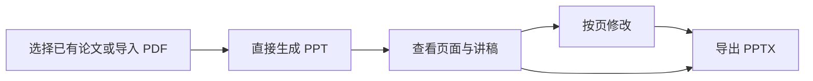

# 论文研究工作台与 PPT 专区：落地方案

版本：v1.0 · 日期：2026-10-05 · 代码基线：`74cf0c9`

本方案整理本次讨论中的产品约定，并据现有代码提出实施步骤。本轮交付方案文档，尚未实施下述改造。它取代旧《前端重做方向》中按功能组织入口的安排；后端事实、教学与来源约束沿用既有实现。

## 1. 产品定位与设计原则

核心用户是刚进入科研的医学生。产品帮助用户围绕一个研究方向组织论文，通过连续讨论理解研究问题、方法、图表、证据与研究启发，并把需要汇报的内容整理成 PPT。

已确认的方向：

- 左侧由用户自己命名课题或研究方向，在课题下归组论文。
- 课题、论文显示名称、讨论标题和 PPT 汇报名称均支持用户重命名。
- 论文研究是一段连续过程，方法讲解、图表解读和概念解释在同一讨论中发生。
- PPT 有独立且稳定的入口，支持导入论文后直接生成汇报。
- 沿用当前原型的整体视觉与空间结构，调整信息组织和交互。
- 同时提供固定引导和随当前问题出现的建议，保持界面整洁。

设计尺度：丰富体现在支持的事情，简洁体现在当下呈现的内容。用户可以直接提问；固定引导提供稳定起点；详细内容在需要时展开。

以下的默认值、按钮数量和具体文案是第一版实施建议，后续通过实际试用调整。

## 2. 信息组织：课题 → 论文 → 连续讨论与成果

第一版把课题作为论文分组，不再额外要求用户创建一层“专题”。用户可以用研究方向、课题名称或自己的分类习惯命名。

```text
论文研究
  我的课题
    细胞衰老与身体功能
      Xu et al. · 2018
      另一篇相关论文
    肿瘤免疫
      论文 A
      论文 B
    未分组论文
      刚导入的论文

PPT 专区
  新建汇报
  我的汇报
```

“论文研究”和“PPT 专区”是两个主入口。进入论文研究后，左侧显示课题与论文；进入 PPT 专区后，左侧显示汇报记录。制作 PPT 时通过论文选择器使用同一份论文资料。

### 课题与论文的行为

| 操作 | 第一版行为 |
| --- | --- |
| 新建课题 | 用户输入名称即可建立；研究目标为可选信息 |
| 导入论文 | 有当前课题时加入该课题；没有课题时进入“未分组论文” |
| 重命名或移动 | 允许重命名课题、论文显示名称、讨论标题和 PPT 汇报名称；论文可移动到另一课题 |
| 展开课题 | 显示论文列表，默认展开当前课题，其余可收起 |
| 点击论文 | 恢复该论文最近一次讨论、关联材料与当前成果 |
| 开始新讨论 | 在当前论文中新增讨论；此前的讨论通过页头“讨论记录”查看 |
| 打开课题 | 可围绕研究方向提问；绑定论文后继续基于相应材料讨论 |
| 移除课题 | 第一版先支持归档；论文与已有成果保留，可重新归组 |

第一版每篇论文只有一个主要归属课题，移动时保留论文 ID、讨论和成果。多重归组、标签和复杂筛选留到后续，避免首屏出现过多管理操作。

重命名入口放在对应条目的菜单中，当前讨论和汇报也可从页头修改名称。用户名称独立于论文原始题录；原始标题、作者、DOI 和来源信息保留用于引用。保存后所有关联位置同步显示新名称，记录 ID 与来源版本保持一致。

连续讨论按实际用户问题记录，不再预设“研究问题／方法／图表”等独立任务列表。示例内容仅用于演示，不迁移成真实用户的阅读记录。

## 3. 论文研究页的布局

| 区域 | 常驻内容 | 按需展开内容 |
| --- | --- | --- |
| 主导航 | 论文研究、PPT 专区、设置入口 | 设置与个人记录 |
| 左侧 | 课题、论文、添加入口、简短搜索 | 重命名、移动、归档菜单 |
| 页头 | 当前课题与论文、讨论记录、资料与成果按钮 | 论文题录、切换历史讨论 |
| 中间 | 连续对话、当前回复、输入框 | 当前回复的详细解释与引用 |
| 右侧 | 打开后显示当前选中的资料或成果 | 原文 PDF、图件、完整解读、笔记 |

新讨论默认以对话为主，右侧收起。用户打开依据、图件或完整成果时才展开。再次进入已有讨论时，恢复用户上次选择的面板状态。

桌面支持讨论与阅读并排，成果可以放大阅读；手机依次查看对话与阅读面板，并提供清楚的返回按钮。先沿用当前字体与颜色体系，把主要正文保持在适合阅读的字号；辅助信息的字号通过实际截图检查。

用户上传成功后能看见论文名称和材料状态。解析、讲解或 PPT 生成中的状态在当前任务处展示，完成或失败后收起执行细节，保留查看记录的入口。

## 4. 引导设计：有固定位置，也有当前上下文

### 4.1 固定引导

| 固定位置 | 形式 | 建议内容与行为 |
| --- | --- | --- |
| 首次进入／空讨论 | 一句提示和最多三个轻量入口 | “带我读懂这篇论文”“我有一个研究想法”“解释一个概念”；点击后进入同一对话 |
| 论文页头 | “阅读路线”文字按钮 | 展开研究问题 → 实验设计 → 结果与证据 → 局限与启发；可从任何一步开始 |
| 输入框附近 | 最多三个简短快捷操作 | 固定保留“讲得更通俗”“查看依据”，第三个位置用于当前的下一步建议 |
| 输入框占位 | 一句自然邀请 | “哪里没读懂？可以用自己的话问。” |

固定的是入口和位置，执行时依据当前内容。没有上一段讲解时，“讲得更通俗”不显示为可执行操作；没有论文依据时，“查看依据”不制造来源。空讨论用起始建议，已有讨论用追问操作，两组不会同时堆在输入框附近。

“阅读路线”是可查看和自由跳转的参考，不强制逐步通关。点击路线后，把当前论文和所选问题交给同一助手，保持连续上下文。

### 4.2 动态引导

助手优先回答用户本次问题，必要时在回复末尾给一条具体的继续建议，例如：“理解了这两种对照之后，可以看 Figure 1 的组间比较。”

用户表示不理解时，围绕当前句子补基础、换例子或缩小解释范围；需要确认材料或指代时，每次提出一个具体问题。用户继续追问后，快捷建议更新为当前内容，不累积旧建议。

### 4.3 保持整洁的约束

- 起始入口最多三个；快捷操作最多三个；详细路线默认折叠。
- 同一建议只占一个显著位置，避免同时出现在卡片、输入框和侧栏。
- 已开始讨论后，起始欢迎内容退出主要阅读区域。
- 术语说明和来源信息可展开，长报告通过摘要入口进入右侧。
- 模型、提示词和内部角色配置放在设置或开发界面。
- 阅读路线和按钮点击不计为“已理解”；学习反馈继续由用户主动提供。

## 5. 统一研究对话与输出

以“当前课题、当前论文、当前问题”为上下文，用户可以自然地从研究问题聊到方法、图表、局限或研究想法。界面不要求用户先选择后台功能分类。

| 用户意图 | 对话中的行为 | 主要输出位置 |
| --- | --- | --- |
| 想先读懂论文 | 从研究问题与核心实验展开，按问题补基础 | 对话；完整解读按需打开 |
| 遇到方法或术语 | 结合当前段落解释原理、测量对象与作用 | 当前回复，可进一步展开 |
| 读不懂图 | 绑定真实图件、图注与相关段落，解释比较关系 | 对话与右侧图件联动 |
| 核对一句结论 | 显示来源位置，区分观察、解释与结论范围 | 右侧原文或依据 |
| 想讨论自己的方向 | 围绕研究目标澄清问题，保存讨论中的想法 | 对话与课题记录 |
| 想整理内容 | 生成有标题的解读、表格或笔记，回复中给打开入口 | 右侧成果面板 |
| 想制作汇报 | 把当前论文及明确选中的内容交给 PPT 专区 | PPT 工作区 |

短回复留在对话中；长成果在对话里提供摘要和入口。完整成果保留来源定位，个人笔记保留用户自己的表述。研究建议与论文已有结论分别表达，不能把新想法写成作者已经验证的结果。

第一版课题可以归组多篇论文，但每个基于论文的请求绑定一篇明确的当前论文。切换论文时恢复该论文自己的讨论。多篇文献的证据比较需要独立的材料与引用合同，列为后续能力，不靠课题分组自动开启。

## 6. PPT 专区：导入后可直接生成

PPT 专区始终有“选择已有论文”与“导入新论文”两个入口。用户不需要先完成带读，也不必重复上传已有论文。



### 输入与默认值

建议第一版默认采用科研新手的论文组会汇报与八页结构，沿用现有默认大纲。用途、时长、重点和页数放在“调整汇报要求”中，用户可展开修改；这些设置不会成为必须填写的表单。

点击“生成 PPT”后完成默认流程，不增加必须确认大纲的中间步骤。生成前用户可以选择调整要求；生成后可查看或修改大纲。资料确实不足时，明确请求缺少的材料并保留当前任务。

新导入的论文同时加入论文库；用户可以选择课题，也可以先留在未分组。汇报记录关联课题、论文和讨论，两个专区共用论文 ID 与来源版本。

### 汇报工作区

- 左侧：页面缩略图或大纲；需要时切换汇报记录。
- 中间：选中页面的预览，标题、要点与图件可查看。
- 右侧或底部：当前页讲稿、来源和修改输入，详细项按需打开。
- 页头：汇报名称、真实生成状态、导出按钮与版本记录入口。

第一版优先接入既有的指定页修改、版本恢复和 PPTX 导出。新增页、删除页、重排以及完整可编辑预览，须补齐内容复核、版本和渲染流程后再发布；它们不能只通过前端按钮宣称已经支持。

导出使用已保存并完成核对的版本。新增上传论文使用自己的材料生成；固定示例只作为示例展示，不能作为上传论文的完成结果。

## 7. 与现有项目的对应

本方案依据本机源码核对，未重跑真实模型生成。

| 范围 | 当前状态 | 需要实施的变化 |
| --- | --- | --- |
| 新界面 | `app/reading-prototype.tsx` 提供固定任务与固定回复，上传 PDF 仅本地预览 | 改为课题与论文组织，接入持久化和真实请求 |
| 统一对话 | `server/assistant.ts`、`server/conversation.ts` 已提供自然问题、跨轮上下文与取消；消息的 `module` 为可选项 | 新页面直接提交自然问题，后台保留内部路由 |
| PDF 与证据 | 已有上传、正文提取、原文页、图注与图件登记接口 | 复用到新阅读面板，清楚呈现真实材料状态 |
| 课题管理 | 当前类型与接口没有课题实体 | 新增课题、论文归组、重命名、移动与归档 |
| 讨论记录 | 会话已有 ID、目标、绑定论文和成果；新原型中的临时任务不是这些会话 | 增加课题关联与显示标题，按论文恢复历史 |
| 阅读笔记 | 真实后端已有个人学习记录；原型笔记仅保存在浏览器 | 区分论文笔记与明确的用户反馈，再接入统一存储 |
| PPT | 已有大纲、指定页编辑与复核、版本恢复和 PPTX 导出 | 新增独立工作区与创建入口，关联课题和汇报记录 |

扫描 PDF 的自动 OCR、多论文联合推理、完整幻灯片增删重排和真实用户学习效果，均不属于现有已验证能力。

### 最小数据与接口改造

新增 `Project`：ID、名称、可选研究目标、归档状态、创建与更新时间。论文增加分组关系与可选显示名称；会话补充可选课题 ID、用户可改的标题及活动时间；汇报记录保存用户可改的名称，并关联课题、论文、会话与当前版本。

新增 `server/projects.ts` 与课题管理接口；论文归组采用独立元数据索引，保留 `PaperBundle` 的 ID、内容版本与原始材料。移动论文只改变分组元数据，不触发正文重新解析或来源版本变更。

现有上传接口、会话提交／查询／取消接口和 PPT 版本接口继续复用。后台的 `paper / method / figure / ppt` 分类保留为内部能力，用户侧统一为自然问题和上下文相关操作。

论文导入、创建讨论和生成 PPT 都要有明确的请求状态，重复点击不能创建重复任务。切换论文和打开 PPT 时依据 ID 恢复；同一模型请求运行中显示真实状态，遵循现有单请求与预算约束。

### 存量数据处理

既有论文默认进入“未分组”，由用户重新归组。保留原论文 ID、正文文件、来源版本、会话与 PPT 版本，新增关联信息采用兼容旧记录的可选字段。

浏览器原型笔记仅在用户选择后导入为带来源标记的笔记；固定示例消息不作为真实讨论迁移。现有个人反馈和未解决问题保留，课题移动不会把它们转换成掌握状态。

## 8. 实施顺序与每阶段交付

| 阶段 | 工作 | 可审阅交付与完成条件 |
| --- | --- | --- |
| A：信息组织与固定引导 | 重做左侧课题／论文列表；增加两大主入口；补空状态、折叠阅读路线与快捷操作；实现分组元数据存储 | 能建立课题、导入并移动论文；刷新后恢复；没有方法／图表专题页；固定引导数量符合约定 |
| B：贯通论文研究 | 接入既有统一助手、真实上传、来源和个人记录；保存论文讨论及面板状态 | 在同一讨论中完成研究问题→方法追问→图表解读；依据打开真实位置；切换与刷新后上下文正确 |
| C：PPT 专区 | 接入已有论文选择、上传、默认生成、指定页编辑、版本恢复与导出 | 无需先带读即可创建汇报；一篇论文可从两个专区复用；上传论文的实际材料进入生成；导出选定且已核对的版本 |
| D：体验与验收 | 检查空状态、等待、停止、材料不足和恢复；桌面与手机视觉 QA；目标用户试用 | 界面无横向溢出或遮挡；引导帮助任务完成；发现的问题有具体修改记录 |

每阶段先完成对应交互和工程验证，再运行有必要的真实生成。真实生成沿用现有调用预算、取消和来源检查规则；不因界面改造重新设计模型体系。

本轮不安装新的前端框架或替换后台。新增组件按课题导航、统一讨论、阅读面板、引导入口和 PPT 工作区拆分，逐步从原型中提取，避免所有功能继续堆在一个页面文件中。

## 9. 验收：整洁与有引导同时成立

### 工程与内容检查

1. 新用户可直接导入论文；未建立课题不阻断使用。
2. 课题、论文、讨论、笔记与 PPT 关联正确，刷新和后台重启后恢复；重命名在关联位置同步生效，原始题录与引用保留。
3. 研究问题、方法和图表在一个讨论里承接，来源始终属于当前绑定材料。
4. 起始建议、快捷操作和阅读路线遵守数量与展开规则，旧提示不累积。
5. PPT 使用已有论文或新上传论文生成，重复提交、取消、失败和继续修改可追踪。
6. 笔记、论文解释、用户反馈和模型执行状态各自真实，示例不混入完成结果。
7. 内容修改后的 PPT 按真实保存版本核对和导出；页面结构改动不绕过版本合同。
8. 桌面、窄屏和手机均可完成主要操作，键盘能够访问和退出面板／对话框。

已有构建和回归测试按实际代码改动运行；新增检查覆盖课题关系、会话恢复、PPT 关联及引导行为。运行截图留在 `runs/`，个人论文和生成记录保留在既有数据目录。

### 目标用户试用

先邀请少量刚进入科研的医学生完成三个任务：导入论文并弄懂研究问题；追问一个方法并查看依据；直接从论文生成一次汇报。

观察是否能找到起点、是否知道下一步如何继续、是否能找到原文与成果、是否被提示打断。记录误点、停顿和主动询问，并用这些观察调整文案和布局。真人试用与工程通过分别记录。

## 10. 第一版范围与下一步

第一版完成课题归组、单论文连续研究、固定与动态引导、资料／成果按需展示，以及独立 PPT 创建、指定页修改和导出。

多论文综合比较、自动推荐研究方向、复杂标签管理、扫描件 OCR、完整幻灯片结构编辑列入后续评估。已有科学内容失败和材料缺口继续保留，界面改造不改变其验证结论。

建议下一步先实施阶段 A，交付可点击且可保存的“课题—论文”结构，同时呈现阅读引导与 PPT 入口。确认实际界面的信息密度后，继续接入阶段 B、C 的现有能力。

设计参考沿用本轮已核对的 [OpenHealth](https://github.com/OpenHealthForAll/open-health) 的材料管理与 [Agent Chat UI](https://github.com/langchain-ai/agent-chat-ui) 的对话／成果面板；最终布局按本产品的目标用户任务决定。
