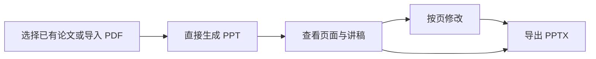

# 论文研究工作台与 PPT 专区：落地方案

版本：v1.2 · 日期：2026-10-05 · 代码基线：`74cf0c9`

本方案整理本次讨论中的产品约定，并据现有代码提出实施步骤。本轮交付方案文档，尚未实施下述改造。它取代旧《前端重做方向》中按功能组织入口的安排；后端事实、教学与来源约束沿用既有实现。

## 1. 产品定位与设计原则

核心用户是刚进入科研的医学生。产品帮助用户围绕一个研究方向组织论文，通过连续讨论理解研究问题、方法、图表、证据与研究启发，并把需要汇报的内容整理成 PPT。

已确认的方向：

- 左侧由用户自己命名课题或研究方向，在课题下归组论文。
- 课题、论文显示名称、讨论标题和 PPT 汇报名称均支持用户重命名。
- 点击上传与拖动文件均可导入；仅开放已经具备识别与解析能力的文件格式。
- 图片作为研究材料导入；明显无关的图片拒绝，无法确定用途时通过简短说明确认。
- 论文研究是一段连续过程，方法讲解、图表解读和概念解释在同一讨论中发生。
- PPT 有独立且稳定的入口，支持导入论文后直接生成汇报。
- 沿用当前原型的整体视觉与空间结构，调整信息组织和交互。
- 同时提供固定引导和随当前问题出现的建议，保持界面整洁。

设计尺度：丰富体现在支持的事情，简洁体现在当下呈现的内容。用户可以直接提问；固定引导提供稳定起点；详细内容在需要时展开。

以下的默认值、按钮数量和具体文案是第一版实施建议，后续通过实际试用调整。

### 本轮确认的六项用户体验优化

| 用户需要 | 已确认的产品安排 |
| --- | --- |
| 不知道如何开始 | 先导入或表达研究想法，课题整理可以稍后进行 |
| 不知道该问什么 | 导入后提供简短概述和贴近当前论文的三个起点 |
| 知道哪里不懂，但不会描述 | 选中文字问“解释这句”，打开图问“带我看这张图” |
| 希望顺利补充材料 | 图片检查保持轻量，可持续补图，归属明确，误判可补用途 |
| 希望找回上次的内容 | 自动命名、继续上次讨论、重要回答一键保存并保留依据 |
| 希望生成适合组会的 PPT | 可跳过的时长／重点设置、页面与讲稿／引用预览、自然语言修改 |

首轮交付优先贯通“导入后有起点 → 指着内容提问 → 查看依据 → 保存并找回”的使用流程，课题管理、图片检查和 PPT 按该流程配套实施。

## 2. 信息组织：课题 → 论文 → 连续讨论与成果

第一版把课题作为论文分组，不再额外要求用户创建一层“专题”。用户可以用研究方向、课题名称或自己的分类习惯命名。

```text
论文研究
  我的课题
    细胞衰老与身体功能
      Xu et al. · 2018
      另一篇相关论文
    肿瘤免疫
      论文 A
      论文 B
    未分组论文
      刚导入的论文

PPT 专区
  新建汇报
  我的汇报
```

“论文研究”和“PPT 专区”是两个主入口。进入论文研究后，左侧显示课题与论文；进入 PPT 专区后，左侧显示汇报记录。制作 PPT 时通过论文选择器使用同一份论文资料。

首次进入无需填写个人资料或创建课题，主区域突出“导入论文”和“说说你的研究想法”。后者允许先在未关联论文的讨论中描述方向；以后补充材料或归组。导入时无需强制选择归属，当前课题存在则默认使用并显示名称，否则进入未分组。

### 课题与论文的行为

| 操作 | 第一版行为 |
| --- | --- |
| 新建课题 | 用户输入名称即可建立；研究目标为可选信息 |
| 导入论文 | 有当前课题时加入该课题；没有课题时进入“未分组论文” |
| 重命名或移动 | 允许重命名课题、论文显示名称、讨论标题和 PPT 汇报名称；论文可移动到另一课题 |
| 展开课题 | 显示论文列表，默认展开当前课题，其余可收起 |
| 点击论文 | 恢复该论文最近一次讨论、关联材料与当前成果 |
| 继续上次讨论 | 首页或论文空状态显示一条最近讨论入口，包含论文、讨论名称和最近活动时间；打开后恢复上下文与阅读位置 |
| 开始新讨论 | 在当前论文中新增讨论；此前的讨论通过页头“讨论记录”查看 |
| 打开课题 | 可围绕研究方向提问；绑定论文后继续基于相应材料讨论 |
| 移除课题 | 第一版先支持归档；论文与已有成果保留，可重新归组 |

第一版每篇论文只有一个主要归属课题，移动时保留论文 ID、讨论和成果。多重归组、标签和复杂筛选留到后续，避免首屏出现过多管理操作。

重命名入口放在对应条目的菜单中，当前讨论和汇报也可从页头修改名称。用户名称独立于论文原始题录；原始标题、作者、DOI 和来源信息保留用于引用。保存后所有关联位置同步显示新名称，记录 ID 与来源版本保持一致。

讨论首次保存时，用首个有意义的问题生成简短标题；尚无问题时采用“论文简称＋新讨论”。汇报默认采用“论文简称＋文献汇报”，必要时补日期区分。自动命名优先使用规则和已有内容，不额外发起模型请求；用户重命名后不再自动覆盖。历史讨论在当前论文中按最近活动排序，汇报记录显示所属论文，避免依赖“讨论 1／汇报 2”找回内容。

连续讨论按实际用户问题记录，不再预设“研究问题／方法／图表”等独立任务列表。示例内容仅用于演示，不迁移成真实用户的阅读记录。

### 文件导入：拖动与点击共用同一规则

论文研究页和 PPT 创建页均支持把文件拖入主要工作区域，也保留可点击、可用键盘访问的“导入材料”按钮。平时不常驻大面积上传框；拖入文件时出现临时提示，放下或离开后消失。阻止浏览器直接打开被拖入的文件。

| 项目 | 第一版规则 |
| --- | --- |
| 开放格式 | PDF、PNG、JPG／JPEG；先沿用已有图像请求支持的 PNG／JPEG。Word、WebP、GIF、SVG、PPT、压缩包等在对应能力完成并验证后再开放 |
| 数量与大小 | 第一版每次导入一个文件，支持连续补充多张图片；PDF 上限 30 MiB，沿用现有后台限制；图片建议上限 10 MiB、解码后不超过 2500 万像素。一次拖入多个文件时明确提示逐个补充，不默默丢弃文件；批量队列留到后续 |
| 上传前检查 | 前端校验扩展名和大小，文件选择器声明允许格式；MIME 信息仅辅助判断 |
| 后端检查 | 再次检查大小、真实文件内容与解码结果；PDF 由解析器确认，图片由图像解码器确认。修改后缀不能绕过格式检查 |
| 解析结果 | 分别展示可用于研究、正文提取不足、解析失败；只有实际可读材料进入研究与 PPT 生成 |
| 扫描或异常 PDF | 扫描件无可提取正文、加密文件或损坏文件，按实际结果提示原因和补救方式，不显示为已经读懂 |
| 材料归属 | PDF 有当前课题时归入该课题，否则进入未分组；图片关联当前论文或课题，无当前上下文时先作为独立待归组材料。PPT 创建页使用同一导入结果，并清楚展示归属 |

入口旁用一句“支持 PDF、PNG、JPG”说明格式，大小限制在上传提示中显示。失败提示直接说明可执行的下一步，例如：“暂不支持 Word，请先导出为 PDF”“该 PDF 未提取到可用正文，请上传可复制文字的版本”。无效格式在进入材料库前拒绝；有效 PDF 若解析失败，沿用后台保留原文件的行为，标记待处理并允许用户重新提供材料。

格式有效与材料充分分别检查：能打开的 PDF 仍可能缺少正文、图注或关键页面。材料不足时保留已有记录，并说明当前能处理的范围与所缺内容。

### 图片内容准入与使用

图片通过格式检查后，结合可见内容、当前课题／论文和用户说明做一次内容判断。采用三个结果，判断理由供界面使用：

| 结果 | 示例与行为 |
| --- | --- |
| 接受 | 论文段落截图、论文图表、实验结果、统计图、科研表格、研究流程或机制图，以及用途明确的相关医学研究图像；加入材料并可继续提问 |
| 不接受 | 明显无关且没有研究用途的游戏界面、娱乐海报、表情包等；显示“不接受：这张图片与当前论文或科研任务无关，请上传论文截图、图表或实验材料” |
| 待确认 | 裁剪过小、缺少上下文、内容用途不明确；问“这张图片用于哪个研究问题？”并等待说明后重新判断 |

判断以科研用途为依据，不能只凭图像外观或是否含医学术语决定。医学教育软件或研究中使用的游戏截图如有明确研究背景，应结合说明判断；清晰但明显无关的图片直接拒绝。模糊、分辨率不足属于无法识别，提示重新提供清晰图片，不能称为与科研无关。

正常图片进入材料库前显示“正在检查图片”；没有得到结果时不宣称接收成功。模型不可用、取消或超时，保留可重试的临时状态，不默认拒绝或接受。明显无关的图片不进入正式论文、笔记或 PPT 记录，临时文件按失败／取消清理流程处理。拒绝提示提供“补充用途说明”入口，以便纠正误判，但不能一键绕过内容检查。

接受的图片可在当前对话中解释或作为 PPT 图件。原图、用户显示名称、上传来源、所属课题／论文、检查状态和图注分别记录；独立截图不自动拥有论文标题、DOI 或原文页码。看不见的坐标、图例和实验细节不能凭空补全。单张图不足以支撑完整论文汇报时，先提供该图的解释，生成完整论文 PPT 需补充正文与必要背景。

图片上传与模型请求分开：原图保存为材料，发送给模型的版本按现有 `visibleImage` 的 PNG／JPEG 和 3,000,000 字符上限处理。必要时缩放或压缩；若关键标签因此无法辨认，提示上传局部截图，不把压缩后的不可读材料继续用于分析。格式解码和内容判断分别验证；图片识别、准入结果缓存及临时文件生命周期需实现后才算完成。

连续补图时保持当前讨论、论文归属和已经输入的问题。材料区用可收起的缩略图列表显示每张图的名称、归属与检查状态；失败图可以单独重试或移除，成功图不必重新上传。用途不明时在该图片附近补一句说明，格式错误、内容无关、图像模糊和缺图注分别提示，不连续弹出阻断对话的窗口。

第一版一次图像分析选中一张明确的图片，其余图片保留供切换和后续追问。连续补图不等于多图联合推理；请求通过材料 ID 绑定当前图，后端解析为已有单图输入。通过检查的图若缺图注，可先解释可见内容，并在需要判断实验含义时请求相应图注。

## 3. 论文研究页的布局

| 区域 | 常驻内容 | 按需展开内容 |
| --- | --- | --- |
| 主导航 | 论文研究、PPT 专区、设置入口 | 设置与个人记录 |
| 左侧 | 课题、论文、添加入口、简短搜索 | 重命名、移动、归档菜单 |
| 页头 | 当前课题与论文、讨论记录、资料与成果按钮 | 论文题录、切换历史讨论 |
| 中间 | 连续对话、当前回复、输入框 | 当前回复的详细解释与引用 |
| 右侧 | 打开后显示当前选中的资料或成果 | 原文 PDF、图件、完整解读、笔记 |

新讨论默认以对话为主，右侧收起。用户打开依据、图件或完整成果时才展开。再次进入已有讨论时，恢复用户上次选择的面板状态。

桌面支持讨论与阅读并排，成果可以放大阅读；手机依次查看对话与阅读面板，并提供清楚的返回按钮。先沿用当前字体与颜色体系，把主要正文保持在适合阅读的字号；辅助信息的字号通过实际截图检查。

用户上传成功后能看见论文名称和材料状态。解析、讲解或 PPT 生成中的状态在当前任务处展示，完成或失败后收起执行细节，保留查看记录的入口。

### 首次阅读的一条完整路径

1. 导入 PDF，先确认文件与解析状态；无需创建课题。
2. 材料可用后展示题录、一两句研究概述和最多三个当前论文的问题起点。
3. 选择一个起点或直接提问，进入持续讨论；起始内容收起。
4. 遇到不懂的原文或图件，直接选定内容追问，并打开依据。
5. 保存有用回答为笔记，退出后从“继续上次讨论”恢复；需要汇报时带当前论文进入 PPT 专区。

科研想法入口沿用同一对话方式，先理解用户的问题，再按需要补充论文；不会生成没有材料支撑的“论文概述”。

### 指着内容提问

| 内容位置 | 入口 | 请求与定位 |
| --- | --- | --- |
| 可选择的论文正文 | 选中文字后出现“解释这句” | 携带论文 ID、来源版本、段落或页码、所选文字与必要的邻近内容 |
| 助手已经给出的解释 | 选句后出现“解释这句”或“讲得更通俗” | 绑定原回复和具体句子，复用现有句子追问能力 |
| 已登记的图件或接受的图片 | 图件查看区显示“带我看这张图” | 绑定选中图及已有图注、关联段落；缺少信息时明确范围 |

选择文字本身不会提交请求；点击“解释这句”或“带我看这张图”后，将选中对象与预填问题放入当前输入框，用户可以直接发送或修改问题，无需再次选择功能分类。输入框显示可移除的引用条，例如“正在问：第 3 页这句话”或“Figure 2”；发送后所选片段与问题出现在同一讨论中。快捷操作“讲得更通俗”优先作用于明确选定的内容；没有选定内容时指向最近一段完整回复，并显示对象。切换论文时清除未提交的引用，保留原论文草稿，避免错用上下文。

原型中的 PDF 内嵌预览不等于已经支持选句。第一版先提供基于实际提取正文的可选择文字视图，并与原文页关联；PDF 文字层选取作为后续增强。没有页码或精确坐标时定位到已知来源段落并如实说明，无法提取正文的扫描页通过图片材料流程处理。手机提供可点击的段落“提问”入口，补足文字选择的不便。

## 4. 引导设计：有固定位置，也有当前上下文

### 4.1 固定引导

| 固定位置 | 形式 | 建议内容与行为 |
| --- | --- | --- |
| 尚未导入材料的首页 | 一句提示和两个主要动作 | “导入论文”“说说你的研究想法”；不要求先创建课题 |
| 已导入论文／空讨论 | 简短概述和最多三个当前论文的起点 | “这篇论文要解决什么问题？”“核心实验怎么设计？”“先带我看最重要的图”；随实际材料调整，点击后进入同一对话 |
| 论文页头 | “阅读路线”文字按钮 | 展开研究问题 → 实验设计 → 结果与证据 → 局限与启发；可从任何一步开始 |
| 输入框附近 | 最多三个简短快捷操作 | 固定保留“讲得更通俗”“查看依据”，第三个位置用于当前的下一步建议 |
| 输入框占位 | 一句自然邀请 | “哪里没读懂？可以用自己的话问。” |

固定的是入口和位置，执行时依据当前内容。没有上一段讲解时，“讲得更通俗”不显示为可执行操作；没有论文依据时，“查看依据”不制造来源。空讨论用起始建议，已有讨论用追问操作，两组不会同时堆在输入框附近。

导入后的概述与问题基于真实摘要和已提取内容，来源可以查看。可用信息不足时只展示已核对的题录和可执行的补充动作；没有图件时不出现“最重要的图”。问题措辞尽量包含该论文的具体对象或方法，例如“这项研究为什么采用这个对照？”，不重复一套无关欢迎语。

概述不强制运行整篇精读。优先复用已存的概述或当前来源版本的摘要；需要生成时作为可取消、可缓存的轻量任务，用户仍可先直接提问。概述失败不阻断阅读或 PPT 入口，准备期间不展示固定示例替代真实内容。

用户主动提问优先于后台准备概述。沿用现有单请求约束，需要时先取消或暂停概述生成再处理用户问题，不同时启动两个模型请求；取消状态与缓存结果按真实完成情况记录。

“阅读路线”是可查看和自由跳转的参考，不强制逐步通关。点击路线后，把当前论文和所选问题交给同一助手，保持连续上下文。

### 4.2 动态引导

助手优先回答用户本次问题，必要时在回复末尾给一条具体的继续建议，例如：“理解了这两种对照之后，可以看 Figure 1 的组间比较。”

用户表示不理解时，围绕当前句子补基础、换例子或缩小解释范围；需要确认材料或指代时，每次提出一个具体问题。用户继续追问后，快捷建议更新为当前内容，不累积旧建议。

### 4.3 保持整洁的约束

- 起始入口最多三个；快捷操作最多三个；详细路线默认折叠。
- 同一建议只占一个显著位置，避免同时出现在卡片、输入框和侧栏。
- 已开始讨论后，起始欢迎内容退出主要阅读区域。
- 术语说明和来源信息可展开，长报告通过摘要入口进入右侧。
- 模型、提示词和内部角色配置放在设置或开发界面。
- 阅读路线和按钮点击不计为“已理解”；学习反馈继续由用户主动提供。

## 5. 统一研究对话与输出

以“当前课题、当前论文、当前问题”为上下文，用户可以自然地从研究问题聊到方法、图表、局限或研究想法。界面不要求用户先选择后台功能分类。

| 用户意图 | 对话中的行为 | 主要输出位置 |
| --- | --- | --- |
| 想先读懂论文 | 从研究问题与核心实验展开，按问题补基础 | 对话；完整解读按需打开 |
| 遇到方法或术语 | 结合当前段落解释原理、测量对象与作用 | 当前回复，可进一步展开 |
| 读不懂图 | 绑定真实图件、图注与相关段落，解释比较关系 | 对话与右侧图件联动 |
| 核对一句结论 | 显示来源位置，区分观察、解释与结论范围 | 右侧原文或依据 |
| 想讨论自己的方向 | 围绕研究目标澄清问题，保存讨论中的想法 | 对话与课题记录 |
| 想整理内容 | 生成有标题的解读、表格或笔记，回复中给打开入口 | 右侧成果面板 |
| 想制作汇报 | 把当前论文及明确选中的内容交给 PPT 专区 | PPT 工作区 |

短回复留在对话中；长成果在对话里提供摘要和入口。完整成果保留来源定位，个人笔记保留用户自己的表述。研究建议与论文已有结论分别表达，不能把新想法写成作者已经验证的结果。

第一版课题可以归组多篇论文，但每个基于论文的请求绑定一篇明确的当前论文。切换论文时恢复该论文自己的讨论。多篇文献的证据比较需要独立的材料与引用合同，列为后续能力，不靠课题分组自动开启。

### 保存、找回与继续

每段完整回答提供轻量的“保存为笔记”入口。保存成功后显示“已保存”和笔记入口，重复点击不生成副本；保存失败时保留内容并允许重试，不能显示为已经保存。用户可以补标题、修改自己的笔记或取消保存。笔记记录原回复、来源版本及具体依据，用户编辑的表述与原始引用分别保留。保存回答不计为已经理解或学习反馈。

当前论文的资料／成果面板集中显示笔记和解读，通过名称与最近更新时间找回；PPT 专区集中显示汇报。用户无需先在笔记、收藏、学习记录之间选择保存类别。内部可复用现有个人记录能力，但论文笔记需要自己的类型和数据约束。

“继续上次讨论”恢复真实保存的对话、当前材料、阅读位置和面板状态。请求仍在执行时展示其真实状态，不把浏览器关闭当作生成完成；失败任务可在原位置继续或重试。阅读位置不存在或来源版本改变时回到当前可用位置并给出简短说明，不跳到另一篇论文或伪造精确定位。

## 6. PPT 专区：导入后可直接生成

PPT 专区始终有“选择已有论文”与“导入新论文”两个入口。用户不需要先完成带读，也不必重复上传已有论文。



### 输入与默认值

建议第一版默认采用科研新手的论文组会汇报、约 10 分钟与八页结构，八页沿用现有默认大纲；时长是内容详略与讲稿的目标，需在实际试用中校准。生成按钮旁以简短文字显示默认要求，用户可直接生成。

用户可展开“调整汇报要求”，优先调整时长和重点，例如 5／10／15 分钟，以及整体介绍／侧重方法／侧重结果。用途和页数置于进一步设置。默认值可跳过，时长不机械等于页数；材料不足或请求超出已支持页数时说明可用范围，不暗中截断内容。

点击“生成 PPT”后完成默认流程，不增加必须确认大纲的中间步骤。生成前用户可以选择调整要求；生成后可查看大纲并修改已有页面内容。资料确实不足时，明确请求缺少的材料并保留当前任务。

新导入的论文同时加入论文库；用户可以选择课题，也可以先留在未分组。汇报记录关联课题、论文和讨论，两个专区共用论文 ID 与来源版本。

### 汇报工作区

- 左侧：页面缩略图或大纲；需要时切换汇报记录。
- 中间：选中页面的预览，标题、要点与图件可查看。
- 右侧或底部：当前页讲稿、来源和修改输入，详细项按需打开。
- 页头：汇报名称、真实生成状态、导出按钮与版本记录入口。

生成完成后先打开页面预览，用户能找到对应讲稿和引用。页面中的图件可查来源；讲稿面向科研新手，解释必要术语，并与页面内容对应。暂时无法完成实际 PPT 渲染时，可以提供明确标注的结构化内容预览；真实幻灯片预览需增加导出后渲染与缓存流程，不把摘要卡片称为最终 PPT 页面。

修改输入支持“这页太专业了”“把方法讲清楚一点”等自然表述。当前选中页作为默认修改范围，在输入框显示“修改第 N 页”；提交后按现有页编辑、复核与版本保存流程更新预览和讲稿。用户要求修改全稿时先明确范围并使用受支持的流程，不能将全稿要求偷偷应用到单页。保存成功、检查失败和可导出状态分别显示，未核对的修改稿不成为导出版本。

第一版优先接入既有的指定页修改、版本恢复和 PPTX 导出。新增页、删除页、重排以及完整可编辑预览，须补齐内容复核、版本和渲染流程后再发布；它们不能只通过前端按钮宣称已经支持。

导出使用已保存并完成核对的版本。新增上传论文使用自己的材料生成；固定示例只作为示例展示，不能作为上传论文的完成结果。

## 7. 与现有项目的对应

本方案依据本机源码核对，未重跑真实模型生成。

| 范围 | 当前状态 | 需要实施的变化 |
| --- | --- | --- |
| 新界面 | `app/reading-prototype.tsx` 提供固定任务与固定回复，上传 PDF 仅本地预览 | 改为课题与论文组织，接入持久化和真实请求 |
| 统一对话 | `server/assistant.ts`、`server/conversation.ts` 已提供自然问题、跨轮上下文与取消；消息的 `module` 为可选项 | 新页面直接提交自然问题，后台保留内部路由 |
| PDF 与证据 | 已有上传、正文提取、原文页、图注与图件登记接口 | 复用到新阅读面板，清楚呈现真实材料状态 |
| 图片材料 | 消息已有 PNG／JPEG 的 `visibleImage` 字段，已有图件推理输入；尚无独立图片上传与内容准入流程 | 增加真实图片上传、解码、内容判断、材料关联与状态；避免把图像输入字段当作完整导入功能 |
| 课题管理 | 当前类型与接口没有课题实体 | 新增课题、论文归组、重命名、移动与归档 |
| 讨论记录 | 会话已有 ID、目标、绑定论文和成果；新原型中的临时任务不是这些会话 | 增加课题关联与显示标题，按论文恢复历史 |
| 选句与选图追问 | 现有 `focus` 定位助手回复片段，`sourceIds` 与 `visibleImage` 可提供材料；新原型 PDF 仅内嵌预览 | 增加原文选句视图和来源锚点，显式绑定所选内容与材料 ID，不能把原文选择伪装为回复片段 |
| 阅读笔记 | 真实后端已有个人学习记录；原型笔记仅保存在浏览器 | 区分论文笔记与明确的用户反馈，再接入统一存储 |
| PPT | 已有大纲、指定页编辑与复核、版本恢复和 PPTX 导出 | 新增独立工作区与创建入口，关联课题和汇报记录 |

扫描 PDF 的自动 OCR、多论文联合推理、完整幻灯片增删重排和真实用户学习效果，均不属于现有已验证能力。

### 最小数据与接口改造

新增 `Project`：ID、名称、可选研究目标、归档状态、创建与更新时间。论文增加分组关系与可选显示名称；会话补充可选课题 ID、用户可改的标题及活动时间；汇报记录保存用户可改的名称，并关联课题、论文、会话与当前版本。

新增 `server/projects.ts` 与课题管理接口；论文归组采用独立元数据索引，保留 `PaperBundle` 的 ID、内容版本与原始材料。移动论文只改变分组元数据，不触发正文重新解析或来源版本变更。

新增独立图片材料记录和上传／检查接口，关联可选课题 ID、论文 ID 与讨论 ID。准入结果包含接受／不接受／待确认、原因、判断版本与上下文摘要；原图和模型用图分开保存。补充用途或切换所属研究任务后重新判断，不能把针对另一上下文的拒绝结果直接复用。

增加版本化的论文入门概述记录，保存论文 ID、来源版本、概述、依据及建议问题；解析或来源更新后重新准备。用户侧使用“正在准备阅读起点”等简短状态，内部记录真实生成、失败与取消。

原文引用增加独立的来源锚点：论文 ID、来源版本、来源 ID、片段及可用页码／位置；后端验证片段属于绑定材料。既有 `focus` 继续用于助手回复选句。图件请求使用服务器保存的材料 ID，不接受仅靠客户端声明图件属于某论文。恢复信息保存讨论 ID、当前材料与阅读锚点，重新打开时验证位置仍有效。

笔记记录包括用户名称、可编辑正文、原回复 ID、论文／课题归属、来源锚点和时间；同一用户对同一回复重复保存保持幂等。讨论与汇报保存标题是否由用户修改的标记，自动命名不覆盖用户名称。汇报额外保存要求、讲稿与实际预览对应的版本 ID，避免旧预览配新内容。

现有上传接口、会话提交／查询／取消接口和 PPT 版本接口继续复用。后台的 `paper / method / figure / ppt` 分类保留为内部能力，用户侧统一为自然问题和上下文相关操作。

论文导入、创建讨论和生成 PPT 都要有明确的请求状态，重复点击不能创建重复任务。切换论文和打开 PPT 时依据 ID 恢复；同一模型请求运行中显示真实状态，遵循现有单请求与预算约束。

### 存量数据处理

既有论文默认进入“未分组”，由用户重新归组。保留原论文 ID、正文文件、来源版本、会话与 PPT 版本，新增关联信息采用兼容旧记录的可选字段。

浏览器原型笔记仅在用户选择后导入为带来源标记的笔记；固定示例消息不作为真实讨论迁移。现有个人反馈和未解决问题保留，课题移动不会把它们转换成掌握状态。

## 8. 实施顺序与每阶段交付

| 阶段 | 工作 | 可审阅交付与完成条件 |
| --- | --- | --- |
| A：开始使用与信息组织 | 首页两个起点、课题／论文列表、重命名、归组存储；接入真实 PDF 上传、拖动／点击校验与讨论入口 | 无课题也能上传并开始讨论；刷新后恢复；沿用当前视觉；不支持格式明确拒绝；尚未开放的图片入口说明状态 |
| B1：完整的首次阅读 | 真实论文概述与问题起点、统一对话、原文／图件追问、依据查看、笔记保存、自动命名与继续上次讨论 | 不依赖预设示例完成“导入→读懂一个问题→看依据→保存→找回”；手机可通过段落按钮提问 |
| B2：图片补充与状态完善 | 图片上传与内容准入、用途补充、连续补图与明确归属；单图选择、等待／取消／失败恢复 | 科研图片可用，无关图片拒绝，不确定图片可补说明；补图不丢草稿或原图；模型不可用时可重试 |
| C：适合组会的 PPT 专区 | 已有论文选择与导入、可跳过的时长／重点设置、默认生成、页面／讲稿／引用预览、自然语言指定页修改、版本恢复与导出 | 无需先带读即可创建；材料复用；预览与讲稿对应当前保存版本；“这页太专业”能改选中页；导出经过核对的版本 |
| D：体验与验收 | 检查空状态、等待、停止、材料不足和恢复；桌面与手机视觉 QA；目标用户试用 | 界面无横向溢出或遮挡；引导帮助任务完成；发现的问题有具体修改记录 |

优先级最高的三个体验是导入后有起点、指着内容提问、继续上次讨论，集中在 A 与 B1 完成。图片支持仍属于第一版，但在 B2 完成准入后才作为可用功能发布。每阶段留下可审阅的实际页面和验证记录；入口存在不等于相应能力已经完成。

每阶段先完成对应交互和工程验证，再运行有必要的真实生成。真实生成沿用现有调用预算、取消和来源检查规则；不因界面改造重新设计模型体系。

本轮不安装新的前端框架或替换后台。新增组件按课题导航、统一讨论、阅读面板、引导入口和 PPT 工作区拆分，逐步从原型中提取，避免所有功能继续堆在一个页面文件中。

## 9. 验收：整洁与有引导同时成立

### 工程与内容检查

1. 新用户可拖动或点击导入 PDF 与图片；未建立课题不阻断使用。两个入口遵循相同规则，验证合法格式、伪造后缀、超限、多文件、扫描件及损坏文件；拒绝和解析不足均有清楚提示。
2. 课题、论文、讨论、笔记与 PPT 关联正确，刷新和后台重启后恢复；重命名在关联位置同步生效，原始题录与引用保留。
3. 研究问题、方法和图表在一个讨论里承接，来源始终属于当前绑定材料。
4. 起始建议、快捷操作和阅读路线遵守数量与展开规则，旧提示不累积。
5. PPT 使用已有论文或新上传论文生成，重复提交、取消、失败和继续修改可追踪。
6. 笔记、论文解释、用户反馈和模型执行状态各自真实，示例不混入完成结果。
7. 内容修改后的 PPT 按真实保存版本核对和导出；页面结构改动不绕过版本合同。
8. 桌面、窄屏和手机均可完成主要操作，键盘能够访问和退出面板／对话框。
9. 使用实际论文截图、实验图、统计图、游戏界面、模糊图与用途不明确图检查图片准入；包含带研究背景的游戏截图，确认不会按外观一律拒绝。记录接受、拒绝与待确认的结果，以及补充说明后的变化，不宣称图片内容判断百分之百准确。
10. 真实论文的起始概述和建议与当前来源一致；缺图时没有虚构图件建议。概述取消或失败后仍可提问，来源变化不会继续显示过期概述。
11. 原文选句、助手回复选句和选图分别绑定正确对象；快捷解释显示作用范围；切换论文不带入另一论文的待提交引用。
12. 自动标题能区分讨论与汇报，用户重命名后不被覆盖；回答保存幂等，修改笔记不破坏依据；退出后可以找到已保存内容并继续原讨论。
13. 默认要求可直接生成 PPT，也可调整时长／重点；页面、讲稿、引用与预览版本一致，单页自然语言修改不误改全稿；实际预览和结构化预览标注清楚。

已有构建和回归测试按实际代码改动运行；新增检查覆盖课题关系、会话恢复、PPT 关联及引导行为。运行截图留在 `runs/`，个人论文和生成记录保留在既有数据目录。

### 目标用户试用

建议第一轮邀请 3–5 名刚进入科研的医学生，提供一篇实际论文，允许自由操作且不代为解释界面。样本用于发现操作障碍，不代表已经证明教学效果。

| 任务 | 观察与记录 |
| --- | --- |
| 不创建课题，导入论文并弄懂一个研究问题 | 是否找到导入入口、是否理解材料状态、起始问题能否帮助开始 |
| 对一段原文或一张图追问，并找到依据 | 是否能表达疑惑、选中对象是否明确、能否回到真实来源 |
| 保存回答，退出后继续讨论并找到笔记 | 是否知道已经保存、能否识别讨论名称、恢复位置是否正确 |
| 补充一张相关图片和一张无关图片 | 归属与检查状态是否清楚、拒绝理由是否可理解、补用途是否顺畅 |
| 直接生成组会 PPT，并修改一页 | 是否能跳过设置、能否找到讲稿和引用、能否用自然语言修改并导出 |

记录每个任务的独立完成／需提示／未完成、主要停顿、误点和主动询问；询问用户最不确定的步骤。把每个观察对应到具体修改，再复测出现问题的步骤。界面丰富程度通过能否完成任务和是否被提示打断评价，真人试用与工程通过分别记录。

## 10. 第一版范围与下一步

第一版完成课题归组、PDF 与科研图片拖动／点击导入、图片内容准入、单论文连续研究、固定与动态引导、资料／成果按需展示，以及独立 PPT 创建、指定页修改和导出。

多论文综合比较、自动推荐研究方向、复杂标签管理、扫描件 OCR、完整幻灯片结构编辑列入后续评估。已有科学内容失败和材料缺口继续保留，界面改造不改变其验证结论。

建议下一步先实施 A 与 B1 的核心流程，以无需建课题的导入、论文自己的问题起点、原文／图件追问、保存与继续讨论为首轮可用成果。保持当前视觉结构，按真实页面检查信息密度；随后完成 B2 图片补充与 C 汇报流程，再进行 D 的用户试用与修正。

设计参考沿用本轮已核对的 [OpenHealth](https://github.com/OpenHealthForAll/open-health) 的材料管理与 [Agent Chat UI](https://github.com/langchain-ai/agent-chat-ui) 的对话／成果面板；最终布局按本产品的目标用户任务决定。
